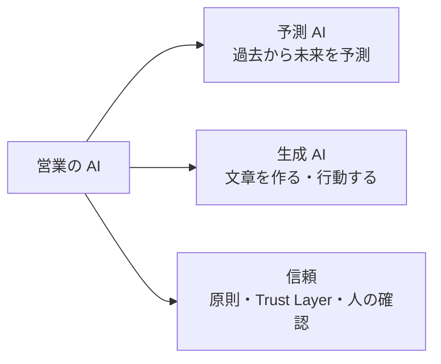
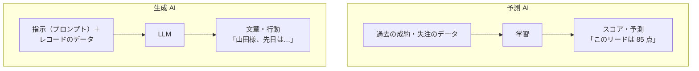
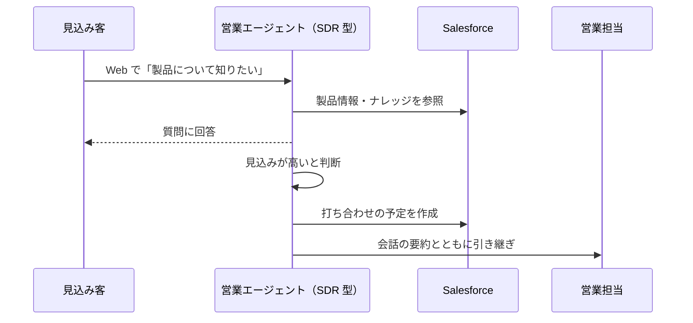
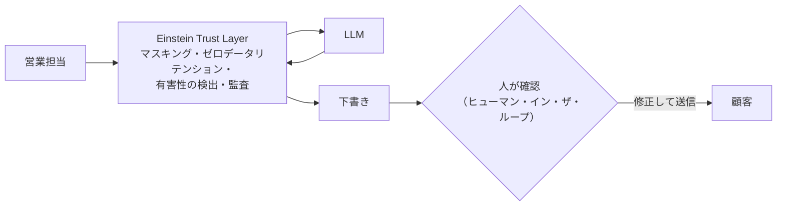

## はじめに：この範囲で学ぶこと

「予測 AI と生成 AI」は配点 13% です。講座提供会社などの情報では、次の 3 つが問われるとされています。

- Agentforce Sales の**生成 AI** の機能
- Agentforce Sales の**予測 AI** の機能
- Salesforce の**信頼できる AI の原則（Trusted AI Principles）**を営業の場面に当てはめる

---

## 1. 予測 AI と生成 AI の違い

### 1-1. 比べてみる

| | **予測 AI** | **生成 AI** |
|---|---|---|
| 何をするか | 過去のデータから**スコアや予測**を出す | **文章を作る**、エージェントとして**行動する** |
| 例 | リードスコアリング、商談スコアリング、予測のインサイト | メールの下書き、商談の要約、通話の要約、営業エージェント |
| 必要なもの | **十分な量と質の過去データ** | 適切な指示と、**根拠になるデータ（グラウンディング）** |
| 弱み | データが少ない・偏っていると精度が出ない | もっともらしい誤り（ハルシネーション） |

なぜ予測 AI には過去データが必要なの？

予測 AI は「過去に成約したリードにはどんな特徴があったか」を学習して、新しいリードを評価します。過去の成約・失注の記録が少なければ、学ぶ材料がありません。設立したばかりのチームや、結果を記録してこなかった会社では、**まずデータを正しく記録・蓄積すること**が先です。

---

## 2. 予測 AI の機能

| 機能 | 何をする？ | 営業への効果 |
|---|---|---|
| **Einstein リードスコアリング** | 取引開始しやすいリードを**点数化** | 見込みの高いリードから対応できる |
| **Einstein 商談スコアリング** | 商談の**成約の可能性**をスコア化し、**影響した要因**も示す | 危ない商談に早く手を打てる |
| **Pipeline Inspection のインサイト** | 停滞・リスクのある商談を知らせる | マネージャーが点検しやすい |
| **Einstein 活動キャプチャ** | メールと予定を自動で記録 | AI が学ぶ活動データが貯まる |

具体例

Universal Containers の営業担当は、毎週 500 件のリードのどれから電話すればよいか分かりません。過去 2 年分の取引開始の記録が十分にあります。→ **Einstein リードスコアリング**で点数の高い順に並べ、上位から対応します。

---

## 3. 生成 AI の機能

| 機能 | 何をする？ |
|---|---|
| **営業メールの生成**（Einstein Sales Emails） | 商談・取引先の情報をもとに、メールの下書きを作る |
| **商談・レコードの要約** | 取引先や商談の最新の状況をまとめる（会議の準備に） |
| **通話の要約**（Einstein Conversation Insights） | 通話を文字にし、要点・競合の言及・次のステップを抽出 |
| **Agentforce の営業エージェント** | 例: Web からのリードに 24 時間応答し、見込みが高ければ営業との打ち合わせを設定する **SDR 型**のエージェント、営業担当の練習相手になる**コーチ型**のエージェント |

---

## 4. データの準備

| AI の種類 | 準備すること |
|---|---|
| 予測 AI | 成約・失注・**失注理由**を正しく記録する、入力ルールを統一する、活動を記録する（活動キャプチャ） |
| 生成 AI | 正しいレコードのデータ、最新の製品情報・ナレッジ。データが正しいほど、具体的で正確な文章になる |

ひっかけ注意

- 「データがほとんどないが、予測 AI をすぐに使いたい」→ ✕ すぐ正確に動く、✕ 生成 AI で過去データを作る。○ **まずデータの記録ルールを整えて蓄積する**
- 「確定的な計算（割引額）」を AI に任せる → ✕。計算は Flow や数式で

---

## 5. 信頼できる AI

### 5-1. Salesforce の信頼できる AI の原則

| 原則 | 意味 | 営業の場面での例 |
|---|---|---|
| **責任（Responsible）** | 人権を守り、データを保護する | 顧客のデータを必要な範囲だけで使う |
| **説明責任（Accountable）** | 結果に責任を持ち、フィードバックを受けて改善する | AI のメールを人が確認し、問題があれば直す |
| **透明性（Transparent）** | AI が作ったものだと分かるようにする | AI が下書きしたことを利用者に示す |
| **力を与える（Empowering）** | 人の能力を高める（人を置き換えるのではなく） | 営業担当の準備時間を減らし、顧客との対話に集中させる |
| **包括性（Inclusive）** | 偏りをなくし、多様な人に配慮する | 特定の地域や属性を不当に低く評価しない |

### 5-2. 仕組みと運用

| 対策 | 内容 |
|---|---|
| **Einstein Trust Layer** | データのマスキング、外部 LLM にデータを残さない（ゼロデータリテンション）、有害性の検出、監査 |
| **人による確認** | 顧客に送る AI の出力は、**担当者が確認してから**送る |
| 段階的な展開 | **権限セット**で一部の利用者から始め、効果と問題を確かめて広げる |
| 効果測定 | 導入前に決めた KPI（リード対応時間、商談化率、メール作成時間）の変化で測る |

具体例

Cloud Kicks の営業担当が「AI のメールに事実と違う内容があった」と報告しました。→ 利用を全面禁止するのではなく、**送信前に担当者が確認する運用を徹底**し、**正確なデータでグラウンディングされるようプロンプトを見直し**ます。

やってみよう（15 分・環境で使える場合）

1. 設定 →「Einstein」で、リードスコアリングや営業メールの機能の設定画面を探してみる
2. プロンプトビルダーで「営業メール」のテンプレートの例を開き、どの項目が差し込まれているかを確認する
3. 「この下書きを顧客に送る前に、何を確認するか」を 3 つ書き出す

---

## 6. まとめ

| テーマ | 覚えること |
|---|---|
| 違い | 予測 AI＝過去から予測（データ量が前提）、生成 AI＝文章・行動（グラウンディングが大事） |
| 予測 AI | リードスコアリング、商談スコアリング（要因も）、パイプラインのインサイト |
| 生成 AI | 営業メール、要約、通話の要約、営業エージェント（SDR 型・コーチ型） |
| 準備 | 成約・失注・失注理由・活動を記録。データが少なければまず蓄積 |
| 原則 | 責任・説明責任・透明性・力を与える・包括性 |
| 運用 | Trust Layer、人が確認してから送る、段階的に展開、KPI で効果測定 |

## 試験直前チェック

- [ ] 予測 AI と生成 AI の違いを例で言える
- [ ] 予測 AI に必要な前提を言える
- [ ] 商談スコアリングが示す情報を言える
- [ ] 営業エージェント（SDR 型）の流れを説明できる
- [ ] 信頼できる AI の 5 つの原則を言える
- [ ] AI のメールに誤りがあったときの対応を言える
- [ ] AI 導入の効果を測る指標を言える
