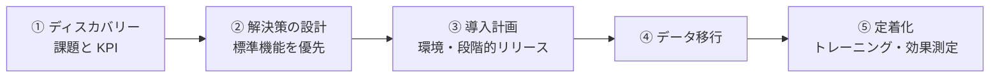
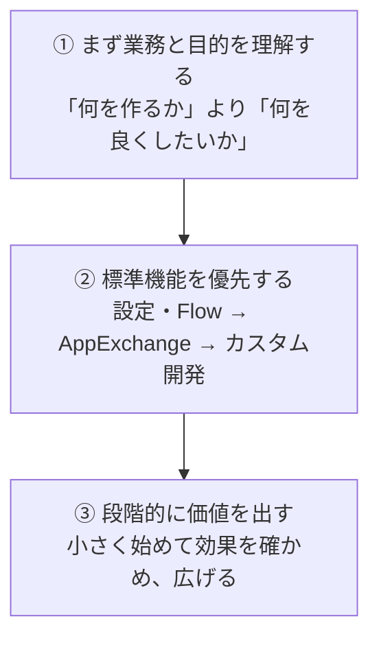
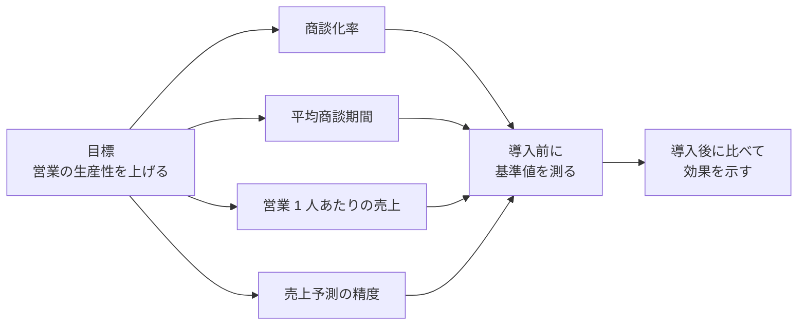
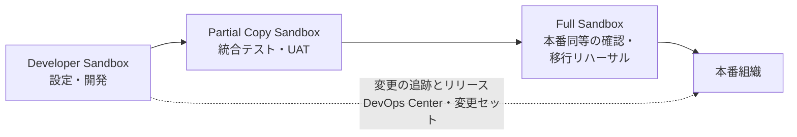
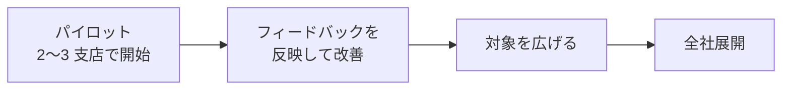
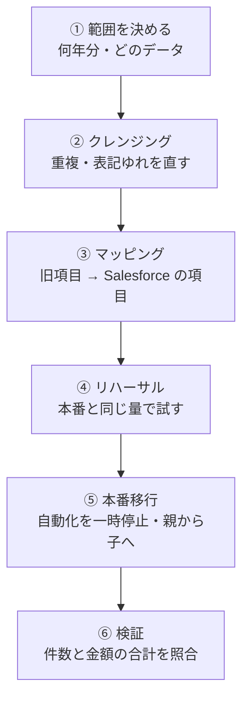
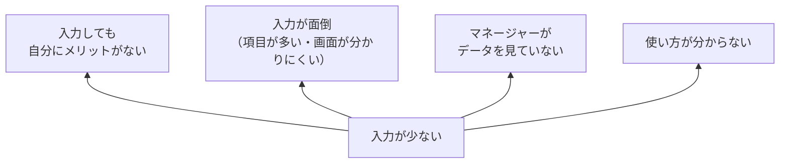

## はじめに：この範囲で学ぶこと

「コンサルティングと導入戦略」は**配点 25% で最大**の範囲です。Sales Cloud（Agentforce Sales）の**機能を知っている**だけでなく、**顧客に合わせてどう導入するか**が問われます。

この資格の前提

Agentforce Sales Consultant（旧 Sales Cloud Consultant）は、**Platform Administrator の知識を前提**にした資格です。共有・自動化・レポートなどの基本は Admin のレッスンで復習してください。このレッスンでは「コンサルタントとしてどう判断するか」に集中します。

---

## 1. コンサルタントの基本姿勢

### 1-1. 3 つの原則

なぜ「標準機能を優先」なの？

| | 標準機能 | カスタム開発 |
|---|---|---|
| 作る時間 | 短い | 長い |
| 保守 | Salesforce がバージョンアップに合わせて維持 | 自社で直し続ける必要がある |
| 新機能 | 年 3 回の新機能をそのまま使える | 新機能と合わないことがある |
| 人が替わったとき | 他の管理者でも分かる | 作った人しか分からないことがある |

カスタム開発が必要な場面もありますが、まず「**業務を標準機能に合わせられないか**」を顧客と一緒に考えるのがコンサルタントの役割です。

ひっかけ注意

「顧客が〇〇をしたいと言っている。コンサルタントが**最初に**すべきことは？」→ たいてい正解は「**背景（目的・課題・現状）を確認する**」です。「すぐに機能を有効にする」「すぐにカスタム開発する」は誤りになりやすい選択肢です。

---

## 2. ディスカバリー：課題と成功の指標

### 2-1. 確認すること

| 観点 | 確認すること |
|---|---|
| 営業組織 | チームの構成、地域・製品・業種の担当の分け方、マネージャーの階層 |
| 営業プロセス | リードから受注までの段階、各段階の基準、誰が何をするか |
| データ | 顧客・商品・価格をどこで管理しているか、データの品質 |
| 連携 | ERP、MA ツール、会計システムなど |
| 課題 | 予測が外れる、入力されない、対応が遅い など |

### 2-2. 成功の指標（KPI）と基準値

ポイント

**導入前に基準値を測っておく**ことが大切です。基準値がないと、導入後に「どれだけ良くなったか」を経営陣に示せません。

### 2-3. 原因を見つける例

「売上予測が毎月外れる」という相談を受けたら、すぐに予測の機能を入れるのではなく、原因を探します。

| よくある原因 | 対策の方向 |
|---|---|
| フェーズの意味が担当者ごとにバラバラ | フェーズの完了基準を合意し、**パス**と**入力規則**で標準化 |
| 完了予定日が更新されない | マネージャーが Salesforce で会議をし、データを使う文化を作る |
| 商談の金額が入力されない | 商品と価格表の整備、入力の負担を減らす |

---

## 3. 導入計画

### 3-1. 環境とリリース

| 項目 | ポイント |
|---|---|
| 開発 | Developer Sandbox |
| テスト・UAT | Partial Copy／Full Sandbox（本番に近いデータ） |
| リリース管理 | **DevOps Center**（変更の追跡とレビュー、管理者中心でも使いやすい）や変更セット |

### 3-2. 段階的リリース（パイロット）

なぜ全社で一斉に切り替えないの？

全社で同じ日に切り替えると、想定外の問題が起きたときに**全社の営業が止まります**。一部で先に始めれば、問題を小さいうちに見つけて直せます。パイロットに参加した人は、全社展開のときに**周りに教える推進役**にもなってくれます。

### 3-3. 範囲の管理

- 要望が多いときは、**ビジネス価値と工数**で整理し、初回リリースの範囲（**MVP**＝最小限の価値ある範囲）を**スポンサーと合意**する
- 途中で大きな要望が来たら、**範囲・期間・コストへの影響を示し、変更管理の手続き**で判断してもらう

### 3-4. エディションとライセンス

必要な機能（売上予測、テリトリー管理、API 連携、AI 機能など）とユーザー数から、適切なエディションとライセンスを選びます。全員に最上位が必要とは限りません。

---

## 4. データ移行

### 4-1. 移行の流れ

### 4-2. 大事なポイント

| ポイント | 内容 |
|---|---|
| **範囲** | 使わない古いデータは移さず、**アーカイブ**で参照できるようにする |
| **クレンジング** | 移行**前に**重複や表記ゆれを直す（移行後に直すより安い） |
| **順番** | **親から子へ**（ユーザー → 取引先 → 取引先責任者 → 商談 → 商談商品 → 活動） |
| **外部 ID** | 旧システムのキーを外部 ID に持ち、upsert で親子を紐づける |
| **自動化の停止** | 移行中に Flow や通知が動くと、大量のメールが送られることがある。**一時的に無効化**するか、移行用ユーザーを条件で除外する |
| **ツール** | 大量なら**データローダー（Bulk API）** |
| **検証** | 件数・金額の合計の照合と、業務担当者によるサンプル確認 |

具体例

Universal Containers の移行リハーサルで、移行した商談ごとに「新規商談の通知メール」が営業部長に届いてしまいました。本番移行の計画に「**通知の Flow を一時停止し、移行後に再開する**」手順を追加します。

---

## 5. 定着化（アダプション）

### 5-1. なぜ入力されないのか

### 5-2. 定着化の施策

| 原因 | 施策 |
|---|---|
| マネージャーが見ていない | **マネージャーが Salesforce のダッシュボードで会議・1 on 1 を行う**（最も効果的） |
| 入力が面倒 | 必須項目を最小限に、**動的フォーム**で必要なときだけ表示、**Einstein 活動キャプチャ**で自動記録、**モバイル**の最適化 |
| メリットがない | 入力したデータが担当者の役に立つ（次のアクションの提案、パイプラインの見える化） |
| 使い方が分からない | **役割別のトレーニング**、**アプリ内ガイダンス**、リリース後のフォロー |
| 状況が分からない | ログイン率・レコード更新率などの**利用状況ダッシュボード**で定着していないチームを見つけて支援 |

なぜ「マネージャーがダッシュボードで会議」が一番効くの？

営業担当は、**マネージャーが見ているもの**に合わせて行動します。マネージャーが Excel で会議をしていると、営業担当は Excel を更新し、Salesforce は放置されます。マネージャーが Salesforce の画面を見ながら「この商談の次のステップは？」と聞けば、営業担当は Salesforce を最新にしておくようになります。

### 5-3. コミュニケーション

利用者には「**なぜ変わるのか**」「**自分にどんなメリットがあるか**」「**いつ、どう支援されるか**」を伝えます。技術的な仕組みや予算の話は、利用者には必要ありません。

やってみよう（20 分）

1. Developer Edition で、商談のパスを作り、各フェーズに「重要な項目」と「成功へのガイダンス」を設定する
2. 「フェーズが提案以降なら金額は必須」という入力規則を作る
3. 営業マネージャー向けのダッシュボード（担当者別のパイプライン、今月の成立見込み）を作る
4. 「このダッシュボードを使って営業会議をするなら、どの項目が最新である必要があるか」を書き出す

---

## 6. まとめ

| テーマ | 覚えること |
|---|---|
| 姿勢 | まず目的と課題、標準機能を優先、段階的に価値を出す |
| KPI | 導入前に基準値を測る |
| 環境 | Developer → Partial／Full → 本番。DevOps Center で変更を管理 |
| 展開 | パイロット → 改善 → 全社 |
| 範囲 | 価値と工数で MVP を合意。変更は影響を示して判断してもらう |
| 移行 | クレンジングは移行前、親から子へ、外部 ID、自動化を一時停止、照合 |
| 定着 | マネージャーがダッシュボードで会議、入力負担を減らす、役割別トレーニング、利用状況の監視 |

## 試験直前チェック

- [ ] 標準機能を優先する理由を 3 つ言える
- [ ] 顧客の要望を受けたときに最初にすることを言える
- [ ] KPI の基準値を測る理由を言える
- [ ] パイロット導入の利点を言える
- [ ] データ移行の順番と、移行中に自動化を止める理由を言える
- [ ] 定着化に最も効く施策と、その理由を言える
- [ ] 入力の負担を減らす機能を 3 つ言える
