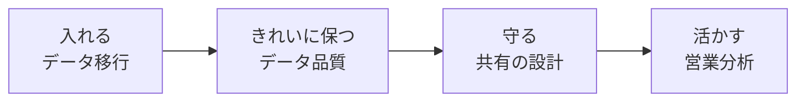
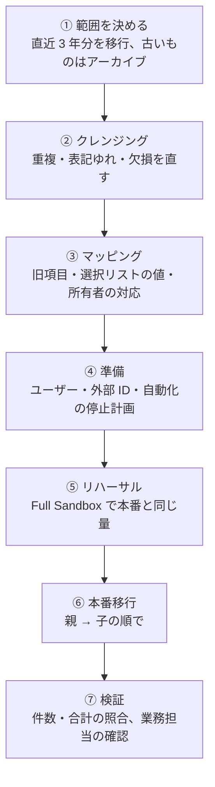
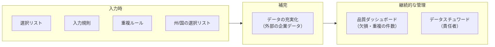
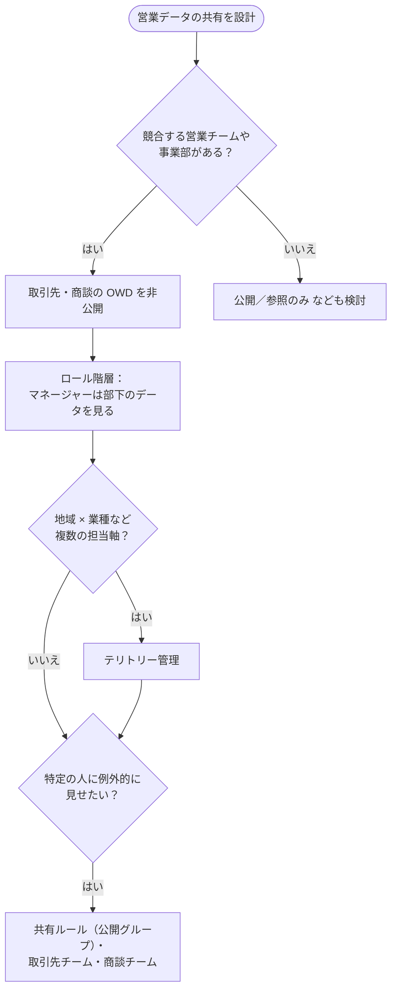
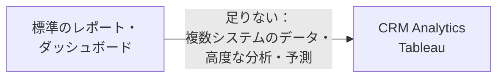

## はじめに：この範囲で学ぶこと

「データ管理」は配点 18% です。営業の判断は**データの質**で決まります。データを「入れる・きれいに保つ・守る・活かす」の 4 つの視点で学びます。

---

## 1. データ移行

### 1-1. 移行の全体像

### 1-2. それぞれのポイント

| 段階 | ポイント | 理由 |
|---|---|---|
| 範囲 | 使うデータだけ移し、古いデータは**アーカイブ** | 容量と性能を守り、移行の時間とコストを減らす |
| クレンジング | **移行前に**直す | 移行後に直すと、ユーザーが使い始めてからになり大変 |
| マッピング | 選択リストの値、所有者（旧担当者 → Salesforce のユーザー）も対応付ける | 値の不一致で取り込みに失敗するのを防ぐ |
| 外部 ID | 旧システムのキーを**外部 ID**に | upsert で親子を紐づけ、再実行しても重複しない |
| 自動化 | Flow・通知・入力規則を**一時停止**、または移行用ユーザーを除外 | 大量の通知メールや、移行データが入力規則に引っかかるのを防ぐ |
| 監査項目 | 旧システムの作成日を残すなら「**監査項目の設定を有効化**」 | 作成日・作成者を作成時に設定できる |
| ツール | 大量なら**データローダー（Bulk API）** | 5 万件を超える・活動などウィザード非対応のデータ |
| 順番 | **ユーザー → 取引先 → 取引先責任者 → 商談 → 商談商品 → 活動** | 子は親への参照が必要 |
| 検証 | 件数・金額の合計の照合＋業務担当者のサンプル確認 | ツールの「成功」だけでは中身の正しさは分からない |

具体例

Northern Trail Outfitters は旧システムに 15 年分の商談がありますが、営業で使うのは直近 3 年分です。→ 直近 3 年分を移行し、それより古いものはアーカイブして**必要なときに参照できる**ようにします。全部を移すと容量と性能に影響し、全部を捨てると過去の取引を確認できなくなります。

---

## 2. データ品質

### 2-1. 品質を保つ 3 つの段階

| 仕組み | 内容 |
|---|---|
| **選択リスト** | 値の表記をそろえる |
| **入力規則** | 不正な値・形式を止める |
| **一致ルール＋重複ルール** | 重複を警告・ブロック。重複を**レポート**するよう記録もできる |
| **州/国/テリトリー選択リスト** | 住所の国と都道府県を選択式にして表記をそろえる |
| **データの充実化** | 外部の企業データで取引先の情報を補う |
| **データスチュワード** | データの品質に責任を持つ人。定期的に品質を確認し、直す |

なぜデータ品質が営業にとって大事なの？

取引先が重複していると、同じ会社に 2 人の営業が別々に連絡してしまいます。業種が表記ゆれしていると、業種別の分析が正しくできません。AI の予測（リードスコアリングなど）も、汚れたデータからは正しく学習できません。**データの品質は、営業の信頼・分析・AI のすべての土台**です。

---

## 3. 共有の設計

### 3-1. 営業組織でよくある共有の要件

| 要件 | 仕組み |
|---|---|
| 担当者は自分の商談だけ、マネージャーは部下の商談を見る | 商談の OWD を**非公開**＋**ロール階層** |
| 競合する事業部同士で見せない | 非公開＋事業部ごとのロール階層（事業部をまたぐ共有ルールを作らない） |
| 製品スペシャリストに特定の商談を見せる | **条件ベースの共有ルール**（公開グループ）、**商談チーム** |
| 大口顧客をチームで担当 | **取引先チーム** |
| 地域と業種で担当が決まる | **テリトリー管理** |

---

## 4. 営業分析

### 4-1. よく使うレポートと機能

| 目的 | 機能 |
|---|---|
| パイプラインの全体 | 商談のサマリー・マトリックスレポート（フェーズ別、完了予定月別、担当者別） |
| 成約率・平均商談期間・平均単価 | **集計式**、レポートの集計 |
| **パイプラインの変化**（先月と比べて） | **履歴トレンドレポート** |
| 担当者ごとに自分のデータだけ | **動的ダッシュボード** |
| 経営層への定期報告 | ダッシュボード＋**購読** |
| Salesforce と ERP など**複数のデータを組み合わせた高度な分析** | **CRM Analytics**、**Tableau** |

ポイント

まず**標準のレポート・ダッシュボード**で足りるかを考えます。複数のシステムのデータを組み合わせる、大量のデータを高度に分析する、といった要件になったら CRM Analytics や Tableau を検討します。

やってみよう（20 分）

1. 取引先の重複ルールを開き、「警告」「ブロック」「レポート」の設定を確認する
2. データインポートウィザードで、取引先責任者の CSV（3 件）を取り込み、重複の判定方法を選んでみる
3. 商談の履歴トレンドレポートを作り、「先週と比べた金額の変化」を表示してみる（環境で使える場合）
4. 商談のダッシュボードの表示ユーザーを「ダッシュボードの閲覧者」にする

---

## 5. まとめ

| テーマ | 覚えること |
|---|---|
| 移行 | 範囲（古いものはアーカイブ）→ クレンジング（移行前）→ マッピング → リハーサル → 親から子へ → 照合 |
| 移行の注意 | 外部 ID、自動化の一時停止、監査項目の設定、大量はデータローダー |
| 品質 | 入力時（選択リスト・入力規則・重複ルール）、補完（充実化）、継続（スチュワード・ダッシュボード） |
| 共有 | 競合があれば非公開＋ロール階層。例外は共有ルール・チーム。複数軸はテリトリー |
| 分析 | 集計式、履歴トレンド、動的ダッシュボード、購読。高度な分析は CRM Analytics・Tableau |

## 試験直前チェック

- [ ] データ移行の流れを順番に言える
- [ ] クレンジングを移行前に行う理由を言える
- [ ] 移行中に自動化を止める理由を言える
- [ ] 旧システムの作成日を残す方法を言える
- [ ] データ品質を保つ仕組みを 4 つ言える
- [ ] 競合する事業部のデータを見せない共有の設計を言える
- [ ] パイプラインの変化を分析する機能を言える
- [ ] CRM Analytics や Tableau を検討する場面を言える
