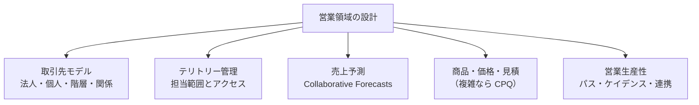
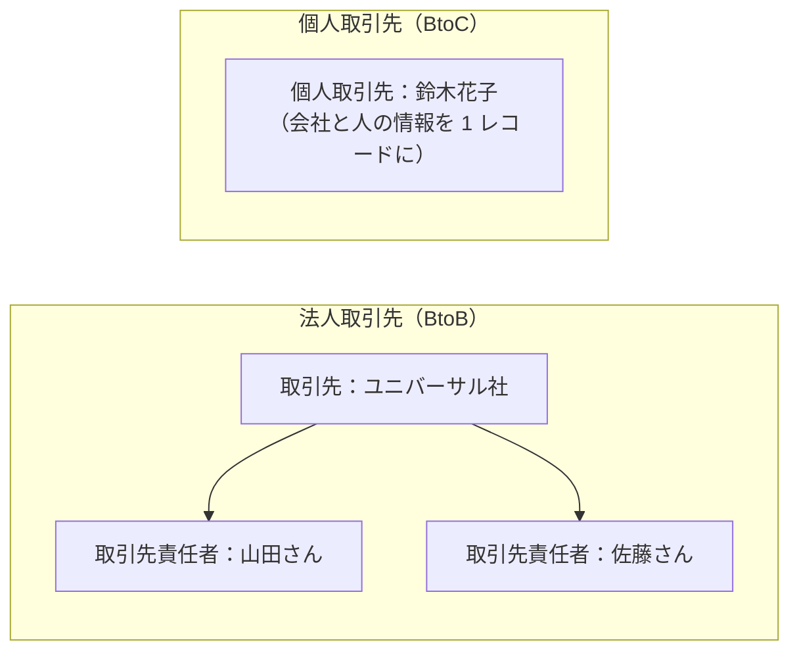
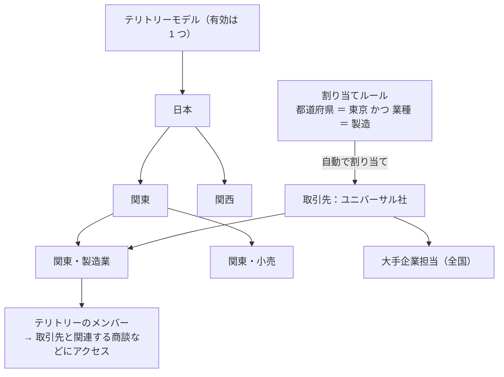
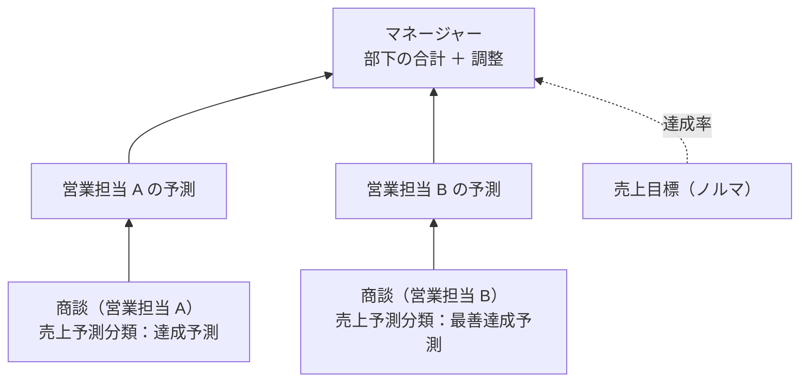
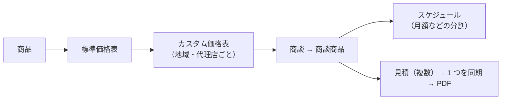

## はじめに：この範囲で学ぶこと

「営業領域の実践的な設計」は配点 24% です。Sales Cloud の主要な機能を、**どんな営業組織にどう当てはめるか**を学びます。

---

## 1. 取引先モデル

### 1-1. 法人と個人

| | 法人取引先 | **個人取引先** |
|---|---|---|
| 対象 | 会社 | 個人のお客様 |
| 構造 | 取引先と取引先責任者が別 | 1 レコードにまとまる |
| 注意 | — | **一度有効にすると無効にできない**。法人取引先と**併用はできる** |

ひっかけ注意

個人取引先を提案するときは「**元に戻せない**」ことを必ず伝え、Sandbox で影響（レポート、連携、既存のプロセス）を検証します。「有効にすると法人取引先が使えなくなる」は誤りです。

### 1-2. 取引先の関係を表す機能

| 機能 | 使いどころ |
|---|---|
| **取引先階層（親取引先）** | 親会社・子会社のグループ全体の取引を把握する |
| **取引先と取引先責任者のリレーション** | 1 人が複数の会社に関わる（顧問、兼任の取締役、転職した元担当者） |
| **取引先チーム** | 大口顧客を営業・技術・カスタマーサクセスのチームで担当し、役割とアクセスを設定 |
| **商談の取引先責任者の役割** | 商談ごとに、意思決定者・影響者などの役割と主担当を記録 |

---

## 2. テリトリー管理

### 2-1. なぜテリトリー管理が必要なのか

なぜロール階層だけでは足りないの？

ロール階層は「上司と部下」の**1 本の木**です。でも実際の営業組織は、

- 「関東の製造業担当」と「全国の大手企業担当」が**同じ取引先を担当する**
- 地域と業種の**2 つの軸**で担当が決まる
- 毎年、担当範囲を**組み直す**

ことがよくあります。1 本の木では表しきれません。**テリトリー管理**は、ロール階層とは**別の階層**で「担当範囲」を管理し、1 つの取引先を**複数のテリトリー**に割り当てられます。

### 2-2. 仕組み

| 要素 | 内容 |
|---|---|
| **テリトリーモデル** | テリトリーの階層全体。状態は**計画中 → 有効 → アーカイブ**。**有効にできるのは 1 つ** |
| テリトリー種別と優先度 | テリトリーの種類（地域、業種など）と、重なったときの優先度 |
| **割り当てルール** | 取引先の項目（都道府県、業種、規模）で自動的にテリトリーに割り当てる |
| アクセス | テリトリーごとに、取引先と関連する**商談・ケース・取引先責任者**へのアクセスレベルを設定 |
| 売上予測 | **テリトリー階層**で売上予測を積み上げることもできる |

ポイント：再編のシミュレーション

来期のテリトリー再編は、新しいモデルを「**計画中**」で作り、割り当てルールを実行して結果を確認します。今の有効なモデルには影響しません。準備ができたら有効化します（前のモデルはアーカイブされます）。

---

## 3. 売上予測（Collaborative Forecasts）

### 3-1. 仕組みの復習

### 3-2. 売上予測種別の選び方

| 売上予測種別 | 使いどころ |
|---|---|
| 商談の金額 | 一般的な売上予測 |
| 商談の数量 | 台数などの数量で管理する |
| **商品ファミリー** | ハードウェア・ソフトウェア・保守など、**製品ライン別**に予測する |
| **商談分割** | 複数の担当者で売上を分ける（営業 60%、プリセールス 40%） |
| カスタム項目 | 粗利など独自の金額で予測する |
| テリトリー | テリトリー階層で予測する |

### 3-3. 調整と売上目標

- **調整**: マネージャーが部下の予測を自分の見立てで上書きする。**部下の元の予測と商談の金額は変わらない**
- **売上目標**: 期間ごとの目標を設定し、達成率を表示する

### 3-4. Pipeline Inspection

**Pipeline Inspection** は、期間内に**金額や完了予定日が変わった商談**、**停滞している商談**、AI によるリスクのインサイトを一画面で確認する機能です。営業マネージャーがパイプラインを点検するのに使います。

---

## 4. 商品・価格・見積

### 4-1. 標準機能の範囲

| 要件 | 機能 |
|---|---|
| 地域や販売先ごとに価格を変える | カスタム価格表 |
| 保守契約を 12 か月に分けて計上 | **商品スケジュール**（売上スケジュール） |
| 複数の案を顧客に出す | 見積を複数作り、選ばれた 1 つを**同期** |
| 製品ラインごとに予測 | 商品ファミリー |

### 4-2. CPQ が必要になる場面

| 標準の見積で対応しにくい要件 | 例 |
|---|---|
| 製品構成の制約 | 「A を選んだら B が必須」「C と D は一緒に選べない」 |
| 複雑な価格ルール | 数量による値引き、契約期間による価格 |
| 多段階の値引き承認 | 値引き率に応じて承認者が変わる |
| 契約・更新・追加購入の管理 | サブスクリプションの更新 |

このような要件では **Revenue Cloud（CPQ）** を検討します。ただしまず「標準機能で足りないか」を確認します。

---

## 5. 営業生産性

| 機能 | 内容 | 使いどころ |
|---|---|---|
| **パス** | フェーズごとの重要な項目とガイダンス | 営業プロセスの標準化 |
| **カンバン** | フェーズの列に並べてドラッグで更新 | パイプラインの整理 |
| **Sales Engagement（ケイデンス）** | メール・電話などの接触の**順番と間隔**を定義し、作業リストとして提示 | インサイドセールスの定型的な接触 |
| **Einstein 活動キャプチャ** | メール・予定の自動記録 | 入力の負担を減らす |
| **Outlook／Gmail 連携** | メールソフトから Salesforce を見て記録 | メール中心の営業 |
| **Slack 連携** | 商談の通知や更新を Slack で | チームでの情報共有 |
| **モバイル** | コンパクトレイアウト・アクションの最適化 | 外出の多い営業 |

具体例

Cloud Kicks のインサイドセールスは、新しいリードに「1 日目メール → 3 日目電話 → 7 日目メール」の順で接触するルールですが、担当者によって守られていません。→ **Sales Engagement のケイデンス**で手順を定義すると、毎日やるべき接触が作業リストとして表示されます。

やってみよう（20 分）

1. 設定 →「テリトリー」でテリトリー管理を有効にし（環境で使える場合）、計画中のモデルを作って階層を 2〜3 段作る
2. 設定 →「売上予測の設定」で、売上予測種別に何があるかを確認する
3. 商品に「商品ファミリー」を設定し、商談に商品を追加する
4. 取引先を 2 つ作り、片方の「親取引先」にもう片方を設定して、階層を表示してみる

---

## 6. まとめ

| テーマ | 覚えること |
|---|---|
| 個人取引先 | BtoC 用。無効に戻せない。法人と併用できる |
| 関係 | 取引先階層、取引先と取引先責任者のリレーション、取引先チーム、商談の取引先責任者の役割 |
| テリトリー | ロール階層とは別の階層。取引先は複数テリトリーに。モデルは計画中で試し、有効は 1 つ |
| 売上予測 | 種別（商品ファミリー・分割など）、調整は元の値を残す、売上目標で達成率 |
| Pipeline Inspection | パイプラインの変化とリスクを点検 |
| 見積 | 標準で足りなければ CPQ（構成の制約・複雑な価格・承認） |
| 生産性 | パス、カンバン、ケイデンス、活動キャプチャ、Slack、モバイル |

## 試験直前チェック

- [ ] 個人取引先を提案するときの注意を言える
- [ ] 1 人が複数の会社に関わる場合の機能を言える
- [ ] テリトリー管理が必要な営業組織の特徴を言える
- [ ] テリトリーモデルの 3 つの状態と、再編の試し方を言える
- [ ] 製品ライン別や担当者間で分ける売上予測の種別を言える
- [ ] CPQ を検討すべき要件を 3 つ言える
- [ ] ケイデンスの使いどころを言える
