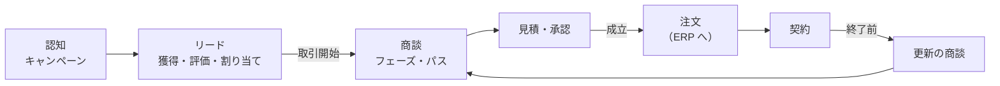
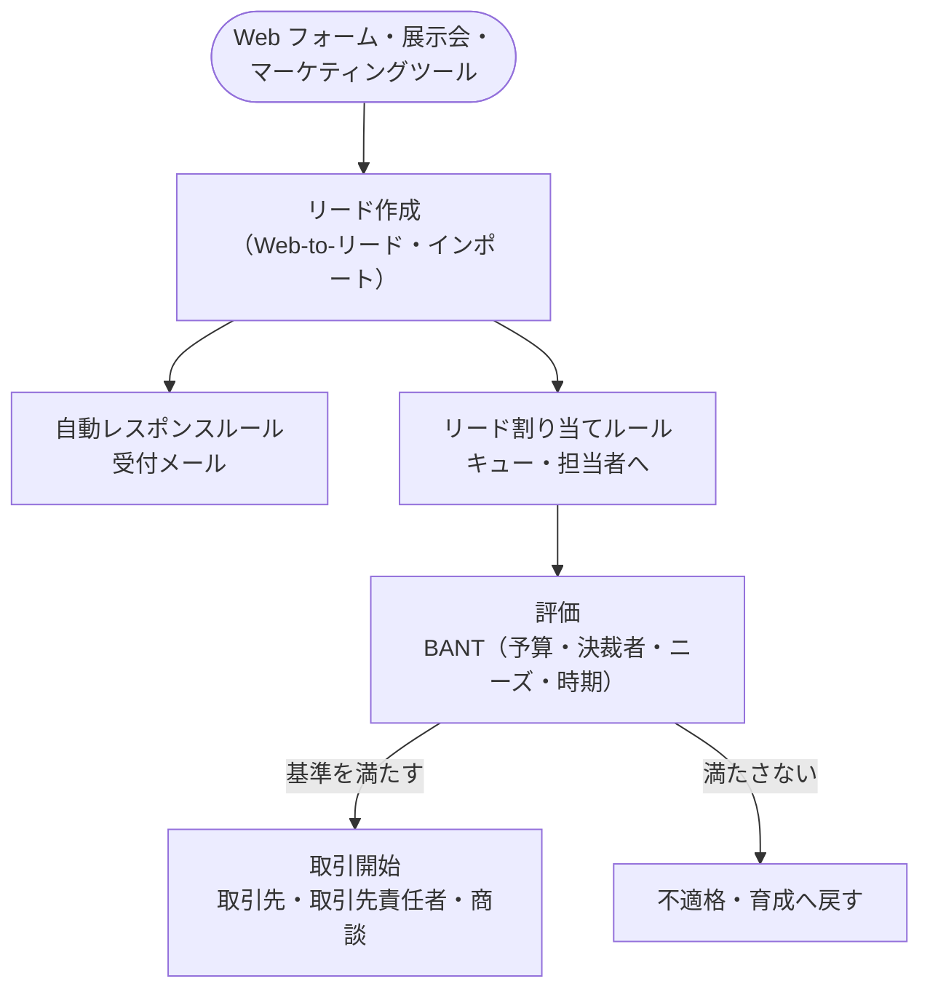
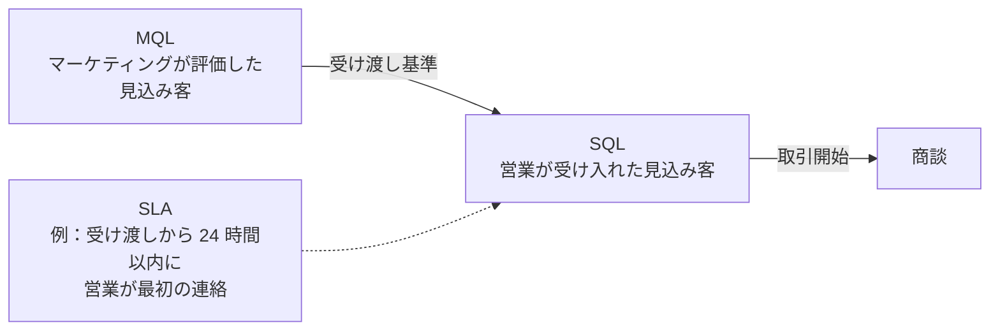
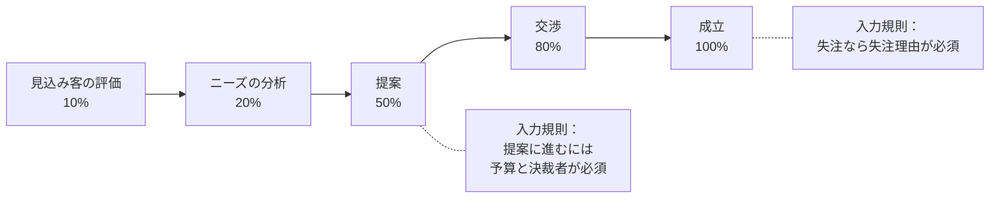
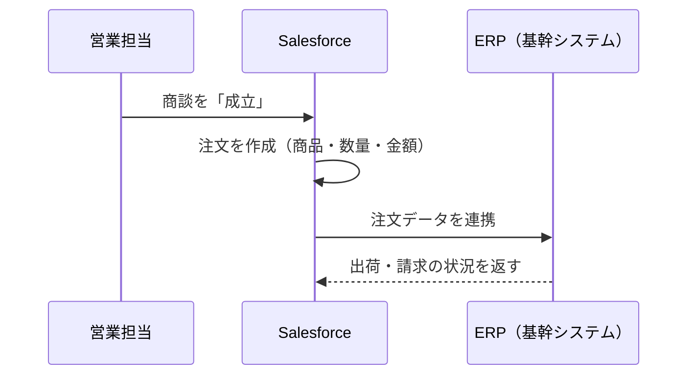
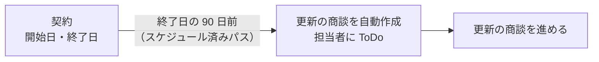

## はじめに：この範囲で学ぶこと

「営業ライフサイクル」は配点 20% です。営業の流れの**各段階で何が起き、どの機能で支えるか**、そして**つまずきやすいポイント**を学びます。

---

## 1. マーケティングとリード

### 1-1. リードが入ってから商談になるまで

| 段階 | 機能 | ポイント |
|---|---|---|
| 獲得 | **Web-to-リード**、データのインポート、MA ツール連携 | Web-to-リードは 1 日の上限あり |
| 受付 | **自動レスポンスルール** | 問い合わせ直後に受付メール |
| 割り当て | **リード割り当てルール**＋**キュー** | 有効は 1 つ、上から評価 |
| 評価 | リードの状況、**リードプロセス**、評価の項目（BANT など） | 評価基準を営業とマーケティングで合意 |
| スコアリング | **Einstein リードスコアリング** | 過去のデータから見込みの高いリードを点数化 |
| 重複 | **一致ルール＋重複ルール**（リードと取引先責任者の比較も） | 二重対応を防ぐ |
| 取引開始 | 取引先・取引先責任者・（任意で）商談、**リード項目の対応付け** | カスタム項目は対応付けで引き継ぐ |

### 1-2. マーケティングと営業の受け渡し（MQL → SQL）

なぜ受け渡しの基準と SLA が必要なの？

マーケティングは「たくさんリードを渡した」と思い、営業は「質の低いリードばかり」と感じる…という**部門間のすれ違い**がよく起きます。どんなリードを渡すか（基準）と、営業がいつまでに対応するか（SLA）を**両部門で合意**すると、すれ違いがなくなり、見込み客を取りこぼさなくなります。

仕組みとしては、リードの状況の値で段階を管理し、割り当てルールで素早く担当者に渡し、**Flow で期限超過を通知**し、レポートで受け渡しの状況を確認します。

---

## 2. 商談管理

### 2-1. フェーズを正しく運用する

| 仕組み | 役割 |
|---|---|
| **フェーズ** | 進み具合。各値に**確度**と**売上予測分類** |
| **セールスプロセス**＋レコードタイプ | 新規・アップセル・更新などで使うフェーズを変える |
| **パス** | フェーズごとの重要な項目とガイダンスを表示（強制力はない） |
| **入力規則** | フェーズを進める条件を**強制**する |
| 失注理由（選択リスト） | 失注を分析できるようにする |
| **大規模商談アラート**／Flow | 大きな商談を経営に知らせる |

ひっかけ注意

「提案に進む前に予算の入力を必須にしたい」→ **入力規則**（フェーズと項目を条件にする）。
ページレイアウトで予算を必須にすると、**最初のフェーズから常に必須**になってしまいます。パスのガイダンスは表示だけで強制できません。

### 2-2. 営業プロセス導入でつまずきやすいこと

| つまずき | 対策 |
|---|---|
| フェーズの定義が担当者ごとに違う | 完了基準を合意し、パスと入力規則で標準化 |
| 必須項目が多すぎて入力されない | 本当に必要な項目に絞り、フェーズに応じて必須にする |
| 失注の理由が分からない | 失注理由を選択リストで必須にする |
| マネージャーがデータを使わない | ダッシュボードで会議を行う |

---

## 3. 見積から受注へ

### 3-1. 見積と承認

| 要件 | 機能 |
|---|---|
| 顧客に複数の案を出す | 見積を複数作り、選ばれた 1 つを**同期** |
| 値引きが 20% を超えたら部長の承認を必要に | **承認プロセス**（見積または商談） |
| 値引き 50% 超は**禁止**したい | **入力規則**（禁止なら入力規則、承認が必要なら承認プロセス） |
| 見積書を送る | 見積テンプレートで PDF、メール送信 |

### 3-2. 注文と ERP

受注した内容は**注文（Order）**で管理し、ERP への連携の起点にするのが一般的です。

---

## 4. 契約と更新

| 要件 | 機能 |
|---|---|
| 契約期間と更新日を管理 | **契約**オブジェクト |
| 終了前に更新の商談を自動で作る | レコードトリガーフローの**スケジュール済みパス** |

なぜ更新の商談を自動で作るの？

既存顧客の更新は、新規顧客の獲得より**少ない労力で大きな売上**になります。ところが担当者の記憶に頼ると、更新の時期を忘れて解約につながることがあります。自動で商談を作れば、**取りこぼしを仕組みで防げます**。

---

## 5. 成果を測る：KPI とレポート

営業ライフサイクルの各段階の成果を、**レポートとダッシュボード**にします。

| 段階 | KPI の例 | レポート |
|---|---|---|
| リード | リード数、対応までの時間、**商談化率** | リードのレポート（状況別・ソース別） |
| 商談 | **パイプライン金額**、**成約率**、**平均商談期間**、平均単価 | 商談のレポート（フェーズ別・担当者別） |
| マーケティング | キャンペーンごとの商談・受注金額 | **キャンペーンインフルエンス**のレポート |
| 予測 | 予測と実績の差 | 売上予測、**履歴トレンドレポート** |
| 更新 | 更新率、解約率 | 契約・更新商談のレポート |

ポイント

経営層や営業部長には、重要な KPI に絞ったダッシュボードを作り、**購読**で毎週届くようにします。担当者ごとに自分のデータだけを見せたいときは**動的ダッシュボード**を使います。

---

## 6. 要件から機能を選ぶ（総合演習）

| 要件 | 選ぶ機能 |
|---|---|
| Web の問い合わせを地域ごとのチームに振り分け | Web-to-リード＋リード割り当てルール＋キュー |
| 既存の取引先責任者と重複するリードを警告 | 重複ルール（取引先責任者と比較する一致ルール） |
| マーケティングから渡されたリードへの対応を 24 時間以内に | 受け渡し基準と SLA の合意＋Flow で期限超過を通知 |
| 新規とアップセルでフェーズを変える | セールスプロセス＋レコードタイプ |
| 提案に進む前に予算を必須に | 入力規則 |
| 値引き 20% 超に部長の承認 | 承認プロセス |
| 受注を ERP に送る | 注文＋連携 |
| 契約終了の 90 日前に更新商談 | スケジュール済みパス |
| セミナーが受注にどれだけ貢献したか | キャンペーンインフルエンス |
| 成約率・商談期間を毎週確認 | レポート・ダッシュボード・購読 |

やってみよう（25 分）

1. Web-to-リードの設定画面を開き、フォームの HTML が生成されることを確認する
2. リードの割り当てルールを作り、条件エントリを 2 つ並べて、順番の意味を確かめる
3. 契約オブジェクトに対して、終了日の 90 日前に商談を作るレコードトリガーフロー（スケジュール済みパス）を作ってみる
4. 商談のレポートで「成約率」を集計式で作る

---

## 7. まとめ

| 段階 | 覚えること |
|---|---|
| リード | Web-to-リード、自動レスポンス、割り当てルール＋キュー、BANT、スコアリング、重複ルール |
| 受け渡し | MQL → SQL の基準と SLA を合意し、仕組み化 |
| 商談 | フェーズ（確度・予測分類）、セールスプロセス、パス（表示）、入力規則（強制） |
| 見積 | 複数作って 1 つ同期。承認が必要なら承認プロセス、禁止なら入力規則 |
| 受注 | 注文で ERP 連携の起点に |
| 更新 | 契約＋スケジュール済みパスで更新商談を自動作成 |
| 成果 | 段階ごとの KPI をレポート・ダッシュボードに |

## 試験直前チェック

- [ ] リードから商談までの各段階の機能を言える
- [ ] MQL・SQL・SLA を説明できる
- [ ] パスと入力規則の役割の違いを言える
- [ ] 承認プロセスと入力規則の使い分けを言える
- [ ] 受注後の ERP 連携の起点になるオブジェクトを言える
- [ ] 更新の商談を自動で作る方法を言える
- [ ] 営業ライフサイクルの KPI を段階ごとに 1 つずつ言える
