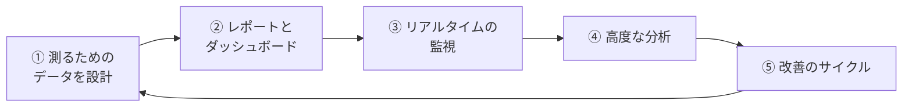
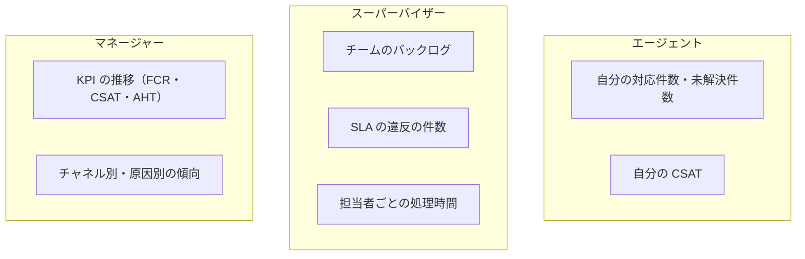
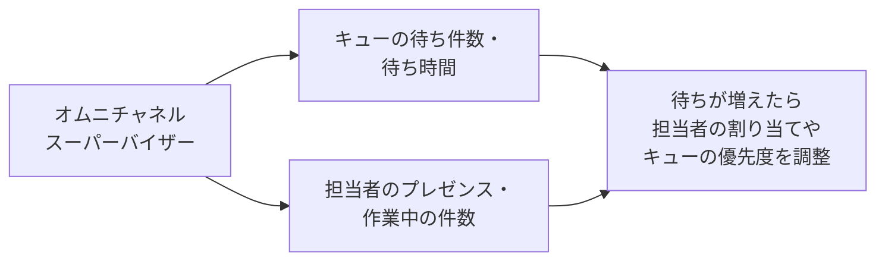
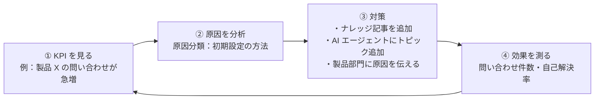

## はじめに：この範囲で学ぶこと

「コンタクトセンター分析」は配点 13% です。「業界知識」で学んだ KPI を、**Salesforce でどう測り、どう改善につなげるか**を学びます。

---

## 1. 測るためのデータを設計する

### 1-1. KPI から逆算する

なぜ「最初に」データを設計するの？

半年後に「問い合わせの原因の上位 5 つを知りたい」と言われても、ケースに原因の情報がなければ分析できません。過去のケースを 1 件ずつ読むのは現実的ではありません。

**測りたい KPI から逆算して、必要な項目を最初から用意しておく**ことが、分析の一番大事な準備です。

| 測りたいこと | 必要なデータ |
|---|---|
| チャネル別の件数・解決時間 | ケースの**発生源（チャネル）**、**作成日時・クローズ日時** |
| 問い合わせの原因の傾向 | **原因分類**（選択リスト。クローズ時に必須） |
| 初回解決率 | 初回解決のフラグ、再オープンの記録 |
| SLA の遵守 | **マイルストン**の達成・違反 |
| 待ち時間・処理時間 | **オムニチャネル**の作業の記録 |
| 顧客満足度 | 対応後の**アンケート**の結果（ケースに紐づける） |
| ナレッジの効果 | 記事の閲覧数・評価・**ケースへの添付** |

ポイント

原因分類のような分析用の項目は、自由入力ではなく**選択リスト**にします。値がそろわないと集計できないからです。

---

## 2. レポートとダッシュボード

### 2-1. 役割ごとのダッシュボード

| 機能 | 使いどころ |
|---|---|
| **動的ダッシュボード** | 1 つのダッシュボードで、エージェントには自分の実績、スーパーバイザーにはチームの実績を見せる |
| **履歴トレンドレポート／報告スナップショット** | **未解決ケース（バックログ）の推移**など、時間による変化を見る |
| レポートの購読 | 週次の KPI を自動で届ける |
| マイルストンのレポート | SLA の遵守率、違反の多いキュー・時間帯 |
| ナレッジのレポート | 役立っている記事、見直すべき記事 |

ひっかけ注意

「ダッシュボードのグラフが多すぎて、何を見ればよいか分からない」→ さらにグラフを増やすのではなく、**役割ごとに重要な KPI に絞ったダッシュボード**を用意します。

---

## 3. リアルタイムの監視

レポートは「過去の傾向」、**オムニチャネルスーパーバイザー**は「**今この瞬間**」を見るための道具です。待ちが急に増えたときにすぐ手を打てます。

---

## 4. 高度な分析

| 道具 | 使いどころ |
|---|---|
| **CRM Analytics（Service Analytics アプリ）** | サービス向けの**テンプレート**で、チャネル別・製品別・担当者別の多角的な分析や予測をすぐに始める |
| **Tableau** | 複数のデータソースを組み合わせた分析・可視化 |
| **Data 360** | チャネルをまたいだお客様の行動（Web の閲覧、購入、問い合わせ）を**統合**して、分析・セグメント・AI に使う |
| アンケート（Salesforce Feedback Management など） | 満足度をケースに紐づけて集める |

具体例

Northern Trail Outfitters は、お客様が問い合わせる前に Web でどのページを見ていたかを知り、問い合わせの予兆をつかみたいと考えています。→ **Data 360** で Web の行動データと問い合わせのデータを統合して分析します。標準のレポートの行数を増やしても、別のシステムのデータは分析できません。

---

## 5. 分析を改善につなげる

### 5-1. 改善のサイクル

なぜ「製品部門に伝える」まで含めるの？

問い合わせが多い原因が「製品の説明書が分かりにくい」なら、サービス部門だけで記事を増やしても、問い合わせ自体はなくなりません。**根本原因を持つ部門に伝えて直してもらう**ことで、問い合わせそのものを減らせます。サービスの分析は、会社全体の改善のヒントにもなります。

### 5-2. AI 機能の効果を測る

Service Replies などの AI 機能を導入したら、**AI 機能の利用状況**と、**AHT・CSAT の変化**をあわせて見ると、効果があったかを評価できます。

やってみよう（20 分）

1. ケースに「原因分類」の選択リスト項目を作り、クローズ時に必須にする入力規則を作る
2. ケースのレポートで、「発生源（チャネル）」別の件数と、作成からクローズまでの平均時間を出す
3. スーパーバイザー用のダッシュボードを作り、表示ユーザーを「ダッシュボードの閲覧者」にする
4. 「問い合わせが急増したとき」の改善のサイクルを、架空の例で 4 段階に書いてみる

---

## 6. まとめ

| テーマ | 覚えること |
|---|---|
| データ設計 | KPI から逆算して項目を用意。原因分類は選択リストで必須に |
| ダッシュボード | 役割ごとに重要な KPI に絞る。動的ダッシュボード |
| 推移 | 履歴トレンドレポート・報告スナップショット |
| リアルタイム | オムニチャネルスーパーバイザー |
| 高度な分析 | CRM Analytics（Service Analytics）、Tableau、Data 360 |
| 改善 | KPI → 原因 → 対策（ナレッジ・AI・根本原因の部門へ）→ 効果測定 |

## 試験直前チェック

- [ ] 原因分析のために最初に用意すべき項目を言える
- [ ] チャネル別の件数と解決時間を出すのに必要な項目を言える
- [ ] 役割ごとに同じダッシュボードで違うデータを見せる方法を言える
- [ ] バックログの推移を見る方法を言える
- [ ] リアルタイムの監視に使う機能を言える
- [ ] チャネルをまたいだ行動を分析する方法を言える
- [ ] 改善のサイクルを具体例で説明できる
