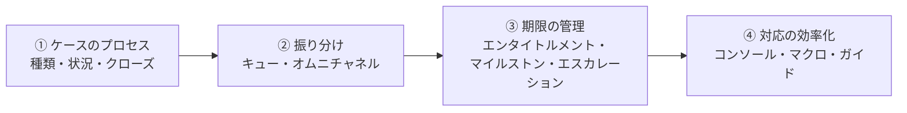
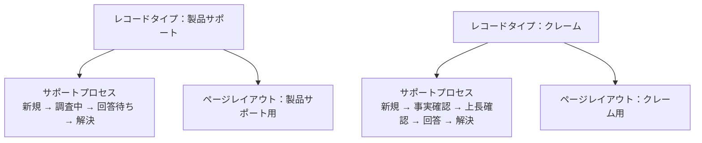
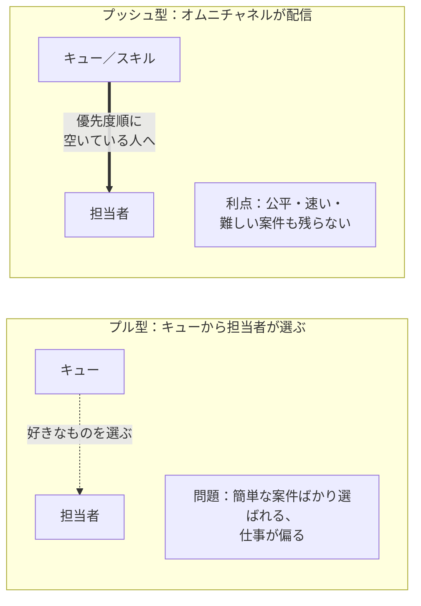
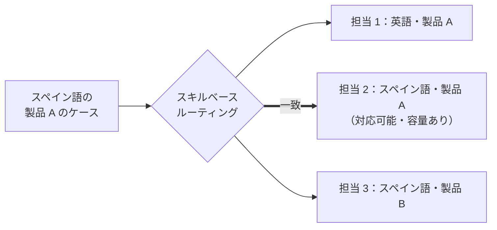
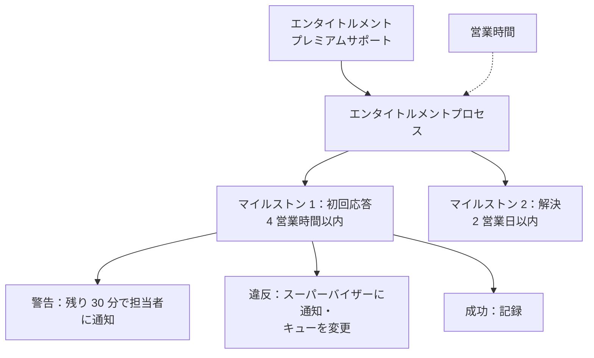

## はじめに：この範囲で学ぶこと

「ケース管理」は配点 13% です。サービスの中心であるケースを、**速く・公平に・期限内に**解決する仕組みを設計します。

---

## 1. ケースのプロセスを設計する

### 1-1. 種類ごとに流れを変える

| 要素 | 役割 |
|---|---|
| **レコードタイプ** | ケースの種類（製品サポート、クレーム、社内ヘルプデスクなど） |
| **サポートプロセス** | 種類ごとに使う「**状況**」の値 |
| ページレイアウト／動的フォーム | 種類ごとの画面 |

### 1-2. クローズ時に必要な情報を集める

分析のために、クローズするときに**原因の分類**と**解決内容**を必ず記録させます。

| 方法 | 内容 |
|---|---|
| **入力規則** | 状況が「クローズ」のとき、原因分類と解決内容を必須にする |
| **クローズ用のアクション・パス** | クローズの画面で必要な項目を入力させる |

### 1-3. 複数のケースをまとめる

| 機能 | 使う場面 |
|---|---|
| **親子ケース** | 大規模な障害で、同じ原因の問い合わせが大量に来た。**親ケース**にまとめて状況を管理し、復旧時に一斉に対応する |
| **ケースのマージ** | 同じお客様の**同じ問い合わせ**が重複して作られた。**1 件にまとめる** |

ひっかけ注意

「障害で 400 件の問い合わせ」→ **親子ケース**（400 件は別々のお客様なので 1 件にマージしない）。
「同じ人から同じ内容のケースが 2 件」→ **ケースのマージ**。

---

## 2. 振り分け

### 2-1. プル型とプッシュ型

### 2-2. 割り当てルール

**ケース割り当てルール**は、ケースが作られたときに条件でキューや担当者を決めます。

- **有効なルールは 1 つ**
- 条件エントリは**上から順に評価**し、**最初に一致したもの**で割り当てる

具体例

条件エントリが「① 優先度 ＝ 高 → 上級キュー」「② 製品 ＝ A → 製品 A キュー」の順に並んでいます。優先度が高い製品 A のケースは、**① に先に一致するので上級キュー**に入ります。製品 A キューに入れたいなら、順番を入れ替えるか条件を見直します。

### 2-3. オムニチャネルの設計

| 要素 | 内容 |
|---|---|
| **プレゼンス状況** | 担当者が「対応可能」「休憩中」などを切り替える。**対応可能な人にだけ配信** |
| **容量** | 担当者が同時に扱える量 |
| **作業のサイズ** | 1 件の作業が使う容量（例: チャットは容量の 3 分の 1、電話は全部） |
| **ルーティング設定** | 優先度、配信方法（最も空いている人など） |
| **キューベース** | キューのメンバーに配信 |
| **スキルベース** | **言語・製品・難易度**などのスキルを持つ担当者に配信 |
| **Omni-Channel Flow** | Flow で振り分けの条件を柔軟に作る（AI エージェントからの引き継ぎも） |

ポイント：「同時に 3 件のチャット、または 1 件の電話」

これは**容量と作業のサイズ**で表現します。担当者の容量を 100 とし、チャット 1 件のサイズを約 33、電話 1 件のサイズを 100 にすると、チャットなら 3 件まで、電話なら 1 件だけになります。

### 2-4. リアルタイムの監視

**オムニチャネルスーパーバイザー**で、スーパーバイザーが**キューの待ち件数・待ち時間**、**担当者のプレゼンス状況と作業**をリアルタイムで確認し、必要なら会話を支援します。

---

## 3. 期限の管理

### 3-1. エンタイトルメントとマイルストン

| 要素 | 内容 |
|---|---|
| **エンタイトルメント** | お客様が受けられるサポートの内容（期間・チャネル・対応時間） |
| **エンタイトルメントプロセス** | どのマイルストンをどの順番で達成するか |
| **マイルストン** | 時間目標。残り時間をケースに表示し、**成功・警告・違反**のアクションを設定 |
| 営業時間 | 時間の計算に営業時間を使える |

### 3-2. エスカレーションルールとの使い分け

| 要件 | 機能 |
|---|---|
| 一定時間たったら上長に再割り当て・通知（シンプル） | **エスカレーションルール** |
| お客様ごとに違う約束（SLA）、**残り時間の表示**、達成・違反の記録と分析 | **エンタイトルメント＋マイルストン** |

なぜマイルストンが便利なの？

マイルストンは、ケースの画面に**残り時間のタイマー**を表示します。担当者は「あと 15 分で期限」と分かるので、期限が来る前に対応できます。また、達成・違反の記録がレポートで分析でき、SLA をどれだけ守れているかを測れます。

---

## 4. 対応の効率化

| 機能 | 内容 |
|---|---|
| **サービスコンソール** | ワークスペースタブ・サブタブ・ユーティリティバー・スプリットビューで、複数のケースと関連情報を同時に扱う |
| **マクロ** | メール送信・項目更新などの複数の操作をワンクリックで |
| **クイックテキスト** | 定型文の挿入 |
| **画面フロー／アクションプラン** | 返品対応などの**手順をガイド**し、新人でも漏れなく進められるようにする |
| **ケースチーム** | 1 件のケースを、役割の違う複数の担当者で対応 |
| 関連情報の表示 | お客様の過去のケース、納入商品、エンタイトルメントを 1 画面に |

やってみよう（25 分）

1. ケースのサポートプロセスを 2 つ作り、それぞれのレコードタイプに割り当てる
2. 「状況がクローズなら原因分類が必須」という入力規則を作る
3. ケース割り当てルールに条件エントリを 2 つ作り、順番によって結果が変わることを確かめる
4. 設定 →「オムニチャネルの設定」を開き、プレゼンス状況・ルーティング設定・容量の項目を確認する（環境で使える場合）

---

## 5. まとめ

| テーマ | 覚えること |
|---|---|
| プロセス | レコードタイプ＋サポートプロセス（状況の値）。クローズ時の必須は入力規則 |
| まとめる | 障害の大量の問い合わせ＝親子ケース、同じ問い合わせの重複＝マージ |
| 振り分け | プル型の問題（偏り）→ オムニチャネルのプッシュ型。割り当てルールは上から評価 |
| オムニチャネル | プレゼンス・容量・作業のサイズ・キューベース／スキルベース・スーパーバイザー |
| 期限 | シンプルならエスカレーションルール、SLA と残り時間ならマイルストン |
| 効率化 | コンソール、マクロ、クイックテキスト、画面フロー／アクションプラン |

## 試験直前チェック

- [ ] ケースの状況の値を種類ごとに変える方法を言える
- [ ] 親子ケースとケースのマージの使い分けを言える
- [ ] プル型の問題とオムニチャネルの利点を言える
- [ ] 割り当てルールの評価の順番を説明できる
- [ ] スキルベースルーティングを使う場面を言える
- [ ] 「同時に 3 件のチャットか 1 件の電話」の設定方法を言える
- [ ] エスカレーションルールとマイルストンの使い分けを言える
- [ ] 新人が手順を漏れなく進められるようにする方法を言える
