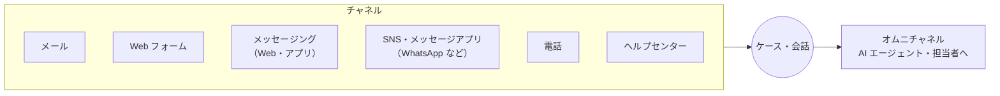
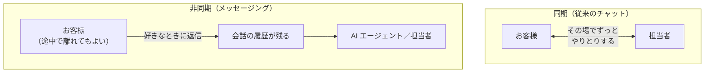
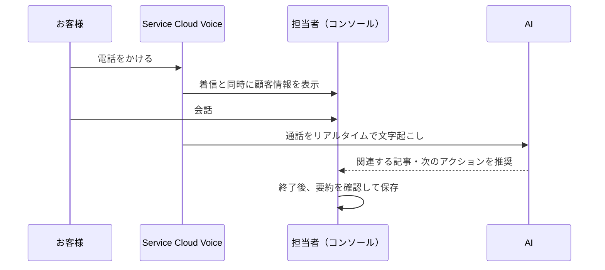
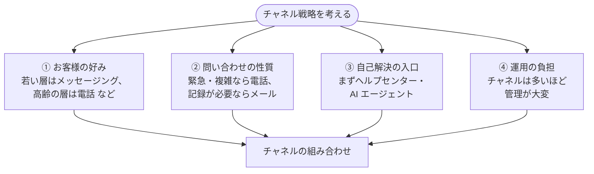
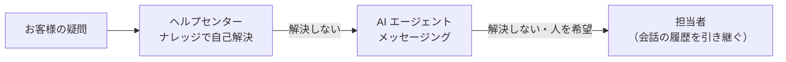

## はじめに：この範囲で学ぶこと

「受付とインタラクションのチャネル」は配点 13% です。お客様がどこから問い合わせ、それがどうケースになり、担当者に届くかを学びます。

---

## 1. 各チャネルの特徴

| チャネル | 機能 | 特徴 | 注意 |
|---|---|---|---|
| **メール** | **メール-to-ケース** | 記録が残る。急ぎでない問い合わせ向き | **オンデマンド**版は Salesforce のアドレスに転送するだけ（社内にソフト不要）。スレッドで返信が同じケースにつく |
| **Web フォーム** | **Web-to-ケース** | Web サイトに簡単に設置できる | **1 日の上限**あり。スパム対策に **reCAPTCHA** |
| **メッセージング** | **Messaging for In-App and Web** | アプリや Web で会話。**途中で離れても後から続けられる**（非同期） | AI エージェントと人の引き継ぎに対応 |
| **SNS・メッセージアプリ** | WhatsApp、Facebook Messenger、SMS などのメッセージングチャネル | お客様が**普段使うアプリ**で対応できる | — |
| **電話** | **Service Cloud Voice**、**Open CTI** | 緊急・複雑な問い合わせ向き | 下で詳しく |
| **セルフサービス** | **Experience Cloud** のヘルプセンター | ナレッジで自己解決、ケースの起票と確認 | ログインする顧客には外部ライセンス |

ポイント：チャットからメッセージングへ

以前の「チャット（Live Agent／Chat）」は、**Messaging for In-App and Web への移行**が進んでいます。AI エージェントとの連携もメッセージングが中心です。既存のチャットを使っている顧客には、移行の計画を勧めます。

---

## 2. メッセージング：同期と非同期

なぜ非同期のメッセージングが好まれるの？

従来のチャットは、お客様が画面を閉じると会話が終わってしまいました。メッセージングは、LINE のように**途中で離れても、後から同じ会話を続けられます**。お客様は待たされるストレスが減り、企業側も 1 人の担当者が複数の会話を並行して扱えます。

---

## 3. 電話：Service Cloud Voice と Open CTI

| | **Service Cloud Voice** | **Open CTI** |
|---|---|---|
| 内容 | 電話を Salesforce に**深く統合**（Amazon Connect などと連携） | **既存の CTI ベンダー**のソフトフォンを Salesforce に組み込む |
| できること | 着信時の顧客情報の表示（スクリーンポップ）、**通話の文字起こし**、**リアルタイムの AI の推奨**、通話と他の作業を**オムニチャネルで一緒に管理** | 着信時の顧客情報の表示、クリックで発信、通話の記録 |
| 向いている場合 | 新しく電話の仕組みを作る、AI を活用したい | 今の電話システムを使い続けたい |

---

## 4. 受付の自動化

| やりたいこと | 機能 |
|---|---|
| メール・Web のケースに受付メールを自動返信 | **自動レスポンスルール** |
| 条件で担当キューを決める | **ケース割り当てルール** |
| 空いている担当者に自動配信 | **オムニチャネル** |
| メッセージングで最初に AI が対応し、必要なら人へ | **AI エージェント＋オムニチャネルのフロー**（Omni-Channel Flow） |
| チャネルや内容で項目を設定、優先度を決める | **Flow** |
| 営業時間外の受付 | メッセージングで受付け、翌営業日に対応する流れを設計 |

---

## 5. チャネルの選び方

### 5-1. 考える観点

ひっかけ注意

- ✕「チャネルは多いほど良い」→ 運用が複雑になり、品質がばらつく
- ✕「チャネルごとに別のシステム・別のナレッジ」→ 対応が一貫しない
- ○ **すべてのチャネルで同じ顧客情報・同じナレッジ・同じケース管理**を使えるようにする（オムニチャネル）

### 5-2. デフレクション（自己解決）の流れ

具体例

Northern Trail Outfitters の若いお客様は電話をあまり使わず、WhatsApp での問い合わせを望んでいます。→ **WhatsApp のメッセージングチャネル**を追加し、既存のサービスコンソールと同じナレッジ・ケース管理で対応します。電話窓口だけを強化するのは、お客様の好みに合いません。

やってみよう（15 分）

1. 設定 →「Web-to-ケース」を開き、フォームの HTML を生成する画面と、reCAPTCHA の設定を確認する
2. 設定 →「メール-to-ケース」を開き、オンデマンドの設定と転送先アドレスの仕組みを確認する
3. 身近なサービスを例に、「電話・メール・メッセージング・ヘルプセンター」をどの問い合わせに使うべきか表にしてみる

---

## 6. まとめ

| テーマ | 覚えること |
|---|---|
| メール | メール-to-ケース（オンデマンドはソフト不要、スレッドで返信をまとめる） |
| Web | Web-to-ケース（上限あり、reCAPTCHA） |
| メッセージング | 非同期で会話を続けられる。チャットからの移行先。AI との引き継ぎ |
| 電話 | Voice＝深い統合・文字起こし・AI、Open CTI＝既存の CTI を組み込む |
| 自動化 | 自動レスポンス・割り当て・オムニチャネル・Flow |
| 選び方 | お客様の好み × 問い合わせの性質。共通の顧客情報とナレッジ。まず自己解決 |

## 試験直前チェック

- [ ] オンデマンドメール-to-ケースの利点を言える
- [ ] Web-to-ケースのスパム対策を言える
- [ ] メッセージングが従来のチャットより優れている点を言える
- [ ] Service Cloud Voice と Open CTI の使い分けを言える
- [ ] チャネルを選ぶ観点を 2 つ以上言える
- [ ] 「チャネルは多いほど良い」が誤りである理由を言える
