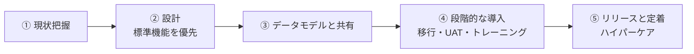
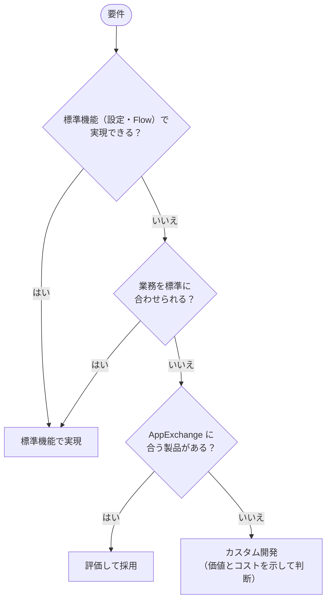
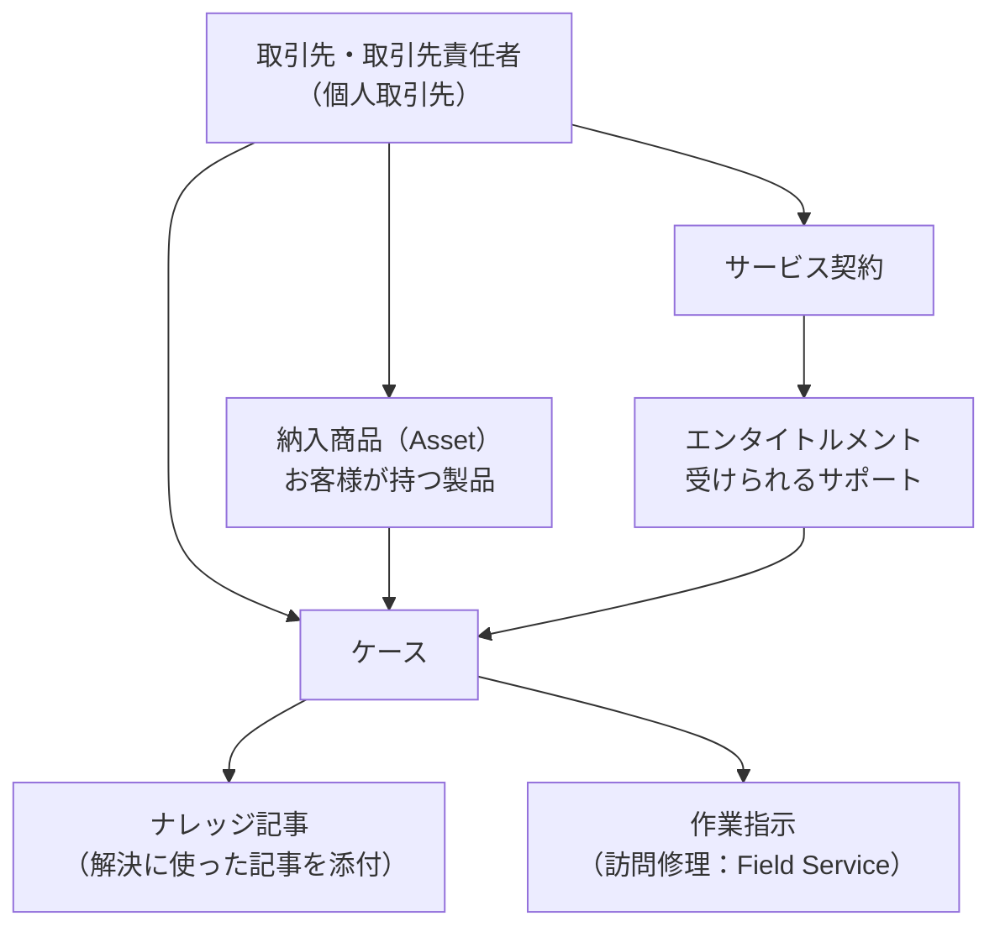
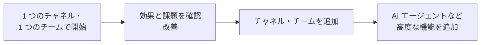
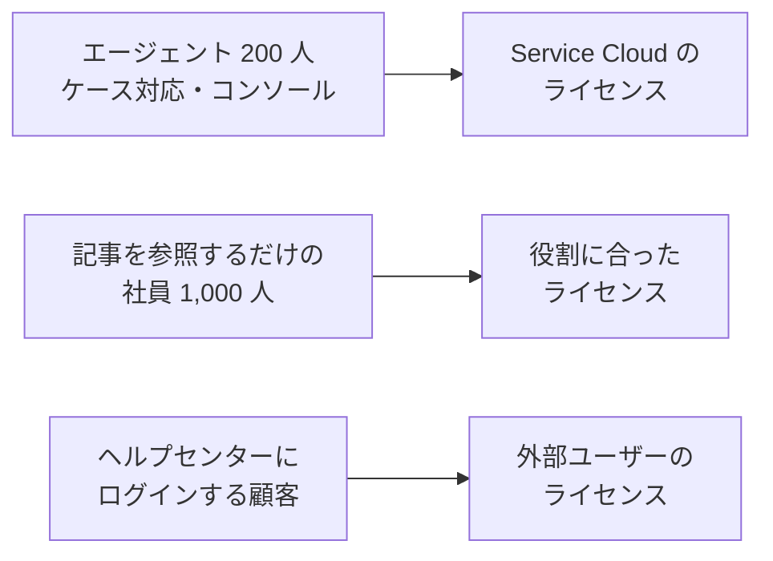

## はじめに：この範囲で学ぶこと

「導入戦略」は配点 12% です。Service Cloud（Agentforce Service）を**顧客の組織に合わせてどう導入するか**を学びます。

---

## 1. 現状把握

| 確認すること | 理由 |
|---|---|
| 問い合わせの**量・種類・チャネル・季節変動** | どのチャネルとルーティングが必要か、AI に任せられる問い合わせはどれか |
| 現在の **KPI**（FCR、AHT、CSAT など） | 改善の目標と基準値を決める |
| お客様の**ジャーニー**と不満が生じる場面 | 待ち時間、たらい回し、同じ説明の繰り返しなど、優先して直すべき点 |
| 使っているシステム（電話、注文、ナレッジ） | 連携の必要性 |
| 組織（チーム、Tier、拠点、営業時間） | キュー・ルーティング・営業時間の設計 |

ひっかけ注意

「顧客がサービスの改善を求めている」問題で、最初にすべきことは**現状と課題の把握**です。「すぐに AI エージェントを入れる」「全機能を有効にする」は誤りになりやすい選択肢です。

---

## 2. 設計の基本方針

標準機能を優先する理由は、Sales Consultant と同じです（保守性、新機能の活用、引き継ぎやすさ）。

---

## 3. データモデルと共有

### 3-1. サービスの主なオブジェクト

### 3-2. ケースの共有の考え方

| 状況 | OWD の例 |
|---|---|
| エージェント同士で協力し、他の人のケースも参照したいが、編集は担当者だけ | **公開／参照のみ** |
| 誰でも引き継いで編集してよい | 公開／参照・更新（・転送） |
| 機密性の高いケース（人事、クレームの詳細）がある | **非公開**＋共有ルール・キュー・ケースチーム |

- **キュー**でチームの作業を管理する（キューのメンバーがアクセスできる）
- 顧客・パートナーなどの**外部ユーザー**には**外部の組織の共有設定**（内部より厳しくできる）

---

## 4. 段階的な導入

### 4-1. 進め方

なぜ一度に全部を切り替えないの？

コンタクトセンターは**止まるとお客様に直接迷惑がかかる**業務です。5 つのチャネルと 10 チームを同じ日に切り替えると、問題が起きたときの影響が大きすぎます。小さく始めて、効果を確かめ、問題を直しながら広げるのが安全です。

### 4-2. 導入の準備

| 項目 | ポイント |
|---|---|
| 環境 | 開発・テストは Sandbox、UAT は本番に近い Partial Copy／Full |
| **データ移行** | ケース履歴は親（取引先・取引先責任者）を先に。ナレッジ記事は**記事の種類（レコードタイプ）・データカテゴリ・公開チャネル**の対応付けを計画する |
| **UAT** | **スーパーバイザーとエージェントの代表**が実際の業務シナリオで |
| **トレーニング** | **役割別**：エージェントにはコンソール・マクロ・ナレッジ、スーパーバイザーにはオムニチャネルスーパーバイザー・レポート |
| **ハイパーケア** | リリース直後の集中サポート体制（窓口・担当・手順） |

---

## 5. データ移行・品質・ガバナンス・大量データ

公式の試験ガイドでは「データ移行、データ品質、データガバナンス、大量データの考慮点と影響を説明する」ことが問われます。

### 5-1. データ移行

| 考慮点 | 内容 |
|---|---|
| **範囲** | 何年分のケースを移すか。古いケースはアーカイブし、参照だけできるようにする選択も |
| **順番** | 取引先 → 取引先責任者 → 納入商品（資産）→ エンタイトルメント → ケース → メール・コメント・ファイル |
| **キー** | 旧システムの ID を**外部 ID**に入れ、upsert で親子をつなぐ |
| **元の日時** | ケースの作成日などを元の値で残すには「監査項目の設定」を使う |
| **自動化** | 移行中は割り当てルール・自動レスポンス・エスカレーション・Flow を止める（移行したケースに通知が飛ぶのを防ぐ） |
| **ナレッジ** | 記事の移行は、記事の種類（レコードタイプ）・データカテゴリ・公開状態の対応を決める |

ひっかけ注意

過去のケースを移行したら、顧客に「お問い合わせを受け付けました」の自動メールが大量に送られてしまった。→ 移行前に**自動レスポンスルール・メールアラートを止める**のが鉄則です。

### 5-2. データ品質とガバナンス

| 観点 | 対策 |
|---|---|
| **重複** | 取引先・取引先責任者の重複ルール。メールから作られるケースの取引先責任者の照合 |
| **必須の情報** | クローズ時の必須項目（原因・解決方法）を入力規則やパスで |
| **個人情報** | 項目レベルセキュリティ、暗号化、保持期間、削除の依頼への対応 |
| **データの責任者** | ナレッジの記事のオーナー、ケースの分類の定義の責任者を決める |

### 5-3. 大量データ

| 状況 | 影響 | 対策 |
|---|---|---|
| ケースが毎年数百万件増える | 検索・レポート・リストビューが遅くなる | 期間で絞ったリストビュー、古いケースのアーカイブ |
| メール・添付が多い | ファイルストレージが不足 | 保持期間を決めて整理、外部ストレージ |
| 1 つの取引先に大量のケース | ロックの競合、共有の再計算 | 取引先を分ける、共有の設計を簡単に |
| 大量の顧客ユーザー（ポータル） | 共有の計算が重い | Customer Community と共有セット |

---

## 6. 製品とライセンス

### 6-1. 主な製品

| 製品 | 内容 |
|---|---|
| **Service Cloud** | ケース、サービスコンソール、オムニチャネル、ナレッジ、エンタイトルメントなど |
| **Experience Cloud** | 顧客向けのヘルプセンター。ログインする顧客には**外部ユーザー用のライセンス**（Customer Community など） |
| **Service Cloud Voice** | 電話をコンソールに統合し、文字起こしや AI の推奨を使う |
| **Field Service** | 訪問修理などの現地作業の管理 |
| **Agentforce** | AI エージェント、生成 AI の機能 |

### 6-2. ライセンスの考え方

ポイント

ライセンスは「**誰が・どの機能を使うか**」で選びます。全員に最上位のライセンスは不要ですし、逆にエージェントに閲覧用の最低限のライセンスだけでは仕事になりません。

やってみよう（15 分）

1. 設定 →「共有設定」でケースの OWD を確認し、「公開／参照・更新・転送」があることを確かめる
2. 設定 →「キュー」でケース用のキューを作り、メンバーを追加する
3. 「1 つのチャネル・1 チームから始める」導入計画を、3 つの段階に分けて書いてみる

---

## 7. まとめ

| テーマ | 覚えること |
|---|---|
| 現状把握 | 量・種類・チャネル・季節変動、KPI、ジャーニーの不満点 |
| 設計 | 標準機能 → 業務を合わせる → AppExchange → カスタム |
| データモデル | ケース・納入商品・エンタイトルメント・サービス契約・ナレッジ |
| 共有 | 協力型なら公開／参照のみ、機密なら非公開＋例外。外部は外部の OWD |
| 導入 | 1 チャネル・1 チームから段階的に。UAT はエージェント代表 |
| トレーニング | 役割別（エージェント／スーパーバイザー） |
| ライセンス | 役割と機能で選ぶ。顧客サイトは外部ユーザーのライセンス |

## 試験直前チェック

- [ ] 現状把握で確認すべきことを 4 つ言える
- [ ] 協力型のサポート組織に合うケースの OWD を言える
- [ ] 段階的に導入する理由を言える
- [ ] ナレッジ記事を移行するときに対応付けるものを言える
- [ ] エージェントとスーパーバイザーのトレーニングの違いを言える
- [ ] 顧客向けヘルプセンターに必要な製品とライセンスを言える
- [ ] 過去のケースを移行するときに止めるべき自動化を言える
- [ ] ケースが大量に増えるときの対策を 2 つ言える
