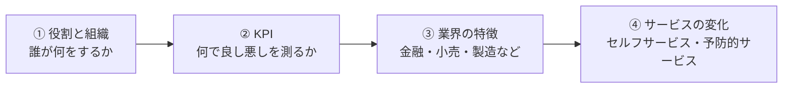
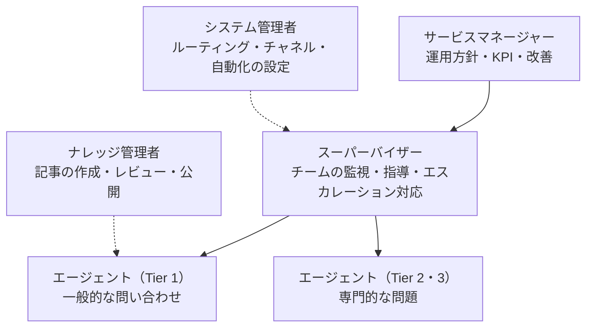
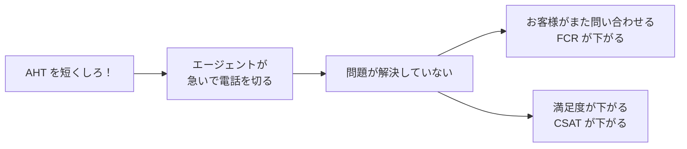
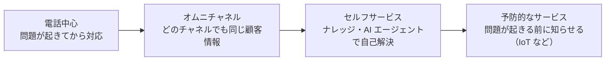

## はじめに：この範囲で学ぶこと

「業界知識」は配点 12% です。Salesforce の機能の前に、**コンタクトセンター（お客様窓口）がどう動いているか**を理解します。これが分かると、他の範囲の設計問題で「なぜその機能が必要か」が見えるようになります。

---

## 1. コンタクトセンターの役割

### 1-1. 主な役割

| 役割 | 主な仕事 |
|---|---|
| **エージェント** | お客様の問い合わせに対応し、ケースを解決する |
| **スーパーバイザー** | チームの稼働と待ち状況を**リアルタイムで監視**し、エスカレーション対応と指導を行う |
| **サービスマネージャー** | KPI と運用方針を決め、改善を進める |
| **ナレッジ管理者** | 記事の品質を管理する |
| システム管理者 | Salesforce の設定を行う |

### 1-2. Tier（階層）

| Tier | 担当 |
|---|---|
| Tier 1 | よくある質問、簡単な手続き |
| Tier 2 | 専門知識が必要な問題 |
| Tier 3 | 開発部門などの専門家が対応する難しい問題 |

なぜ Tier に分けるの？

全員がすべての問い合わせに対応できるようにするのは大変です。簡単な問い合わせを Tier 1 で素早く解決し、難しいものだけを専門家に回すと、**専門家の時間を難しい問題に集中**でき、全体の対応が速くなります。最近は、Tier 1 の一部を **AI エージェント**が担うことも増えています。

---

## 2. コンタクトセンターの KPI

### 2-1. 主な KPI

| KPI | 意味 | 良い方向 |
|---|---|---|
| **初回解決率（FCR）** | 最初の対応で解決した割合 | 高いほど良い |
| **平均処理時間（AHT）** | 1 件あたりの対応時間（会話＋後処理） | 短いほど効率的（ただし短すぎに注意） |
| **顧客満足度（CSAT）** | 対応後のアンケートの満足度 | 高いほど良い |
| **NPS（ネットプロモータースコア）** | 他の人に勧めたいか | 高いほど良い |
| **サービスレベル** | 決めた時間内に応答した割合（例: 80% を 20 秒以内） | 高いほど良い |
| **放棄率** | つながる前にお客様があきらめた割合 | 低いほど良い |
| **自己解決率（デフレクション）** | ナレッジや AI で、ケースを作らずに解決した割合 | 高いほど良い |
| エスカレーション率 | 上位の担当に回した割合 | 状況による |

### 2-2. KPI のトレードオフ（頻出）

なぜ 1 つの KPI だけを追ってはいけないの？

KPI は互いに影響し合います。AHT（処理時間）だけを下げようとすると、解決の質が下がり、FCR や CSAT が悪くなります。逆に、丁寧すぎて AHT が長くなると、待ち時間が増えてサービスレベルが下がります。

**複数の KPI を組み合わせてバランスを見る**のが、コンタクトセンターの運営の基本です。

---

## 3. 業界ごとの特徴

| 業界 | 特徴 | 重視すること |
|---|---|---|
| **金融** | 口座・取引に関わる問い合わせ | **本人確認**、**規制への準拠**、**監査証跡**（誰がいつ何をしたか） |
| 医療・ヘルスケア | 個人の健康情報 | 個人情報の厳格な保護 |
| **小売・EC** | 注文・配送・返品の問い合わせが大量。季節で量が大きく変わる | 注文システムとの**連携**、メッセージングと **AI による自動化**、セルフサービス |
| **製造・ハイテク** | 販売した機器の故障・保守 | **納入商品（Asset）**、保証・**エンタイトルメント**、フィールドサービス（訪問修理） |
| 通信 | 契約変更、障害の問い合わせ | 大量の問い合わせ、障害時の一斉対応（**親子ケース**） |
| 公共 | 住民からの問い合わせ | アクセシビリティ、多言語対応 |

具体例

Cloud Kicks は靴の EC サイトで、問い合わせの 6 割が「注文はいつ届くか」です。年末は問い合わせが 3 倍になります。→ 注文システムと連携した **AI エージェント**で配送状況に 24 時間答え、**ナレッジ**で返品方法を自己解決できるようにすると、ピーク時のエージェントの負担を減らせます。

---

## 4. サービスの変化の方向

| 方向 | 内容 |
|---|---|
| **オムニチャネル** | 電話・メール・メッセージングなど、**どのチャネルでも同じ顧客情報・同じナレッジ**で一貫した対応 |
| **セルフサービス** | お客様が自分で調べて解決できる仕組み（ヘルプセンター、AI エージェント） |
| **予防的なサービス** | 機器のデータ（IoT）から異常を見つけ、**問題が起きる前に**連絡や修理を手配する |

やってみよう（15 分・紙とペンで）

自分がよく使うサービス（通販、携帯電話会社など）の窓口を思い浮かべて、

1. どんなチャネル（電話・チャット・メール・FAQ）があるかを書き出す
2. その窓口が重視していそうな KPI を 3 つ選ぶ
3. 「AHT だけを下げたら何が起きるか」を書く

---

## 5. まとめ

| テーマ | 覚えること |
|---|---|
| 役割 | エージェント、スーパーバイザー（監視・指導）、マネージャー、ナレッジ管理者 |
| Tier | 難易度で担当を分け、専門家の時間を守る |
| KPI | FCR・AHT・CSAT・NPS・サービスレベル・放棄率・デフレクション |
| トレードオフ | 1 つの KPI だけを追わない |
| 業界 | 金融＝本人確認・規制・監査、小売＝注文連携・自動化、製造＝Asset・保証 |
| 方向 | オムニチャネル → セルフサービス → 予防的なサービス |

## 試験直前チェック

- [ ] スーパーバイザーの役割を言える
- [ ] FCR・AHT・CSAT・サービスレベル・デフレクションの意味を言える
- [ ] KPI のトレードオフの例を説明できる
- [ ] 金融・小売・製造の業界の特徴を 1 つずつ言える
- [ ] 予防的なサービスの意味を言える
