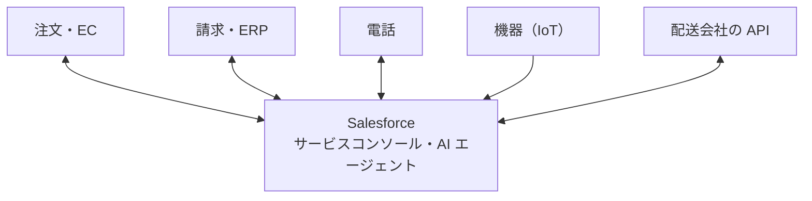
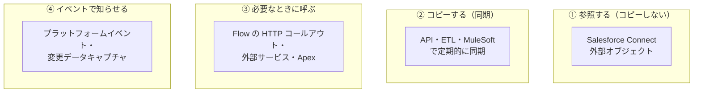
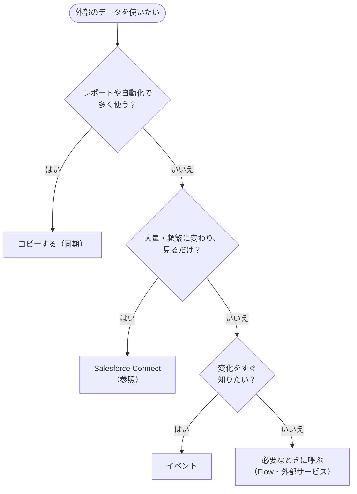

## はじめに：この範囲で学ぶこと

「連携」は配点 10% です。サービスの担当者は、Salesforce の外にある情報（注文、請求、配送、機器の状態）も必要とします。それをどうつなぐかを学びます。

---

## 1. サービスでよくある連携

| 連携先 | 目的 |
|---|---|
| 注文・EC システム | 注文・配送状況を見る、返品を受け付ける |
| 請求・ERP | 請求内容や支払状況を確認する |
| 電話 | 着信時に顧客情報を表示し、通話を記録する |
| 機器（IoT） | 異常を検知して、問題が起きる前に対応する |
| 外部サービス（配送会社など） | 最新の状況を取得する |

なぜ連携が大事なの？

担当者が注文の状況を確認するたびに別のシステムを開き、ログインし、検索していると、お客様を待たせ、**処理時間（AHT）**が長くなります。Salesforce の画面に必要な情報が並んでいれば、すぐに答えられます。AI エージェントにとっても、外部のデータを取得できることが、正しく答えるための前提です。

---

## 2. 連携の方式（どうつなぐか）

### 2-1. 4 つの方式

| 方式 | 特徴 | 向いている場面 |
|---|---|---|
| **① 参照する**（Salesforce Connect） | データを**コピーせず**、外部オブジェクトとして画面に表示。常に最新、容量を使わない | **大量で頻繁に変わる**データを、担当者が**見るだけ** |
| **② コピーする** | Salesforce にデータを持つ。**レポートや自動化**に使える。同期の管理が必要 | レポート・自動化・AI で多く使うデータ |
| **③ 必要なときに呼ぶ** | ボタンや AI のアクションで、その時だけ外部から取得 | 配送状況の確認、与信の照会 |
| **④ イベントで知らせる** | 変化をリアルタイムに伝える | 機器の異常、注文の状況の変化 |

### 2-2. 選び方

具体例

- Universal Containers の担当者は、基幹システムの**数千万件の注文**を見たいが、コピーはしたくない → **Salesforce Connect**
- Cloud Kicks は、請求システムの**未払い金額をケースのレポート**に含めたい → **コピー（同期）**
- サービスエージェントが**配送会社の API**から配送状況を取得して答えたい → 外部 API を呼ぶ **Flow をエージェントのアクション**にする
- 機器から**異常のイベント**が届いたらケースを作りたい → **プラットフォームイベント＋プラットフォームイベントトリガーフロー**

---

## 3. 外部から Salesforce へ

外部システムから Salesforce を更新することもあります。

| 例 | 方法 |
|---|---|
| 注文システムで状況が変わったら、関連するケースを更新 | 外部システムから **Salesforce の REST API** で、**外部 ID** を使って更新（重複を防ぐ） |
| 機器の異常を知らせる | **プラットフォームイベント**を発行 |

---

## 4. 電話との連携

| 方式 | 内容 |
|---|---|
| **Service Cloud Voice** | Amazon Connect などのテレフォニーと統合。文字起こし、AI の推奨、オムニチャネルでの一括管理 |
| **Open CTI** | 既存の CTI ベンダーのソフトフォンを Salesforce に組み込む |

---

## 5. 連携を設計するときの注意

| 注意点 | 内容 |
|---|---|
| **データのマスター** | どのシステムが正しいデータを持つか（どこで更新し、どこへ配信するか）を決める |
| **エラー処理** | 失敗したら**再試行**し、**ログに残して担当者に通知**する |
| 制限 | API の呼び出し回数の上限、性能 |
| **認証情報** | **指定ログイン情報（Named Credential）**で安全に管理する（Flow や項目にパスワードを書かない） |
| 連携の数が多い | **MuleSoft** などの連携基盤で、変換・エラー処理・監視を一元管理する |
| AI エージェントのアクション | 外部データを呼ぶ場合も、**権限**と**エラー時の応答**（「現在確認できません」など）を設計する |

なぜ連携が多いと連携基盤を使うの？

10 個のシステムを 1 対 1 でつなぐと、つなぐ線がどんどん増え、どこかで仕様が変わるたびに多くの連携を直すことになります。連携基盤を真ん中に置けば、**変換・エラー処理・監視を 1 か所で**管理でき、変更にも強くなります。

やってみよう（15 分）

1. 設定 →「指定ログイン情報」を開き、外部の接続先と認証の設定項目を確認する
2. 設定 →「外部データソース」で、Salesforce Connect の接続の種類を確認する（作成は不要）
3. 身近なサービスを例に、「参照・コピー・必要なときに呼ぶ・イベント」のどれが向いている情報かを 1 つずつ書く

---

## 6. まとめ

| テーマ | 覚えること |
|---|---|
| 目的 | 担当者と AI が 1 画面で答えられるようにする（AHT の短縮） |
| 参照 | Salesforce Connect：大量・頻繁に変わる・見るだけ。コピーしない |
| コピー | レポートや自動化で多く使うデータ |
| 呼ぶ | Flow の HTTP コールアウト・外部サービス。AI のアクションにも |
| イベント | プラットフォームイベント（IoT の異常など）→ Flow でケース作成 |
| 外部から | REST API で外部 ID を使って更新 |
| 注意 | マスターを決める、再試行と通知、指定ログイン情報、多数なら連携基盤 |

## 試験直前チェック

- [ ] 連携の 4 つの方式と、それぞれが向いている場面を言える
- [ ] Salesforce Connect が向いている場面を言える
- [ ] レポートで使いたいデータの連携方法を言える
- [ ] IoT の異常からケースを作る仕組みを言える
- [ ] 認証情報を安全に管理する方法を言える
- [ ] 連携を設計するときに決めるべきことを 2 つ言える
