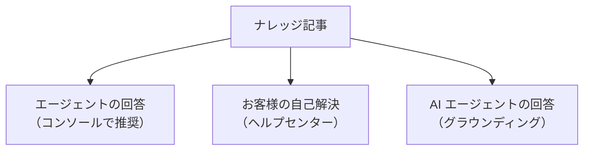
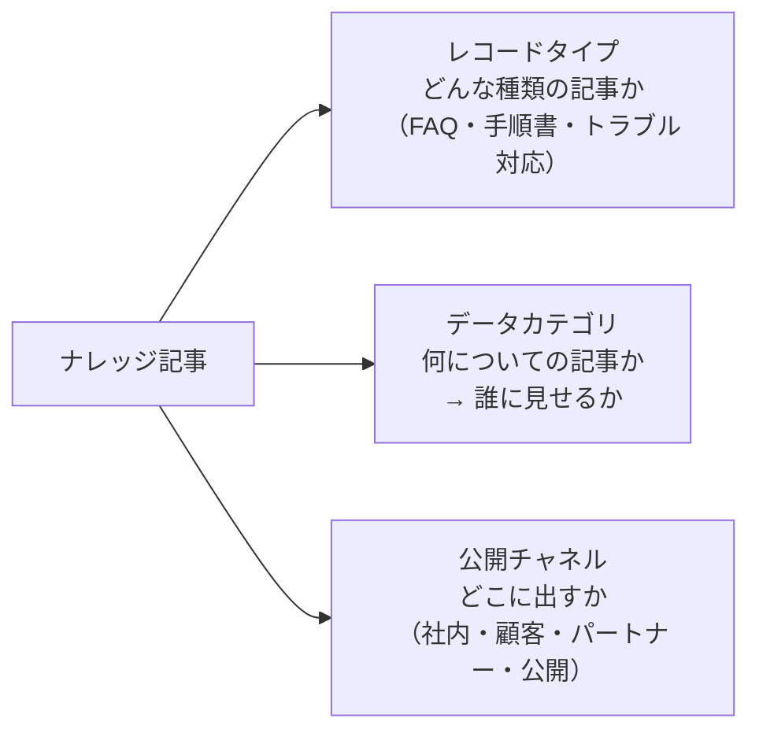
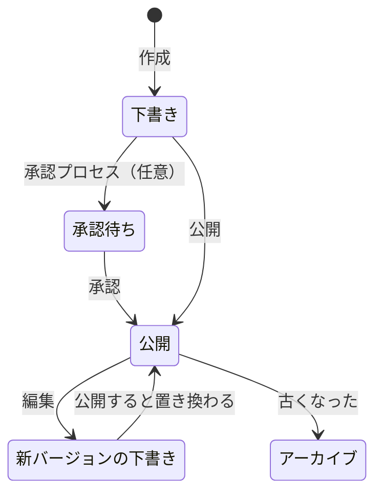
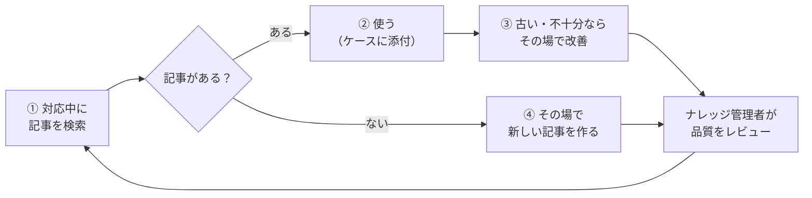

## はじめに：この範囲で学ぶこと

「ナレッジ管理」は配点 12% です。ナレッジは、エージェントの回答、お客様の自己解決、AI エージェントの回答の**すべての土台**です。

なぜナレッジがそんなに大事なの？

同じ質問に、エージェントが毎回自分の記憶で答えていると、**答えがバラバラ**になり、新人は答えられません。正しい答えを記事にして共有すれば、誰でも同じ品質で答えられ、お客様は自分で調べて解決でき、AI エージェントも正しい根拠を使って答えられます。

---

## 1. Lightning ナレッジの構成

### 1-1. 記事の 3 つの設定

| 設定 | 役割 | 例 |
|---|---|---|
| **レコードタイプ** | 記事の種類ごとに項目やレイアウトを変える | FAQ は「質問・回答」、手順書は「手順・注意点」 |
| **データカテゴリ** | 記事を分類し、**ロール・プロファイル・権限セットごとに見せる範囲**を決める | 「製品 A」の記事は製品 A の担当だけに |
| **公開チャネル** | 記事を**どこに表示するか** | 社内アプリだけ／顧客のヘルプセンターにも |

ひっかけ注意：データカテゴリと公開チャネル

- 「社内向けの手順書と顧客向けの FAQ を同じナレッジで管理し、**顧客には FAQ だけ**を見せたい」→ **公開チャネル**
- 「**製品 A の担当には製品 A の記事だけ**を見せたい」→ **データカテゴリ**と表示範囲

「どこに」は公開チャネル、「誰に（分類ごとに）」はデータカテゴリ、と覚えましょう。

### 1-2. 利用者の設定

記事を作成・編集する人には、ユーザーレコードの「**ナレッジユーザー**」と、作成・編集・公開などの**権限**が必要です。

---

## 2. 記事のライフサイクル

| 段階 | ポイント |
|---|---|
| 下書き | 作成・編集中。公開されていない |
| **承認** | 法務・品質のレビューを必須にしたいなら**承認プロセス** |
| 公開 | 指定した公開チャネルに表示される |
| **公開後の編集** | 編集すると**新しいバージョンの下書き**が作られ、**公開中の記事はそのまま表示**され続ける |
| **アーカイブ** | 古い記事を公開から外す。記録としては残る |
| 多言語 | 翻訳を管理し、言語ごとに公開できる |

なぜ編集すると「新しいバージョン」になるの？

公開中の記事を直接書き換えると、編集の途中の中途半端な内容がお客様に見えてしまいます。新しいバージョンの下書きで編集し、完成したら公開して置き換えれば、**お客様は常に完成した記事を見られます**。

---

## 3. 記事を活用する

### 3-1. 使われる場所

| 場所 | 使われ方 |
|---|---|
| **サービスコンソール** | ナレッジコンポーネントが、ケースの件名などから**関連する記事を推奨**する |
| **ケースへの添付** | 解決に使った記事をケースに添付する（どの記事が役立ったかが分かる） |
| **ヘルプセンター**（Experience Cloud） | お客様が検索して自己解決する |
| **AI エージェント** | ナレッジを検索して回答の根拠にする |
| 生成 AI | Service Replies が記事を参考に返信を作る |

### 3-2. 効果を測る

| 指標 | 分かること |
|---|---|
| **ケースへの添付数** | 実際の解決に使われている記事 |
| **記事の評価** | 役に立ったかどうか |
| 閲覧数 | よく見られている記事・見られていない記事 |
| 自己解決率 | ヘルプセンターや AI で解決した割合 |

使われていない記事や評価の低い記事は、見直すか、アーカイブします。

---

## 4. KCS：ナレッジを育てる運用

### 4-1. KCS とは

**KCS（Knowledge-Centered Service）**は、「ナレッジは**対応の中で作り、使いながら改善する**」という考え方です。

なぜ KCS なの？

ナレッジ管理者が年に 1 回まとめて記事を書く方式では、**現場の新しい問い合わせに追いつけません**。一番新しい情報を持っているのは、毎日お客様と話しているエージェントです。エージェントが**日々の対応の中で**記事を作り・直すことで、ナレッジが常に最新に保たれます。

| KCS に合う運用 | KCS に合わない運用 |
|---|---|
| エージェントが対応中に記事を作成・改善する | ナレッジ管理者だけが年に 1 回まとめて作る |
| 記事を使うたびに改善する | エージェントは記事を編集してはいけない |
| 管理者が品質をレビューする | 古い記事を見直さない |

やってみよう（20 分）

1. 設定 →「Lightning ナレッジの設定」でナレッジを有効にし、自分のユーザーに「ナレッジユーザー」を付ける
2. 記事を作成して公開し、もう一度編集して、新しいバージョンの下書きができることを確認する
3. 設定 →「データカテゴリ」でカテゴリグループ（例: 製品）とカテゴリ（製品 A・製品 B）を作る
4. 記事の公開チャネルに何が選べるかを確認する

---

## 5. まとめ

| テーマ | 覚えること |
|---|---|
| 構成 | レコードタイプ＝種類、データカテゴリ＝誰に（分類ごと）、公開チャネル＝どこに |
| 利用者 | ナレッジユーザーと権限が必要 |
| ライフサイクル | 下書き → （承認）→ 公開 → 編集で新バージョン → アーカイブ |
| 活用 | コンソールの推奨、ケースへの添付、ヘルプセンター、AI のグラウンディング |
| 効果 | 添付数・評価・閲覧数・自己解決率 |
| KCS | 対応の中で作り、使いながら改善。管理者は品質をレビュー |

## 試験直前チェック

- [ ] レコードタイプ・データカテゴリ・公開チャネルの役割の違いを言える
- [ ] 記事を作れないときに確認すべき設定を言える
- [ ] 公開済みの記事を編集したときの動きと、その理由を言える
- [ ] 公開前に法務のレビューを必須にする方法を言える
- [ ] 記事の効果を測る方法を言える
- [ ] KCS の考え方と、合う運用・合わない運用を言える
