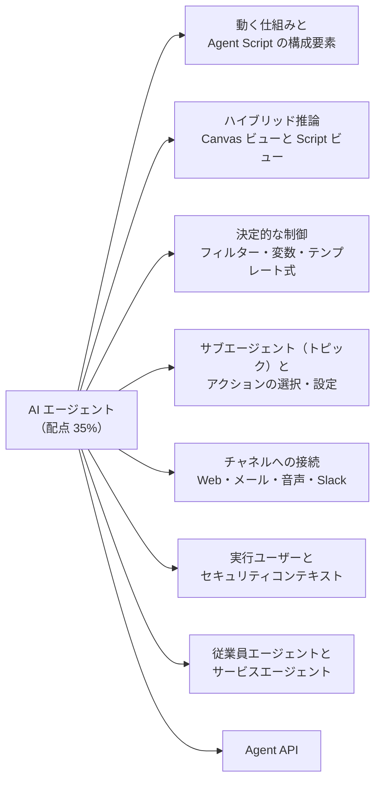
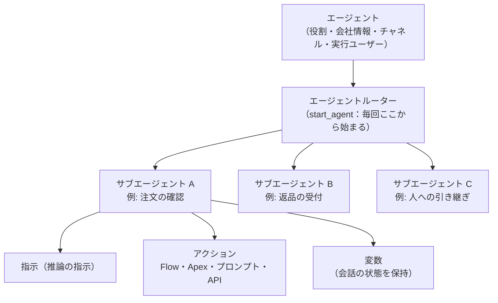
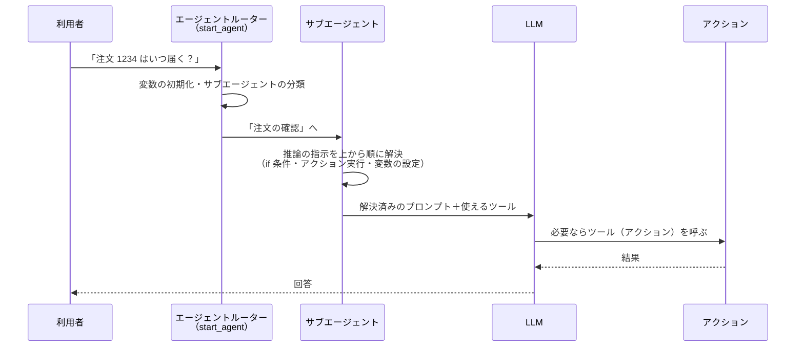
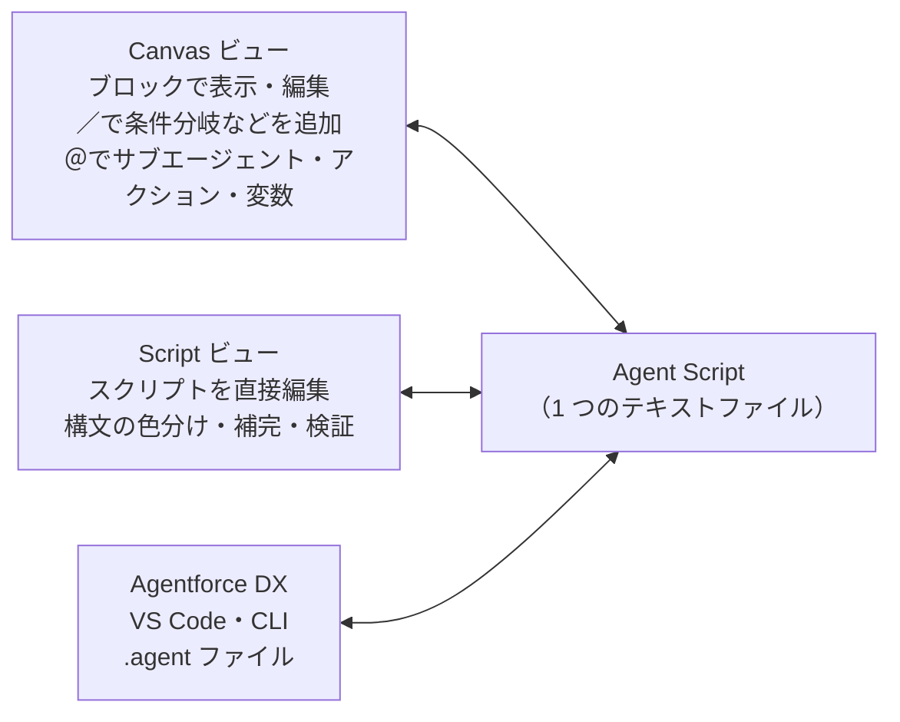
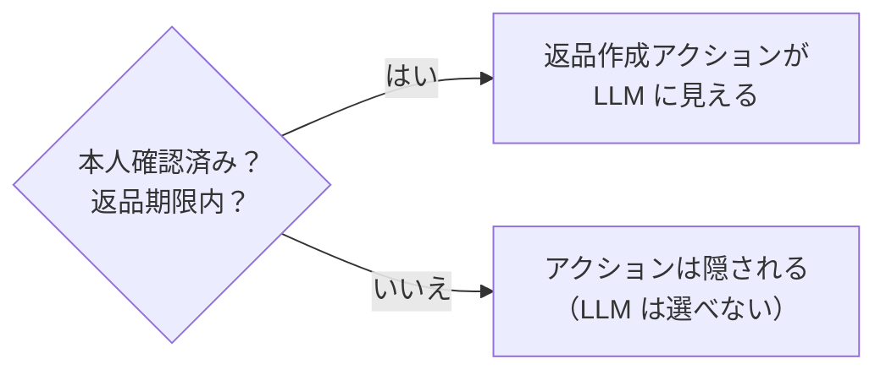
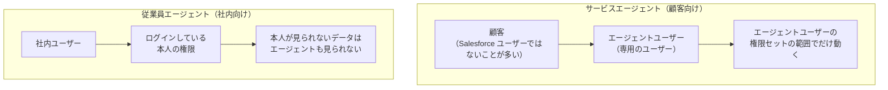

## はじめに：この範囲で学ぶこと

「AI エージェント」は配点 **35%** で、試験の 3 分の 1 以上を占めます。公式の出題目標は次の 8 つです。



<div class="callout tip">
<p class="callout-title">用語の変更：トピック → サブエージェント</p>

2026 年 4 月から、エージェントの「**トピック**」は「**サブエージェント**」と呼ばれるようになりました（機能は同じ）。試験ガイドやヘルプには両方の呼び方が混ざっています。このレッスンでは「サブエージェント（トピック）」と書きます。

</div>

---

## 1. AI エージェントとは

### 1-1. チャットボットとの違い

| | 従来のチャットボット | AI エージェント（Agentforce） |
|---|---|---|
| 会話の進め方 | あらかじめ作った分岐（シナリオ）どおり | 依頼を理解し、使う道具（アクション）を自分で選ぶ |
| 想定外の言い方 | 対応できない | 意味が同じなら理解できる |
| できること | 決まった回答を返す | レコードの照会・更新、Flow や Apex の実行、ナレッジの検索など |
| 作り方 | 分岐を 1 つずつ作る | 役割・指示・アクションを与える。必要な部分だけ決定的に作る |

エージェントは「**依頼を理解する → どの仕事か判断する → 必要な道具を使う → 結果を見て次を決める → 回答する**」を繰り返します。この判断をする仕組みが **推論エンジン（Atlas 推論エンジン）** です。

### 1-2. 構成要素



| 要素 | 役割 |
|---|---|
| **エージェント** | 全体の設定。役割（role）、説明、会社情報、種類（サービス／従業員）、実行ユーザー、チャネル |
| **サブエージェント（トピック）** | 仕事の単位。「どんな依頼を扱うか」の**説明**と、その中での**指示**と**アクション**を持つ |
| **指示（推論の指示）** | サブエージェント内での振る舞い。自然言語の指示と、決定的なロジックを混ぜて書ける |
| **アクション** | 実際の処理。Flow、Apex、プロンプトテンプレート、標準アクション、API、MCP サーバーのツールなど |
| **変数** | 会話の状態（本人確認済みか、注文番号など）を確実に保持する |

---

## 2. 推論の流れ（Flow of Control）

### 2-1. 1 回の発話で何が起きるか



ポイントは次の 3 つです。

1. **すべての発話はエージェントルーター（`start_agent`）から始まる**。ここで変数を初期化し、どのサブエージェントに進むかを分類します。
2. サブエージェントの**推論の指示は上から順に処理**され、条件分岐やアクションの実行、変数の設定が**先に解決**されます。LLM が受け取るのは、条件に合った指示だけが残った「**解決済みのプロンプト**」です。
3. LLM は解決済みのプロンプトと、使ってよい**ツール（推論アクション）**の一覧を見て、回答するかツールを呼ぶかを決めます。

<div class="callout why">
<p class="callout-title">なぜ「先に解決」が大事なのか</p>

たとえば「会員ランクがプラチナならお礼を言う」という条件を、自然言語だけで書くと、LLM が条件を読み違える可能性があります。Agent Script の `if` で書けば、条件の判定は**プログラムとして確実に**行われ、LLM には合った指示だけが渡ります。LLM に判断させない部分を増やすほど、**毎回同じ結果**になりやすく、**応答も速く**なります。

</div>

### 2-2. 遷移（トランジション）

| 方法 | 動き |
|---|---|
| `@utils.transition to` | 別のサブエージェントへ**一方通行**で移る。元のサブエージェントの指示は捨てられ、移った先のサブエージェントが上から読まれる |
| `@subagent.<名前>` を参照 | 別のサブエージェントを**ツールのように呼び出し**、終わったら**元のサブエージェントに戻る** |

遷移を LLM のツールとして公開すれば「いつ移るかを LLM に任せる」こともでき、ロジックの中に書けば「必ず移る」ようにできます。

---

## 3. Agent Script とハイブリッド推論

### 3-1. Agent Script とは

**Agent Script** は、新しい **Agentforce Builder** でエージェントを定義する Salesforce 独自の言語です。**自然言語の指示**（柔軟）と、**プログラムの式**（確実）を 1 つの中に混ぜて書けます。この組み合わせを **ハイブリッド推論** と呼びます。

| 部分 | 書き方 | 誰が判断するか |
|---|---|---|
| ロジックの指示 | `->` の後に書く（`if`、アクションの実行、変数の設定、遷移） | **プログラム**（決定的） |
| プロンプトの指示 | パイプ記号（縦線）の後に書く自然言語 | **LLM**（柔軟） |

### 3-2. 主なブロック

| ブロック | 内容 |
|---|---|
| `system` | 全体の指示と、必須のメッセージ（`welcome`＝あいさつ、`error`＝エラー時） |
| `config` | エージェントの API 名、説明、役割、種類（`AgentforceServiceAgent` / `AgentforceEmployeeAgent`）など |
| `variables` | 変数の宣言 |
| `language` | 対応する言語（ロケール） |
| `start_agent` | **エージェントルーター**。毎回の発話の入口 |
| `subagent` | サブエージェント（トピック）。説明・推論の指示・アクションを持つ |

最低限、`system`・`config`・`start_agent` が必要です。インデント（字下げ）が文法の一部になっている点も特徴です。

### 3-3. 例で読む

```
variables:
    is_verified: mutable boolean = False
        description: "本人確認が済んでいるかどうか"
    order_id: mutable string = ""
        description: "利用者が伝えた注文番号"

subagent Order_Status:
    description: "注文の配送状況や到着予定日を確認する"
    reasoning:
        instructions: ->
            if @variables.is_verified == False:
                transition to @subagent.Verify_Customer
            run @actions.get_delivery_date
                with order_id = @variables.order_id
                set @variables.delivery_date = @outputs.delivery_date
            | 注文 {!@variables.order_id} の到着予定日は {!@variables.delivery_date} だと伝えてください。
            | 遅れている場合は、まずお詫びを伝えてください。
```

（説明用に簡略化した例です。）

- 本人確認が済んでいなければ、**必ず**本人確認のサブエージェントへ移る（LLM の判断に任せない）。
- 到着予定日を取るアクションは、このサブエージェントに来たら**毎回**実行する。
- `{!@variables.order_id}` は **テンプレート式**。変数の値がプロンプトに差し込まれる。
- 伝え方（言い回し、お詫び）は LLM に任せる。

### 3-4. Canvas ビューと Script ビュー



- **Canvas ビュー**: エージェントを作ると最初に開く画面。スクリプトを分かりやすい**ブロック**にまとめて表示し、展開すると中のスクリプトが見えます。`/` で if/else などの定型パターン、`@` でサブエージェント・アクション・変数を追加できます。
- **Script ビュー**: スクリプトを**直接**書く画面。構文の色分け、自動補完、その場での検証があります。
- どちらも**同じエージェント**を編集しているので、自由に行き来できます。
- 開発者は **Agentforce DX**（VS Code 拡張・Salesforce CLI）で、スクリプトを `.agent` ファイル（メタデータ上は `AiAuthoringBundle`）として扱えます。
- Agentforce に**自然言語で頼む**と（「注文額が 1 万円を超えたら送料無料を案内して」など）、サブエージェント・アクション・指示に変換してくれます。

<div class="callout trap">
<p class="callout-title">ひっかけ注意</p>

「Canvas ビューで作ったエージェントは Script ビューで編集できない」は**誤り**です。どちらのビューも同じ Agent Script を編集しています。また、ハイブリッド推論は**新しい Agentforce Builder** の機能で、従来のビルダー（自然言語の指示だけ）にはありません。

</div>

---

## 4. 決定的な動きを作る仕組み

生成 AI は確率的に動くので、「毎回必ずこうしてほしい」部分は仕組みで固定します。

### 4-1. 変数

| 種類 | 特徴 | 例 |
|---|---|---|
| **通常の変数（mutable）** | エージェントが値を変えられる。初期値を決めておくと最初のターンから条件が安定する | `is_verified`、`order_id` |
| **リンク変数（linked）** | 実行時のコンテキスト（セッション情報など）に結び付いた**読み取り専用**の値。初期値は持たず、設定もできない | メッセージングセッション ID、利用者の取引先責任者 ID |

変数を使うと、**LLM の会話の記憶に頼らずに**状態を確実に保持できます。長い会話で LLM が前の情報を取り違える（文脈のずれ）のを防げます。

### 4-2. 条件式（if / else）

- `if`・`else if`・`else` で、**どの指示を LLM に渡すか**、**どのアクションを実行するか**を決めます。
- `and`・`or` を組み合わせるときは、**かっこ**で評価の順番を明確にします。

### 4-3. フィルター（available when）



- `available when` を付けると、**条件を満たすときだけ**、そのサブエージェントやツール（推論アクション）が LLM に見えます。
- 条件を満たさなければ、LLM はそもそも**選べません**。利用者が「返金して」と巧みに頼んでも、条件外なら実行されません。

<div class="callout why">
<p class="callout-title">「指示に書く」だけでは足りない理由</p>

「本人確認前に返金してはいけません」と指示に書くだけだと、利用者の言葉巧みな誘導（プロンプトインジェクション）や、長い会話での推論ミスで守られないことがあります。**業務上重要な制限はフィルターで仕組みとして守る**のが原則です。LLM は「使える状態のツール」なら、指示で触れていなくても呼ぶ可能性がある点も覚えておきましょう。

</div>

### 4-4. テンプレート式

`{!@variables.変数名}` のように書くと、変数の値が**プロンプトに差し込まれます**。`system` ブロックのあいさつで利用者の名前を入れる、指示の中で注文番号を示す、といった使い方をします。

### 4-5. 推論の前後（before_reasoning / after_reasoning）

| ブロック | タイミング | 使い方 |
|---|---|---|
| `before_reasoning` | サブエージェントの処理の最初 | データの事前取得、変数の設定 |
| `after_reasoning` | 推論のループが終わった後、毎回 | 入力された情報を変数に保存、次のサブエージェントへ遷移、後処理のアクション |

`after_reasoning` には `|`（プロンプトの指示）は書けません。また、途中で別のサブエージェントに遷移した場合、元のサブエージェントの `after_reasoning` は実行されません。

### 4-6. アクションの連鎖（action chaining）

- ロジックの中で**アクションを順番に実行**し、前のアクションの出力を次の入力に渡せます。
- ツールとして公開したアクションに、「実行した直後に別のアクションを実行する」設定も付けられます。
- 「注文を検索 → 配送日を計算 → 結果を伝える」のように**順番が決まっている処理**は、LLM に任せず連鎖させるか、1 つの Flow にまとめます。

---

## 5. サブエージェント（トピック）とアクションの設定

### 5-1. サブエージェントを設計する

| 設定 | 書くこと | よい例 |
|---|---|---|
| **名前・説明（分類の説明）** | どんな依頼を扱うか。ルーターが振り分けに使う | 「注文の配送状況・到着予定日・追跡番号に関する問い合わせを扱う」 |
| **範囲（スコープ）** | 何をして、何をしないか | 「注文内容の変更は扱わない」 |
| **指示** | 具体的なルール。1 つの指示に 1 つのルール | 「回答する前に必ず注文番号を確認する」 |
| **アクション** | このサブエージェントで使う処理 | 注文検索、配送日取得 |

- **標準のサブエージェント（トピック）**: テンプレートやエージェントの種類に応じて用意されているもの（一般的な FAQ、人への引き継ぎ、範囲外の依頼への対応など）。そのまま使うか、コピーして調整します。
- **カスタムのサブエージェント**: 自社の業務に合わせて作るもの。
- サブエージェントの説明が**互いに重なる**と、振り分けを誤ります。境界をはっきり書きましょう。

### 5-2. アクションの種類

| 種類 | 中身 | 向いている処理 |
|---|---|---|
| **標準アクション** | Salesforce が用意。ナレッジで回答、レコードの照会・要約、メールの下書きなど | よくある処理をすぐ使う |
| **Flow** | 自動起動フロー（トリガーなし） | 宣言的に作れる業務ロジック、複数ステップ |
| **Apex** | `@InvocableMethod` を付けたメソッド | 複雑な計算、大量データ、外部呼び出し |
| **プロンプトテンプレート** | プロンプトビルダーで作ったテンプレート | 文章の生成・要約・分類 |
| **API・外部サービス** | 外部サービス（OpenAPI）、MuleSoft など | 外部システムの照会・更新 |
| **MCP サーバーのツール** | API カタログに登録した MCP サーバー | 外部の AI ツールやサービスの機能を再利用 |

### 5-3. アクションの設定項目

| 項目 | 意味 | 注意 |
|---|---|---|
| **説明（指示）** | 何をするアクションか | LLM はこの説明を読んで使うかを決める。具体的に書く |
| **入力** | 必要なパラメーターと説明 | 必須で値が決まっていない入力は、LLM が会話から埋めようとする（スロットフィリング） |
| **ユーザーからの入力を必須** | 推測せず、利用者に聞く | 金額・日付など誤ると困る値 |
| **出力** | 結果のどの項目を使うか | 「会話に表示」をオンにすると利用者に見せられる |
| **実行前にユーザーの確認を求める** | 実行の前に「よろしいですか？」と確認 | 更新・削除・送金など取り消しにくい操作 |
| **進捗インジケーター** | 実行中であることを表示 | 時間のかかる処理 |

<div class="callout example">
<p class="callout-title">例：返品受付のサブエージェント</p>

- 説明：「購入した商品の返品・交換の受付を扱う。返金の状況確認は扱わない」
- フィルター：`is_verified == True` かつ `within_return_window == True` のときだけ「返品を作成」アクションが見える
- アクション：「注文を検索」（Flow）→「返品期限を判定」（Apex）→「返品を作成」（Flow、実行前に確認を求める）
- 指示：「返品理由を必ず選択肢から選んでもらう」「交換の在庫がない場合は返金を案内する」

</div>

---

## 6. チャネルへの接続

| チャネル | 主な使い方 | 準備するもの |
|---|---|---|
| **Web・アプリ（拡張チャット／Messaging for In-App and Web）** | Web サイトやモバイルアプリのチャット | メッセージングチャネル、Omni-Channel フロー、埋め込みサービスのリリース |
| **Experience Cloud サイト** | 顧客ポータルやヘルプセンター | サイトに埋め込みサービスを配置 |
| **メール** | 問い合わせメールへの返信 | メールのチャネル設定（Omni-Channel でエージェントへルーティング） |
| **音声** | 電話での応対（Agentforce Voice） | 音声チャネル（Service Cloud Voice など） |
| **Slack** | 社内の従業員向けエージェント | Slack との接続 |
| **その他のメッセージング** | SMS、WhatsApp など | メッセージングチャネル |

- 顧客向けチャネルでは、**Omni-Channel フロー**で会話をエージェントに振り分け、必要なら**人のサービス担当者に引き継ぎ**ます（引き継ぎ先のキューも用意します）。
- 音声チャネルでは、短い文で答える、読み上げに向かない表や URL を避けるなど、**チャネルに合った指示**が必要です。

---

## 7. 実行ユーザーとセキュリティコンテキスト（頻出）

エージェントが「**誰の権限で**」アクションを実行するかは、試験で繰り返し問われます。



| | サービスエージェント | 従業員エージェント |
|---|---|---|
| 実行ユーザー | **エージェントユーザー**（エージェント用の専用ユーザー） | **会話している本人** |
| 権限の付け方 | エージェントユーザーに**最小限**の権限セット | 本人のプロファイル・権限セット・共有がそのまま効く |
| 注意点 | 顧客ごとに見せてよいデータを**本人確認と変数・フィルターで**制御する | 本人にアクセス権がないと、アクションが失敗する |

- アクションで呼ぶ **Flow の実行コンテキスト**（ユーザーコンテキストかシステムコンテキストか）や、**Apex の共有設定**（`with sharing` など）も結果に影響します。システムコンテキストで動く処理は、エージェントユーザーの権限を超えてデータに触れる可能性があるので注意します。
- 「アクションが失敗する」「データが見つからない」問題の多くは、**エージェントユーザーの権限不足**（オブジェクト権限、項目レベルセキュリティ、共有、Apex クラスへのアクセス）が原因です。

<div class="callout trap">
<p class="callout-title">ひっかけ注意</p>

「顧客向けエージェントに管理者の権限を付ければ確実に動く」は誤りです。顧客の操作で、他の顧客の情報まで扱えてしまいます。**最小権限**にして、足りない権限を 1 つずつ足します。

</div>

---

## 8. 従業員エージェントとサービスエージェントの使い分け

| 判断の材料 | 従業員エージェント | サービスエージェント |
|---|---|---|
| 話す相手 | 社内のユーザー（営業、サービス担当者など） | 顧客・見込み客・パートナー |
| 場所 | Lightning Experience の画面、Slack、モバイル | Web チャット、メッセージング、メール、音声、ポータル |
| 典型的な仕事 | レコードの要約、メールの下書き、データの検索・更新、会議の準備 | 注文確認、返品受付、予約、FAQ、本人確認、引き継ぎ |
| 権限 | 本人の権限 | エージェントユーザーの権限 |

<div class="callout example">
<p class="callout-title">判断の練習</p>

- 「営業担当者が、商談の次のアクションを提案してほしい」→ **従業員エージェント**
- 「Web サイトの訪問者が、配送状況を 24 時間確認できるようにしたい」→ **サービスエージェント**
- 「サービス担当者が、ケースの履歴を要約してほしい」→ **従業員エージェント**（話す相手は社内の担当者）

</div>

---

## 9. Agent API

**Agent API** は、エージェントを **REST API** で呼び出す仕組みです。Salesforce の画面やメッセージングを使わずに、どこからでもエージェントと会話できます。

| 使いどころ | 例 |
|---|---|
| 自社のアプリ・サイトに組み込む | 独自の UI を持つモバイルアプリからエージェントを使う |
| 画面を持たない（ヘッドレス）エージェント | バックエンドの処理として、エージェントに判断させる |
| 他のシステムやワークフローから呼ぶ | 外部の業務システムやバッチからエージェントを呼び出す |
| エージェント同士の連携 | 他のエージェントから Agentforce のエージェントを呼ぶ |

**流れ**: セッションを開始 → メッセージを送る（応答を受け取る）→ セッションを終了。

**準備と注意点**

- **外部クライアントアプリケーション**（OAuth のクライアントクレデンシャルフローなど）を作り、アクセストークンを取得します。
- **Agentforce（Default）** という種類のエージェントには使えません。
- 呼び出しには**タイムアウト**（120 秒）があり、利用量に応じて**クレジットを消費**します。
- 既存のチャネル（Web チャットなど）で足りるなら、わざわざ Agent API で作る必要はありません。**標準のチャネルでは実現できない UI や連携**があるときに選びます。

---

## 10. まとめ

| テーマ | 覚えること |
|---|---|
| 構成要素 | エージェント → ルーター → サブエージェント（トピック）→ 指示・アクション・変数 |
| 用語 | 2026 年 4 月からトピックはサブエージェントと呼ぶ |
| 推論の流れ | 毎回 start_agent から。ロジックを先に解決し、解決済みのプロンプトを LLM へ |
| ハイブリッド推論 | `->` はロジック（決定的）、パイプ記号はプロンプト（LLM） |
| ビュー | Canvas＝ブロック、Script＝直接編集、どちらも同じスクリプト |
| 決定的な制御 | 変数、if/else、available when、テンプレート式、before/after_reasoning、遷移 |
| アクション | 説明が選択の決め手。入力必須・確認・出力の表示を設定 |
| 実行ユーザー | サービス＝エージェントユーザー、従業員＝本人 |
| Agent API | REST でどこからでも。外部クライアントアプリ、Default 型は不可 |

## 試験直前チェック

- [ ] エージェントルーター（start_agent）の役割を説明できる
- [ ] 「解決済みのプロンプト」とは何かを説明できる
- [ ] ロジックの指示（`->`）とプロンプトの指示（パイプ記号）の違いを言える
- [ ] Canvas ビューと Script ビューの違いと関係を言える
- [ ] 通常の変数とリンク変数の違いを言える
- [ ] available when を使うべき場面を、指示に書くだけの場合と比べて説明できる
- [ ] `@utils.transition to` と `@subagent` 参照の違いを言える
- [ ] アクションの種類を 5 つ言え、それぞれの向き不向きを言える
- [ ] 「実行前に確認を求める」を設定すべきアクションの例を言える
- [ ] サービスエージェントと従業員エージェントの実行ユーザーの違いを言える
- [ ] Agent API を使う場面と、使えないエージェントの種類を言える
