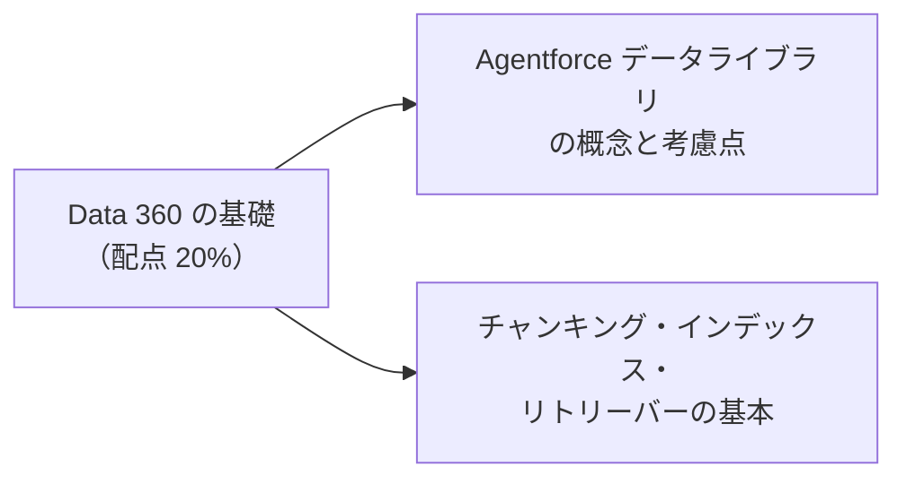
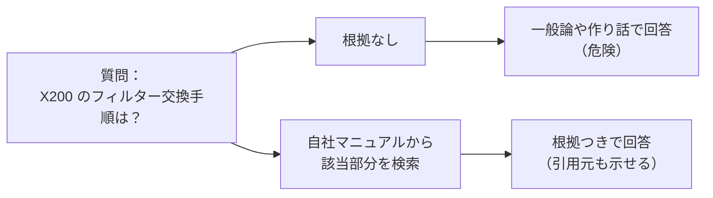
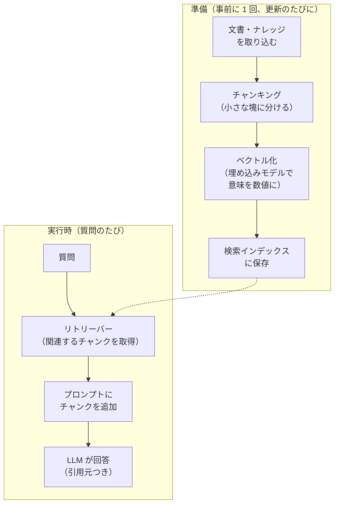
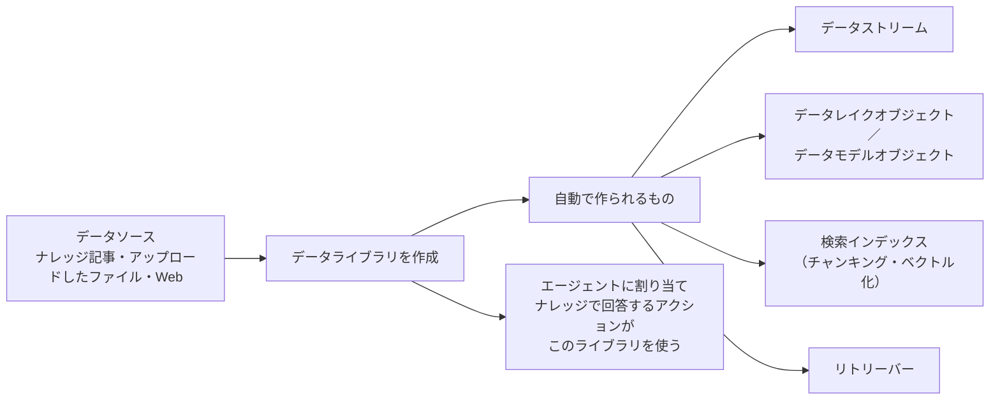
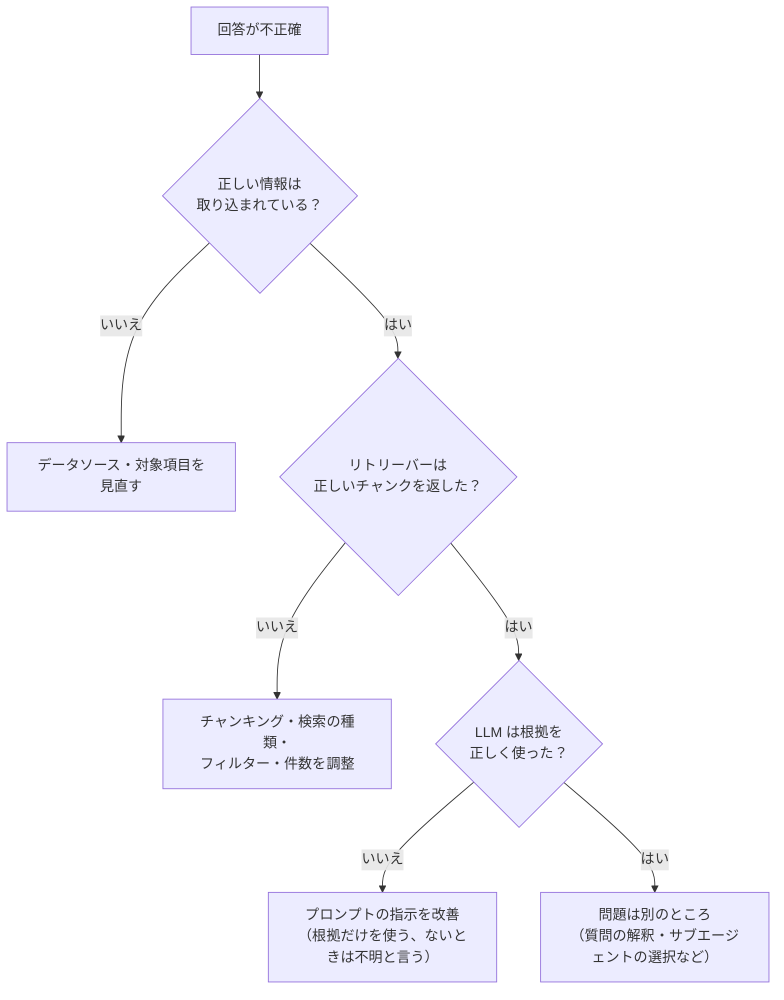

## はじめに：この範囲で学ぶこと

「Data 360 の基礎」は配点 **20%** です。公式の出題目標は 2 つだけですが、どちらも **RAG（検索拡張生成）** の仕組みを理解していないと答えられません。

名前の整理

**Data 360** は、以前の **Data Cloud** の新しい名前です。古い資料では「Data Cloud」と書かれていることがあります。

---

## 1. なぜエージェントに Data 360 が必要か

LLM は一般的な知識は持っていますが、**自社の製品マニュアル、社内規程、最新の FAQ** は知りません。知らないことを聞かれると、もっともらしい作り話（**ハルシネーション**）をすることがあります。

| データの種類 | 例 | エージェントでの使い方 |
|---|---|---|
| **構造化データ** | 取引先、注文、統合プロファイル、計算済みインサイト | 差し込み・アクションの入力・クエリ |
| **非構造化データ** | PDF、ナレッジ記事、Web ページ、通話の文字起こし | **検索して関連部分を取り出し**（RAG）、プロンプトに入れる |

---

## 2. RAG（検索拡張生成）の流れ

**RAG** は、質問に関係する情報を**検索で取り出し**、それを根拠としてプロンプトに入れてから LLM に回答させる方法です。

| 用語 | 意味 |
|---|---|
| **チャンキング** | 長い文書を、検索しやすい小さな塊（**チャンク**）に分けること |
| **ベクトル化（埋め込み）** | 文章の**意味**を数値の並び（ベクトル）に変えること。意味が近い文章はベクトルも近くなる |
| **検索インデックス** | チャンクとベクトルを保存し、速く検索できるようにしたもの |
| **リトリーバー** | 質問を受けて、インデックスから**関連するチャンクを取り出す**部品 |
| **グラウンディング** | 取り出した情報を根拠としてプロンプトに入れること |

---

## 3. チャンキング

### 3-1. なぜ分けるのか

- 文書を丸ごと LLM に渡すと、**長すぎて入らない**、**関係ない部分が多くて精度が下がる**、**コストと時間がかかる**。
- 小さな塊に分けておけば、質問に**関係する部分だけ**を渡せます。

### 3-2. 分け方と大きさ

| 分け方 | 内容 | 向いている文書 |
|---|---|---|
| **一定の長さで分ける** | 決まった文字数（トークン数）ごとに区切る | 構造のない長い文章 |
| **見出し・段落で分ける（セクション単位）** | 文書の構造（見出し、段落）に沿って区切る | マニュアル、ヘルプ記事、ナレッジ記事 |
| **意味で分ける（セマンティック）** | 話題が変わるところで区切る | 話題が混在する文章 |

| チャンクの大きさ | 長所 | 短所 |
|---|---|---|
| **小さい** | ピンポイントで一致しやすい | 前後の文脈が欠けて、答えが不完全になりやすい |
| **大きい** | 文脈が保たれる | 関係ない内容が混ざり、検索の精度とコストが悪化しやすい |

- チャンク同士に**重なり（オーバーラップ）**を持たせると、区切りの境目で情報が切れるのを防げます。
- 表が多い文書、話者が入れ替わる文字起こし、個人情報を含む文書などは、標準の分け方では難しいことがあり、**独自の前処理**を検討します。

---

## 4. 検索インデックス

| 検索の種類 | 仕組み | 得意なこと |
|---|---|---|
| **ベクトル検索** | 質問とチャンクの**意味の近さ**で探す | 言い方が違っても同じ意味のものを見つける（「返金」と「払い戻し」） |
| **キーワード検索** | 単語が**一致**するものを探す | 型番・製品コード・固有名詞 |
| **ハイブリッド検索** | ベクトル検索とキーワード検索を**組み合わせる** | 意味と固有名詞の両方を大事にしたいとき |

インデックスを作るときに決めること：

- **対象**：どのオブジェクト（データモデルオブジェクト）のどの項目を検索対象にするか
- **チャンキングの方法**
- **埋め込みモデル**（ベクトル化に使うモデル）
- **検索の種類**（ベクトル／ハイブリッド）
- 絞り込みに使う**項目**（言語、製品、公開範囲など）

例：型番が大事なサポート

「X200-B のエラー E14」のように型番やエラーコードで質問されることが多いなら、ベクトル検索だけだと似た別の型番を拾うことがあります。**ハイブリッド検索**にして、キーワードの一致も効かせます。

---

## 5. リトリーバー

**リトリーバー**は、検索インデックスに問い合わせて、関連するチャンクを取り出す部品です。

| 設定 | 内容 |
|---|---|
| **対象のインデックス** | どの検索インデックスを使うか（データスペースも指定） |
| **フィルター** | 言語・製品・地域などで結果を絞る（固定値、または実行時の値） |
| **返す件数** | 何件のチャンクを返すか |
| **返す項目** | チャンクのテキスト、引用元（ファイル名・URL・記事）など |

- 検索インデックスを作ると、**既定のリトリーバー**が自動で用意されます。用途に合わせて**カスタムのリトリーバー**を作れます。
- 複数のインデックスをまとめて検索するリトリーバー（アンサンブル）もあります。
- リトリーバーは、**プロンプトテンプレート**のリソースとして挿入したり、エージェントの**アクション**の中で使ったりします。

ひっかけ注意

「回答に古い製品の情報が混ざる」→ 指示を増やすより、**リトリーバーのフィルター**（製品・バージョン）や、**インデックスの対象データ**を見直すのが正解です。「検索結果が少なすぎて答えが不完全」→ 返す件数やチャンクの大きさを調整します。

---

## 6. Agentforce データライブラリ

### 6-1. データライブラリとは

**Agentforce データライブラリ**（ADL）は、エージェントを**自社の文書やナレッジでグラウンディング**するための仕組みを、まとめて自動で作ってくれる機能です。

| データソース | 例 |
|---|---|
| **ナレッジ** | Salesforce ナレッジの記事（どの項目を対象にするか選ぶ） |
| **ファイル** | PDF などの文書をアップロード |
| **Web** | 自社サイトのページ |

### 6-2. 考慮点

| 観点 | 考えること |
|---|---|
| **前提** | Data 360 が使える状態であること（データライブラリは Data 360 の仕組みの上で動く） |
| **処理時間** | 作成すると、データストリーム → オブジェクト → 対応付け → チャンキングの順に処理される。記事やファイルの**数・大きさ・複雑さ**、対象にした**項目の数**で時間が変わる |
| **鮮度** | 元のデータが更新されたときに、インデックスがどう更新されるかを確認する。古い記事が残ると誤回答の原因 |
| **品質** | 重複・矛盾した文書、古い文書を整理してから取り込む |
| **アクセス** | 誰に見せてよい情報かを考える。社外の顧客向けエージェントに、社内向けの文書を混ぜない |
| **コスト** | 取り込み・インデックス・検索は Data 360 の**クレジット**を消費する |
| **引用** | 回答に**引用元**を示せる。利用者が確かめられ、信頼性が上がる |
| **調整** | 自動で作られた設定（チャンキング、リトリーバー）は、あとから調整できる |

データライブラリを使う理由

自分でデータストリーム、データモデル、検索インデックス、リトリーバー、アクションを 1 つずつ作ると手間がかかり、設定ミスも起きます。データライブラリは**一式を既定値で自動作成**するので、すぐに RAG を使い始められます。細かい調整が必要になったら、自動で作られた部品を個別に調整します。

---

## 7. 構造化データでのグラウンディング

文書だけでなく、Data 360 の**構造化データ**もエージェントの回答の質を上げます。

| データ | 使いどころ |
|---|---|
| **統合プロファイル（統合個人）** | 複数のシステムにまたがる顧客情報を 1 人分にまとめたもの。顧客に合わせた回答 |
| **計算済みインサイト** | 生涯価値（LTV）、直近の購入金額など、集計した指標 |
| **データグラフ** | 関連するデータをまとめた形で素早く取得 |
| **外部データ（ゼロコピー）** | データウェアハウスのデータを、コピーせずに参照 |

---

## 8. 精度を上げるための見直し方

---

## 9. まとめ

| テーマ | 覚えること |
|---|---|
| RAG | 取り込み → チャンキング → ベクトル化 → インデックス → 検索 → プロンプトに追加 → 回答 |
| チャンク | 小さい＝的確だが文脈不足、大きい＝文脈ありだがノイズ。重なりで境目を補う |
| 検索 | ベクトル＝意味、キーワード＝一致、ハイブリッド＝両方 |
| リトリーバー | インデックスから関連チャンクを取得。フィルター・件数・返す項目 |
| データライブラリ | ナレッジ・ファイル・Web から、RAG の部品一式を自動作成 |
| 考慮点 | 処理時間、鮮度、品質、アクセス、クレジット、引用 |

## 試験直前チェック

- [ ] RAG の流れを準備と実行時に分けて説明できる
- [ ] チャンキングが必要な理由と、チャンクの大きさのトレードオフを言える
- [ ] ベクトル検索・キーワード検索・ハイブリッド検索の違いを言える
- [ ] リトリーバーで設定できることを 3 つ言える
- [ ] データライブラリが自動で作るものを言える
- [ ] データライブラリの処理時間に影響する要素を言える
- [ ] 回答が不正確なときの見直しの順番を説明できる
