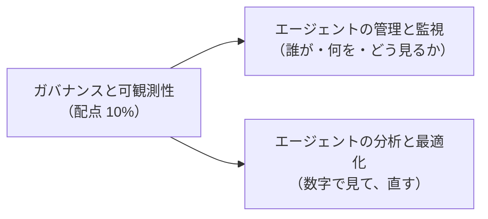
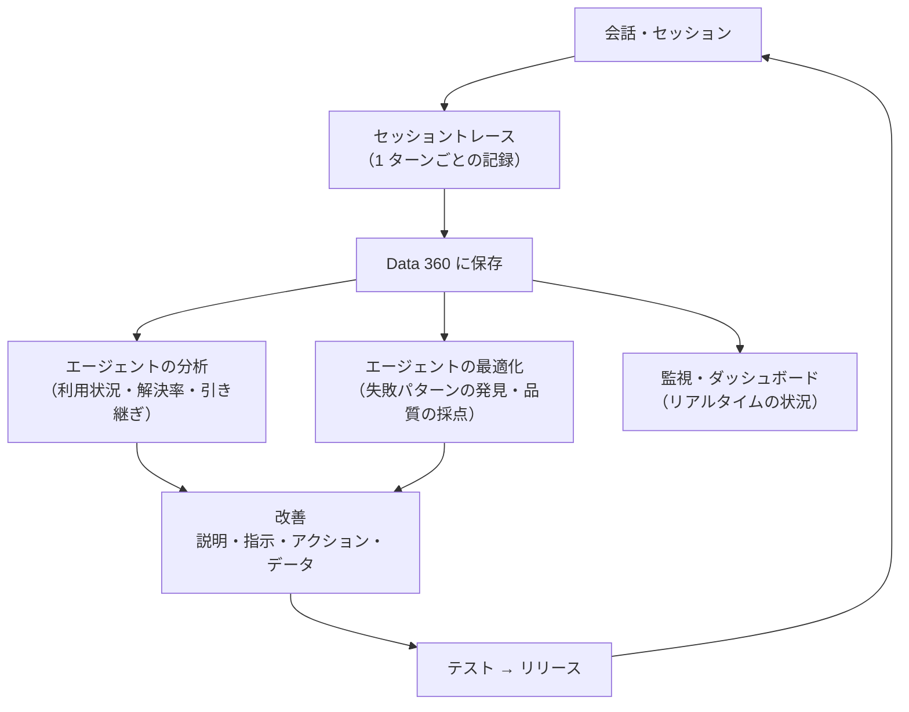
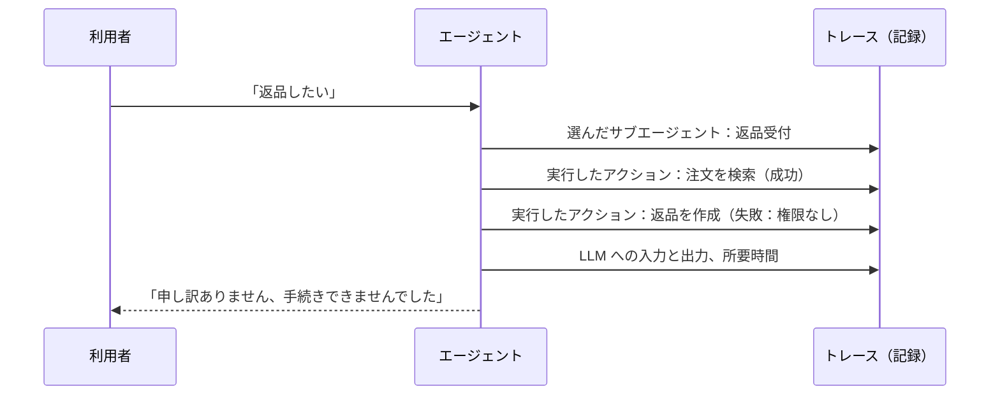
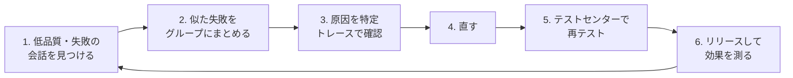

## はじめに：この範囲で学ぶこと

「ガバナンスと可観測性」は配点 **10%** です。エージェントは公開して終わりではなく、**何が起きているかを見て、安全に直し続ける**必要があります。

**可観測性**（オブザーバビリティ）とは、「エージェントが中で何をしたか」を後から追いかけられる状態のことです。

---

## 1. エージェントの可観測性（Agentforce Observability）の全体像

| 仕組み | 役割 |
|---|---|
| **セッショントレース** | 各ターンの入力、選ばれたサブエージェント（トピック）、実行したアクション、LLM の呼び出し、ガードレールのチェック、出力を**構造化されたデータ**として Data 360 に記録 |
| **エージェントの分析**（Agent Analytics） | 利用件数、解決（デフレクション）、離脱、人への引き継ぎ、品質スコアなどを**ダッシュボード**で見る |
| **エージェントの最適化**（Agent Optimization） | セッションや意図ごとに**品質を採点**（LLM による評価）し、うまくいかない会話のパターンと原因を見つける |
| **監視**（コマンドセンター・健全性の監視） | エージェントの状態を**リアルタイム**に把握し、問題があればすぐ対応 |
| **監査とフィードバック** | プロンプト・応答・有害性スコア・利用者の評価（高評価／低評価）を記録 |

記録は「さかのぼれない」

セッショントレースは、**有効にした後の会話から**記録されます。公開してから有効にすると、それ以前の会話は分析できません。**公開前に**トレースとデータモデルを有効にしておきましょう。

---

## 2. エージェントを管理する

### 2-1. 誰が何をできるか（権限）

| 役割 | 必要なもの |
|---|---|
| エージェントを作る・編集する | エージェントを管理する権限（権限セット） |
| プロンプトテンプレートを作る | プロンプトテンプレートマネージャーの権限セット |
| 分析・最適化を見る | 分析・最適化の権限、Data 360 の利用権限など |
| 顧客向けエージェントの実行 | エージェントユーザーに最小限の権限セット |

- 作る人、承認する人、本番に出す人を分け、**誰でも本番のエージェントを変えられる状態**にしないことが大切です。

### 2-2. 変更の管理

| 仕組み | 使い方 |
|---|---|
| **バージョン** | 変更は新しいバージョンで行い、テストしてから有効化。問題があれば前のバージョンに戻す |
| **サンドボックス → 本番** | 本番で直接変えず、サンドボックスで変更・テストしてからリリース |
| **設定変更履歴** | 誰がいつ設定を変えたかを確認 |
| **テストの再実行** | 変更のたびに、テストセンターで同じテストを流して品質が落ちていないか確認 |

### 2-3. 安全に運用するためのガードレール

- **範囲を絞る**：サブエージェントの説明と範囲で、扱わない依頼を明確にする。
- **仕組みで制限する**：重要な操作は、変数とフィルター（available when）で条件を満たすときだけ使えるようにする。
- **確認を挟む**：取り消しにくいアクションは、実行前に利用者の確認を求める。
- **人に引き継ぐ**：高リスク・感情的・判断が難しい依頼は人へ。
- **AI であることを伝える**：利用者に、AI が対応していることを明示する。
- **Einstein Trust Layer**：マスキング、有害性の検出、監査証跡、ゼロデータリテンション。

---

## 3. エージェントを監視する

### 3-1. 見るべき指標

| 指標 | 意味 | 悪いときに疑うこと |
|---|---|---|
| **会話数・利用者数** | どれだけ使われているか | 入口が分かりにくい、チャネルの設定 |
| **解決率（デフレクション・封じ込め）** | 人に引き継がずに解決できた割合 | 必要なアクションやナレッジが足りない |
| **引き継ぎ率（エスカレーション）** | 人に引き継いだ割合 | 範囲が狭すぎる、本人確認で失敗 |
| **離脱率** | 途中で会話をやめた割合 | 回答が遅い、何度も同じ質問をする |
| **アクションの成功・失敗** | アクションがエラーになっていないか | 権限不足、入力の不足、外部システムの障害 |
| **応答時間** | 返事までの時間 | アクションが重い、取得するデータが多すぎる |
| **品質スコア・利用者の評価** | 回答の質、高評価／低評価 | 指示があいまい、根拠のデータが古い |
| **有害性スコア** | 不適切な出力がないか | プロンプトの防御、指示の見直し |
| **消費量（クレジット）** | コスト | 不要な呼び出し、長すぎるプロンプト |

### 3-2. セッショントレースの読み方

この例なら、トレースから「返品を作成」アクションが**権限不足**で失敗していると分かります。エージェントユーザーの権限セットを直せばよい、と原因に直接たどり着けます。

- 新しい Agentforce Builder では、メッセージごとの**推論の要約**と、詳しい**トレース**（スパン、変数の変化、時刻）を見られます。
- Agent Script の設定で、**詳しいイベントログ**を有効にすると、デバッグと監視に使える記録が増えます。
- 外部の監視ツールと連携するための仕組み（OpenTelemetry 形式など）もあります。

---

## 4. エージェントの分析と最適化

### 4-1. 分析（何が起きているかを数字で見る）

- ダッシュボードで、**どのサブエージェント（トピック）がよく使われているか**、**どこで引き継ぎや離脱が多いか**を見ます。
- 期間やチャネルで比べ、変更の効果を確かめます（変更前後の解決率など）。

### 4-2. 最適化（なぜうまくいかないかを見つけて直す）

| よくある原因 | 直し方 |
|---|---|
| 違うサブエージェントが選ばれる | サブエージェントの**説明**を具体的にし、重なりをなくす |
| 必要なアクションが呼ばれない | アクションの**説明**と入力の説明を改善、または決定的に実行する |
| 間違った情報を答える | **根拠のデータ**（ナレッジ、データライブラリ）を更新、リトリーバーを調整 |
| 指示を守らない | 重要なルールは**フィルター・条件式**で仕組みにする |
| 対応できない依頼が多い | 新しいサブエージェントやアクションを追加、または引き継ぎを明確に |
| アクションがエラー | 権限、入力、外部システムを確認 |

- 最適化の機能は、会話（セッション）や意図ごとに **LLM を使って品質を採点**し、問題のある会話を見つけやすくします。
- 見つけた失敗の会話は、**テストケースに追加**して回帰テストに使います。

改善の例

分析で「配送の問い合わせの 40% が人に引き継がれている」と分かった。トレースを見ると、海外発送の注文で「配送日を取得」アクションがエラーになっていた。→ 海外発送に対応するよう Flow を直し、海外の注文番号のテストケースを追加して再テスト → リリース後に引き継ぎ率が下がったことを分析で確認。

---

## 5. まとめ

| テーマ | 覚えること |
|---|---|
| 可観測性 | セッショントレースで、各ターンの選択・アクション・LLM 呼び出しを Data 360 に記録 |
| 注意 | トレースは有効にした後からしか記録されない → 公開前に有効化 |
| 管理 | 権限を分ける、バージョン、サンドボックスでテスト、設定変更履歴 |
| ガードレール | 範囲、フィルター、確認、引き継ぎ、AI の明示、Trust Layer |
| 指標 | 解決率、引き継ぎ率、離脱率、アクションの失敗、応答時間、品質、消費量 |
| 最適化 | 見つける → まとめる → 原因 → 直す → 再テスト → 効果を測る |

## 試験直前チェック

- [ ] セッショントレースに記録される内容を 4 つ言える
- [ ] トレースを公開前に有効にすべき理由を言える
- [ ] エージェントの分析と最適化の違いを言える
- [ ] 解決率・引き継ぎ率が悪いときに疑うことを言える
- [ ] 「違うサブエージェントが選ばれる」ときの直し方を言える
- [ ] エージェントの変更を安全に行う手順を説明できる
