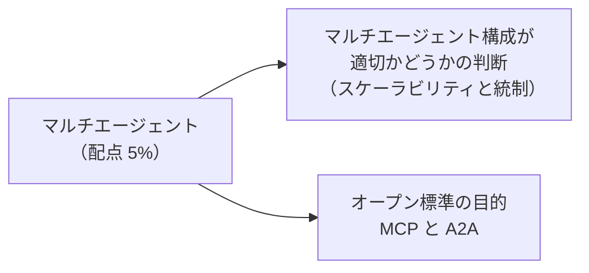
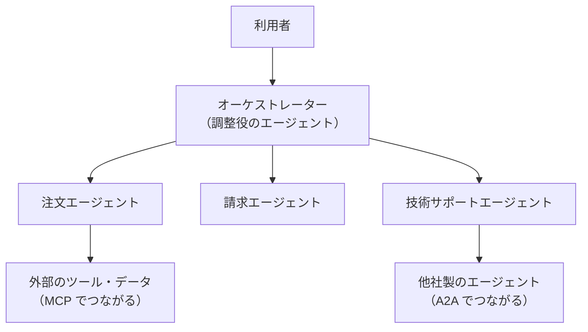
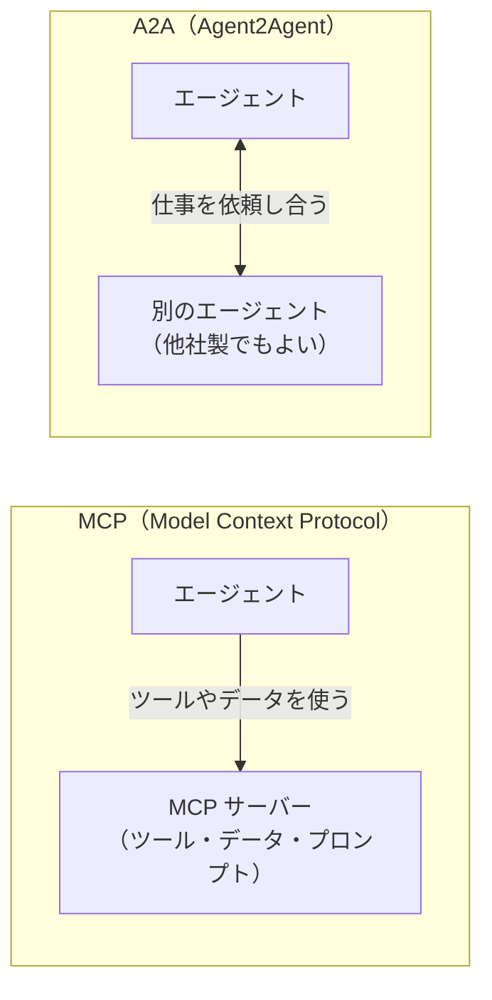

## はじめに：この範囲で学ぶこと

「マルチエージェントのオーケストレーション」は配点 **5%** と小さい範囲ですが、新しく加わった内容なので、用語の意味を確実に押さえましょう。

---

## 1. マルチエージェントとは

**マルチエージェント**は、1 つの大きなエージェントにすべてを任せるのではなく、**役割ごとに専門のエージェントを分け**、それらを**調整役（オーケストレーター）**がつなぐ構成です。

| 用語 | 意味 |
|---|---|
| **オーケストレーター** | 依頼を受け、どの専門エージェントに任せるかを決め、結果をまとめる |
| **専門エージェント** | 1 つの領域（注文、請求など）に集中したエージェント |
| **引き継ぎ（ハンドオフ）** | エージェント間で、会話の文脈や状態（本人確認済みなど）を渡すこと |

---

## 2. マルチエージェントにすべきかの判断

### 2-1. 1 つのエージェントで困ること

- サブエージェント（トピック）やアクションが増えすぎると、**選択を誤りやすく**なり、応答も遅くなる。
- 担当部署がバラバラなのに 1 つのエージェントを共有すると、**変更の影響範囲**が大きく、テストも大変。
- 領域ごとに**必要な権限**が違うのに、1 つの実行ユーザーにすべての権限を持たせることになる。

### 2-2. 判断の表

| 状況 | おすすめ | 理由 |
|---|---|---|
| 扱う業務が少なく、1 つのチームが管理する | **1 つのエージェント** | シンプルで、テストと運用が楽 |
| 業務領域が多く、サブエージェントの選択ミスが増えてきた | **マルチエージェント** | 各エージェントの範囲が狭くなり、選択の精度が上がる |
| 領域ごとに担当チーム・リリースの周期が違う | **マルチエージェント** | チームごとに独立して変更・テストできる（統制） |
| 領域ごとに必要な権限やデータが大きく違う | **マルチエージェント** | 各エージェントの権限を最小限にできる |
| 他社製品・他部門のエージェントと連携したい | **マルチエージェント（A2A など）** | 標準の方法でエージェント同士をつなげる |
| 処理の順番が厳密に決まっている 1 本の手続き | **1 つのエージェント＋決定的なロジック** | エージェントを分けると引き継ぎが増え、かえって複雑 |

「スケーラビリティ」と「統制」

- **スケーラビリティ**：業務が増えても、エージェントを足していけば精度と性能を保ちやすい。
- **統制（コントロール）**：エージェントごとに担当・権限・変更の管理を分けられる。どのエージェントが何をしたかも追いやすい。

ただし、エージェントが増えるほど**引き継ぎの設計と全体の監視**が重要になります。分ければよい、というわけではありません。

### 2-3. 設計のポイント

| ポイント | 内容 |
|---|---|
| 役割を明確に分ける | 各エージェントの担当範囲が重ならないようにする |
| 引き継ぐ情報を決める | 会話の要約、本人確認の状態、注文番号などを確実に渡す |
| 権限は最小限 | 各エージェントの実行ユーザーには、その領域に必要な権限だけ |
| 失敗時の流れ | どのエージェントも対応できないときの、人への引き継ぎ |
| 全体の可観測性 | どのエージェントが何をしたかを、まとめて追跡できるようにする |

---

## 3. オープン標準：MCP と A2A

### 3-1. 2 つの標準の違い

| | MCP | A2A |
|---|---|---|
| 正式名 | Model Context Protocol | Agent2Agent プロトコル |
| つなぐ相手 | **ツール・データ**（外部サービスの機能） | **他のエージェント** |
| 目的 | AI アプリが、外部のシステムやデータに**共通の方法**で安全にアクセスする | 異なるベンダー・基盤で作られたエージェント同士が、**仕事を依頼し合い、協力する** |
| たとえ | エージェントが使う**道具箱の共通規格** | エージェント同士の**共通の言葉** |
| Salesforce での例 | MCP サーバーを登録し、そのツールを**エージェントのアクション**として使う。Salesforce の機能を外部の AI アプリから使うための MCP サーバーもある | Agentforce のエージェントと、他社のエージェントが協力して 1 つの依頼を処理する |

覚え方

- **MCP＝エージェントと道具**（Model の Context＝外の情報や機能をモデルに渡す）
- **A2A＝エージェントとエージェント**（Agent to Agent）

### 3-2. なぜオープン標準が必要か

- 標準がないと、外部のツールやエージェントとつなぐたびに**個別の連携**を作る必要があり、手間とコストがかかる。
- 標準があれば、**一度対応すれば多くの相手とつながる**。ベンダーに縛られにくくなる。
- 認証やアクセス制御の考え方を共通化でき、**安全に**つなぎやすくなる。

### 3-3. 関連する Salesforce の仕組み

| 仕組み | 役割 |
|---|---|
| **Agent API** | 外部のアプリや他のエージェントから、Agentforce のエージェントを REST で呼び出す |
| **MCP サーバーの登録** | 外部の MCP サーバーを登録し、そのツールをエージェントのアクションとして使う |
| **サブエージェントの呼び出し** | 1 つのエージェントの中で、別のサブエージェントに処理を任せて戻ってくる |

ひっかけ注意

「外部の在庫システムの機能をエージェントの道具として使いたい」→ **MCP**。「他社の物流会社のエージェントと協力して配送を手配したい」→ **A2A**。逆に覚えないようにしましょう。

---

## 4. まとめ

| テーマ | 覚えること |
|---|---|
| マルチエージェント | 役割ごとに専門エージェント、オーケストレーターが調整 |
| 向いている場面 | 業務が多い、チームや権限が分かれる、外部のエージェントと連携 |
| 向いていない場面 | 小さな業務、順番が厳密な 1 本の手続き |
| 設計 | 範囲の重なりをなくす、引き継ぐ情報、最小権限、失敗時、全体の監視 |
| MCP | エージェント ↔ ツール・データ |
| A2A | エージェント ↔ エージェント |

## 試験直前チェック

- [ ] マルチエージェントにするメリットを、スケーラビリティと統制の観点で言える
- [ ] 1 つのエージェントのままのほうがよい場面を言える
- [ ] オーケストレーターの役割を言える
- [ ] MCP と A2A の違いを、例を挙げて説明できる
- [ ] オープン標準を使う理由を言える
