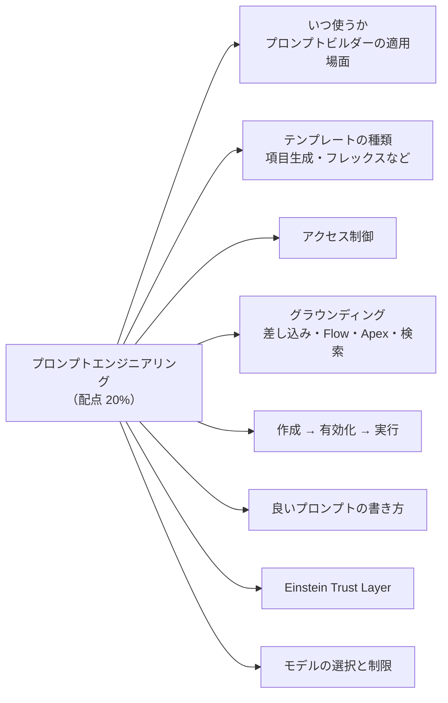
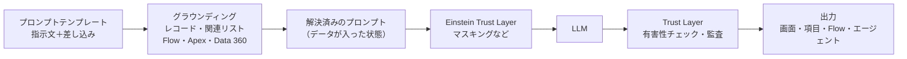
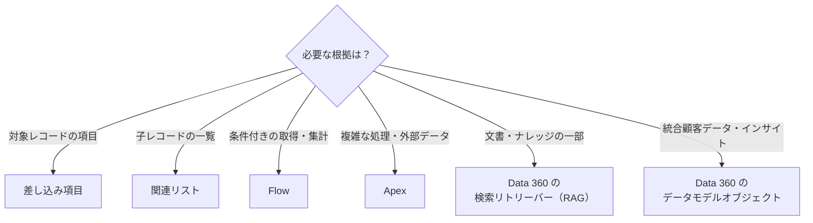
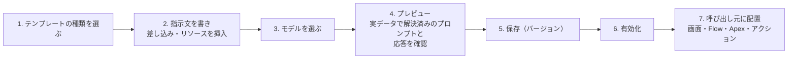
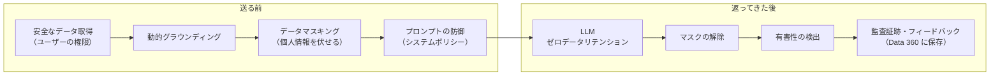

## はじめに：この範囲で学ぶこと

「プロンプトエンジニアリング」は配点 **20%** です。中心になるのは **プロンプトビルダー**（Prompt Builder）です。

---

## 1. プロンプトビルダーとは

**プロンプトビルダー** は、生成 AI への指示（プロンプト）を **テンプレート** として作り、Salesforce のデータを差し込んで、画面・Flow・Apex・エージェントから**繰り返し使える**ようにするツールです。

### 1-1. プロンプトビルダーを使うべき場面

| 要件 | プロンプトビルダーが向いているか | 理由 |
|---|---|---|
| 商談の情報から、毎回同じ形式で顧客向けメールの下書きを作りたい | 向いている | 同じ指示を繰り返し、データだけ差し替える |
| ケースの説明から、要約を項目に保存したい | 向いている | 項目生成テンプレートで画面から生成・編集できる |
| Flow の中で、問い合わせ内容を分類したい | 向いている | フレックステンプレートを Flow から呼ぶ |
| 利用者と何往復も会話しながら、必要なら注文を更新したい | エージェントが向いている | 会話の流れと複数のアクションの選択が必要 |
| 条件が決まった計算（税額の計算など） | 向いていない | 生成 AI ではなく数式・Flow・Apex で確実に計算する |

判断のコツ

「**決まった目的の文章を、データに合わせて毎回作る**」ならプロンプトビルダー。「**会話しながら、状況に応じて行動を選ぶ**」ならエージェント。プロンプトテンプレートは、エージェントの**アクション**としても使えます。

---

## 2. テンプレートの種類

| 種類 | 使う場所 | 入力 | 例 |
|---|---|---|---|
| **営業メール** | メール作成画面（メールの下書き） | 受信者（取引先責任者・リード）と関連レコード | 商談の状況を踏まえたフォローメール |
| **項目生成** | レコードページの項目（Dynamic Forms の項目の横のボタン） | 対象オブジェクトのレコード | 商談の「次のステップの要約」項目、ケースの要約項目 |
| **レコードの要約** | レコードの要約（エージェントなどからの要約） | 対象オブジェクトのレコード | 取引先の概要 |
| **フレックス** | Flow・Apex・エージェントのアクション・API | 自由に定義した複数の入力（オブジェクトやテキスト） | 問い合わせの分類、複数レコードを組み合わせた提案文 |

### 2-1. 種類ごとの考慮点

- **項目生成**
  - テンプレートは**特定のオブジェクトの特定の項目**に結び付けます。
  - Lightning アプリケーションビルダーで、ページの **Dynamic Forms** の項目にテンプレートを割り当てます。利用者が項目横のボタンを押すと生成され、**内容を確認・編集してから保存**します。
  - 保存先は長いテキストなどの**テキスト項目**です。
- **フレックス**
  - 入力の種類と数を**自由に定義**できる、もっとも汎用的な型です。
  - 画面のボタンからではなく、**Flow・Apex・エージェントのアクション**から呼び出すのが基本です。
- **営業メール**
  - メール作成の画面で使い、生成された下書きを担当者が編集して送ります。

ひっかけ注意

「Flow から呼び出して、いくつかのレコードの情報を組み合わせた文章を作りたい」→ **フレックス**。「レコードページの特定の項目に AI で値を入れたい」→ **項目生成**。項目生成テンプレートは、任意の場所から自由な入力で呼ぶ用途には向きません。

---

## 3. アクセス制御

| 何を制御するか | 仕組み |
|---|---|
| テンプレートを**作成・編集**できる人 | 「**プロンプトテンプレートマネージャー**」の権限セット |
| テンプレートを**実行**できる人 | 「**プロンプトテンプレートユーザー**」の権限セット（または必要な権限） |
| 差し込まれる**データ** | 実行するユーザーの**オブジェクト権限・項目レベルセキュリティ・共有**が適用される |
| 画面での表示 | Lightning ページへの配置、項目の表示設定 |
| エージェントから使う場合 | アクションを実行するユーザー（サービスエージェントならエージェントユーザー）の権限 |

データの取得は「実行するユーザーの権限」

テンプレートが参照するデータは、**実行するユーザーが見られる範囲**だけが差し込まれます。これは Trust Layer の「**安全なデータ取得**」の考え方です。ユーザーが見られない項目は、プロンプトにも入りません。逆に、Flow や Apex をシステムコンテキストで動かしてデータを渡すと、ユーザーの権限を超えたデータが入る可能性があるので注意します。

---

## 4. グラウンディング（根拠のデータを渡す）

**グラウンディング**は、LLM に「答えの根拠となる自社のデータ」を渡すことです。具体的で正確な出力になり、**ハルシネーション**（もっともらしい誤り）を減らせます。

| 手法 | 使いどころ | 例 |
|---|---|---|
| **差し込み項目（レコードの項目）** | 対象レコードの項目をそのまま使う | 取引先名、商談のフェーズ |
| **関連リスト** | 関連する子レコードの一覧を使う | 商談の商品、ケースのメール |
| **Flow（テンプレートトリガーのプロンプトフロー）** | 条件付きの取得、複数オブジェクトの集計、整形が必要 | 「過去 90 日の未解決ケースだけ」を要約用に整える |
| **Apex** | Flow では難しい処理、外部データの取得 | 外部の在庫システムから在庫数を取る |
| **Data 360（構造化データ）** | 統合プロファイル、計算済みインサイト | 顧客の生涯価値（LTV）、購入履歴 |
| **Data 360 の検索（リトリーバー）** | 文書・ナレッジなど**非構造化データ**から関連部分を探す（RAG） | 製品マニュアルから該当する手順を探す |

選び方のコツ

- **簡単なものから**選ぶ：差し込み項目 → 関連リスト → Flow → Apex。宣言的に済むなら Apex は使わない。
- 「マニュアルや FAQ の**中身**に基づいて答えたい」→ **検索（RAG）**。
- 必要なデータだけを渡す。関係ない大量のデータは、精度を下げ、コストと応答時間を増やす。

---

## 5. 作成 → 有効化 → 実行

| 手順 | ポイント |
|---|---|
| 作成 | 種類によって、対象オブジェクトや入力の定義が決まる |
| プレビュー | 実際のレコードを選んで、**解決済みのプロンプト**（データが差し込まれた状態）と**応答**を確認する |
| バージョン | 変更はバージョンとして保存。**有効にできるのは 1 つのバージョン**。前のバージョンに戻すこともできる |
| 有効化 | 有効化したテンプレートだけが呼び出し元で使える |
| 実行 | 項目生成はレコードページのボタン、営業メールはメール作成画面、フレックスは Flow・Apex・エージェントのアクション、API からも呼べる |

やってみよう（20 分）

1. 設定 →「プロンプトビルダー」→ 新規 →「項目生成」、オブジェクト「商談」、項目に長いテキスト項目（例：AI 要約）を選ぶ
2. 指示文に「あなたは営業マネージャーです。次の商談の状況を 3 行で要約してください」と書き、商談名・フェーズ・完了予定日・説明を差し込む
3. 商談レコードを選んでプレビューし、解決済みのプロンプトと応答を見比べる
4. 保存して有効化し、Lightning アプリケーションビルダーで商談ページの Dynamic Forms の項目に割り当てる
5. 商談を開き、項目横のボタンで生成 → 内容を直してから保存する

---

## 6. 良いプロンプトの書き方

| 要素 | 書くこと | 例 |
|---|---|---|
| **役割** | 誰として書くか | 「あなたは丁寧なカスタマーサポート担当者です」 |
| **タスク** | 何をしてほしいか（1 つに絞る） | 「次のケースの経緯を要約してください」 |
| **文脈（データ）** | 根拠となる情報 | 差し込み項目、関連リスト、検索結果 |
| **形式** | 出力の形 | 「箇条書き 3 点、各 40 文字以内」 |
| **トーン** | 言葉づかい | 「敬語で、専門用語を避ける」 |
| **制約・ガードレール** | してはいけないこと | 「データにないことは推測せず『不明』と書く」「価格を約束しない」 |
| **例（few-shot）** | 望む出力の見本 | 良い要約の例を 1 つ示す |

- **具体的に、短く、はっきり**書く。あいまいな言葉（「いい感じに」）は避ける。
- データの区切りを明確にする（「以下はケースの情報です」の後にデータを置く）。
- 1 つのテンプレートに目的を詰め込みすぎない。目的ごとにテンプレートを分ける。
- **いろいろなレコードでプレビュー**し、データが空の場合・長い場合でも破綻しないか確かめる。

改善の例

- 改善前：「このケースについて何か書いて」
- 改善後：「あなたはサポートのリーダーです。以下のケースの情報だけを使い、①問題、②これまでの対応、③次にやること、を各 1 文で書いてください。情報が足りない項目は『情報なし』と書いてください。」

---

## 7. Einstein Trust Layer

プロンプトが LLM に送られる前と、応答が返ってきた後で、データと利用者を守る仕組みです。

| 機能 | 内容 |
|---|---|
| **安全なデータ取得** | ユーザーの権限の範囲でだけデータを取得 |
| **動的グラウンディング** | 信頼できる自社のデータで根拠を与える |
| **データマスキング** | 氏名・電話番号・カード番号などを LLM に送る前に伏せ、戻ってきたら元に戻す |
| **プロンプトの防御** | システムポリシーで、ハルシネーションや不適切な出力、プロンプトインジェクションを抑える |
| **ゼロデータリテンション** | 外部の LLM プロバイダーが、プロンプトや応答を**保存も学習もしない**契約 |
| **有害性の検出** | 応答の有害性（差別・暴力など）をスコア化 |
| **監査証跡** | プロンプト・応答・スコア・フィードバックを記録し、後から確認できる |

ひっかけ注意

「ゼロデータリテンションがあるので、どんなデータでもプロンプトに入れてよい」は誤り。必要なデータに絞り、マスキングや権限で守るのが基本です。また、Trust Layer は**出力の正しさを保証するものではない**ので、外部に出す文章は人が確認する運用も大切です。

---

## 8. モデルの選択と制限

| やりたいこと | 方法 |
|---|---|
| テンプレートごとにモデルを選ぶ | プロンプトビルダーのテンプレート設定で、使うモデルを選ぶ |
| Salesforce が用意したモデルを使う | **Salesforce が管理するモデル**（OpenAI、Azure OpenAI、Anthropic、Google Gemini など） |
| 自社で契約した LLM を使う | **BYOLLM**（独自の LLM を接続）。Einstein Studio（Model Builder）で接続し、設定済みモデルとして使う |
| 温度などのパラメーターを調整する | Einstein Studio で**設定済みモデル**を作る（同じ基盤モデルで設定違いを用意できる） |
| 特定のプロバイダーのモデルを使わせない | Einstein の生成 AI 設定で、**プロバイダーごとにモデルを無効化**する（例：OpenAI のモデルへのアクセスを止める） |
| 公開前の新しいモデル | ベータのモデルを使うかどうかも設定で制御 |

モデルを制限する理由

規制や社内ポリシーで「データを特定の地域・特定のプロバイダーでしか処理させない」と決まっている会社があります。その場合、使ってはいけないプロバイダーのモデルを**組織の設定で無効化**し、テンプレートで選べないようにします。

---

## 9. まとめ

| テーマ | 覚えること |
|---|---|
| 使う場面 | 決まった目的の文章をデータに合わせて作る → プロンプトビルダー |
| 種類 | 営業メール、項目生成、レコードの要約、フレックス |
| アクセス | マネージャー（作る）とユーザー（使う）の権限セット。データはユーザーの権限で取得 |
| グラウンディング | 差し込み → 関連リスト → Flow → Apex、文書は検索（RAG）、統合データは Data 360 |
| 手順 | 作成 → プレビュー → 保存 → 有効化（1 バージョン）→ 配置 |
| 良いプロンプト | 役割・タスク・文脈・形式・トーン・制約・例 |
| Trust Layer | 安全な取得、マスキング、防御、ゼロデータリテンション、有害性、監査 |
| モデル | テンプレートごとに選ぶ、BYOLLM、設定済みモデル、プロバイダーごとに無効化 |

## 試験直前チェック

- [ ] プロンプトビルダーとエージェントの使い分けを説明できる
- [ ] 4 つのテンプレートの種類と、それぞれの呼び出し場所を言える
- [ ] 項目生成テンプレートを画面に出すまでの手順を言える
- [ ] テンプレートの作成と実行に必要な権限を言える
- [ ] グラウンディングの手法を 5 つ言え、使い分けを説明できる
- [ ] 解決済みのプロンプトをどこで確認できるか言える
- [ ] 良いプロンプトの要素を 5 つ言える
- [ ] Einstein Trust Layer の機能を、送る前・返ってきた後に分けて言える
- [ ] 特定のモデルを使わせないための設定を説明できる
