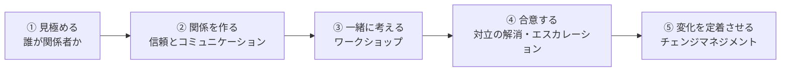
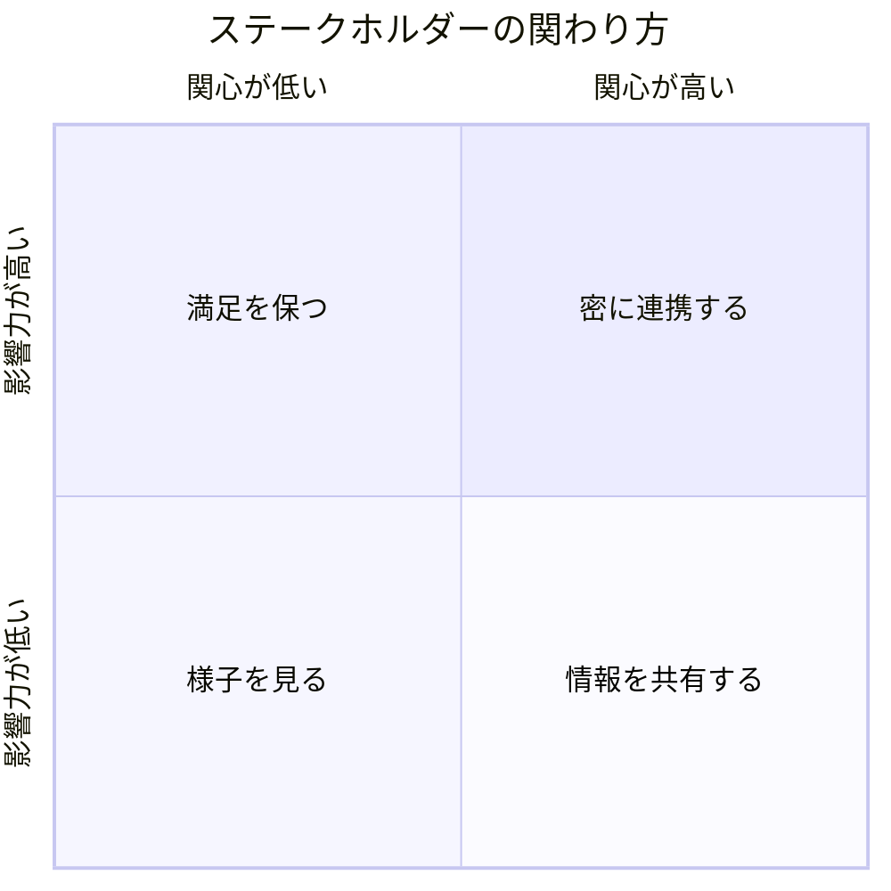
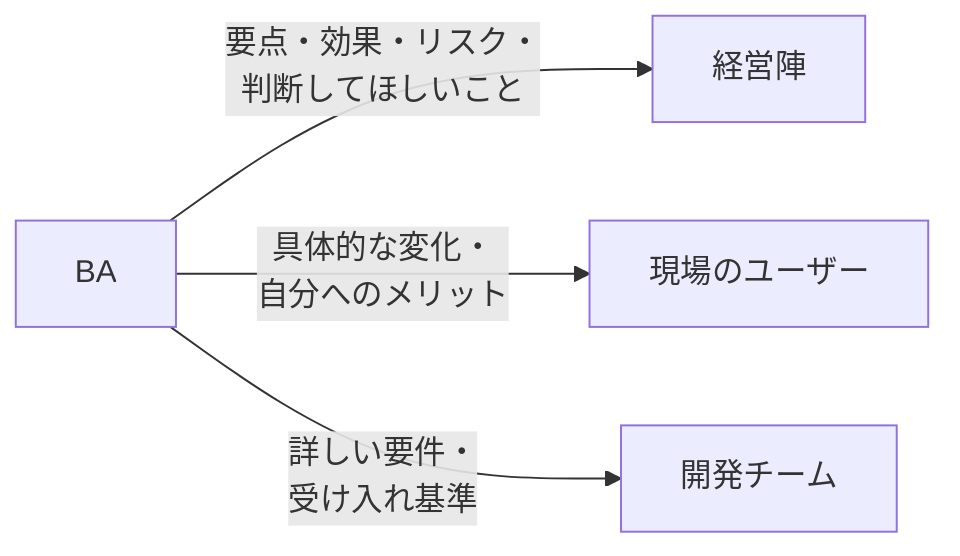
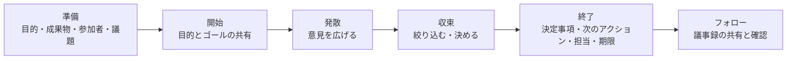
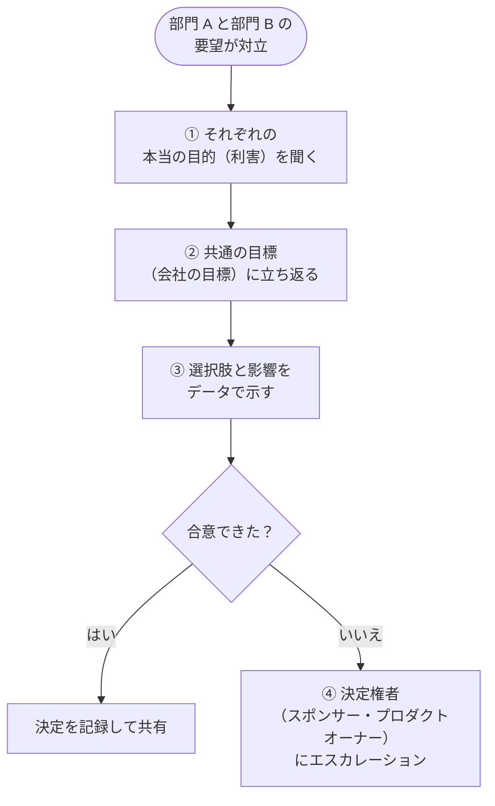
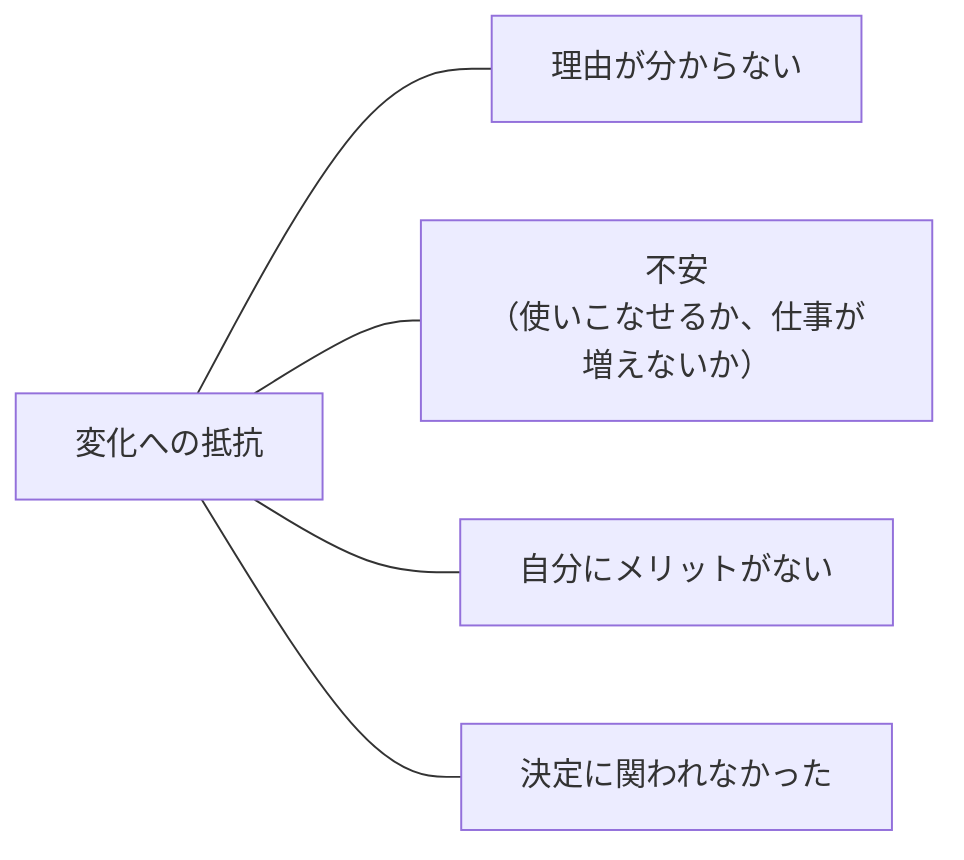

## はじめに：この範囲で学ぶこと

「ステークホルダーとの協働」は**配点 23% で最大**の範囲です。BA の仕事の大部分は「人と協力して合意を作る」ことだからです。

ステークホルダーとは

プロジェクトに**影響を与える人**、またはプロジェクトから**影響を受ける人**すべてです。経営者、部門の責任者、実際に使う社員、IT チーム、場合によっては顧客も含まれます。

---

## 1. ステークホルダーを見極める

### 1-1. 主な役割

| 役割 | 主な責任 | BA との関わり |
|---|---|---|
| **エグゼクティブスポンサー** | 予算と最終的な決定権。プロジェクトの目的を決める | 重要な判断、対立のエスカレーション先 |
| **プロダクトオーナー** | 要件・バックログの**優先順位**を決め、成果物を受け入れる | 日々の判断を仰ぐ相手 |
| **業務の専門家（SME）** | 業務を一番よく知っている | 要件の情報源 |
| **エンドユーザー** | 毎日システムを使う人 | 使いやすさと定着のカギ |
| **IT・開発チーム** | 実現方法と技術的な制約を知っている | 実現可能性の確認 |

### 1-2. 影響力 × 関心度マトリックス（頻出）

| 位置 | 関わり方 | 例 |
|---|---|---|
| 影響力が高い × 関心が高い | **密に連携する**（重要な判断に関与してもらう） | 営業本部長（プロジェクトの当事者） |
| 影響力が高い × 関心が低い | **満足を保つ**（要点を簡潔に報告） | 忙しい役員 |
| 影響力が低い × 関心が高い | **情報を共有する**（進捗をこまめに伝える） | 新しい仕組みを楽しみにしている現場の社員 |
| 影響力が低い × 関心が低い | **様子を見る** | 関係の薄い部署 |

なぜ関わり方を変えるの？

全員に同じ量の情報を同じ頻度で送ると、忙しい役員には負担になり、現場の熱心な社員には物足りなくなります。**相手に合わせて関わり方を変える**ことで、限られた時間で全員の協力を得られます。

### 1-3. RACI チャート

タスクごとに「誰が何を担うか」を明確にする表です。

| タスク | 営業本部長 | プロダクトオーナー | BA | 開発チーム | 現場代表 |
|---|---|---|---|---|---|
| 要件の承認 | I | **A** | R | C | C |
| 要件の作成 | I | C | **R・A** | C | C |
| 開発 | I | C | C | **R・A** | I |
| UAT | I | A | C | C | **R** |

- **R**（Responsible）: 実際に作業する人
- **A**（Accountable）: 最終的な責任者（**1 タスクに 1 人**）
- **C**（Consulted）: 相談される人
- **I**（Informed）: 報告を受ける人

具体例

Northern Trail Outfitters のプロジェクトで「誰が要件を承認するのか分からず作業が止まっている」。→ **RACI チャート**を作り、要件承認の A（説明責任者）をプロダクトオーナーに決めます。

---

## 2. 関係を作る：コミュニケーション

### 2-1. コミュニケーション計画

| 決めること | 例 |
|---|---|
| 誰に | 経営陣、プロダクトオーナー、現場代表 |
| 何を | 進捗、リスク、判断してほしいこと、変化の内容 |
| どの方法で | 定例会議、メール、Slack、デモ |
| どのくらいの頻度で | 毎週、隔週、マイルストンごと |
| 誰が | BA、プロジェクトマネージャー |

### 2-2. 相手に合わせた伝え方

ポイント

- 専門用語を避け、**図・画面のプロトタイプ・デモ**で見せる
- 決まったことは**記録して共有**し、確認してもらう（議事録、意思決定ログ）
- 都合の悪い情報（遅れ・リスク）も**早めに正直に**伝える。信頼の土台になる

---

## 3. 一緒に考える：ワークショップ

### 3-1. ワークショップの流れ

| 段階 | ポイント |
|---|---|
| 準備 | **目的**と、終わったときに持ち帰る**成果物**を決める。適切な参加者を選ぶ |
| 開始 | 目的とゴールを全員で共有する |
| 発散 | 量を重視し、批判しない |
| 収束 | 基準（価値・工数など）で絞り込む。投票なども使う |
| 終了 | **決定事項・未解決事項・次のアクション・担当者・期限**を確認する |
| フォロー | 議事録を共有して確認してもらう |

### 3-2. 全員が参加できる工夫

ひっかけ注意

「役職の高い人ばかりが話して、他の人が黙っている」場面では、

- ○ **個人で付箋に書いてから共有する**、順番に意見を聞く、匿名で投票する、少人数のグループに分ける
- ✕ 発言の多い人の意見でまとめる、黙っている人を外す、ワークショップをやめる

BA は**ファシリテーター**として、全員の意見を引き出します。

リモートの参加者が多い場合は、オンラインのホワイトボードで全員が同時に書き込む、地域ごとにセッションを分ける、非同期（後から書き込む）で意見を集める、などの工夫をします。

---

## 4. 合意する：対立の解消

### 4-1. 対立を解く手順（超頻出）

なぜ「立場」ではなく「利害」を聞くの？

営業部は「入力項目を減らしたい」、経営企画部は「分析のために項目を増やしたい」。これは**立場**（何を主張しているか）の対立です。
理由を聞くと、営業部は「入力の時間を減らしたい」、経営企画部は「どの施策が効いたか知りたい」という**利害**（本当に必要なこと）が見えます。

利害が分かれば「必須の項目は最小限にし、分析に必要なデータは自動で集める」のように、**両方を満たす案**が見つかることがあります。

ひっかけ注意

- ✕ BA が自分の判断で一方の要望を採用・却下する
- ✕ 役職が上の人の意見に従う
- ✕ 両方の要望をすべて実装する
- ✕ 合意できるまで何もしない
- ○ 目的を聞き、選択肢を示し、それでも決まらなければ**決定権者にエスカレーション**

### 4-2. 技術チームと業務部門の間

開発チームが「この要件は期限までに難しい」、業務部門が「必須だ」と対立したときも、BA は**代替案**（段階的に実装する、標準機能で一部を代替する）と**トレードオフ**を整理して、決定権者と一緒に判断します。

---

## 5. 変化を定着させる：チェンジマネジメント

### 5-1. なぜ人は変化に抵抗するのか

### 5-2. 定着のための施策

| 施策 | 内容 |
|---|---|
| **早い段階から巻き込む** | 設計やテストに参加してもらい、当事者意識を持ってもらう |
| **チェンジチャンピオン** | 各部門の推進役。現場の声を集め、同僚を支援する |
| メリットを伝える | 「あなたの仕事がこう楽になる」を具体的に |
| 役割別のトレーニング | 現場向け・マネージャー向けで内容を変える |
| **アプリ内ガイダンス** | 画面上で使い方を案内する |
| デモと早い成果 | 定期的なデモ、小さな成功（クイックウィン）を早く見せる |
| 効果の測定 | 利用状況とフィードバックを集め、改善する |

具体例

Cloud Kicks のベテラン営業担当が新しい仕組みに強く反対しています。他の担当者もその人の意見に従う傾向があります。
→ 懸念を丁寧に聞き、**設計やテストに参加**してもらう。納得すれば、その人自身が**チェンジチャンピオン**として周りを動かしてくれます。

やってみよう（20 分・紙とペンで）

身近なプロジェクト（例: 部署の新しいツールの導入）を題材に、

1. ステークホルダーを 6 人以上書き出し、影響力 × 関心度の 4 つの枠に分ける
2. 主なタスク 4 つについて RACI チャートを作る（A は各タスク 1 人）
3. 1 時間のワークショップの「目的・成果物・議題と時間配分」を書く

---

## 6. まとめ

| テーマ | 覚えること |
|---|---|
| 役割 | スポンサー＝決定権、プロダクトオーナー＝優先順位、SME＝業務知識、エンドユーザー＝定着のカギ |
| 分析 | 影響力 × 関心度の 4 象限。RACI（A は 1 人） |
| コミュニケーション | 相手に合わせる。記録して共有。悪い知らせも早く |
| ワークショップ | 目的と成果物 → 発散 → 収束 → 次のアクション。全員参加の工夫 |
| 対立 | 利害を聞く → 共通の目標 → 選択肢 → 決定権者へエスカレーション |
| 定着 | 早く巻き込む、チェンジチャンピオン、メリット、役割別トレーニング、アプリ内ガイダンス |

## 試験直前チェック

- [ ] 主なステークホルダーの役割の違いを言える
- [ ] 影響力 × 関心度の 4 つの関わり方を言える
- [ ] RACI の 4 文字の意味を言える
- [ ] ワークショップの準備と終わり方を言える
- [ ] 発言の偏りを防ぐ工夫を 3 つ言える
- [ ] 対立を解く手順と、最後のエスカレーション先を言える
- [ ] 「立場」と「利害」の違いを説明できる
- [ ] 抵抗する人への対応と、チェンジチャンピオンの役割を言える
