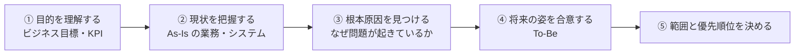
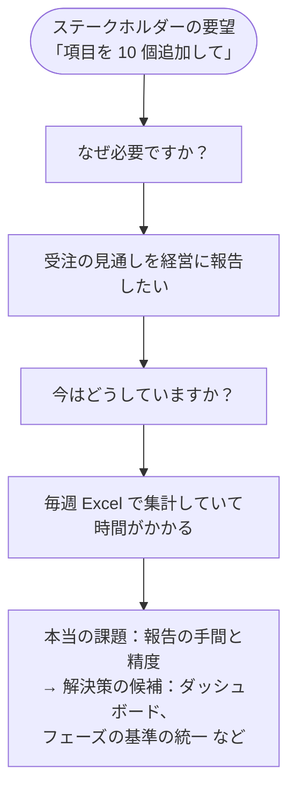
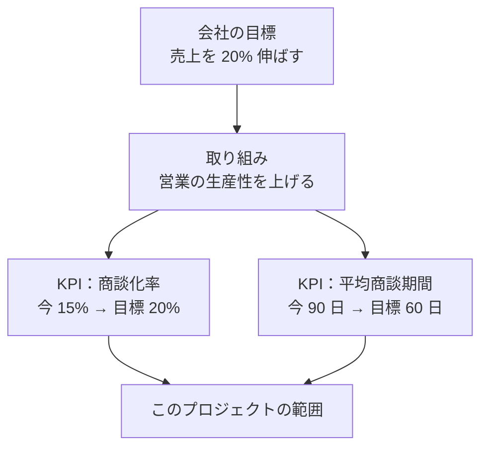
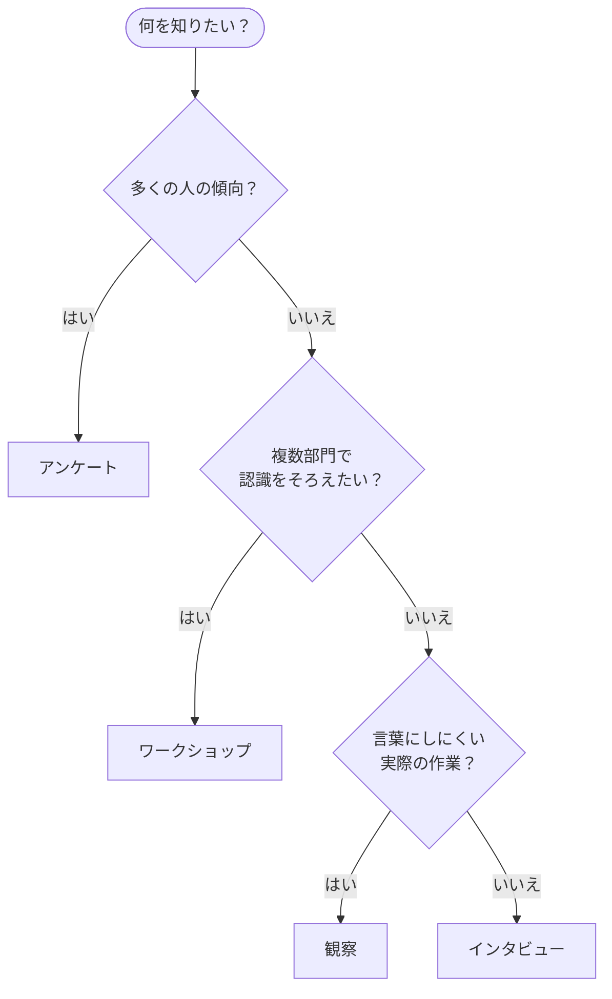
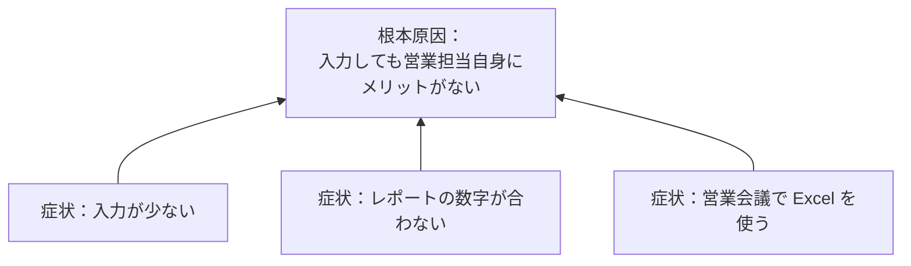
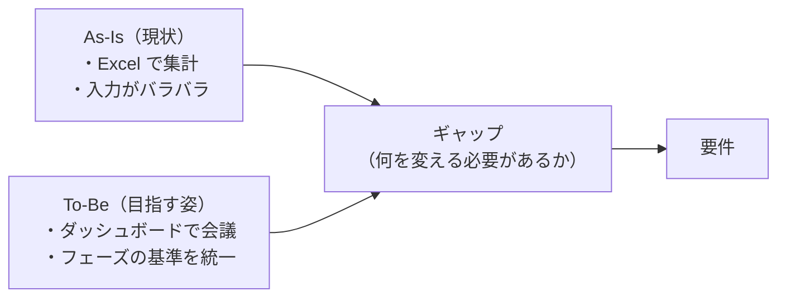
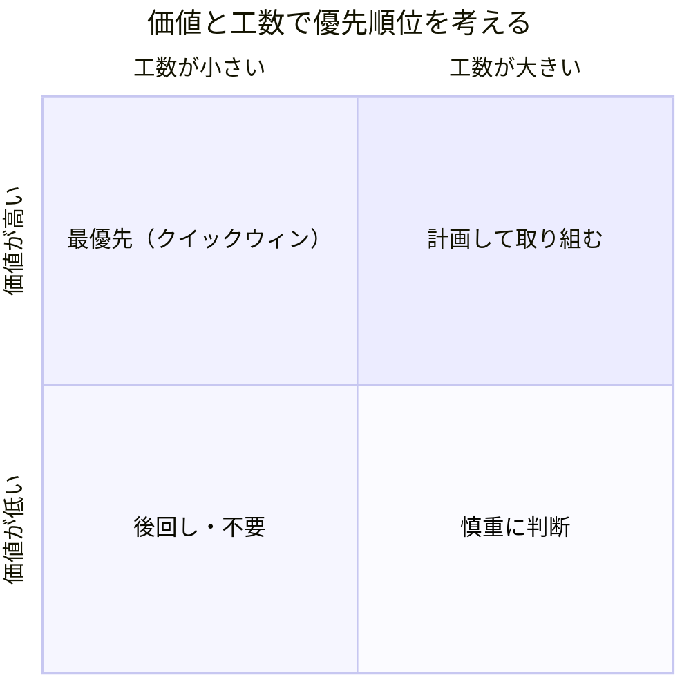

## はじめに：この範囲で学ぶこと

「顧客の現状把握（Customer Discovery）」は配点 17% です。ビジネスアナリスト（BA）の仕事の**最初の一歩**です。

ビジネスアナリスト（BA）とは

BA は、**業務の課題を理解し、それを解決するための要件をまとめる人**です。業務部門（営業、サービスなど）と技術チーム（管理者、開発者）の間に立ち、両方が理解できる言葉で橋渡しをします。Salesforce の BA 試験は、この橋渡しを Salesforce のプロジェクトでどう進めるかを問います。

---

## 1. なぜディスカバリーが大切なのか

なぜ？ 「言われたものを作る」の落とし穴

営業部長が「商談に項目を 10 個追加して」と言ったとします。そのまま作ると、

- 実は**既存の項目で足りた**
- 本当の目的は「受注の見通しを経営に報告したい」で、**項目よりダッシュボードが必要**だった
- 項目が増えて**入力が面倒になり、営業担当が入力しなくなった**

ということが起こります。

「何を作るか」の前に「**なぜ必要か・何を良くしたいか**」を理解する。これがディスカバリーの目的です。試験でも、**要望をそのまま実装する選択肢はほぼ不正解**です。

---

## 2. 目的を理解する

### 2-1. 確認すること

| 観点 | 質問の例 |
|---|---|
| **ビジネス戦略・目標** | 会社として 3 年後にどうなりたいか？今年の重点は？ |
| **取り組み（イニシアチブ）** | どんなプロジェクトが動いているか？このプロジェクトはどれにつながるか？ |
| **課題** | 目標の達成を何が邪魔しているか？ |
| **KPI（成功の測り方）** | 何の数字が良くなれば成功か？今の値は？ |
| **組織** | 誰が意思決定するか？どの部署が関わるか？ |

### 2-2. 目標と KPI のつながり

ポイント：基準値を測っておく

KPI は**プロジェクトの最初に今の値（基準値）を測っておく**ことが大切です。基準値がないと、終わった後に「どれだけ良くなったか」を示せません。

---

## 3. 現状を把握する：情報を集める手法

### 3-1. 手法の使い分け（頻出）

| 手法 | 向いている場面 | 弱み |
|---|---|---|
| **インタビュー** | 個人の事情や本音、背景を**深く**知りたい | 時間がかかる。人数が多いと大変 |
| **ワークショップ** | **複数の部門**で認識をそろえ、**その場で合意**したい | 声の大きい人に引っぱられやすい |
| **観察（シャドーイング）** | **実際の作業**や、言葉にされない手間・回避策を知りたい | 観察される人が普段と違う行動をすることがある |
| **アンケート** | **多くの人**から傾向を**数字で**集めたい | 理由までは分かりにくい |
| **ドキュメント分析** | 既存のマニュアル、帳票、システムの資料を確認したい | 資料が古いことがある |
| **既存システムのデータ分析** | 利用状況やログから**事実**を知りたい | 「なぜ」は分からない |

なぜ観察が大切なの？

人は自分の仕事を**正確に説明できない**ことがよくあります。慣れた作業ほど、途中の手間や回避策（「ここは Excel に一度コピーしてから…」）を意識していないからです。実際の作業を見ると、インタビューでは出てこない**本当の課題**が見つかります。

具体例

Universal Containers の倉庫スタッフは「伝票の処理は簡単です」と言います。BA が実際の作業を観察すると、1 枚ごとに 3 つの画面を行き来し、メモ用紙に番号を書き写していました。これが処理の遅れの原因でした。

### 3-2. 既存の Salesforce 組織を調べる

すでに Salesforce を使っている会社では、**今あるもの**を把握してから考えます。

| 調べること | 方法 |
|---|---|
| データモデル（オブジェクト・項目・リレーション） | スキーマビルダー、オブジェクトマネージャー |
| 自動化（Flow・承認プロセス・Apex） | 設定のフロー一覧など |
| 利用状況 | ログイン履歴、レポートの実行状況、レコードの更新状況 |
| 改善点（使われていない項目・上限に近い設定など） | **Salesforce Optimizer** |

---

## 4. 根本原因を見つける

### 4-1. 症状と原因を分ける

ステークホルダーが話すのは多くの場合「**症状**」です。症状ごとに対策をしても、原因が残っていれば問題は繰り返します。

### 4-2. 原因を探す手法

| 手法 | やり方 |
|---|---|
| **なぜなぜ分析（5 Whys）** | 「なぜ？」を繰り返して原因を掘り下げる |
| **特性要因図（フィッシュボーン）** | 原因を「人・プロセス・システム・データ」などに分けて洗い出す |
| **SWOT 分析** | 強み・弱み（内部）、機会・脅威（外部）を整理する |

なぜなぜ分析の例

1. なぜ売上予測が外れる？ → 商談の完了予定日が古いまま
2. なぜ古いまま？ → 営業担当が更新しない
3. なぜ更新しない？ → 更新しても誰も見ていない
4. なぜ誰も見ていない？ → マネージャーが Excel で会議をしている
5. なぜ Excel？ → Salesforce のダッシュボードが会議に合っていない

→ 対策は「入力を強制する」ではなく、**会議で使えるダッシュボードを作り、マネージャーが Salesforce で会議をする**こと。

---

## 5. 将来の姿（To-Be）を合意する

現状（As-Is）と課題が分かったら、**ステークホルダーと一緒に**目指す姿（To-Be）を描きます。

ひっかけ注意

To-Be は **BA が一人で決めるものではありません**。ステークホルダーと合意して決めます。また、「今の業務をそのまま Salesforce で再現する」のは基本的に避けます。業務の見直しと、Salesforce の標準機能の活用を一緒に考えます（詳しくは「業務プロセスの可視化」のレッスンで）。

---

## 6. 範囲と優先順位を決める

### 6-1. 範囲を決める

| 考え方 | 内容 |
|---|---|
| **範囲内（In Scope）** | このプロジェクトでやること |
| **範囲外（Out of Scope）** | 今回はやらないこと。**明確に書いておく** |
| **スコープクリープ** | 範囲がなし崩しに広がること。スケジュールの遅れの原因になる |

### 6-2. 優先順位を付ける

| 手法 | 内容 |
|---|---|
| **価値 × 工数** | 価値が高く工数が小さいもの（クイックウィン）から |
| **MoSCoW** | Must（必須）・Should（重要）・Could（あれば良い）・Won't（今回はやらない） |

ポイント：優先順位を決めるのは誰？

BA は**判断材料（価値・工数・リスク）を整理する**役割です。最終的に優先順位を決めるのは、**プロジェクトスポンサーやプロダクトオーナー**です。「BA が優先順位を決める」という選択肢は誤りです。

やってみよう（20 分・紙とペンで）

身近な業務（例: 経費精算）を題材に、次を書き出してみましょう。

1. この業務の目的と、成功を測る KPI を 2 つ
2. 現状の課題を 5 つ（ステークホルダーが言いそうな「症状」の形で）
3. そのうち 1 つについて「なぜ」を 5 回繰り返し、根本原因を見つける
4. 課題を「価値 × 工数」の 4 つの枠に分けてみる

---

## 7. まとめ

| テーマ | 覚えること |
|---|---|
| 最初にすること | 要望の背景にある目的と課題を確認する |
| 目標と KPI | 会社の目標につなげ、基準値を測っておく |
| 手法 | 深く＝インタビュー、合意＝ワークショップ、実態＝観察、多数の傾向＝アンケート |
| 既存組織 | データモデル・自動化・利用状況・Salesforce Optimizer |
| 原因 | 症状と根本原因を分ける。なぜなぜ分析・フィッシュボーン・SWOT |
| To-Be | ステークホルダーと合意する。現状をそのまま再現しない |
| 範囲 | 範囲外を明確に。スコープクリープを防ぐ |
| 優先順位 | 価値 × 工数、MoSCoW。決めるのはスポンサー・プロダクトオーナー |

## 試験直前チェック

- [ ] 要望をそのまま実装してはいけない理由を説明できる
- [ ] 目標・取り組み・KPI のつながりを説明できる
- [ ] インタビュー・ワークショップ・観察・アンケートの使い分けを言える
- [ ] 既存の Salesforce 組織で確認すべきことを 3 つ言える
- [ ] なぜなぜ分析で根本原因を見つけられる
- [ ] スコープクリープの意味と防ぎ方を言える
- [ ] MoSCoW の 4 つを言える
- [ ] 優先順位を最終的に決めるのが誰か言える
