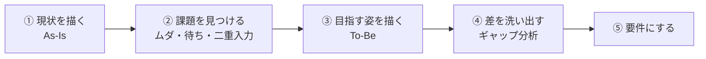
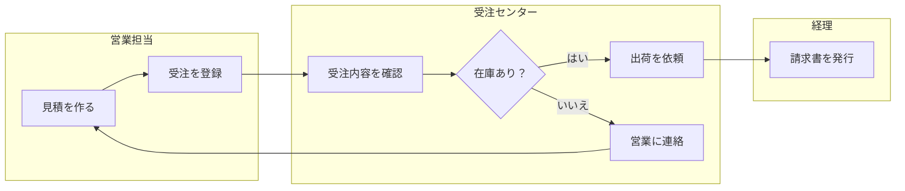
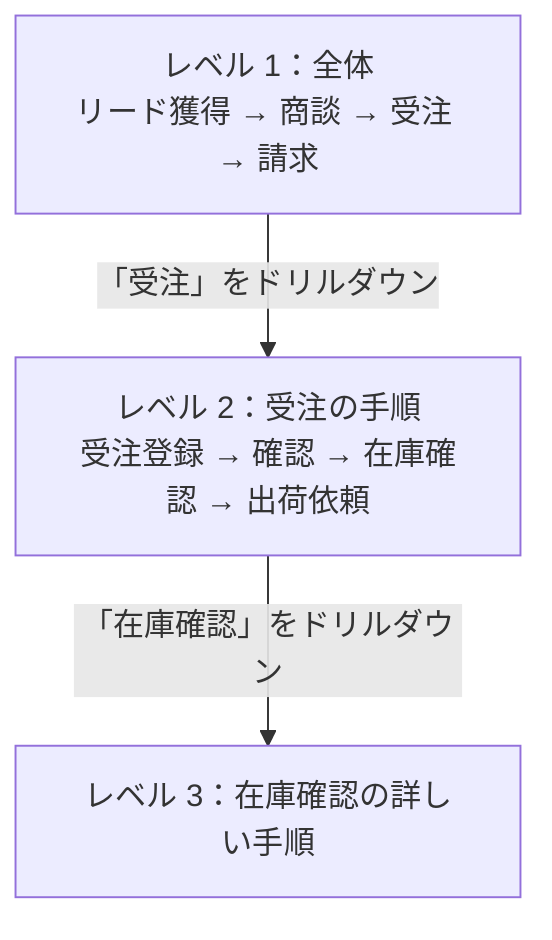
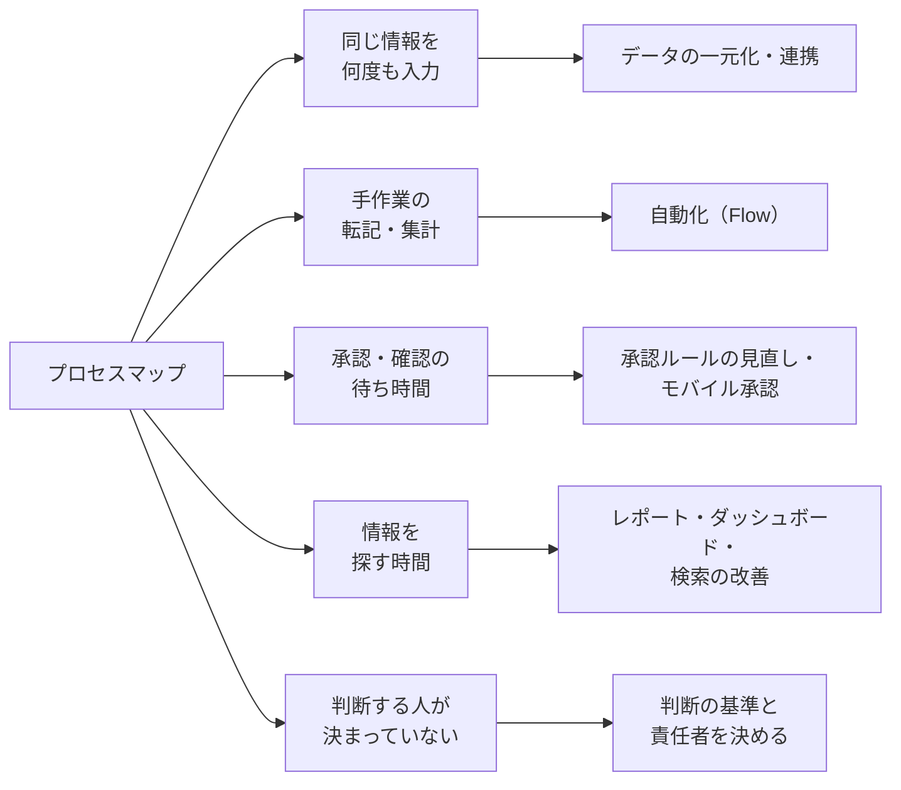
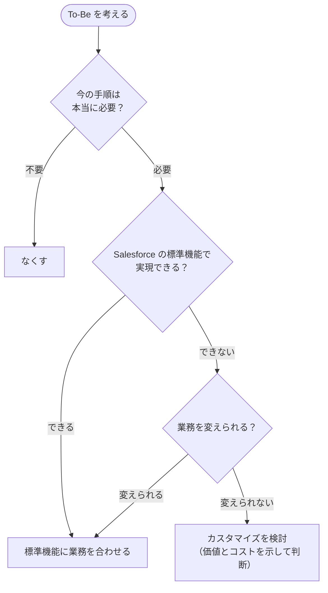

## はじめに：この範囲で学ぶこと

「業務プロセスの可視化」は配点 12% です。業務の流れを**図にする**技術と、図から**改善点を見つける**考え方を学びます。

---

## 1. なぜプロセスを図にするのか

なぜ？

同じ「受注処理」でも、営業担当・受注センター・経理では見えている範囲が違い、頭の中のイメージがバラバラです。言葉だけで話すと、「承認は誰がするの？」「その後どこに回るの？」が曖昧なまま進んでしまいます。

図にすると、

- 関係者の**認識がそろう**
- **抜け漏れ**（例外処理、誰も担当していない作業）が見つかる
- **ムダ**（待ち時間、二重入力）が目に見える
- 要件やユーザーストーリーの**根拠**になる

---

## 2. プロセスを描く記法

### 2-1. スイムレーン図（最もよく使う）

**スイムレーン図**は、役割（部門・人・システム）ごとに「レーン（水泳のコース）」を分けて、**誰が何をするか**を描きます。

レーンをまたぐ矢印は**受け渡し**です。受け渡しが多いところほど、**待ち時間や伝達ミス**が起きやすくなります。

### 2-2. その他の記法

| 記法 | 特徴 | 向いている場面 |
|---|---|---|
| **UPN（Universal Process Notation）** | 各手順を「**誰が・何を・何を使って**」で簡潔に書く。詳しい下位の図に**ドリルダウン**できる | Salesforce のプロジェクトでよく使われる。全体から詳細まで段階的に描く |
| **BPMN** | 業務プロセスの国際標準。イベントや分岐を厳密に表せる | 詳細な設計、システム化 |
| フローチャート | シンプルな手順と分岐 | 小さな手順 |
| バリューストリームマップ | 工程ごとの**時間・待ち**を書き込む | ムダの発見 |

---

## 3. 現状（As-Is）を描く

### 3-1. ありのままを描く

ひっかけ注意

As-Is は「マニュアルに書いてある手順」ではなく、**実際に行われている手順**を描きます。

- 担当者によってやり方が違う → **その違いもそのまま記録**し、標準化が必要かを議論する
- 「いつもは Excel にコピーしてから…」のような**回避策**も描く
- 例外処理（返品・キャンセルなど）も忘れずに

理想の手順を描いてしまうと、本当の課題が見えなくなります。

### 3-2. 正確さを確かめる

描いた図は、**実際にその業務をしている担当者にレビュー**してもらいます。BA だけ、経営陣だけで確認すると、現場の実態とずれていることに気づけません。

### 3-3. 詳細度を相手に合わせる

| 相手 | 見せる図 |
|---|---|
| 経営陣 | 全体像（レベル 1） |
| 業務の担当者 | 自分の担当部分の詳しい手順（レベル 2〜3） |
| 開発チーム | 画面や自動化に関わる詳しい手順と例外処理 |

1 枚の図に全部を詰め込まず、**全体 → 詳細**に分けます。例外処理が多い場合も、**主要な流れと例外を別の図**に分けると読みやすくなります。

---

## 4. 課題を見つける

### 4-1. 改善のヒントになるパターン

| 見つけたこと | 改善の方向 |
|---|---|
| **二重入力**（Excel と Salesforce に同じ情報） | データを 1 か所で管理、システム連携 |
| **手作業の転記・集計** | Flow による自動化、レポート |
| **承認の待ち**（平均 3 日止まる） | 承認者・承認条件の見直し、モバイル承認、一定額以下の自動承認 |
| **情報を探す時間** | ダッシュボード、検索、関連情報を 1 画面に |
| **判断の分岐で、誰が決めるか曖昧** | 判断の基準と責任者をステークホルダーに確認し、図に明記 |
| 顧客に価値を生まない工程 | 本当に必要か確認し、なくせないか検討 |

ポイント

**法令で必要な確認**や、**顧客に価値を提供している工程**は、簡単になくしてはいけません。「ムダに見える」ものも、なぜその手順があるのかを確認してから判断します。

---

## 5. 目指す姿（To-Be）を描く

### 5-1. 考え方

なぜ「今の業務をそのままシステム化」しないの？

今の業務には、昔のシステムの制約や、手作業ならではの回避策が含まれています。それをそのまま Salesforce で再現すると、

- ムダな手順も一緒にシステム化される
- カスタマイズが増え、**保守が大変になる**
- Salesforce が毎年追加する**新機能を活かせなくなる**

まず業務を見直し、**標準機能に業務を合わせられないか**を考えるのが基本です。

### 5-2. ギャップ分析

As-Is と To-Be を並べて、**何を変える必要があるか**を洗い出します。この「差」が要件になります。

| As-Is | To-Be | ギャップ（変えること） |
|---|---|---|
| 受注を Excel で受け取り、受注センターが手入力 | 営業担当が Salesforce で受注を登録 | 受注の画面と入力規則、営業へのトレーニング |
| 在庫を電話で確認 | 在庫を画面で確認 | 在庫システムとの連携 |
| 請求書を手で作成 | 受注確定で請求データを自動作成 | 会計システムとの連携、自動化 |

やってみよう（25 分・紙とペンで）

身近な業務（例: 有給休暇の申請）を題材に、

1. 「申請者・上司・人事・システム」の 4 つのレーンで、今のスイムレーン図を描く
2. レーンをまたぐ受け渡しに印をつけ、待ち時間が長そうな場所を探す
3. 改善した To-Be の図を描く
4. As-Is と To-Be の差を 3 つ書き出す（これが要件の元になります）

---

## 6. まとめ

| テーマ | 覚えること |
|---|---|
| 目的 | 認識をそろえ、抜け漏れとムダを見つけ、要件の根拠にする |
| 記法 | スイムレーン図＝誰が何を。UPN＝誰が・何を・何を使って、ドリルダウン |
| As-Is | 実際のやり方をありのまま。担当者にレビューしてもらう |
| 詳細度 | 相手に合わせる。全体 → 詳細に分ける |
| 課題 | 二重入力・手作業・待ち・探す時間・曖昧な判断 |
| To-Be | 業務を見直し、標準機能に合わせる。現状をそのままシステム化しない |
| ギャップ分析 | As-Is と To-Be の差が要件になる |

## 試験直前チェック

- [ ] プロセスを図にする目的を 3 つ言える
- [ ] スイムレーン図と UPN の特徴を言える
- [ ] As-Is を描くときの注意を言える
- [ ] 相手に合わせて詳細度を変える理由を言える
- [ ] プロセスマップから見つかる改善の候補を 3 つ言える
- [ ] 「今の業務をそのままシステム化しない」理由を説明できる
- [ ] ギャップ分析の意味を言える
