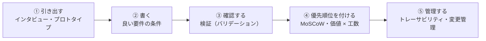
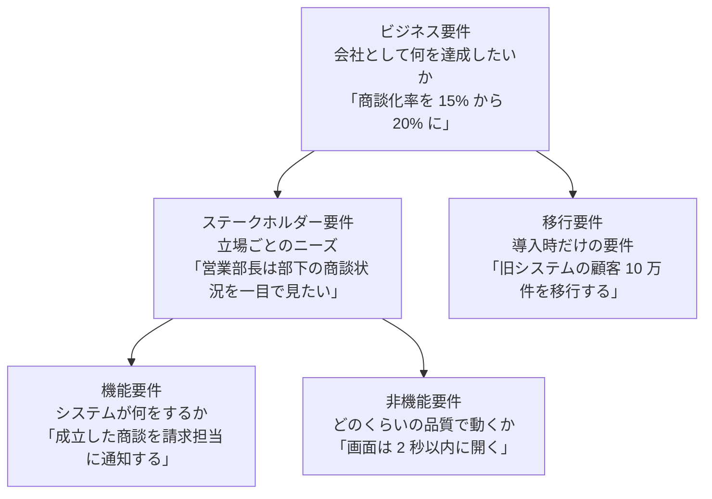
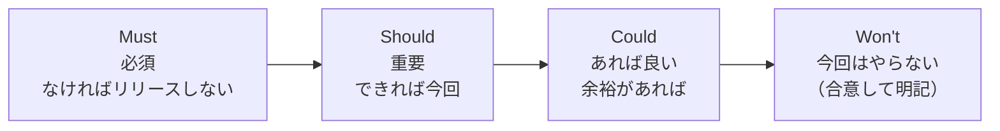
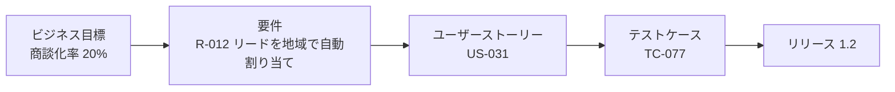
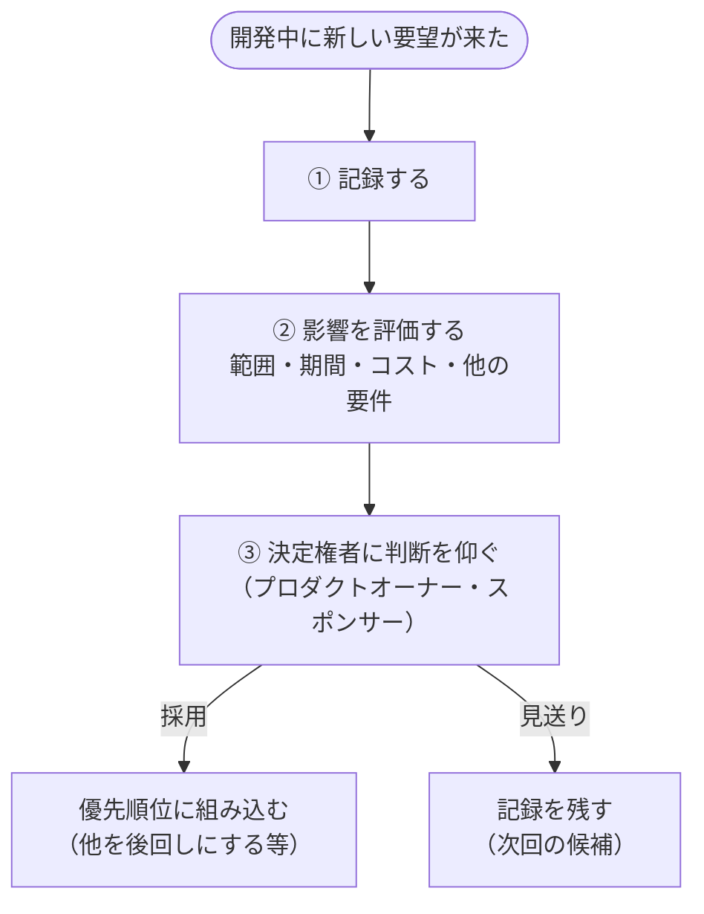

## はじめに：この範囲で学ぶこと

「要件定義」は配点 18% です。「何を作るか」をはっきり決め、それを管理し続ける方法を学びます。

---

## 1. 要件とは、その種類

### 1-1. 要件の階層

| 種類 | 内容 | 例 |
|---|---|---|
| **ビジネス要件** | 会社として達成したいこと | 解約率を 10% 下げる |
| **ステークホルダー要件** | 立場ごとのニーズ | サポート担当は顧客の過去の問い合わせをすぐ見たい |
| **機能要件** | システムが**何をするか** | 優先度が高いケースを上級キューに割り当てる |
| **非機能要件** | **どのくらいの品質で**動くか | 個人情報は人事部だけが見られる |
| **移行要件** | 導入のときだけ必要 | 旧システムのデータを移行し、件数を照合する |

### 1-2. 非機能要件（見落としやすい）

| 分類 | 例 |
|---|---|
| **性能** | 主要な画面は 2 秒以内、1 日 1 万件の取り込み |
| **セキュリティ** | 誰がどのデータを見られるか、暗号化 |
| 可用性 | 業務時間中は止めない |
| 使いやすさ | 研修なしで基本操作ができる |
| 拡張性 | 3 年後に利用者が 2 倍になっても使える |
| **法令・監査** | データの保持期間、変更履歴の記録 |

なぜ非機能要件を意識して聞くの？

ステークホルダーは「何ができるか」（機能）は話しますが、「どのくらいの品質か」（非機能）は**当たり前だと思って話さない**ことが多いからです。後から「遅すぎる」「見えてはいけない人に見えている」と分かると、作り直しになります。BA から**意識して質問**する必要があります。

---

## 2. 良い要件の条件

| 条件 | 悪い例 | 良い例 |
|---|---|---|
| **明確**（解釈が 1 つ） | 「早く表示されること」 | 「主要なレポートは 5 秒以内に表示されること」 |
| **検証できる**（テストできる） | 「使いやすいこと」 | 「新規の担当者が 5 分以内にケースを登録できること」 |
| **必要**（目的につながる） | 「全項目を必須にする」 | 「請求に必要な 3 項目を必須にする」 |
| **実現可能** | 予算・期間・技術で不可能 | 制約の中で実現できる |
| **一貫している**（矛盾しない） | 「全員が編集できる」と「所有者だけが編集できる」が両方ある | 矛盾を解消した 1 つの要件 |

ポイント：要件は「何が必要か」、解決策は後で

- ✕「商談のダッシュボードに棒グラフを 3 つ置く」（解決策の決めつけ）
- ○「営業マネージャーは、部下の今月の商談状況を 1 画面で確認できる」（必要なこと）

要件に解決策を書くと、より良い方法を検討する余地がなくなります。実現方法は設計の段階で考えます。

---

## 3. 要件を引き出す・確かめる

### 3-1. 引き出す手法

インタビュー・ワークショップ・観察・アンケート（「顧客の現状把握」のレッスン参照）に加えて、

| 手法 | 効果 |
|---|---|
| **プロトタイプ・モックアップ** | 画面のイメージを見せると、言葉では出てこない具体的な意見が出る |
| 既存資料の分析 | 帳票や Excel から、必要な項目やルールが分かる |
| 現行システムの分析 | 今できていることを確認し、漏れを防ぐ |

具体例

Cloud Kicks のステークホルダーは「いい感じの画面がほしい」としか言えません。BA が Sandbox で簡単な画面を作って見せると、「この項目は上に」「ここにボタンがほしい」と具体的な要望が次々に出てきました。

### 3-2. 検証（バリデーション）

まとめた要件は、**ステークホルダーに確認してもらいます**。BA の理解が正しいか、目的を満たすか、抜けはないかを確かめます。

---

## 4. 優先順位を付ける

### 4-1. MoSCoW

なぜ「Won't」を書くの？

「今回はやらない」ことを明記して合意しておくと、後から「あれも入っていると思っていた」という**期待のずれ**を防げます。範囲がなし崩しに広がる**スコープクリープ**の対策にもなります。

### 4-2. 判断材料と決める人

| BA が整理する判断材料 | 決める人 |
|---|---|
| ビジネス価値、工数、リスク、依存関係（この要件がないと他ができない） | **プロダクトオーナー**・スポンサー |

ひっかけ注意

- ✕ BA が一人で優先順位を決める
- ✕ 要件を出した人の役職の高さで決める
- ✕ 全部を同時に開発する
- ○ BA が判断材料を整理し、プロダクトオーナーが決める

### 4-3. 実現方法を考えるときの順番

要件の実現方法を検討するときは、**標準機能（設定と Flow）** → AppExchange → カスタム開発の順に検討します。標準機能は保守しやすく、新機能も活かせるからです。

---

## 5. 要件を管理する

### 5-1. トレーサビリティ

**トレーサビリティ**は、目標 → 要件 → ストーリー → テストのつながりを追えるようにすることです。**要件トレーサビリティマトリックス**（対応表）で管理します。

| 効果 | 内容 |
|---|---|
| 漏れの防止 | テストされていない要件が分かる |
| 影響の把握 | 要件が変わったとき、どのストーリーとテストに影響するか分かる |
| 理由の説明 | 「この機能はなぜあるのか」を目標までさかのぼって説明できる |

### 5-2. 変更管理（超頻出）

ひっかけ注意

「開発の途中で役員から新しい要望が来た」問題の正解は、**記録して影響を評価し、決定権者に判断を仰ぐ**です。

- ✕ 黙って開発者に追加を頼む（スコープクリープ）
- ✕ 範囲外なので理由も聞かずに断る
- ✕ 記録せずに次のプロジェクトまで放置

### 5-3. 1 か所で管理する

要件は、要件管理ツールや Salesforce 上の管理オブジェクト、Jira などの**1 か所**で管理し、**状態**（提案中・承認済み・開発中など）と**変更履歴**を残します。各自のファイルやメールでバラバラに管理すると、どれが最新か分からなくなります。

やってみよう（20 分・紙とペンで）

「有給休暇の申請をシステム化する」という題材で、

1. ビジネス要件・機能要件・非機能要件・移行要件を 1 つずつ書く
2. 「使いやすいこと」「早く承認されること」を、測定できる要件に書き直す
3. 書いた要件に MoSCoW を付ける（Won't も 1 つ以上）

---

## 6. まとめ

| テーマ | 覚えること |
|---|---|
| 種類 | ビジネス・ステークホルダー・機能・非機能・移行 |
| 非機能 | 性能・セキュリティ・可用性・法令。BA から意識して聞く |
| 良い要件 | 明確・検証できる・必要・実現可能・一貫。解決策を決めつけない |
| 引き出す | プロトタイプで具体的な意見を引き出す |
| 検証 | ステークホルダーに確認してもらう |
| 優先順位 | MoSCoW（Won't を明記）。BA は材料、決めるのはプロダクトオーナー |
| トレーサビリティ | 目標 → 要件 → ストーリー → テスト |
| 変更 | 記録 → 影響評価 → 決定権者が判断 |

## 試験直前チェック

- [ ] 機能要件と非機能要件の違いを例で言える
- [ ] 非機能要件の分類を 4 つ言える
- [ ] 良い要件の 5 つの条件を言える
- [ ] 悪い要件を測定できる形に書き直せる
- [ ] MoSCoW と Won't を書く理由を言える
- [ ] 優先順位を決めるのが誰かを言える
- [ ] トレーサビリティの効果を 3 つ言える
- [ ] 開発中に来た要望への正しい対応を言える
