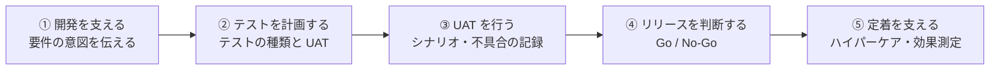
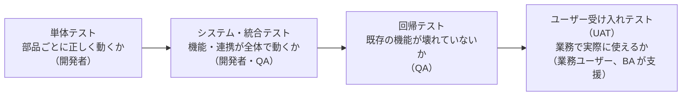
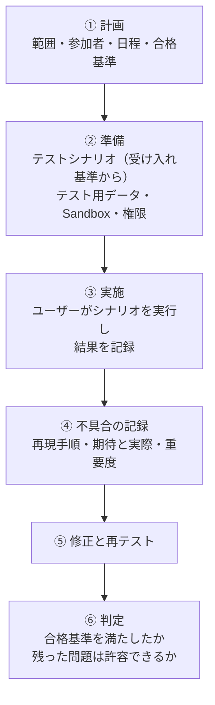
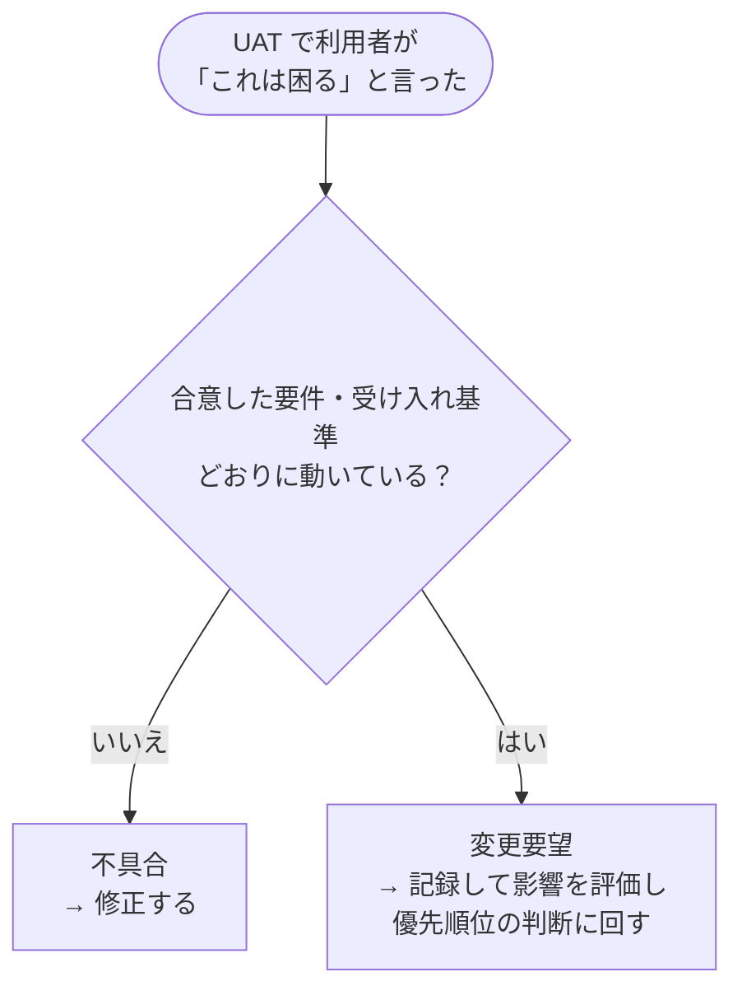
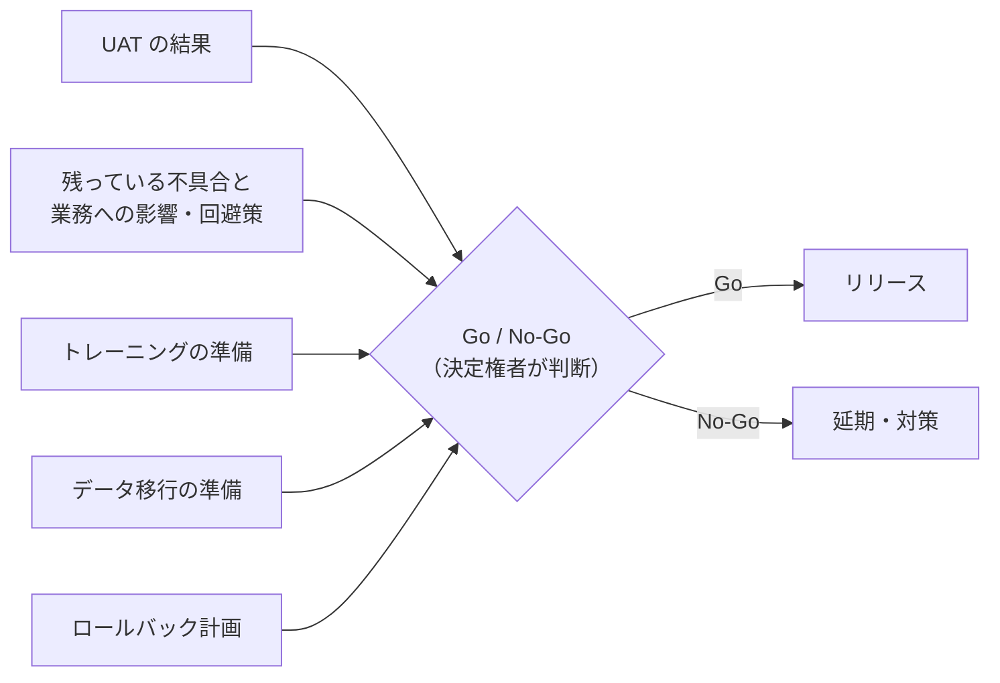

## はじめに：この範囲で学ぶこと

「開発支援とユーザー受け入れ」は配点 12% です。要件を渡した後も BA の仕事は続きます。

---

## 1. 開発を支える

### 1-1. BA の役割

| 場面 | BA がすること |
|---|---|
| 開発者からの質問 | **要件の背景と意図**を説明する |
| 要件に書かれていない点 | **推測で決めず**、ステークホルダーに確認して決め、共有する |
| スプリントレビュー（デモ） | 作ったものが要件を満たすかを一緒に確認し、フィードバックを集める |
| 変更の要望 | 記録し、影響を評価して、決定権者の判断に回す |

なぜ BA が推測で決めてはいけないの？

画面の項目の並び順のような小さなことでも、業務のやり方によって「使いやすい順番」は違います。BA が推測で決めると、UAT で「使いにくい」と言われて作り直しになることがあります。**業務のことは業務の担当者に確認する**のが一番の近道です。

### 1-2. 定期的なデモ

開発の途中で**定期的にデモ**を行い、ステークホルダーに見てもらうと、期待とのずれを**早く**見つけられます。完成してから見せるより、手戻りがずっと少なくなります。

---

## 2. テストの種類と UAT

### 2-1. テストの全体像

| テスト | 目的 | 主な担当 |
|---|---|---|
| 単体テスト | 部品ごとに正しく動くか | 開発者 |
| システム・統合テスト | 機能や外部連携が全体として動くか | 開発者・QA |
| 回帰テスト | 変更で既存の機能が壊れていないか | QA |
| 性能テスト | 大量データや多人数でも動くか | 開発者・QA |
| **UAT** | **業務で実際に使えるか** | **業務ユーザー**（BA が計画・支援） |

### 2-2. UAT の 3 つのポイント

| ポイント | 内容 |
|---|---|
| **誰が** | 実際に使う**業務ユーザーの代表**（開発者や BA だけではない） |
| **どこで** | **本番に近い環境**：Partial Copy や Full Sandbox |
| **何を** | **業務のシナリオ**に沿って、受け入れ基準を満たすか |

ひっかけ注意

- UAT を**本番組織**で行う → ✕（本番のデータを壊す危険）
- UAT を**データのない Developer Sandbox** で行う → 業務に近い確認ができない
- テスト用ユーザーに**システム管理者権限**を与える → ✕（本番の利用者と同じ**権限**でテストしないと、権限の問題を見つけられない）

---

## 3. UAT を進める

### 3-1. 流れ

### 3-2. テストシナリオの作り方

テストシナリオは、**ユーザーストーリーの受け入れ基準**と**実際の業務の流れ**から作ります。

| 項目 | 例 |
|---|---|
| シナリオ | 交渉中の商談を成立にする |
| 前提 | 営業担当者でログイン、交渉中の商談がある |
| 手順 | 1. 商談を開く 2. フェーズを成立にする 3. 保存 |
| 期待する結果 | 保存でき、請求担当に 5 分以内に通知が届く |
| 結果 | 合格／不合格、メモ |

### 3-3. 不具合と変更要望を分ける（超頻出）

具体例

Northern Trail Outfitters の UAT で、利用者が「要件どおりに動くけど、ボタンを上に移動してほしい」と言いました。→ 要件どおりなので**不具合ではなく変更要望**です。その場で開発者に直接依頼せず、記録して影響と優先度を評価します。

### 3-4. 不具合の記録

| 記録すること | 理由 |
|---|---|
| **再現手順** | 開発者が同じ問題を起こして原因を調べられる |
| **期待した結果と実際の結果** | 何が問題かがはっきりする |
| **重要度（業務への影響）** | 修正の優先順位を決められる |
| 環境・ユーザー・日時 | 権限やデータの条件を特定できる |

---

## 4. リリースを判断する

### 4-1. Go / No-Go 判定

重大な不具合が見つかり、リリースまで時間がない場合も、**BA が勝手に延期を決めたり、黙ってリリースしたりはしません**。影響・回避策・修正の見込みを整理して、**決定権者に判断を仰ぎます**。

### 4-2. リリース計画

- 段階的なリリース（一部の部門から）
- 利用者への告知（いつ・何が変わるか）
- 問題があったときの**ロールバック**（元に戻す）計画

---

## 5. 定着を支える

| 活動 | 内容 |
|---|---|
| **ハイパーケア** | リリース直後の**集中サポート期間**。問い合わせ窓口と担当者を決め、問題をすぐ解決する |
| トレーニングとフォロー | 役割別の研修、アプリ内ガイダンス |
| **効果測定** | プロジェクトの最初に決めた **KPI の基準値と比べて**、目標を達成できたかを確認する |
| 継続的な改善 | 利用状況とフィードバックを集め、次の改善につなげる |

やってみよう（20 分・紙とペンで）

「経費精算のシステム化」を題材に、

1. 受け入れ基準から、UAT のテストシナリオを 2 つ（正常・例外）書く
2. 架空の不具合を 1 つ想定し、再現手順・期待と実際の結果・重要度を書く
3. 「要件どおりだが使いにくい」という意見を 1 つ想定し、不具合と変更要望のどちらか、どう扱うかを書く

---

## 6. まとめ

| テーマ | 覚えること |
|---|---|
| 開発支援 | 要件の意図を説明。未確定の点は推測せずステークホルダーに確認 |
| テストの種類 | 単体・統合・回帰・性能・UAT |
| UAT | 業務ユーザーが、本番に近い Sandbox で、本番と同じ権限で、業務シナリオに沿って |
| シナリオ | 受け入れ基準と業務の流れから作る |
| 不具合と変更要望 | 要件どおりでなければ不具合、要件どおりなら変更要望 |
| 記録 | 再現手順・期待と実際・重要度 |
| Go / No-Go | テスト結果・残課題・準備状況・ロールバック計画で決定権者が判断 |
| 定着 | ハイパーケア、KPI の基準値と比べて効果測定 |

## 試験直前チェック

- [ ] 開発中に要件にない点を聞かれたときの対応を言える
- [ ] UAT の目的と、誰が・どこで・何をテストするかを言える
- [ ] UAT のテスト用ユーザーに管理者権限を与えてはいけない理由を言える
- [ ] 不具合と変更要望の違いと、それぞれの扱いを言える
- [ ] 不具合の記録に含める情報を 3 つ言える
- [ ] Go / No-Go 判定の材料を言える
- [ ] ハイパーケアの意味と、効果測定の方法を言える
