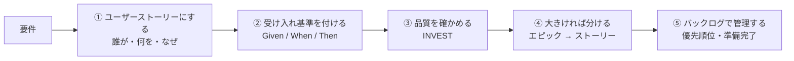
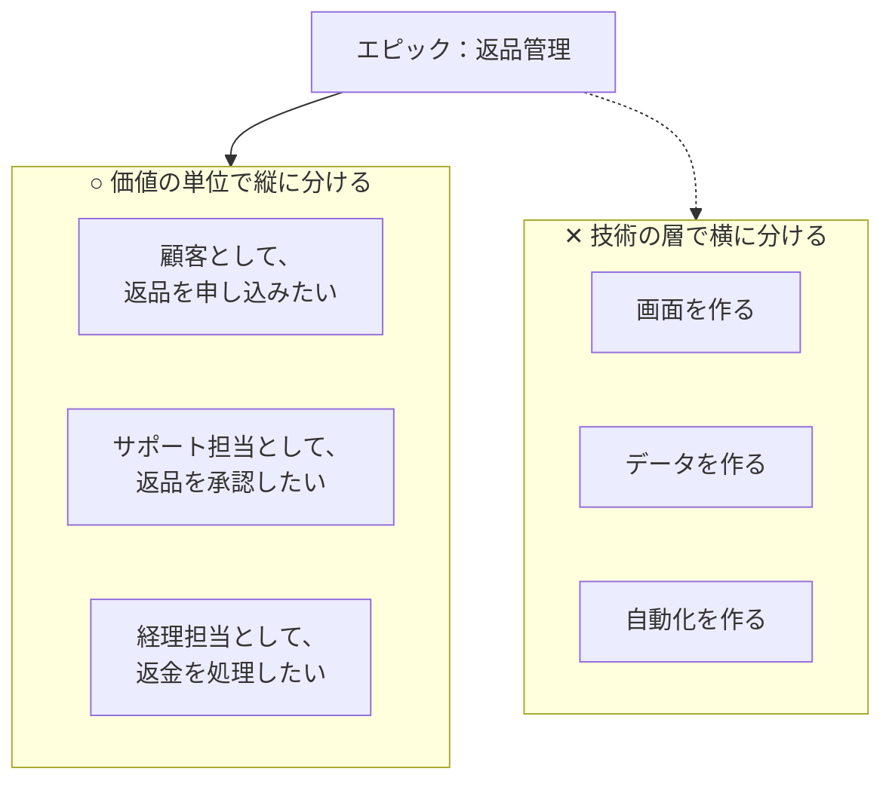
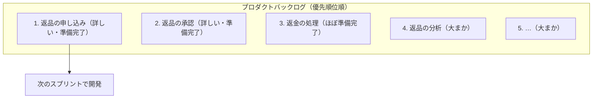

## はじめに：この範囲で学ぶこと

「ユーザーストーリー」は配点 18% です。Salesforce のプロジェクトの多くは、短い期間（スプリント）で少しずつ作って確認する**アジャイル**という進め方をとります。そのときに要件を表す形がユーザーストーリーです。

---

## 1. ユーザーストーリーの書き方

### 1-1. 基本の形

> **（役割）として、（目的）のために、（機能）がしたい。**

| 部分 | 書き方のコツ |
|---|---|
| **役割** | 「ユーザー」ではなく**具体的な役割**（営業担当者、サポートマネージャー） |
| **機能** | 何ができるようになるか（画面の作り方ではなく、できること） |
| **目的** | **なぜ必要か**。ここが一番大事 |

なぜ「目的」が一番大事なの？

目的が書かれていると、

- **価値**が分かり、優先順位を判断できる
- 開発チームが「その目的なら、もっと簡単な方法がある」と**より良い解決策**を提案できる
- 受け入れテストで「目的を達成できたか」を確かめられる

目的のないストーリーは、ただの「作業の指示」になってしまいます。

### 1-2. 良い例・悪い例

| 例 | 評価 |
|---|---|
| 「サポート担当者として、顧客への回答を早くするために、ケース画面で関連するナレッジ記事を見たい」 | ○ 役割・目的・機能がそろっている |
| 「ナレッジのコンポーネントをケースページに追加する」 | ✕ 作業の指示。誰の何のためか分からない |
| 「ユーザーとして、ナレッジを見たい」 | ✕ 役割が曖昧、目的がない |
| 「システムはナレッジを表示する」 | ✕ システム目線。ユーザーの価値が見えない |

### 1-3. 役割ごとに分ける

同じ機能でも、使う人によって目的が違うことがあります。その場合は**役割ごとに別のストーリー**にします。

| ストーリー | 受け入れ基準の違い |
|---|---|
| 営業担当者として、今日の訪問の準備のために、担当の商談の一覧を見たい | 自分の商談だけが表示される |
| 営業マネージャーとして、週次会議の準備のために、チームの商談の状況を見たい | 部下全員の商談が表示され、フェーズ別に集計される |

---

## 2. 受け入れ基準

### 2-1. 受け入れ基準とは

**受け入れ基準**は、そのストーリーが「**完成した**」と言える条件です。テストの元になります。

### 2-2. Given / When / Then

| 要素 | 書くこと |
|---|---|
| **Given** | 前提となる状態 |
| **When** | 利用者の操作や出来事 |
| **Then** | 期待される結果 |

### 2-3. 良い受け入れ基準

| ポイント | 説明 |
|---|---|
| **具体的で検証できる** | 「通知が正しく動く」ではなく「5 分以内に請求担当に通知が届く」 |
| **例外も含める** | 正常な場合だけでなく、「金額が空なら成立にできず、エラーメッセージが出る」など |
| **非機能も含める** | 「経理部以外には請求金額が表示されない」など |
| **実装方法は書かない** | 「Apex で作る」などは受け入れ基準ではない |
| **関係者で確認する** | プロダクトオーナー・業務担当・開発チームで共通の理解にする |

---

## 3. 良いストーリーの条件：INVEST

| 文字 | 意味 | 確認すること |
|---|---|---|
| **I**ndependent | 独立している | 他のストーリーに強く依存していないか |
| **N**egotiable | 交渉できる | 詳細は話し合いで決められる余地があるか（契約書ではない） |
| **V**aluable | 価値がある | ユーザーやビジネスにとっての価値があるか |
| **E**stimable | 見積もれる | 開発チームが工数を見積もれるだけの情報があるか |
| **S**mall | 小さい | 1 回のスプリントで終わるか |
| **T**estable | テストできる | 受け入れ基準があり、確認できるか |

ひっかけ注意

INVEST の文字を、似た英単語に置き換えた選択肢がよく出ます。「Important（重要）」「Technical（技術的）」「Immediate（すぐ作れる）」は**含まれません**。

---

## 4. エピックと分割

### 4-1. エピックとは

1 回のスプリントで終わらない**大きなストーリー**を**エピック**と呼びます。エピックは、小さなストーリーに分けてから開発します。

### 4-2. 正しい分け方・間違った分け方（頻出）

なぜ技術の層で分けてはいけないの？

「画面を作る」だけのストーリーが終わっても、データも自動化もないので、**ユーザーはまだ何も使えません**。テストもできず、価値も確認できません。

**それぞれのストーリーが完成すれば、ユーザーが何かを使えるようになる**ように分ける（縦に切る）のが原則です。

| 分ける切り口 | 例 |
|---|---|
| **業務の手順ごと** | 申し込み → 承認 → 返金 |
| **ユーザーの役割ごと** | 顧客・サポート担当・経理担当 |
| データの種類ごと | 法人の返品、個人の返品 |
| 正常な場合と例外 | 通常の返品 → 期限切れの返品の扱い |

---

## 5. バックログで管理する

### 5-1. プロダクトバックログ

| ポイント | 内容 |
|---|---|
| 並べる人 | **プロダクトオーナー**が優先順位順に並べる |
| 詳しさ | **近く着手する上位ほど詳しく**、下位は大まかでよい |
| **バックログリファインメント** | ストーリーを詳しくし、見積もり、分割する継続的な活動 |

### 5-2. 準備完了と完了の定義

| 定義 | 意味 | 例 |
|---|---|---|
| **Definition of Ready（準備完了の定義）** | 開発を**始めてよい**条件 | 受け入れ基準がある、依存関係が分かっている、見積もり済み |
| **Definition of Done（完了の定義）** | **完了**と言える、チーム共通の条件 | テスト済み、レビュー済み、ドキュメント更新済み |
| 受け入れ基準 | **ストーリーごと**の完成の条件 | 「5 分以内に通知が届く」 |

具体例

Universal Containers の開発チームが「このストーリーは依存関係が分からず、見積もれない」と言っています。→ **準備完了の定義**を満たしていません。BA は**バックログリファインメント**で依存関係と詳細を明らかにします。見積もりなしで開発を始めてもらうのは誤りです。

やってみよう（25 分・紙とペンで）

「経費精算をシステム化する」というエピックで、

1. 役割（申請者・上司・経理）ごとに、ユーザーストーリーを 1 つずつ書く
2. そのうち 1 つに、Given / When / Then の受け入れ基準を正常な場合と例外の 2 つ書く
3. 書いたストーリーを INVEST の 6 文字で確認する
4. 「画面・データ・自動化」で分けた場合と、価値の単位で分けた場合を比べてみる

---

## 6. まとめ

| テーマ | 覚えること |
|---|---|
| 書き方 | （役割）として、（目的）のために、（機能）がしたい。目的が一番大事 |
| 受け入れ基準 | Given / When / Then。具体的・例外も・実装方法は書かない |
| INVEST | Independent・Negotiable・Valuable・Estimable・Small・Testable |
| 分割 | エピックは価値の単位で縦に分ける。技術の層で分けない |
| バックログ | プロダクトオーナーが並べる。上位ほど詳しく。リファインメント |
| 定義 | Ready＝始めてよい条件、Done＝チーム共通の完了条件、受け入れ基準＝ストーリーごと |

## 試験直前チェック

- [ ] ユーザーストーリーの 3 つの要素と、目的が大事な理由を言える
- [ ] 悪いストーリーを良いストーリーに書き直せる
- [ ] Given / When / Then で受け入れ基準を書ける
- [ ] INVEST の 6 文字を言える
- [ ] エピックを技術の層で分けてはいけない理由を説明できる
- [ ] バックログの並びを決めるのが誰かを言える
- [ ] 準備完了の定義と完了の定義の違いを言える
