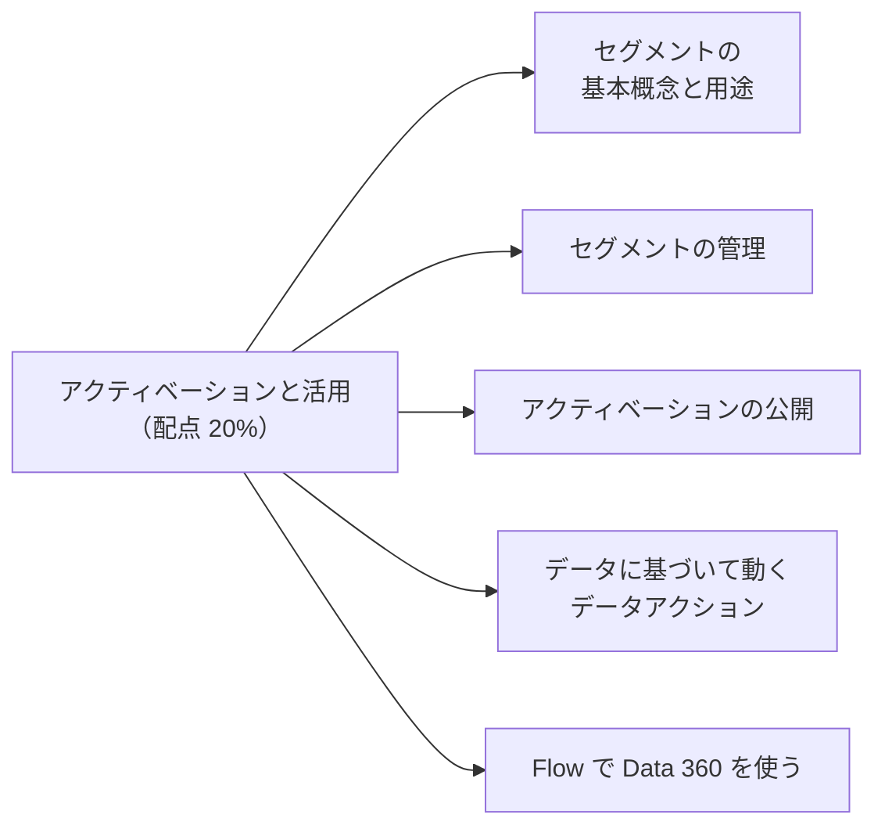
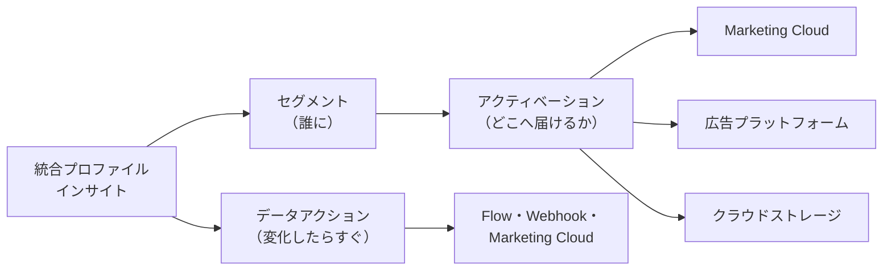
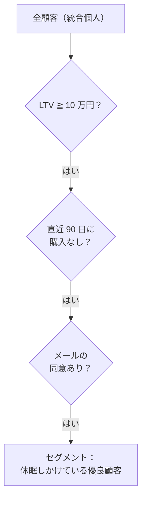
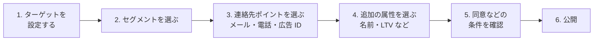
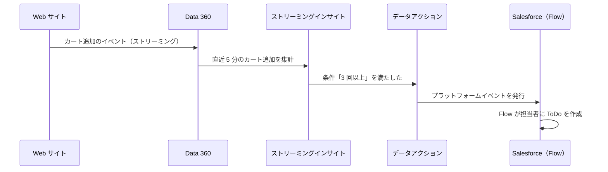

## はじめに：この範囲で学ぶこと

「アクティベーションと活用」は配点 **20%** で、Data 360 Consultant で最も大きい範囲です。

---

## 1. セグメントの基本

**セグメント**は、条件に合う顧客の**グループ**です。「誰に」届けるかを決めます。

### 1-1. セグメントの使い道

| 用途 | 例 |
|---|---|
| マーケティング | 「最近購入がない優良顧客」に再来店のクーポンを送る |
| 広告 | 既存顧客を広告の配信から除外する、似た人に広告を出す |
| サービス | 「解約の兆候がある上位顧客」を担当者に知らせる |
| 分析 | 顧客層ごとの売上を比べる |
| パーソナライズ | Web やアプリの表示を、顧客層ごとに変える |

### 1-2. セグメントの対象（Segment On）

- 何の単位でグループを作るか。通常は**統合個人**（人）。B2B では**取引先**（会社）単位も使えます。
- 対象のエンティティと、条件に使うデータが**リレーションでつながっている**必要があります。

### 1-3. 条件に使えるデータ

| データ | 例 |
|---|---|
| **プロファイルの属性** | 年齢層、居住地、会員ランク |
| **関連する属性**（購入・行動などの DMO） | 直近 30 日に購入した、メールを開封した |
| **計算済みインサイト** | LTV が 10 万円以上、購入回数 5 回以上 |
| **予測モデルのスコア** | 解約確率が 70% 以上 |

- **AND・OR** を組み合わせ、**除外**の条件も使えます。
- 別のセグメントを条件に入れる（**ネスト**）ことで、共通の条件を使い回せます。
- 公開する前に、**人数（母数）**を確認します。少なすぎる・多すぎるなら条件を見直します。

セグメントの種類の例

- **標準のセグメント**：条件で作る、いちばん基本のセグメント
- **ウォーターフォールセグメント**：優先順位をつけて、顧客を重複なく複数のグループに振り分ける（1 人が 1 つのグループだけに入る）
- **リアルタイムのセグメント**：行動に応じて、すぐに所属が変わる（データグラフなどを利用）

---

## 2. セグメントを管理する

### 2-1. 公開のスケジュール

| 方法 | 特徴 |
|---|---|
| **標準の公開** | 決まった間隔（例：12 時間・24 時間ごと）でセグメントを計算し直す |
| **高速な公開（ラピッドパブリッシュ）** | より短い間隔で更新。ただし**対象にするデータの期間**などに制限がある |
| **手動で公開** | 必要なときに公開する |
| **リアルタイム** | 行動のたびに更新（対応する機能が必要） |

- 更新が頻繁なほど**クレジット**を多く消費します。業務に必要な鮮度に合わせます。

### 2-2. 運用のポイント

| ポイント | 内容 |
|---|---|
| 名前と説明 | 何の目的のセグメントか、誰が使うかを書く |
| 不要なセグメントの停止 | 使っていないセグメントの公開を止めて、コストを減らす |
| データスペース | ブランドごとのデータスペースでセグメントを分ける |
| 人数の推移を見る | 急に増減したら、データの取り込みや ID 解決に問題がないか確認 |

---

## 3. アクティベーション

**アクティベーション**は、セグメントを**外部のシステム（アクティベーションターゲット）に届ける**ことです。

### 3-1. アクティベーションターゲット

| ターゲット | 使い方 |
|---|---|
| **Marketing Cloud Engagement** | メール・SMS などの配信リスト、ジャーニーの対象 |
| **Marketing Cloud Account Engagement** | B2B のマーケティング |
| **広告プラットフォーム** | Google・Meta・Amazon などに、広告の配信対象や除外リストとして送る |
| **クラウドストレージ** | S3 などにファイルとして出力し、他のシステムで使う |
| **Data 360** | Data 360 の中で、別の処理に使う |
| **パーソナライズ** | Web やアプリの表示の出し分け |

### 3-2. アクティベーションを公開する手順

| 設定 | ポイント |
|---|---|
| **連絡先ポイント** | どこに届けるか（メールアドレス、電話番号、広告用の ID）。統合後に複数ある場合、どれを使うかのルールを決める |
| **追加の属性** | 配信先でパーソナライズに使う項目（名前、おすすめ商品、LTV など） |
| **同意** | 配信してよい人だけに絞る（オプトインの状態） |
| **公開の状態の確認** | 成功・失敗、配信件数を確認する |

ひっかけ注意

「セグメントの人数は 1 万人なのに、配信は 6 千件だった」→ よくある理由は、**連絡先ポイント（メールアドレス）がない人**や、**同意がない人**が除かれたことです。エラーではない場合があります。

---

## 4. データに基づいて動く（データアクション）

**データアクション**は、データの変化を**きっかけ**に、**すぐに**処理を起こす仕組みです。セグメントのように定期的に計算するのではなく、**イベント駆動**で動きます。

| 要素 | 内容 |
|---|---|
| **きっかけ** | ストリーミングインサイトの条件を満たした、DMO のデータが変わった など |
| **条件** | どんなときに動くか（金額が 10 万円以上 など） |
| **送り先（ターゲット）** | **Salesforce のプラットフォームイベント**（→ Flow や Apex で処理）、**Webhook**（外部システム）、**Marketing Cloud**（ジャーニーの開始） |

データアクションの例

- 上位顧客がカートを放棄したら、担当営業に ToDo を作る（プラットフォームイベント → Flow）
- 機器のセンサーの値が異常になったら、ケースを作る（プラットフォームイベント → Flow）
- 購入直後に、お礼のジャーニーを始める（Marketing Cloud）
- 外部の配送システムに通知する（Webhook）

### 4-1. セグメント・アクティベーションとの違い

| | セグメント＋アクティベーション | データアクション |
|---|---|---|
| 動くタイミング | 公開のスケジュール（定期） | データが変わったとき（すぐ） |
| 対象 | グループ（多くの人） | 1 件 1 件のイベント・レコード |
| 主な用途 | キャンペーン、広告 | リアルタイムの通知・自動処理 |

---

## 5. Flow で Data 360 を使う

| 使い方 | 例 |
|---|---|
| **データアクションから Flow を動かす** | プラットフォームイベントで起動する Flow が、ToDo やケースを作る |
| **Data 360 のデータの変化で動く Flow** | Data 360 のデータ（DMO）の変化をきっかけに Flow を起動する |
| **Flow の中で Data 360 のデータを取得** | 画面フローやレコードトリガーフローで、統合プロファイルやインサイトを取得して判断に使う |
| **セグメントに基づく自動化** | セグメントに入った人に対して処理を行う |

なぜ Flow とつなぐのか

Data 360 は「気づく」のが得意で、Flow は「業務の処理をする」のが得意です。Data 360 で**重要な変化に気づき**、Flow で **ToDo・ケース・メール・レコード更新**などの業務に変える、という分担が基本です。

---

## 6. まとめ

| テーマ | 覚えること |
|---|---|
| セグメント | 対象（統合個人・取引先）、条件（属性・関連属性・インサイト・予測）、除外・ネスト、人数の確認 |
| 公開 | 標準（定期）、高速、手動、リアルタイム。頻度はコストに影響 |
| アクティベーション | ターゲット、連絡先ポイント、追加属性、同意 |
| データアクション | 変化をきっかけにすぐ動く。プラットフォームイベント・Webhook・Marketing Cloud |
| Flow | データアクションで起動、データの変化で起動、Flow の中で取得 |

## 試験直前チェック

- [ ] セグメントの対象と、条件に使えるデータを 4 種類言える
- [ ] 公開のスケジュールの種類とコストの関係を言える
- [ ] アクティベーションターゲットを 4 つ言える
- [ ] セグメントの人数と配信件数が違う理由を言える
- [ ] データアクションの送り先を 3 つ言える
- [ ] セグメント＋アクティベーションとデータアクションの違いを言える
- [ ] Flow で Data 360 を使う方法を 2 つ言える
