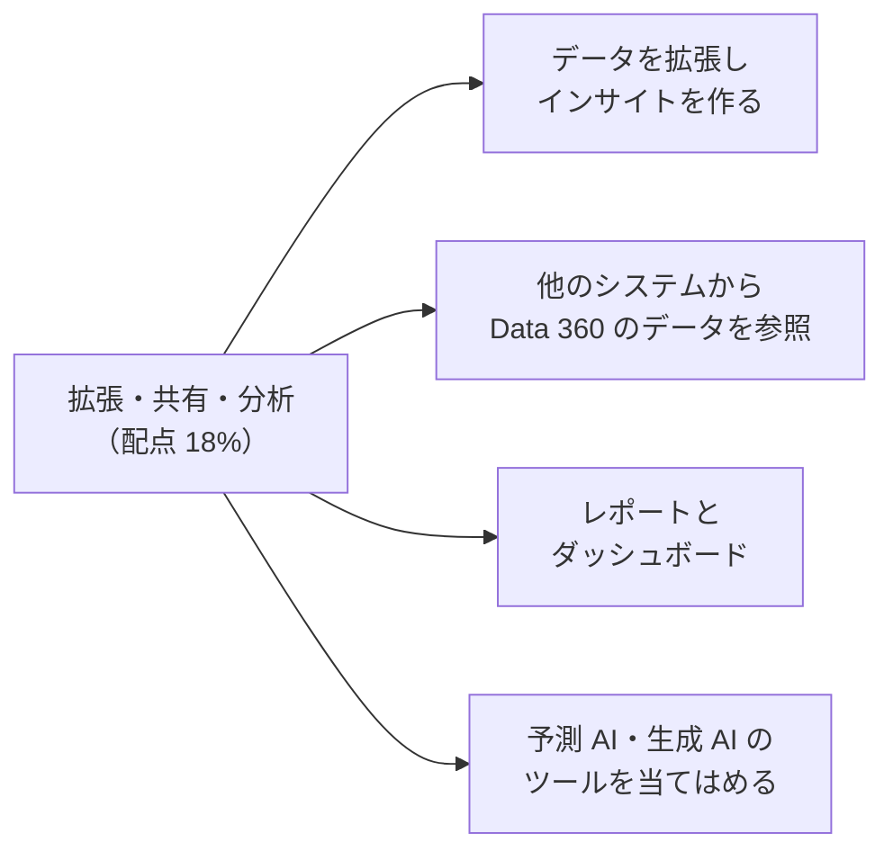
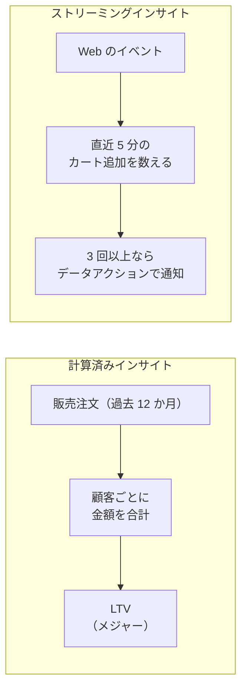
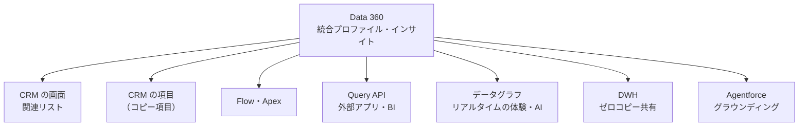
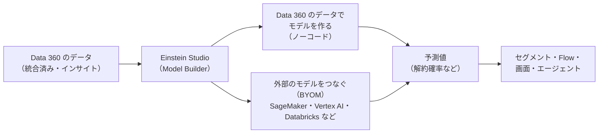

## はじめに：この範囲で学ぶこと

「データの拡張・共有・分析」は配点 **18%** です。

---

## 1. インサイトでデータを拡張する

統合したデータから、**業務に使える指標**を作ることを「拡張」と言います。

### 1-1. 計算済みインサイトとストリーミングインサイト

| | 計算済みインサイト | ストリーミングインサイト |
|---|---|---|
| 計算のタイミング | **定期的**に（スケジュール） | データが届くたびに**ほぼリアルタイム** |
| 集計の範囲 | 長い期間（過去 12 か月など）も可 | 短い時間の枠（**ウィンドウ**、例：直近 5 分） |
| 作り方 | SQL、または画面（ビルダー） | SQL、または画面 |
| 主な使い道 | セグメントの条件、プロファイルの表示、分析、AI の特徴量 | **データアクション**と組み合わせた即時の対応 |
| 例 | 顧客ごとの生涯価値（LTV）、購入回数、最終購入日、平均購入単価 | 5 分以内にカートに 3 回追加、機器の温度が 10 分で急上昇 |

### 1-2. メジャーとディメンション

| 用語 | 意味 | 例 |
|---|---|---|
| **メジャー** | 集計した**数値** | 購入金額の合計、購入回数 |
| **ディメンション** | 集計の**切り口** | 統合個人の ID、商品カテゴリ、店舗 |

- 「顧客ごとの」インサイトにするには、ディメンションに**統合個人の ID**を入れます。こうするとセグメントやプロファイルで使えます。
- 「顧客 × 商品カテゴリごとの購入金額」のように、複数のディメンションも使えます。

変換とインサイトの使い分け

- データを**整形・結合して別のデータを作りたい** → データ変換
- 顧客ごとの**指標（数値）**を作り、セグメントやプロファイルで使いたい → **計算済みインサイト**
- 数分以内の動きをとらえて**すぐ動きたい** → **ストリーミングインサイト**＋データアクション

### 1-3. その他の拡張

| 方法 | 内容 |
|---|---|
| **数式項目・データ変換** | 取り込み時・取り込み後の整形（「接続と取り込み」で学習） |
| **予測モデルのスコア** | Einstein Studio で作ったモデルの予測値（購入確率など）をデータに加える |
| **生成 AI による補完** | プロンプトを使って、テキストの分類や要約をデータに加える |

---

## 2. 他のシステムから Data 360 のデータを参照する

| 方法 | 使いどころ |
|---|---|
| **CRM の画面に表示（関連リスト・コンポーネント）** | 取引先責任者や取引先のページに、統合プロファイルの情報、注文履歴、インサイトを表示する |
| **Data 360 の項目をレコードにコピー（コピー項目）** | インサイトの値（LTV など）を CRM のレコードの項目に反映し、レポートや自動化で使う |
| **Flow・Apex** | Flow や Apex から Data 360 のデータを取得して処理に使う |
| **Query API（SQL）** | 外部のアプリや BI ツールから SQL で問い合わせる |
| **データグラフ** | 関連するデータをまとめた形で、アプリや AI に**素早く**渡す |
| **ゼロコピーのデータ共有** | DWH（Snowflake など）から、コピーせずに Data 360 のデータを使う |
| **Agentforce・プロンプト** | エージェントやプロンプトのグラウンディングに使う |

要件と方法の対応

- 「サービス担当者が、ケースの画面で顧客の過去の購入を見たい」→ **関連リスト**
- 「LTV を取引先責任者の項目に入れて、既存のレポートと割り当てルールで使いたい」→ **コピー項目**
- 「社内の BI ツールで統合データを分析したい」→ **Query API** または **ゼロコピー共有**
- 「Web サイトで、訪問者に合わせたおすすめを一瞬で出したい」→ **データグラフ**（リアルタイム）

---

## 3. レポートとダッシュボード

| 方法 | 特徴 |
|---|---|
| **Data 360 のレポート** | Data 360 のオブジェクトを使ったレポート・ダッシュボード |
| **Tableau・CRM Analytics** | 統合データを高度に可視化・分析 |
| **CRM のレポート（コピー項目経由）** | CRM の項目に反映した値で、いつものレポートを使う |
| **クエリ（SQL）** | データを直接調べる |

- 誰が何を判断するためのレポートか（マーケティングの効果、顧客の価値の分布、データの品質）を先に決めます。
- **データの品質**（統合率、空の項目の割合、取り込みの遅れ）のダッシュボードも、運用で役立ちます。

---

## 4. 予測 AI と生成 AI を当てはめる

### 4-1. 予測 AI（Einstein Studio）

| 方法 | 使いどころ |
|---|---|
| **Data 360 のデータでモデルを作る** | データサイエンティストがいなくても、購入確率・解約確率などを予測したい |
| **外部のモデルをつなぐ（BYOM）** | すでに自社の機械学習基盤でモデルを作っている。データはゼロコピーで渡せる |

**例**：解約確率が高い顧客をセグメントにして、引き留めのキャンペーンを送る。Flow で担当者に ToDo を作る。

### 4-2. 生成 AI

| 方法 | 使いどころ |
|---|---|
| **プロンプトのグラウンディング** | 統合プロファイルやインサイトをプロンプトに入れ、顧客に合わせた文章を作る |
| **非構造化データの検索（RAG）** | マニュアルやナレッジを検索インデックスにして、エージェントの回答の根拠にする |
| **生成 AI でデータを補う** | 問い合わせ文を分類する、レビューを要約するなど |
| **Agentforce** | 統合データを使い、顧客ごとに合った回答と行動をする |

ひっかけ注意

「将来の購入確率を出したい」→ **予測 AI**。「顧客の状況に合わせたメール文を作りたい」→ **生成 AI**。「過去 12 か月の購入金額を出したい」→ どちらでもなく**計算済みインサイト**（集計で確実に出せる）。

---

## 5. まとめ

| テーマ | 覚えること |
|---|---|
| 計算済みインサイト | 定期計算、長い期間、メジャー＋ディメンション、セグメントやプロファイルで使う |
| ストリーミングインサイト | 短いウィンドウでリアルタイム、データアクションと組み合わせる |
| 参照 | 関連リスト、コピー項目、Flow・Apex、Query API、データグラフ、ゼロコピー |
| 分析 | Data 360 のレポート、Tableau、CRM のレポート、SQL |
| 予測 AI | Einstein Studio でモデルを作る、BYOM でつなぐ |
| 生成 AI | グラウンディング、RAG、データの補完、Agentforce |

## 試験直前チェック

- [ ] 計算済みインサイトとストリーミングインサイトの違いを 3 つ言える
- [ ] メジャーとディメンションの意味と例を言える
- [ ] 要件に合わせて、他のシステムから参照する方法を選べる
- [ ] コピー項目を使う理由を言える
- [ ] 予測 AI・生成 AI・インサイトの使い分けを説明できる
- [ ] BYOM を選ぶ場面を言える
