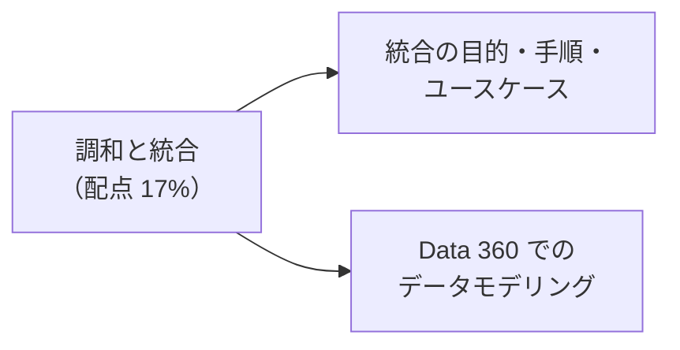
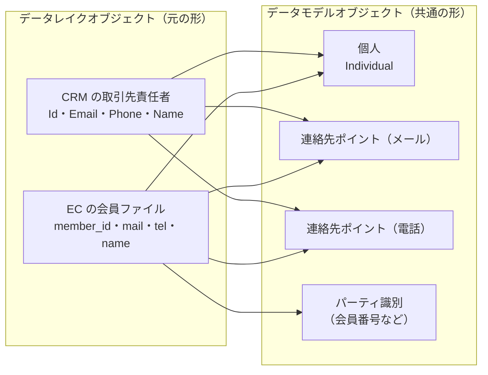
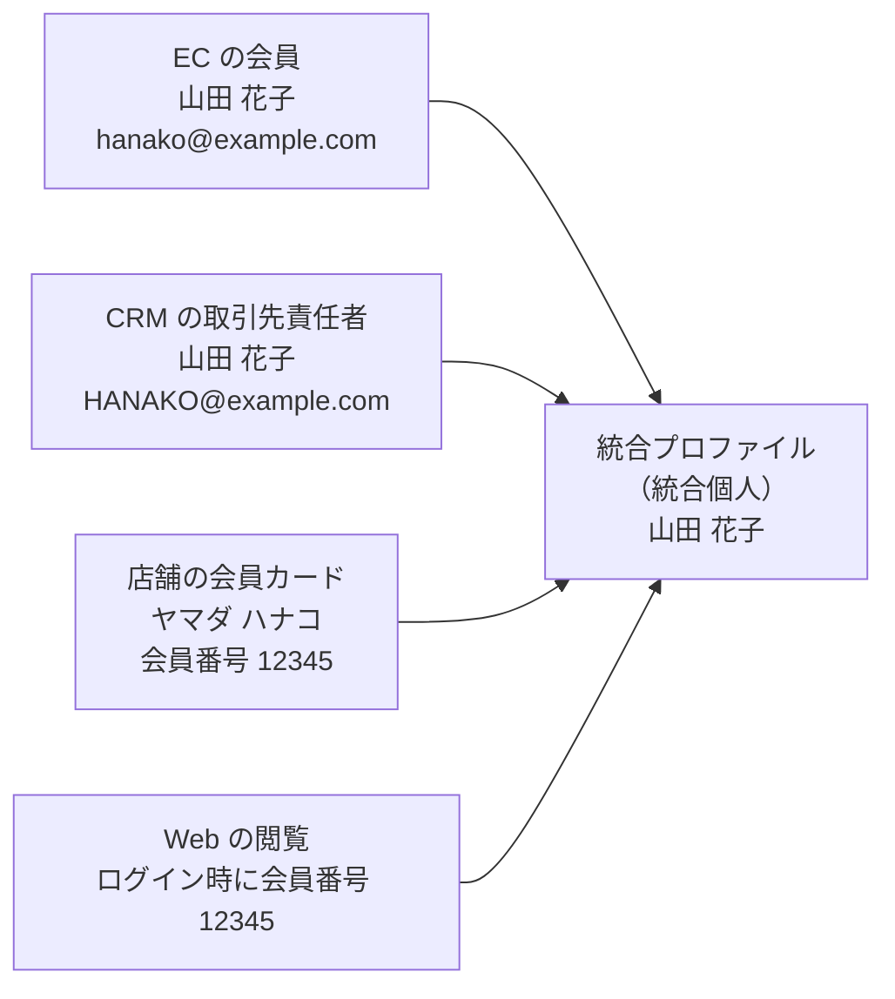
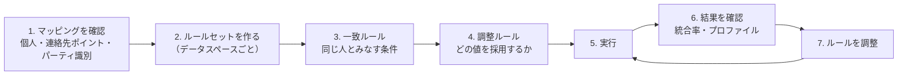

## はじめに：この範囲で学ぶこと

「ハーモナイゼーション（調和）とユニフィケーション（統合）」は配点 **17%** です。

- **調和**：ソースごとにばらばらなデータの形や意味を、**共通のデータモデルにそろえる**こと
- **統合**：別々のソースにある「**同じ人（会社）**」を見つけて、**1 つのプロファイルにまとめる**こと

---

## 1. データモデリング（調和）

### 1-1. DLO から DMO へ

- 1 つの DLO を、**複数の DMO** にマッピングできます（会員ファイル → 個人＋メール＋電話＋会員番号）。
- 違う名前の項目でも、**意味が同じなら同じ DMO の同じ項目**にマッピングします（EC の `mail` と CRM の `Email` → 連絡先ポイント（メール）のメールアドレス）。

### 1-2. Customer 360 データモデルの主な DMO

| 分野 | 主な DMO | 内容 |
|---|---|---|
| **パーティ（人・会社）** | 個人（Individual）、取引先（Account） | 人や会社の基本情報 |
| **連絡先ポイント** | メール、電話、住所、アプリ（デバイス）、ソーシャル | 連絡手段。ID 解決の一致に使う |
| **パーティ識別** | パーティ識別（Party Identification） | 会員番号、ロイヤルティ ID、外部システムの顧客 ID など |
| **エンゲージメント** | メールのエンゲージメント、Web のエンゲージメントなど | 行動の記録 |
| **販売** | 販売注文、販売注文の商品 | 購買 |
| **商品** | 商品 | 商品マスター |
| **同意** | 連絡先ポイントの同意など | 配信してよいか |

### 1-3. マッピングのポイント

| ポイント | 内容 |
|---|---|
| **標準の DMO を優先** | 標準の DMO を使うと、ID 解決・セグメント・他の機能とそのまま連携できる |
| **カスタム DMO** | 標準にないデータ（独自の業務データ）はカスタム DMO を作る |
| **リレーション** | DMO 同士の関係（個人 1：注文 多など）を正しく設定する。セグメントで「注文した人」を条件にするのに必要 |
| **ID 解決に必要なマッピング** | **個人**と、**連絡先ポイント**または**パーティ識別**へのマッピング（どの個人の連絡先かを示す項目も） |
| **データ型** | 日付・数値などの型を合わせる |
| **カテゴリ** | エンゲージメントの DLO はエンゲージメントの DMO へ |

ひっかけ注意

「ID 解決を実行したのに、メールアドレスが同じ人がまとまらない」→ よくある原因は、メールアドレスを**連絡先ポイント（メール）の DMO にマッピングしていない**、または連絡先ポイントが**どの個人のものか**を示す項目をマッピングしていないことです。個人の DMO の項目にメールを入れるだけでは一致に使われません。

---

## 2. 統合（ID 解決）の目的

| 目的 | 説明 |
|---|---|
| **顧客の全体像** | ばらばらだった購買・問い合わせ・行動を 1 人分にまとめて見る |
| **重複の削減** | 同じ人に同じメールを何通も送らない |
| **正確な数字** | 顧客数・生涯価値を正しく数える |
| **パーソナライズと AI** | 1 人の全体像をもとに、出し分けや AI の回答に使う |

### 2-1. ユースケース

| ユースケース | 統合の単位 |
|---|---|
| 個人の顧客（B2C）の全体像 | **個人**（統合個人） |
| 法人の顧客（B2B）で、複数のシステムの取引先をまとめる | **取引先**（統合取引先） |
| Web の匿名の訪問者が、ログインした後に会員とつながる | デバイスの ID と会員番号（パーティ識別）を使って個人に結び付ける |

---

## 3. ID 解決の手順

### 3-1. 一致ルール（同じ人とみなす条件）

| 一致の方法 | 意味 | 例 |
|---|---|---|
| **完全一致** | 値がまったく同じ | 姓が同じ |
| **正規化した一致** | 大文字・小文字、空白、書式の違いを整えてから比べる | `HANAKO@Example.com` と `hanako@example.com` |
| **あいまい一致（ファジー）** | 表記ゆれを許して比べる（主に名前） | 「Hanako」と「Hanakko」 |
| **パーティ識別の一致** | 会員番号・外部 ID が同じ | ロイヤルティ ID が同じ |

- 1 つの一致ルールの中の条件は**すべて満たす（AND）**必要があります。
- 複数の一致ルールは、**どれか 1 つを満たせば（OR）**一致とみなします。

例：よくあるルールの組み合わせ

- ルール 1：名（あいまい）＋ 姓（完全）＋ メール（正規化）
- ルール 2：名（あいまい）＋ 姓（完全）＋ 電話（正規化）
- ルール 3：会員番号（パーティ識別）

→ どれか 1 つでも満たせば、同じ人としてまとめる。

### 3-2. 緩すぎ・厳しすぎのリスク

| 状態 | 起きること | 例 |
|---|---|---|
| **緩すぎる（過剰な統合）** | **別人がまとまる**。他人の情報でパーソナライズ、誤った配信、プライバシーの問題 | 家族で共有のメールアドレス、会社の代表電話だけで一致させる |
| **厳しすぎる（統合不足）** | **同じ人がまとまらない**。重複配信、顧客数の水増し | 名前の完全一致を必須にして、表記ゆれでまとまらない |

どちらが危ないか

一般に、**別人をまとめてしまう**ほうがリスクが大きいです（他人の購入履歴が表示される、他人にメールが届く）。最初はやや**保守的**なルールから始め、結果を見ながら緩めていくのが安全です。

### 3-3. 調整ルール（どの値を採用するか）

統合したプロファイルの項目（名前、住所など）に、ソースごとに違う値があるとき、**どれを採用するか**を決めます。

| 調整ルール | 採用する値 | 向いている項目 |
|---|---|---|
| **最終更新** | 最も新しく更新された値 | 住所、電話番号（変わりやすい） |
| **最も頻繁** | いちばん多くのソースに出てくる値 | 名前の表記 |
| **ソースの優先順位** | 信頼できるソースの値を優先（例：CRM ＞ EC ＞ アンケート） | 正式な氏名、生年月日 |

- 項目ごとに違う調整ルールを設定できます。
- 連絡先ポイント（メールや電話）は、統合後も**複数の値を持てます**（統合連絡先ポイント）。

---

## 4. 統合の結果

| 結果 | 内容 |
|---|---|
| **統合個人（統合プロファイル）** | まとめられた 1 人分のプロファイル |
| **統合リンク** | 統合プロファイルと、元のソースのレコードの対応関係。どのデータがどこから来たか追跡できる |
| **統合連絡先ポイント** | 統合後のメール・電話・住所などの一覧 |
| **処理サマリー** | 元のプロファイル数、統合後のプロファイル数、**統合率** |

**統合率**の目安：元のプロファイルが 100 万件、統合後が 70 万件なら、30 万件分がまとまった（統合率 30%）。数字が想定と大きく違う場合は、ルールやマッピングを見直します。

確認のしかた

1. ID 解決の**処理サマリー**で、元の件数と統合後の件数を見る
2. **プロファイルエクスプローラー**で、何人か統合プロファイルを開き、まとまったソースのレコードを確認する
3. まとまるべき人がまとまっていない／別人がまとまっている例を探し、一致ルールを調整する

---

## 5. まとめ

| テーマ | 覚えること |
|---|---|
| 調和 | DLO を共通の DMO にマッピング。1 つの DLO を複数の DMO へ |
| 主な DMO | 個人、取引先、連絡先ポイント、パーティ識別、エンゲージメント、販売注文 |
| ID 解決の前提 | 個人＋連絡先ポイント／パーティ識別のマッピング |
| 一致ルール | 完全・正規化・あいまい・パーティ識別。ルール内は AND、ルール間は OR |
| リスク | 緩すぎ＝別人がまとまる（危険）、厳しすぎ＝重複が残る |
| 調整ルール | 最終更新、最も頻繁、ソースの優先順位 |
| 結果 | 統合個人、統合リンク、統合連絡先ポイント、統合率 |

## 試験直前チェック

- [ ] 調和と統合の違いを言える
- [ ] ID 解決のためにマッピングが必要な DMO を言える
- [ ] 一致ルールの 4 つの方法と、AND・OR の関係を言える
- [ ] 一致ルールが緩すぎる・厳しすぎるときの問題を言える
- [ ] 調整ルールの 3 つの選択肢と向いている項目を言える
- [ ] 統合リンクの役割を言える
- [ ] B2B で統合する単位を言える
