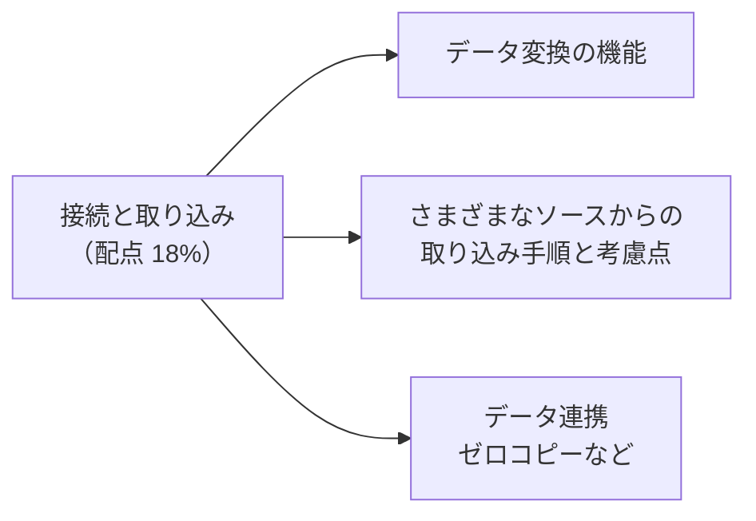
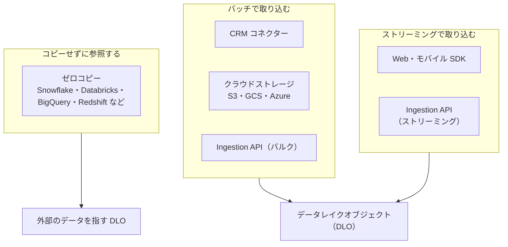
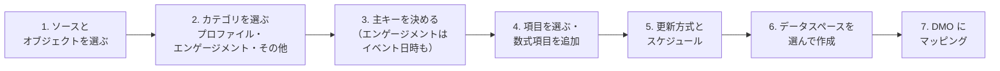
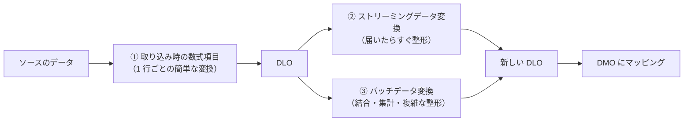
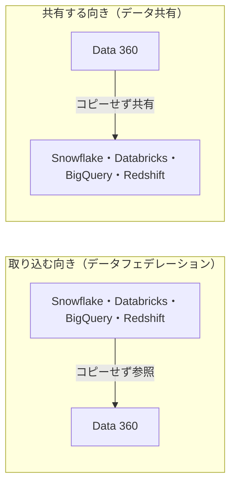

## はじめに：この範囲で学ぶこと

「データソースの接続と取り込み」は配点 **18%** です。

---

## 1. データの入り方は 3 通り

| 方法 | 特徴 | 向いているデータ |
|---|---|---|
| **バッチ** | 決まった間隔でまとめて取り込む | 顧客マスター、注文履歴、日次のファイル |
| **ストリーミング** | 発生したらすぐ（ほぼリアルタイム）取り込む | Web・アプリの行動、IoT、決済のイベント |
| **ゼロコピー** | 外部の DWH のデータを**コピーせずに**参照する | DWH に大量にあり、コピーしたくないデータ |

---

## 2. 主なデータソースとコネクター

| ソース | 方法 | ポイント |
|---|---|---|
| **Salesforce の CRM 組織** | Salesforce CRM コネクター | 取引先・取引先責任者・リードなど。**データバンドル**（よく使うオブジェクトとマッピングのセット）ですばやく始められる |
| **Marketing Cloud Engagement** | Marketing Cloud コネクター | メール・SMS などのエンゲージメントデータ。バンドルあり |
| **Commerce Cloud など他の Salesforce 製品** | 各製品のコネクター | 注文・商品などのデータ |
| **Web サイト・モバイルアプリ** | **Web・モバイル SDK** | 閲覧・クリック・カート追加などの行動をストリーミング。イベントの形（スキーマ）を定義する |
| **クラウドストレージ** | Amazon S3、Google Cloud Storage、Azure など | CSV などのファイルを定期的に取り込む |
| **自社システム** | **Ingestion API**（ストリーミング・バルク） | 取り込むデータの形（スキーマ）を定義してから送る |
| **連携基盤** | MuleSoft など | 多くのシステムをつなぐ |
| **DWH・データレイク** | **ゼロコピー** | コピーせず参照 |
| **非構造化データ** | 文書・ナレッジなど | 検索インデックスを作り、AI のグラウンディングに使う |

選び方のコツ

- 「Salesforce の別の組織のデータ」→ **CRM コネクター**
- 「Web サイトの閲覧行動をリアルタイムで」→ **Web SDK**
- 「自社の POS からイベントが発生するたびに送りたい」→ **Ingestion API（ストリーミング）**
- 「毎晩 S3 に置かれる CSV」→ **S3 コネクター**
- 「Snowflake にある大量の購買データを、コピーせずに使いたい」→ **ゼロコピー**

---

## 3. データストリームを作る

### 3-1. 手順

### 3-2. カテゴリ（重要）

| カテゴリ | 意味 | 例 | 必須の項目 |
|---|---|---|---|
| **プロファイル** | 人や会社の**属性** | 顧客マスター、会員情報 | 主キー |
| **エンゲージメント** | **いつ何をしたか**という行動・取引（時系列） | 購入、メール開封、Web 閲覧 | 主キー＋**イベント日時** |
| **その他** | 上の 2 つ以外 | 商品マスター、店舗マスター | 主キー |

ひっかけ注意

- 購入履歴のように**日時を持つ行動データ**を「プロファイル」で取り込むのは誤り。**エンゲージメント**にし、イベント日時の項目を指定します。
- カテゴリや主キーは、データストリームを作った**後からは変えにくい**ので、作る前に決めておきます。

### 3-3. 主キーと更新方式

- **主キー**：レコードを一意に見分ける項目。同じ主キーのデータが来たら更新される（重複しない）。一意な項目がない場合は、**数式項目**で複数の項目を連結して作ることもあります。
- **更新方式**：
  - **差分（アップサート）**：新しいデータと変わったデータだけを反映。処理量とクレジットを抑えられる
  - **全件の置き換え**：毎回すべてのデータを入れ替える。削除も反映されるが、処理量が多い
- **スケジュール**：ソースに応じて更新の間隔を決める。必要以上に頻繁にするとクレジットが増えます。

### 3-4. 取り込みの考慮点

| 観点 | 考えること |
|---|---|
| **データの量と頻度** | 件数、1 日の増加量、どれくらい新しいデータが必要か |
| **データの品質** | 必須項目の欠け、形式のばらつき（電話番号・日付）、重複 |
| **データ型** | 日付・数値・テキストを正しく扱えるか（日付の形式の不一致はエラーの原因） |
| **個人情報と同意** | 必要な項目だけを取り込む、同意の情報も一緒に取り込む |
| **データスペース** | どのデータスペースに入れるか |
| **コスト** | 取り込みの件数と頻度がクレジットに影響 |
| **削除の扱い** | ソースで削除されたデータをどう反映するか |

---

## 4. データ変換

### 4-1. 変換の種類

| 方法 | できること | 例 |
|---|---|---|
| **数式項目（取り込み時）** | 1 行の中での計算・整形 | 姓と名を連結、文字を大文字にそろえる、主キーを作る、値の置き換え |
| **ストリーミングデータ変換** | 取り込まれたデータを**ほぼリアルタイム**に整形して別の DLO に出力 | ストリーミングのイベントを整えてすぐ使う |
| **バッチデータ変換** | 複数の DLO の**結合・集計・絞り込み・整形**を、画面（ビジュアルエディター）で組み立て、スケジュールで実行 | 注文明細を注文ごとに集計、2 つのソースを結合 |

使い分け

- **1 行の中で済む**簡単な変換 → **数式項目**
- **リアルタイム**性が必要 → **ストリーミングデータ変換**
- **複数のデータの結合や集計**が必要 → **バッチデータ変換**
- 指標として集計したい（顧客ごとの購入金額など）→ 変換ではなく**計算済みインサイト**（「拡張・共有・分析」で学びます）

---

## 5. データ連携とゼロコピー

### 5-1. ゼロコピーの 2 つの向き

| 向き | 意味 | 例 |
|---|---|---|
| **外部 → Data 360**（フェデレーション） | DWH のデータを、Data 360 から**その場で参照**する | Snowflake の購買履歴を、コピーせずにセグメントの条件に使う |
| **Data 360 → 外部**（データ共有） | Data 360 の統合データを、DWH から**コピーせずに**使えるようにする | 統合プロファイルを、データサイエンスのチームが Databricks で分析 |

### 5-2. ゼロコピーのメリットと考慮点

| メリット | 考慮点 |
|---|---|
| データを**二重に持たない**（保存コスト・同期の手間が減る） | 参照のたびに**外部の DWH 側にも処理の負荷とコスト**がかかる |
| ETL（コピーの仕組み）の開発・保守が要らない | 応答の速さは外部の DWH の性能やネットワークに左右される |
| 常に**最新のデータ**を参照できる | 高速化のためにキャッシュ（加速）を使うと、鮮度とのトレードオフがある |
| データの管理（ガバナンス）を元の場所で続けられる | 外部側のアクセス権・セキュリティの設定が必要 |

「ゼロコピーなら何でもよい」わけではない理由

ゼロコピーは、大量で変化するデータを**コピーせずに**使えるのが強みです。一方、頻繁に何度も参照するデータや、リアルタイムの処理（データアクションなど）で使うデータは、取り込んだほうが速く安定することがあります。**データの量・参照の頻度・必要な鮮度・コスト**で判断します。

### 5-3. その他のデータ連携

- パートナー企業と、互いの顧客データをそのまま見せずに分析する**クリーンルーム**のような、プライバシーを守るデータ連携の仕組みもあります。
- どの連携でも、**同意と契約の範囲**で使うことが前提です。

---

## 6. まとめ

| テーマ | 覚えること |
|---|---|
| 入り方 | バッチ、ストリーミング、ゼロコピー |
| ソース | CRM コネクター、Marketing Cloud、Web・モバイル SDK、ストレージ、Ingestion API、MuleSoft、ゼロコピー |
| カテゴリ | プロファイル（属性）、エンゲージメント（行動・イベント日時が必須）、その他 |
| 主キー・更新方式 | 主キーで重複防止。差分は軽く、全件置き換えは削除も反映 |
| 変換 | 数式項目（1 行）、ストリーミング変換（即時）、バッチ変換（結合・集計） |
| ゼロコピー | 外部 → Data 360 の参照と、Data 360 → 外部の共有。コピー不要だが外部側の負荷とコスト |

## 試験直前チェック

- [ ] ソースごとに適したコネクター・取り込み方法を言える
- [ ] 3 つのカテゴリと、エンゲージメントに必要な項目を言える
- [ ] 差分と全件置き換えの違いを言える
- [ ] 数式項目・ストリーミング変換・バッチ変換の使い分けを言える
- [ ] ゼロコピーの 2 つの向きを例で説明できる
- [ ] ゼロコピーと取り込みのどちらを選ぶか、判断の材料を 3 つ言える
