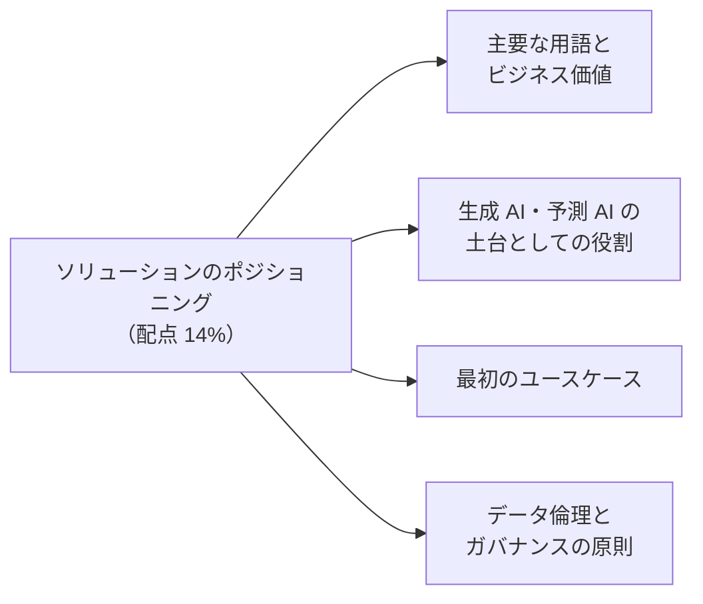
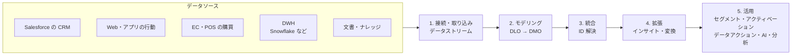
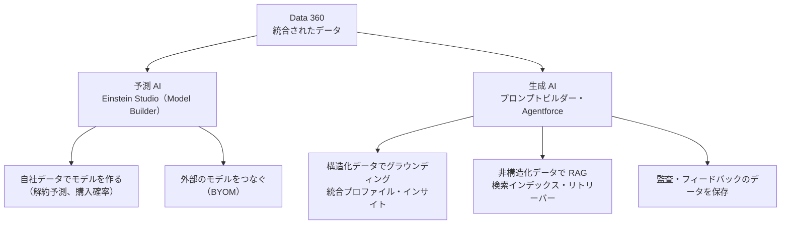

## はじめに：この範囲で学ぶこと

「ソリューションのポジショニング」は配点 **14%** です。製品の設定より、**Data 360 とは何か、なぜ価値があるのかを顧客に説明する力**が問われます。

名前の変化

Customer Data Platform → Genie → **Data Cloud** → **Data 360**（現在）。試験の解説や古い資料では Data Cloud と書かれていることがあります。

---

## 1. Data 360 とは

**Data 360** は、社内外に散らばった顧客データを**つなぎ、そろえ、1 人の顧客としてまとめ**、それを**分析・セグメント・AI・業務のアクション**に使えるようにする、Salesforce プラットフォーム上のデータ基盤です。

### 1-1. 主要な用語

| 用語 | 意味 |
|---|---|
| **データソース** | データの出どころ（CRM 組織、S3、Web サイトなど） |
| **データストリーム** | データソースから Data 360 にデータを取り込む「流れ」の設定 |
| **データレイクオブジェクト（DLO）** | 取り込んだデータを**元の形のまま**保存する入れ物 |
| **データモデルオブジェクト（DMO）** | 共通の形（Customer 360 データモデル）にそろえたデータの入れ物。DLO を**マッピング**して作る |
| **Customer 360 データモデル** | 個人・連絡先・注文などの標準のデータモデル |
| **データスペース** | ブランドや地域ごとに、データと処理を論理的に分ける区画 |
| **ID 解決** | 別々のソースの「同じ人」を見つけてまとめる処理 |
| **統合プロファイル（統合個人）** | ID 解決でまとめた 1 人分の顧客データ |
| **計算済みインサイト** | 集計した指標（生涯価値、購入回数など） |
| **ストリーミングインサイト** | 短い時間の中でリアルタイムに集計する指標 |
| **セグメント** | 条件に合う顧客のグループ |
| **アクティベーション** | セグメントを外部（マーケティング、広告など）に届けること |
| **データアクション** | データの変化をきっかけに、すぐ処理を起こすこと |
| **データグラフ** | 関連するデータをまとめて素早く取り出せる形にしたもの |
| **ゼロコピー** | DWH などのデータを**コピーせずに**参照・共有する仕組み |
| **クレジット（消費）** | 取り込み・処理・セグメントなどの使用量に応じて消費する課金の単位 |

### 1-2. どんな仕組みの上で動いているか

- Data 360 は Salesforce プラットフォーム（Hyperforce）上の**レイクハウス**として、オープンな形式で大量のデータを保存します。
- **メタデータ**が Salesforce と共通なので、CRM のレコードページ、Flow、レポート、Agentforce からそのまま使えます。

---

## 2. ビジネス価値

### 2-1. CRM・DWH・従来の CDP との違い

| | CRM | DWH・データレイク | Data 360 |
|---|---|---|---|
| 主な目的 | 営業・サービスの業務 | 全社データの保管と分析 | 顧客データの**統合と活用**（業務・AI・マーケティング） |
| データの量 | 業務レコード中心 | とても大量 | 大量（行動データ・イベントも） |
| 同じ人の統合 | 重複ルールなどで限定的 | 自分で作り込む | **ID 解決**で標準機能として提供 |
| 業務への反映 | そのまま | 別の仕組みが必要 | CRM・Flow・Agentforce・マーケティングに**直接**反映 |
| リアルタイム | 業務の更新 | バッチ中心が多い | ストリーミングの取り込み・インサイト・データアクション |

「DWH があるから Data 360 は不要」への答え方

Data 360 は DWH を置き換えるのではなく、**ゼロコピー**で DWH のデータをそのまま使い、統合した顧客データを**業務（CRM・Agentforce・マーケティング）に届ける**役割を持ちます。DWH のデータを CRM に毎回コピーする連携を作り込まずに済む、という価値を説明します。

### 2-2. 価値の言い方

| 誰にとって | 価値 |
|---|---|
| 営業 | 商談や取引先の画面で、購買や Web 行動を含む顧客の全体像を見られる |
| サービス | 過去の購入・問い合わせ・利用状況を 1 画面で確認し、早く解決できる |
| マーケティング | 統合プロファイルでセグメントを作り、重複配信を減らし、パーソナライズできる |
| 経営 | 顧客生涯価値、解約の兆候など、全社で同じ数字を見られる |
| IT | 個別の連携やコピーを減らし、データを 1 か所で管理できる |
| AI | 正確で新しい顧客データが、AI の精度を上げる |

---

## 3. 生成 AI・予測 AI の土台としての役割

| AI の種類 | Data 360 の役割 | 例 |
|---|---|---|
| **予測 AI** | 学習・予測に使う**きれいな統合データ**を提供。Einstein Studio でモデルを作る、外部の機械学習基盤のモデルをつなぐ（BYOM） | 解約しそうな顧客のスコアを出し、セグメントや Flow で使う |
| **生成 AI** | プロンプトやエージェントに**根拠のデータ**を渡す（グラウンディング） | エージェントが顧客の注文履歴と製品マニュアルを根拠に回答 |
| **AI の信頼性** | Einstein Trust Layer の**監査とフィードバックのデータ**を保存 | どんなプロンプトと応答があったかを後から分析 |

合言葉

「**AI の質はデータの質で決まる**」。Data 360 は、ばらばらで古く重複したデータを、統合された新しいデータにして AI に渡します。

---

## 4. 最初のユースケースの選び方

### 4-1. 代表的なユースケース

| 目的 | ユースケース | 使う機能 |
|---|---|---|
| 顧客理解 | サービス担当者が、購買・Web 行動・問い合わせを 1 画面で見る | ID 解決、関連リスト、プロファイル表示 |
| マーケティング | 購入しそうな顧客に合わせたメール・広告 | セグメント、アクティベーション |
| リアルタイム対応 | カート放棄の直後に通知、上位顧客の来店を店舗に通知 | ストリーミング、ストリーミングインサイト、データアクション |
| AI | エージェントの回答を自社データでグラウンディング | 検索インデックス、データライブラリ |
| 分析 | 顧客生涯価値、チャーン予測 | 計算済みインサイト、Einstein Studio |
| 広告費の削減 | 既存顧客を広告の配信対象から外す | セグメント、広告プラットフォームへのアクティベーション |

### 4-2. 最初の 1 つを選ぶ基準

- **事業の目的**から始める（「データを集めたい」ではなく「解約率を 2 ポイント下げたい」）。
- 必要な**データソースが少なく**、品質がある程度よいもの。
- **成果を測れる**（開封率、コンバージョン、対応時間）。
- 小さく始めて価値を示し、**段階的に**データソースとユースケースを広げる。

ひっかけ注意

「最初にすべてのシステムのデータを取り込んでから、使い道を考える」は誤り。取り込みにもクレジットがかかり、価値が見えるまで時間がかかります。**ユースケースから逆算して**、必要なデータだけを取り込みます。

---

## 5. データ倫理とガバナンスの原則

| 原則 | 内容 | Data 360 での実践 |
|---|---|---|
| **同意（コンセント）** | 本人が同意した目的・チャネルでだけ使う | 同意の情報を取り込み、セグメントやアクティベーションで同意のない人を除外 |
| **データの最小化** | 目的に必要なデータだけを集めて使う | 必要な項目だけ取り込む、不要な機微情報は取り込まない |
| **透明性** | どんなデータをどう使うかを説明できる | 利用目的を明示、データの出どころを追跡（統合リンク） |
| **目的の制限** | 集めた目的以外に使わない | データスペース、アクセス制御で用途を分ける |
| **公平性** | 差別や不当な扱いにつながる使い方をしない | 人種・宗教・健康などの機微な属性でセグメントしない |
| **セキュリティ** | 不正アクセスや漏えいから守る | 権限セット、データスペース、ポリシーによるアクセス制御、暗号化 |
| **本人の権利** | 削除・アクセスの依頼に応える | 削除の依頼を受け付け、関連するデータを消す仕組み |
| **法令の順守** | GDPR、個人情報保護法などに従う | データの保管場所、保持期間、同意の記録 |

倫理的に問題のある例

「健康状態を推測できる購買データ（例：特定の医薬品の購入）で、保険の広告を出し分けたい」→ 本人が予想しない使い方で、機微な情報を推測して使うことになります。**同意の範囲、法令、利用者の期待**の観点から、コンサルタントとして懸念を伝え、代わりの方法を提案するのが正解です。

---

## 6. まとめ

| テーマ | 覚えること |
|---|---|
| 流れ | 取り込み → モデリング（DLO→DMO）→ ID 解決 → 拡張 → 活用 |
| 用語 | データストリーム、DLO、DMO、データスペース、統合プロファイル、インサイト、セグメント、アクティベーション、データアクション、ゼロコピー |
| 価値 | 顧客の全体像を業務・AI・マーケティングに直接届ける。DWH はゼロコピーで活かす |
| AI | 予測＝Einstein Studio・BYOM、生成＝グラウンディング・RAG、監査データの保存 |
| ユースケース | 事業の目的から逆算し、小さく始めて広げる |
| 倫理 | 同意、最小化、透明性、目的の制限、公平性、セキュリティ、本人の権利 |

## 試験直前チェック

- [ ] DLO と DMO の違いを言える
- [ ] Data 360 と DWH・CRM の違いを説明できる
- [ ] Data 360 が生成 AI と予測 AI にどう役立つか、それぞれ例を挙げられる
- [ ] 最初のユースケースを選ぶ基準を 3 つ言える
- [ ] データ倫理の原則を 4 つ言える
- [ ] 機微なデータの使い方について、コンサルタントとしてどう対応するか説明できる
