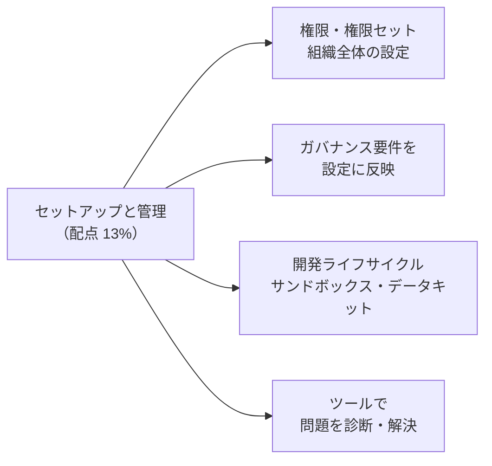
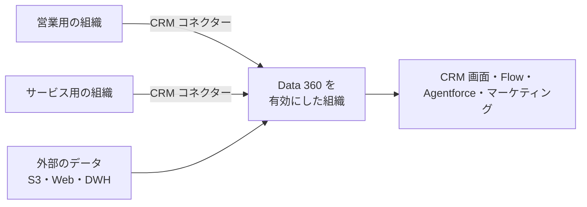
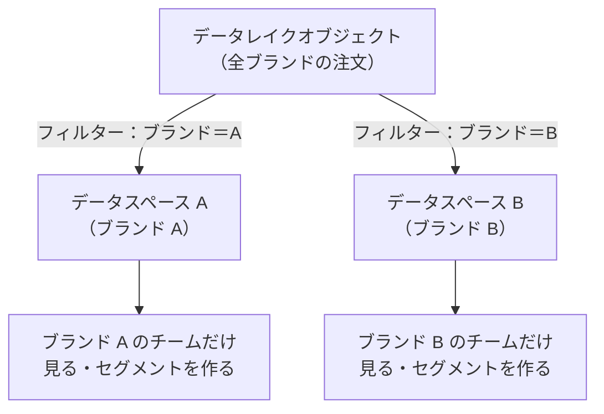
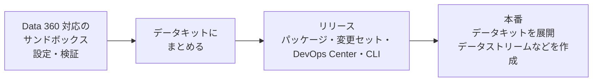

## はじめに：この範囲で学ぶこと

「Data 360 のセットアップと管理」は配点 **13%** です。

---

## 1. Data 360 の組織と初期設定

### 1-1. どの組織で動くか

- Data 360 は Salesforce の組織の上で有効化して使います（**Data 360 を有効にした組織**がデータの中心になる）。
- 他の Salesforce 組織のデータは **Salesforce CRM コネクター**で取り込めます。

### 1-2. 初期設定の流れ

1. Data 360 を有効化（設定の「Data 360 の設定」画面）
2. 管理者に**管理者用の権限セット**を割り当てる
3. 必要な**コネクター**（CRM、Marketing Cloud、クラウドストレージなど）を設定
4. **データスペース**の方針を決める
5. 利用者の役割ごとに**権限セット**を割り当てる

---

## 2. 権限と権限セット

### 2-1. 役割ごとの標準の権限セット

Data 360 には、役割に合わせた**標準の権限セット**が用意されています（名前は「Data 360（旧 Data Cloud）〜」）。

| 役割 | できること（目安） |
|---|---|
| **管理者（Admin）** | すべての機能の設定・管理。コネクター、データストリーム、データモデル、ID 解決、権限 |
| **マーケティング管理者** | マーケティング関連の機能の管理（セグメント、アクティベーションの設定を含む） |
| **マーケティングマネージャー** | セグメントとアクティベーションを作り、公開まで行う |
| **マーケティングスペシャリスト** | セグメントを作る |
| **データ担当（Data Aware Specialist）** | データの取り込み・マッピング・インサイトなど、データまわりの作業 |
| **ユーザー** | データやプロファイルを参照する |

- 役割に合った権限セットを割り当て、**最小権限**にします。
- 標準の権限セットでは合わない場合は、**カスタム権限セット**で必要な権限を組み合わせます。
- CRM の画面で Data 360 の情報（関連リストなど）を見せる場合は、**DMO へのアクセス権**も必要です。

### 2-2. データスペース

| 項目 | 内容 |
|---|---|
| 目的 | ブランド・地域・事業部ごとに、データ・メタデータ・処理を**論理的に分ける** |
| 既定 | 最初は「default」のデータスペースがある |
| アクセス | データスペースごとに、権限セットで利用者を割り当てる |
| フィルター | 同じ DLO のデータを、条件（ブランドなど）でデータスペースごとに分けられる |
| 独立した処理 | データスペースごとに、データモデル、ID 解決、セグメントなどを持てる |

ひっかけ注意

「ブランド B のマーケティング担当者に、ブランド A の顧客データを見せたくない」→ **データスペース**で分けるのが基本。別の Data 360 組織を用意する必要はありません。

---

## 3. ガバナンスの要件を設定に反映する

| 要件 | 設定での対応 |
|---|---|
| 部門ごとにデータを分けたい | **データスペース**と権限セット |
| 機微な項目（年齢・収入・健康など）を一部の人だけに見せたい | 項目の**分類（タグ付け）**と、**ポリシーによるアクセス制御**（属性ベースのアクセス制御） |
| 同意のない人に配信しない | **同意（コンセント）**のデータを取り込み、セグメント・アクティベーションで除外 |
| 不要なデータを取り込まない | データストリームで**必要な項目だけ**選ぶ（データの最小化） |
| 削除の依頼に応える | 削除の依頼を受け付け、関連するデータを削除する仕組み（同意・プライバシーの API） |
| 保持期間を守る | 取り込み方式と、古いデータの扱いを決める |
| 誰が何を変えたか追いたい | 設定変更履歴、処理の履歴 |

- Data 360 のガバナンス機能では、データとメタデータの**タグ付けと分類**を行い、そのタグに基づいて**ポリシー**でアクセスを制御できます。
- ガバナンスの要件は**後から付け足すより、最初に設計**するほうが手戻りが少なくなります。

なぜ項目単位の制御が必要か

データスペースは「どのデータ（行）を見せるか」を分けるのに向いていますが、「同じ顧客のデータのうち、年収の項目だけは一部の人にしか見せない」という要件には、**項目の分類とポリシー**による制御が向いています。

---

## 4. 開発ライフサイクル

### 4-1. サンドボックスで作ってから本番へ

| 道具 | 役割 |
|---|---|
| **Data 360 対応のサンドボックス** | 本番に影響を与えずに、データストリーム・データモデル・セグメントなどを作って試す |
| **データキット** | データストリーム、データモデルのマッピング、計算済みインサイト、ID 解決のルールなどを**ひとまとめ**にして持ち運ぶ |
| **パッケージ・変更セット・DevOps Center・CLI** | データキットや関連するメタデータを別の組織にリリースする |

- データキットは「**設定の入れ物**」で、データそのもの（顧客のレコード）は運びません。本番では、展開した設定をもとに**本番のデータを取り込みます**。
- データキットを入れた後、本番で**データストリームなどを作成（展開）**する手順が必要です。
- 接続先の認証情報（コネクターの設定）は、環境ごとに設定します。

### 4-2. 変更を安全に行うコツ

- いきなり本番の ID 解決ルールやセグメントの条件を変えない。サンドボックスで**影響（統合率、セグメントの人数）**を確かめる。
- 変更の前後で数字を記録し、意図どおりか確認する。

---

## 5. ツールで問題を診断・解決する

### 5-1. 主なツール

| ツール | 何を確認するか |
|---|---|
| **データストリームの更新履歴** | 取り込みの成功・失敗、件数、エラーの内容 |
| **データエクスプローラー** | DLO・DMO・計算済みインサイトの中身（レコード）を見る |
| **クエリエディター（SQL）** | SQL でデータを調べる（件数、重複、空の項目） |
| **プロファイルエクスプローラー** | 統合プロファイルの中身と、元のレコードとのつながりを見る |
| **ID 解決の処理サマリー** | 元のプロファイル数、統合後の数、統合率 |
| **セグメントの人数・公開履歴** | セグメントの母数、公開の成功・失敗 |
| **アクティベーションの状態** | 配信の成功・失敗、配信件数 |
| **消費量の確認（クレジット）** | どの処理がどれだけクレジットを使っているか |

### 5-2. よくある問題と原因

| 症状 | よくある原因 | 確認・対応 |
|---|---|---|
| 取り込みが失敗する | 日付の形式、データ型の不一致、ファイルの文字コード、認証情報の期限切れ | 更新履歴のエラーを見て、形式や数式項目を直す |
| DLO にはあるのに DMO にない | **マッピング**が足りない、別の**データスペース** | マッピングとデータスペースを確認 |
| ID 解決で人がまとまらない | **連絡先ポイント**（メール・電話）や**パーティ識別**の DMO にマッピングしていない、一致ルールが厳しすぎる | マッピングとルールを見直す |
| 別人がまとまってしまう | 一致ルールが緩すぎる（共有のメールアドレス、代表電話） | ルールを厳しくする、共有の値を除く |
| セグメントの人数が 0 | 関連する DMO の**リレーション**がない、条件の誤り、データの更新待ち | リレーションと条件を確認 |
| アクティベーションで配信されない | 連絡先ポイントがない、同意がない、配信先の認証エラー | 連絡先ポイントと同意、配信先の設定を確認 |
| クレジットの消費が多い | 不要に頻繁な更新、全件の置き換え、不要なデータの取り込み | 更新頻度・方式を見直す、取り込む項目を絞る |

やってみよう（Trailhead の Data 360 の環境で 15 分）

1. データストリームを 1 つ開き、更新履歴で取り込み件数を確認する
2. データエクスプローラーで、そのデータの DLO と、マッピングした DMO のレコードを見比べる
3. ID 解決の処理サマリーで、統合前と統合後のプロファイル数を確認する
4. 1 人の統合プロファイルをプロファイルエクスプローラーで開き、どのソースのデータがまとまっているかを見る

---

## 6. まとめ

| テーマ | 覚えること |
|---|---|
| 組織 | Data 360 を有効にした組織が中心。他の組織は CRM コネクターで |
| 権限 | 役割ごとの標準の権限セット。最小権限 |
| データスペース | ブランド・地域で論理的に分ける。フィルターで同じ DLO を分割 |
| ガバナンス | タグ付け・分類とポリシー、同意、最小化、削除依頼 |
| 開発 | サンドボックスで作る → データキット → リリース → 本番で展開 |
| 診断 | 更新履歴、データエクスプローラー、クエリ、プロファイルエクスプローラー、処理サマリー |

## 試験直前チェック

- [ ] 役割ごとの権限セットの違いを説明できる
- [ ] データスペースを使う場面と、フィルターの役割を言える
- [ ] 機微な項目へのアクセスを制限する方法を言える
- [ ] データキットに入るものと入らないものを言える
- [ ] 「DLO にはあるのに DMO にない」ときに確認することを言える
- [ ] ID 解決で人がまとまらないときの原因を 2 つ言える
