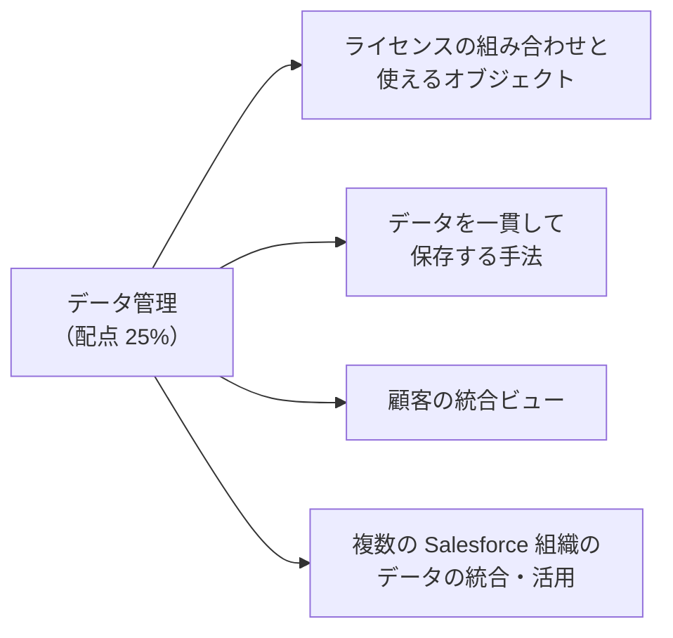
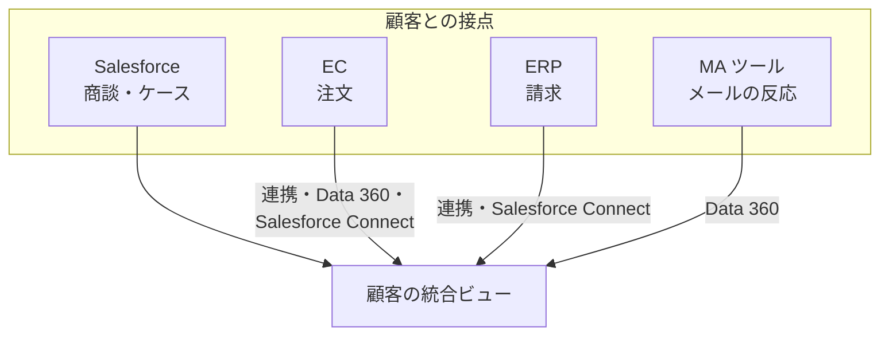
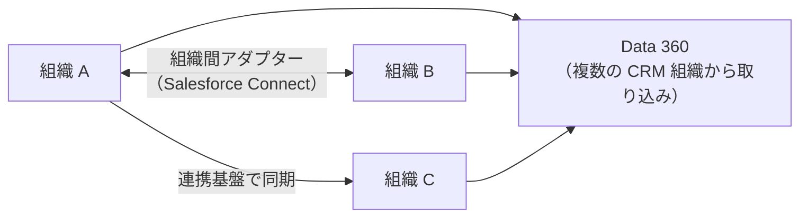

## はじめに：この範囲で学ぶこと

「Salesforce のデータ管理」は配点 **25%** です。

---

## 1. ライセンスとオブジェクト

「誰が、どのオブジェクトを使うか」は、**ライセンス**で決まります。データモデルを設計するときは、利用者のライセンスで使えるかを必ず確認します。

### 1-1. 社内ユーザーのライセンス

| ライセンス | 使える主なデータ | 向いている利用者 |
|---|---|---|
| **Salesforce**（フル） | すべての標準オブジェクト（商談、リード、ケース、売上予測など）とカスタムオブジェクト | 営業・サービスの担当者 |
| **Salesforce Platform** | 取引先・取引先責任者、カスタムオブジェクト、ToDo・行動など。**商談・リード・ケース・売上予測・キャンペーンなどの CRM オブジェクトは使えない** | 独自のアプリだけを使う社員 |
| **アプリケーションの利用向けの軽いライセンス** | 決まった数のカスタムオブジェクトなど | 特定のアプリだけを使う社員 |
| **Salesforce Integration** | API 経由のアクセス（画面ログインなし） | 連携用のユーザー |

### 1-2. 外部ユーザー（Experience Cloud）のライセンス

| ライセンス | 特徴 | 共有の仕組み | 向いている利用者 |
|---|---|---|---|
| **Customer Community** | 大量の顧客向け。**ロールがない** | **共有セット**（取引先・取引先責任者を通じてアクセス）、共有グループ | 多数の一般顧客のセルフサービス |
| **Customer Community Plus** | ロールあり、共有ルールが使える、レポート | ロール階層、共有ルール | 取引先ごとに管理者がいる法人顧客 |
| **Partner Community** | ロールあり、**リード・商談・キャンペーン**が使える | ロール階層、共有ルール | 販売パートナー、代理店 |

ひっかけ注意

- 「Platform ライセンスのユーザーに商談を見せたい」→ Platform ライセンスでは商談は使えません。ライセンスを変えるか、必要な情報をカスタムオブジェクトで持つ設計を検討します。
- 「代理店に商談を登録させたい」→ **Partner Community**。Customer Community では商談は使えません。
- 「数十万人の顧客に自分のケースだけ見せたい」→ **Customer Community＋共有セット**（ロールを使わないので大量でも性能がよい）。

---

## 2. データを一貫して保存する

### 2-1. 入口で正しくする

| 手段 | 内容 |
|---|---|
| **データ型** | 日付は日付型、金額は通貨型に。文字列で持たない |
| **必須項目** | 項目の設定またはページレイアウトで必須に（API からの登録も考えるなら項目の設定や入力規則で） |
| **選択リスト（制限付き）** | 値をそろえ、勝手な値を入れさせない |
| **入力規則** | 条件付きの必須、形式（郵便番号など）、項目同士の矛盾のチェック |
| **一意・外部 ID** | 重複を防ぐ。外部のキーで upsert |
| **重複ルール・一致ルール** | 似たレコードの重複を警告・ブロック |
| **保存前の Flow** | 形式を整える（大文字小文字、電話番号の書式、値の補完） |

### 2-2. 処理の一貫性

| 手段 | 内容 |
|---|---|
| **トランザクション** | 関連する複数の更新を、すべて成功かすべて失敗にする（途中まで反映されない） |
| **API の「すべてか無か」** | Composite API や DML のオプションで、部分的な成功を許すかを選ぶ |
| **upsert と外部 ID** | 同じデータが何度届いても 1 件にする（冪等） |
| **レコードのロック** | 同時に同じレコードを更新すると競合する。親子の更新順や件数に注意 |
| **項目履歴・Field Audit Trail** | 誰がいつ何を変えたかを記録 |

「どこで止めるか」の考え方

データの誤りは、**入口（入力時・取り込み時）で止める**のが最も安く済みます。保存された後で見つけて直すほど、影響が広がりコストが上がります。

---

## 3. 顧客の統合ビュー（シングルビュー）

顧客との接点（営業、サービス、EC、店舗、マーケティング）が複数のシステムにあるとき、**1 人・1 社の顧客の全体像**を Salesforce 上で見られるようにする手法です。

| 手法 | 内容 | 向いている場面 |
|---|---|---|
| **データを Salesforce に連携（コピー）** | 外部のデータを定期的・リアルタイムに Salesforce のオブジェクトへ | レポートや自動化で使いたい |
| **データの仮想化（Salesforce Connect）** | 外部のデータをコピーせずに表示 | 大量・参照だけ・最新が必要 |
| **Data 360** | 複数ソースを統合プロファイルにまとめ、関連リストなどで表示 | 多くのソース、行動データ、ID 解決が必要 |
| **画面での組み合わせ（マッシュアップ）** | 外部の画面を埋め込む、Lightning コンポーネントで外部 API を呼ぶ | 一時的な参照、データを持ちたくない |
| **MDM** | 全社の顧客マスターを整え、各システムに配る | 全社的な一貫性が必要 |

### 3-1. 人と会社の表し方

| 手段 | 使いどころ |
|---|---|
| **個人取引先** | B2C の個人顧客を 1 件で扱う（取引先と取引先責任者の両方の性質） |
| **取引先責任者と複数の取引先** | 1 人が複数の会社に関わる（兼務、転職、コンサルタント） |
| **取引先の階層（親取引先）** | 企業グループ全体を把握 |
| **個人（Individual）オブジェクト** | 同意やプライバシーの設定を人ごとに持つ |

---

## 4. 複数の Salesforce 組織のデータ

### 4-1. 単一組織か複数組織か

| | 単一組織 | 複数組織 |
|---|---|---|
| 長所 | データの共有・統合ビューが簡単、ライセンスや保守を集約 | 事業ごとに独立して変更できる、規制（データの所在地）に対応しやすい、上限を分散 |
| 短所 | 変更の調整が大変、上限（ガバナ制限・ストレージ）に近づく | データの共有に連携が必要、統合ビューを作りにくい |
| 向いている | 業務の共通度が高い、全社で顧客を共有したい | 事業が大きく異なる、法規制で分ける必要がある、M&A 直後 |

### 4-2. 複数の組織のデータを統合・活用する方法

| 方法 | 内容 | 向いている場面 |
|---|---|---|
| **Salesforce Connect（組織間アダプター）** | 他の組織のデータを外部オブジェクトとして**コピーせず**表示 | 他の組織のデータを参照したいだけ |
| **連携基盤・API で同期** | 組織間でデータを同期（双方向も可） | 両方の組織で業務に使う |
| **Data 360** | 複数の組織から取り込んで統合し、統合プロファイルとして活用 | 全社の顧客ビュー、分析、マーケティング |
| **ハブ組織** | 1 つの中央の組織にマスターデータを集め、各組織に配る | 共通のマスター（商品・顧客）を管理 |
| **組織の統合（マージ）** | 複数の組織を 1 つにまとめる | 長期的に一本化する方針がある |

判断の例

「子会社の組織にある顧客の契約状況を、本社の営業が商談の画面で見たい。更新は子会社だけが行う」
→ 本社側から**組織間アダプター**で参照するのが簡単（コピー不要、常に最新）。本社でもレポートや自動化で使う必要が出てきたら、**連携で同期**や **Data 360** を検討。

---

## 5. ストレージとデータの量

| 項目 | 内容 |
|---|---|
| **データストレージ** | レコードが使う容量（多くのレコードは 1 件あたり約 2KB と数える） |
| **ファイルストレージ** | 添付ファイル・ファイル・ドキュメント |
| **節約の方法** | 古いデータのアーカイブ、不要なレコードの削除、大きなファイルは外部ストレージに置いてリンク、ビッグオブジェクト |

---

## 6. まとめ

| テーマ | 覚えること |
|---|---|
| ライセンス | Platform は CRM オブジェクト不可。Customer Community は共有セット、Plus はロール、Partner はリード・商談 |
| 一貫性 | データ型、必須、制限付き選択リスト、入力規則、一意・外部 ID、重複ルール、保存前 Flow、トランザクション |
| 統合ビュー | コピー、仮想化、Data 360、マッシュアップ、MDM |
| 人と会社 | 個人取引先、複数の取引先、親取引先、個人オブジェクト |
| 複数組織 | 組織間アダプター、連携で同期、Data 360、ハブ組織、統合 |

## 試験直前チェック

- [ ] Platform ライセンスで使えない標準オブジェクトの例を言える
- [ ] Customer Community・Customer Community Plus・Partner Community の違いを言える
- [ ] データを一貫して保存する手段を 5 つ言える
- [ ] 顧客の統合ビューを作る手法を 4 つ言え、使い分けを説明できる
- [ ] 単一組織と複数組織の長所・短所を言える
- [ ] 他の組織のデータを参照だけしたいときの方法を言える
