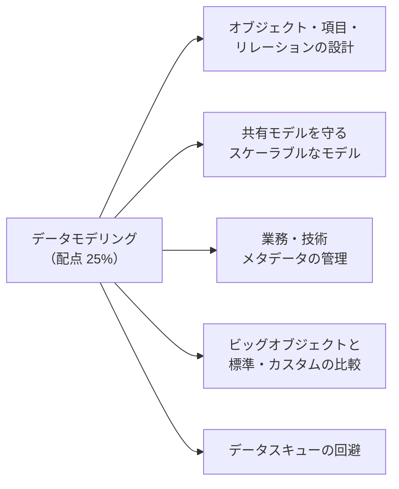
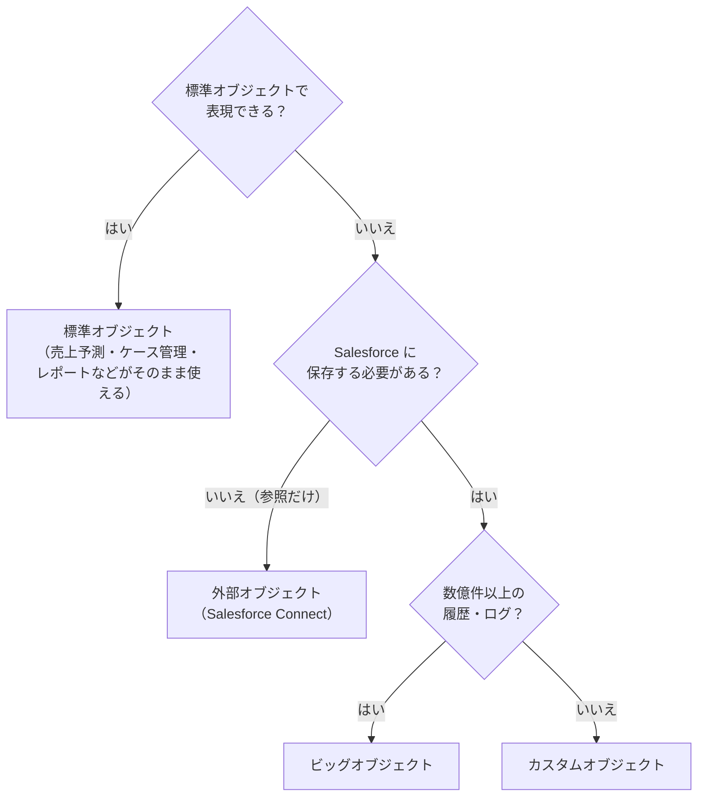
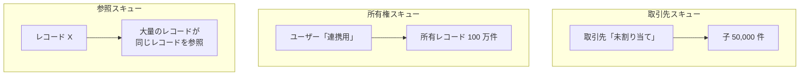

## はじめに：この範囲で学ぶこと

「データモデリング／データベース設計」は配点 **25%** です。

---

## 1. オブジェクトを選ぶ

### 1-1. 標準オブジェクトを優先する

| 種類 | 使いどころ | 注意 |
|---|---|---|
| **標準オブジェクト** | 取引先・商談・ケースなど、標準の業務 | 標準の機能（売上予測、エンタイトルメントなど）がそのまま使える。**無理に別の意味で流用しない** |
| **カスタムオブジェクト** | 標準にない業務データ | ライセンスによって使える数に制限がある |
| **外部オブジェクト** | 外部にあるデータを参照するだけ | 外部の性能に依存、使える機能に制限 |
| **ビッグオブジェクト** | 数億〜数十億件の履歴・監査データ | 検索・自動化・共有に制限（後述） |
| **カスタムメタデータ型** | 設定値（リリースで移せる） | データではなく設定 |

ひっかけ注意：標準オブジェクトの流用

「使っていないからケースオブジェクトを社内の申請管理に流用する」のような設計は避けます。将来ケース管理を使いたくなったときに困り、ライセンスや機能の意味もずれます。

### 1-2. B2B と B2C のモデル

| モデル | 内容 | 考慮点 |
|---|---|---|
| **取引先＋取引先責任者** | 法人（会社）とその担当者 | B2B の標準 |
| **個人取引先** | 個人の顧客を 1 件の取引先として扱う | **一度有効にすると無効に戻せない**。B2B と B2C が混ざる場合の設計を最初に決める |
| **取引先責任者と複数の取引先** | 1 人の担当者を複数の会社に関連付ける | 転職・兼務の表現 |

---

## 2. 項目とリレーション

### 2-1. リレーションの種類と影響

| リレーション | 共有 | 削除 | 集計 | 注意 |
|---|---|---|---|---|
| **主従関係** | 子は親の共有に従う（子に所有者がない） | 親を削除すると子も削除 | **積み上げ集計**が使える | 子の数が多いと親のロックが競合しやすい。1 オブジェクトに主従は 2 つまで |
| **参照関係** | 子は独立した共有 | 設定で選べる（値をクリア、削除を禁止など） | 標準の積み上げ集計は不可（Flow などで代替） | 柔軟。必須にもできる |
| **多対多（連結オブジェクト）** | 2 つの主従を持つ連結オブジェクト。両方の親の共有が必要 | どちらかの親を削除すると削除 | 両方の親で集計 | 学生と講座、商品と案件など |
| **外部参照・間接参照** | 外部オブジェクトとのリレーション | — | — | Salesforce Connect |
| **階層** | ユーザー同士のみ | — | — | 上司など |

### 2-2. 項目の設計

| ポイント | 内容 |
|---|---|
| **データ型を正しく** | 数値を文字列で持たない（並べ替え・集計ができない） |
| **選択リスト** | 値をそろえる。グローバル選択リストで共通化、制限付きで勝手な値を防ぐ |
| **外部 ID** | 他のシステムのキーを持ち、upsert と重複防止に使う（インデックスも付く） |
| **一意** | 重複を許さない項目 |
| **数式・積み上げ集計** | 保存しないで計算する。数式は検索・インデックスに使いにくい場合がある |
| **項目の数** | オブジェクトの項目数には上限があり、多すぎる項目は画面と保守を重くする |

### 2-3. 正規化と非正規化

| | 正規化 | 非正規化 |
|---|---|---|
| 考え方 | データを 1 か所で持ち、重複させない | 参照を減らすため、必要な値をコピーして持つ |
| 長所 | 更新が 1 回で済む、整合性が高い | レポート・検索・共有が簡単で速い |
| 短所 | 多くの結合（リレーション）が必要 | コピーの同期が必要、矛盾のリスク |
| Salesforce での例 | 住所は取引先にだけ持つ | 取引先の「業種」を商談にもコピーして、商談のレポートや共有ルールで使う |

Salesforce で非正規化を選ぶ理由

Salesforce のレポートタイプや共有ルール、リストビューは、**たどれるリレーションの深さ**や**使える項目**に制限があります。業務でよく使う条件（例：取引先の地域で商談を共有したい）は、子のレコードにも値を持たせると設計が簡単になります。

---

## 3. 共有モデルを守るスケーラブルな設計

| 考えること | 設計の例 |
|---|---|
| **共有の要件を先に確認** | 「誰が、どのレコードを見られるべきか」でリレーションを決める。子を親と同じ公開範囲にしたい → 主従関係（親に従う） |
| **主従か参照か** | 子に独自の所有者と共有が必要 → 参照関係 |
| **OWD はできるだけ公開に** | 機密性がないオブジェクトは公開にして、共有計算をなくす |
| **共有ルールの数を抑える** | 共有ルールが多いと再計算の負荷が大きい |
| **所有者を分散** | 1 人のユーザーに大量のレコードを持たせない |
| **大量データを見越す** | 件数の伸びを見積もり、インデックスやアーカイブを最初から考える |

---

## 4. メタデータの管理

**メタデータ**は「データについてのデータ」です。項目の意味、出どころ、機密度などを管理することで、データを正しく使えるようになります。

| 手法 | 内容 | Salesforce での実践 |
|---|---|---|
| **業務用語集（ビジネス辞書）** | 業務の言葉の定義（「アクティブ顧客」とは何か） | 項目の**説明**・**ヘルプテキスト**、社内の用語集 |
| **データ辞書** | オブジェクト・項目の一覧、型、意味、所有者、出どころ | スキーマビルダー、オブジェクトマネージャー、メタデータの出力から作る |
| **データリネージ（系譜）** | データがどこから来て、どう変換され、どこへ行くか | 連携の一覧、項目の説明に元のシステムを記録 |
| **分類体系（タクソノミー）** | データの分類の仕方（顧客データ、取引データ、参照データ） | オブジェクトや項目の命名規則、分類 |
| **データ分類** | 機密度や規制の分類 | 項目の**データの機密度**（公開・社内・機密・制限など）と**コンプライアンス分類**（個人情報、GDPR、PCI など）、**データ所有者**、**項目の使用状況** |

項目のデータ分類を記録する理由

項目に機密度やコンプライアンス分類を記録しておくと、「個人情報の項目はどれか」「GDPR の対象はどれか」がすぐ分かり、暗号化・マスキング・削除の対応や監査がしやすくなります。

---

## 5. ビッグオブジェクト

### 5-1. 標準・カスタムオブジェクトとの比較

| | 標準・カスタムオブジェクト | ビッグオブジェクト |
|---|---|---|
| 件数 | 数百万〜数千万件が目安 | **数十億件**まで |
| 主な用途 | 日々の業務データ | 履歴・監査・ログ・アーカイブ |
| 検索 | SOQL で自由な条件、レポート | **インデックスの項目**で、定義した順に絞り込む SOQL |
| 共有 | 所有者・共有ルールなど | レコード単位の共有なし（オブジェクト・項目の権限のみ） |
| 自動化 | Flow・トリガー | Flow・トリガーは使えない |
| レポート | 標準のレポート | 標準のレポートは使えない（集計して別オブジェクトに出すなど） |
| 書き込み | 通常の DML | API や Apex の専用メソッドで。**同じインデックスのデータは上書き** |
| 変更 | 項目を後から追加・変更 | **インデックスは後から変更できない**（設計が重要） |

- 標準のビッグオブジェクトの例：**項目履歴のアーカイブ**（Field Audit Trail で長期保存した項目履歴）。
- カスタムのビッグオブジェクトは API 名の末尾が `__b`。

### 5-2. 使うべき場面

| 場面 | ビッグオブジェクトが向いているか |
|---|---|
| 10 年分の取引履歴を保管し、顧客ごとに参照したい | 向いている（顧客 ID をインデックスに） |
| Web の閲覧ログ数十億件を保管したい | 向いている |
| 毎日のように条件を変えてレポートしたい | 向いていない（分析基盤や Data 360 を検討） |
| レコードごとに共有を分けたい | 向いていない |
| 更新のたびに自動化を動かしたい | 向いていない |

---

## 6. データスキューを避ける

**データスキュー**は、データが特定のレコードやユーザーに**偏って集中**している状態です。ロックの競合や共有の再計算で性能が落ちます。

| 種類 | 状態（目安） | 起きること | 対策 |
|---|---|---|---|
| **取引先スキュー**（親子のスキュー） | 1 つの親に**1 万件を超える**子 | 子の更新で親がロックされ競合、共有の再計算が重い | 親を分ける（「未割り当て」の取引先を複数に）、子が多すぎない設計 |
| **所有権スキュー** | 1 人のユーザーが**1 万件を超える**レコードを所有 | そのユーザーのロールや共有の変更で、大量の再計算 | 所有者を分散、所有者を**ロールなし**か階層の**上位で子がいないロール**のユーザーにする |
| **参照スキュー** | 大量のレコードが**同じ 1 件**を参照 | 参照先のロック競合 | 参照先を分散、選択リストで代替できないか検討 |

例

連携ユーザーがすべての注文を所有していて、そのユーザーのロールを変えたら共有の再計算が何時間も終わらない。→ 連携ユーザーを**ロールに属さない**状態にし、OWD や共有ルールで必要な人に見せる。必要なら所有者を業務の担当者に振り分ける。

---

## 7. まとめ

| テーマ | 覚えること |
|---|---|
| オブジェクト | 標準を優先 → カスタム、参照だけなら外部、数十億件の履歴はビッグ |
| リレーション | 主従＝親の共有・削除・積み上げ集計、参照＝独立、連結で多対多 |
| 正規化 | 整合性重視。Salesforce ではレポート・共有のため適度に非正規化 |
| 共有を守る | 共有要件でリレーションを選ぶ、OWD は公開にできれば公開、所有者を分散 |
| メタデータ | 用語集、データ辞書、リネージ、分類体系、データ分類（機密度・コンプライアンス） |
| ビッグオブジェクト | 数十億件、インデックスで検索、共有・自動化・レポートなし、インデックスは変更不可 |
| スキュー | 取引先・所有権・参照。1 万件が目安。分散、ロールなしのユーザー |

## 試験直前チェック

- [ ] オブジェクトを選ぶ判断の順番を言える
- [ ] 主従関係と参照関係の共有・削除・集計の違いを言える
- [ ] 非正規化を選ぶ理由と注意点を言える
- [ ] 項目に記録できるデータ分類の情報を 3 つ言える
- [ ] ビッグオブジェクトの制約を 4 つ言える
- [ ] 3 種類のデータスキューと対策を言える
