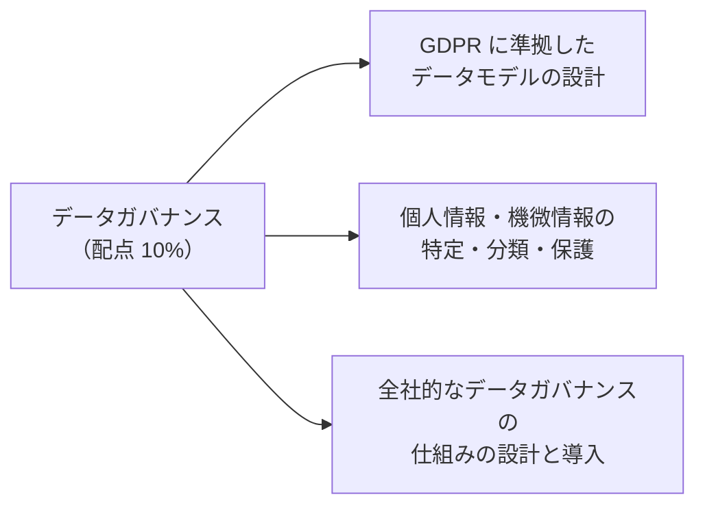
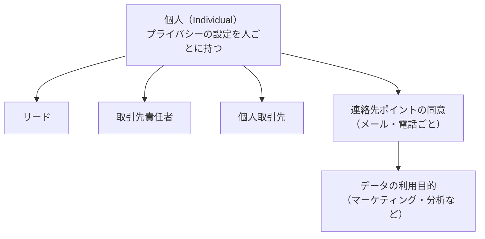
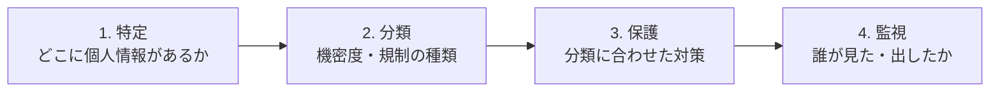
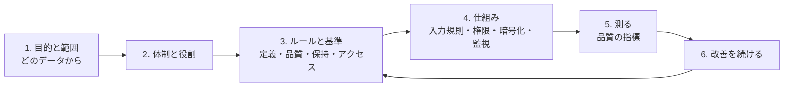

## はじめに：この範囲で学ぶこと

「データガバナンス」は配点 **10%** です。

**データガバナンス**は、「データを**誰が、どんなルールで、どう管理するか**」を決めて守らせる仕組みです。

---

## 1. GDPR とは（データ設計に関わる要点）

**GDPR**（EU 一般データ保護規則）は、EU の個人データを守るための規則です。日本の個人情報保護法などにも似た考え方があります。

| 原則・権利 | 内容 | データ設計への影響 |
|---|---|---|
| **適法性・同意** | 正当な根拠（同意など）があるときだけ処理する | **同意の記録**を持つ |
| **目的の限定** | 集めた目的以外に使わない | 利用目的ごとの同意 |
| **データの最小化** | 必要なデータだけを集める | 不要な項目を作らない・持たない |
| **正確性** | 正しく最新に保つ | 本人による訂正の仕組み |
| **保存期間の限定** | 必要な期間だけ保存する | 保持期間とアーカイブ・削除のルール |
| **アクセス権** | 本人は自分のデータを見られる | 1 人のデータをすべて集めて出せる設計 |
| **削除権（忘れられる権利）** | 本人は削除を求められる | 関連するすべてのデータを削除・匿名化できる設計 |
| **データポータビリティ** | 本人は自分のデータを持ち出せる | 機械で読める形で出力 |
| **処理の制限・異議** | マーケティングなどへの利用を止められる | 「処理しない」フラグ、追跡しない設定 |

---

## 2. GDPR に準拠したデータモデル

### 2-1. Salesforce の仕組み

| 仕組み | 役割 |
|---|---|
| **個人（Individual）オブジェクト** | 1 人の人に対して、プライバシーの設定（追跡しない、処理しない、データを持ち出す、削除を求める など）を持つ。リード・取引先責任者・個人取引先から参照する |
| **同意管理のオブジェクト** | 連絡先ポイント（メールアドレス、電話番号）ごと、**利用目的**ごとの同意を記録（同意の種類、日時、取得方法） |
| **データの利用目的** | マーケティング、分析など、何のために使うかの定義 |

なぜ「人」単位でプライバシーを持つのか

同じ人が、リードとしても、取引先責任者としても登録されていることがあります。プライバシーの設定をそれぞれのレコードに持つと、更新漏れが起きます。**個人オブジェクト**に 1 か所で持ち、各レコードから参照すれば、一貫した対応ができます。

### 2-2. 削除権・アクセス権に応える設計

| 要求 | 設計 |
|---|---|
| **削除（忘れられる権利）** | 1 人に関係するレコード（リード、取引先責任者、ケース、活動、ファイル、外部連携先）を**一覧にできる**設計。削除か**匿名化**（個人を特定できない値に置き換え）かを決める。ごみ箱・バックアップ・連携先からも消す手順 |
| **アクセス・持ち出し** | 1 人のデータを集めて、読める形で出力する手順（レポート、データのエクスポート、専用の製品） |
| **保持期間** | オブジェクトごとに保持期間を決め、過ぎたらアーカイブ・削除 |

匿名化を選ぶ場面

統計（売上の件数・金額）は残したいが、個人は特定できないようにしたい場合は、レコードを消さずに**氏名・連絡先を匿名化**します。

---

## 3. 個人情報・機微情報を特定・分類・保護する

### 3-1. 特定と分類

| 手段 | 内容 |
|---|---|
| **項目のデータ分類** | 項目ごとに**データの機密度**（公開・社内・機密・制限など）と**コンプライアンス分類**（個人情報、GDPR、PCI、HIPAA など）を記録 |
| **データ所有者・使用状況** | 項目の責任者と、使われているか（有効・廃止候補など）を記録 |
| **自動検出** | 機微なデータがどの項目に入っているかを自動で見つけるツール（Shield の機能など） |
| **データ辞書** | 分類の結果を一覧にして共有 |

### 3-2. 保護

| 対策 | Salesforce の機能 |
|---|---|
| **見せる人を絞る** | 項目レベルセキュリティ、権限セット、共有設定、制限ルール |
| **保存時の暗号化** | **Shield Platform Encryption**（項目・ファイルを暗号化。鍵の管理も） |
| **画面での表示を隠す** | 暗号化された項目の表示制限、マスク表示（クレジットカード番号の下 4 桁だけ など） |
| **サンドボックスの個人情報** | **データマスキング**（サンドボックスのデータを匿名化・置き換え） |
| **誰が何をしたか** | **イベントモニタリング**（ログイン、レポートの出力、API）、**Field Audit Trail**（項目の変更履歴を長期保存）、設定変更履歴 |
| **持ち出しを防ぐ** | レポートの出力の権限を絞る、トランザクションセキュリティのポリシー |
| **そもそも持たない** | カード番号などは決済代行会社のトークンだけを持つ |

ひっかけ注意

「暗号化すれば、誰が見てもよい」は誤り。暗号化は**保存されたデータ**を守るもので、**権限のあるユーザーには普通に表示**されます。誰に見せるかは**項目レベルセキュリティや共有**で制御します。

---

## 4. 全社的なデータガバナンスの仕組み

### 4-1. 体制と役割

| 役割 | 責任 |
|---|---|
| **データガバナンス委員会（評議会）** | 全社の方針、優先順位、ルールの承認 |
| **データオーナー** | 業務の責任者。データの定義・品質の基準・利用ルールを決める |
| **データスチュワード** | 日々の品質管理、問題の発見と修正、利用者の支援 |
| **データの管理者（IT）** | 仕組みの構築と運用（権限、暗号化、連携、バックアップ） |
| **利用者** | ルールに沿って入力・利用する |

### 4-2. 運営のモデル

| モデル | 内容 | 長所 | 短所 |
|---|---|---|---|
| **中央集権型** | 中央のチームがすべてを決めて管理 | 一貫性が高い | 現場の事情に合わない、遅い |
| **分散型** | 各部門が自分で決めて管理 | 速い、現場に合う | 部門ごとにばらばら |
| **連邦型（ハイブリッド）** | 全社の共通ルールは中央、運用は各部門 | バランスがよい | 役割の調整が必要 |

### 4-3. 導入の進め方

### 4-4. データ品質の指標

| 指標 | 意味 | 例 |
|---|---|---|
| **完全性** | 必要な項目が埋まっているか | メールアドレスの入力率 |
| **正確性** | 正しい値か | 住所が実在するか |
| **一貫性** | システム間・項目間で矛盾がないか | CRM と ERP で取引先名が一致 |
| **適時性** | 新しいか | 最終更新日が 1 年以内の割合 |
| **一意性** | 重複がないか | 重複している取引先の数 |
| **妥当性** | 決まった形式・範囲か | 郵便番号の形式 |

- 品質の指標を**ダッシュボード**で見える化し、データスチュワードが定期的に確認します。

---

## 5. まとめ

| テーマ | 覚えること |
|---|---|
| GDPR | 同意、目的の限定、最小化、正確性、保存期間、アクセス権、削除権、ポータビリティ |
| データモデル | 個人オブジェクトでプライバシーを人単位に、同意管理のオブジェクトで連絡先・目的ごとの同意 |
| 削除権 | 関連データを一覧にできる設計、削除か匿名化、連携先・バックアップも |
| 特定・分類 | 項目のデータの機密度とコンプライアンス分類、データ所有者、自動検出 |
| 保護 | 項目レベルセキュリティ、Shield 暗号化、データマスキング、イベントモニタリング、Field Audit Trail |
| ガバナンス | 委員会・オーナー・スチュワード、中央・分散・連邦型、品質の 6 指標 |

## 試験直前チェック

- [ ] GDPR の権利を 4 つ言え、データ設計への影響を説明できる
- [ ] 個人オブジェクトの役割を言える
- [ ] 削除の要求に応えるために必要な設計を言える
- [ ] 項目に記録できるデータ分類の情報を言える
- [ ] 暗号化と項目レベルセキュリティの役割の違いを言える
- [ ] データオーナーとデータスチュワードの違いを言える
- [ ] ガバナンスの運営モデルを 3 つ言える
- [ ] データ品質の指標を 5 つ言える
