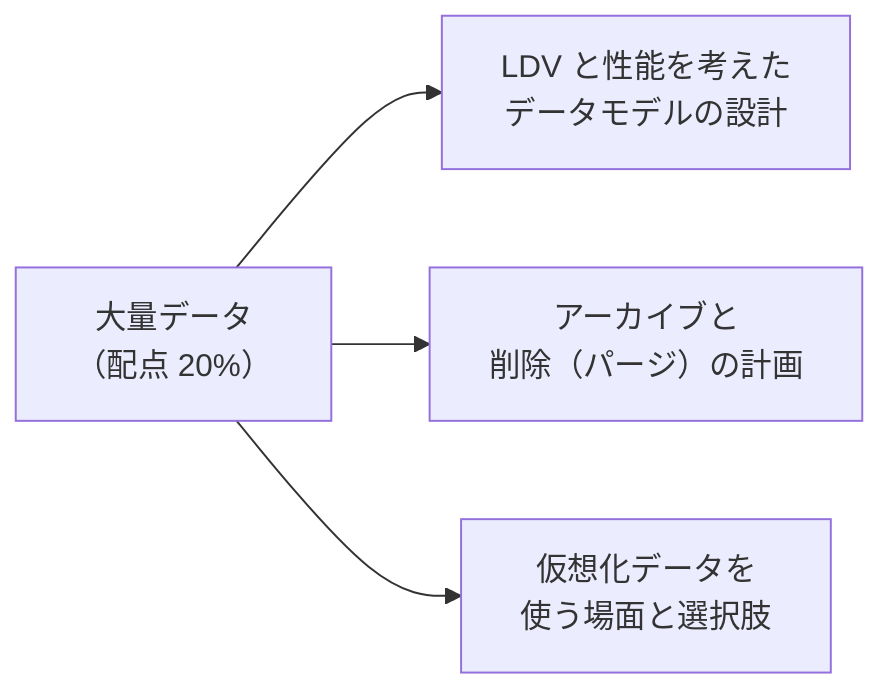
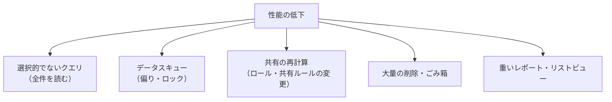

## はじめに：この範囲で学ぶこと

「大量データ（LDV）の考慮点」は配点 **20%** です。

**LDV（Large Data Volumes）** は、目安として「数千万件のレコード」「数万人のユーザー」「数百 GB のデータ」のような規模を指します。この規模になると、普通の設計では検索・共有・読み込みが遅くなります。

---

## 1. 大量データで遅くなる原因

---

## 2. 選択的なクエリとインデックス

### 2-1. 「選択的」とは

**選択的なクエリ**とは、**インデックスのある項目**の条件で、対象を全体のごく一部に絞り込めるクエリです。選択的なら、Salesforce（クエリオプティマイザー）はインデックスを使って速く検索します。選択的でないと、全件を読む（フルスキャン）ことになります。

| インデックス | 選択的とみなされる目安 |
|---|---|
| **標準のインデックス** | 対象が「最初の 100 万件の 30%、それを超える分の 15%」以下（上限 100 万件） |
| **カスタムのインデックス** | 対象が「最初の 100 万件の 10%、それを超える分の 5%」以下（上限 33 万 3,333 件） |

### 2-2. どの項目にインデックスがあるか

| 種類 | 例 |
|---|---|
| **標準でインデックスがある項目** | ID、名前（Name）、所有者（OwnerId）、作成日（CreatedDate）、最終更新（SystemModstamp）、レコードタイプ、**参照・主従の項目**、**外部 ID**、**一意**の項目 |
| **カスタムのインデックス** | よく検索条件に使う項目に、**Salesforce サポートに依頼**して作る（複数項目の組み合わせのインデックスも相談できる） |

### 2-3. インデックスが効きにくい条件

| 条件 | 理由と対策 |
|---|---|
| **NULL を探す**（`= null`） | 空の値は通常インデックスに入らない。空の代わりに既定値を入れる |
| **否定**（`!=`、`NOT IN`、`NOT LIKE`） | 「〜以外」は多くの行が当てはまる。肯定の条件に書き換える |
| **先頭のワイルドカード**（`LIKE '%田'`） | 先頭が決まらないとインデックスを使えない |
| **数式項目** | 計算結果は保存されないため（決まった条件ならインデックスを相談できる場合も） |
| **大きな比較範囲** | 「作成日が 10 年前以降」など、ほぼ全件が当てはまる |

### 2-4. 確認と改善の道具

| 道具 | 使い方 |
|---|---|
| **クエリプラン**（開発者コンソール） | そのクエリでインデックスが使われるか、コスト（1 未満なら選択的）を確認 |
| **スキニーテーブル** | よく使う項目だけを持つ別のテーブル。結合が減り読み取りが速くなる（サポートに依頼。項目数の上限、本番のみ自動ではないなどの制約） |
| **レポートとリストビューの絞り込み** | 期間や所有者で絞る、「すべて」のリストビューを使わせない |

改善の例

- 遅い：`WHERE Status__c != '完了'`（否定）
- 速い：`WHERE Status__c IN ('新規', '対応中', '保留')`（肯定の条件）＋ `Status__c` にカスタムインデックス
- さらに：`CreatedDate = LAST_N_DAYS:90` を加えて、対象を絞る

---

## 3. 大量データでも速いデータモデル

| 設計 | 内容 |
|---|---|
| **データスキューを避ける** | 1 つの親・1 人の所有者・1 つの参照先に 1 万件を超えて集中させない |
| **OWD を公開にできるなら公開に** | 共有の計算と共有テーブルが不要になる |
| **主従関係で共有を親に任せる** | 子の共有レコードが作られない |
| **所有者のロール** | 大量のレコードを持つユーザーは、ロールなし、または子のない上位のロールに |
| **共有ルールを減らす** | ルールが多いほど再計算が重い |
| **必要なデータだけ持つ** | 古いデータはアーカイブ、参照だけなら仮想化 |
| **集計の持ち方** | 大量の子を毎回集計せず、バッチで集計結果を親に保存する |
| **インデックスを意識した項目** | 検索条件になる項目は外部 ID や参照にする、NULL にしない |
| **ディビジョン** | （大規模組織で）データを論理的に区切って、検索やレポートの対象を減らす |

### 3-1. 共有の再計算の負荷を減らす

| 手段 | 内容 |
|---|---|
| **共有計算の延期** | 大量の変更（ロール階層・共有ルール・グループ）の間は計算を止め、後でまとめて実行（機能の有効化が必要） |
| **作業する時間帯** | 業務時間外に大きな変更を行う |
| **グループのネストを浅く** | 公開グループの入れ子が深いと計算が重い |

---

## 4. アーカイブと削除（パージ）の計画

### 4-1. なぜ必要か

- 使わない古いデータが多いと、**検索・レポートが遅く**なり、**ストレージ**も消費します。
- 法令や社内規程で、**保持期間**が決まっているデータもあります。

### 4-2. 計画で決めること

| 決めること | 例 |
|---|---|
| **対象** | 3 年以上前にクローズしたケース、5 年以上前の商談 |
| **保持期間** | 法令（7 年）、業務での参照（2 年） |
| **アーカイブ先** | ビッグオブジェクト、外部のデータベース・ストレージ、アーカイブ用の製品 |
| **参照方法** | アーカイブ後も見たい場合は、Salesforce Connect で表示、ビッグオブジェクトを画面で表示 |
| **削除の方法** | Bulk API での**完全削除**（ごみ箱を経由しない）、ごみ箱を空にする |
| **関連データ** | 子レコード・活動・ファイルも一緒に扱うか |
| **頻度と時間帯** | 毎月、業務時間外にバッチで |

### 4-3. アーカイブ先の比較

| アーカイブ先 | 長所 | 短所 |
|---|---|---|
| **ビッグオブジェクト** | Salesforce の中にあり、画面や Apex から参照できる | 検索はインデックスの項目だけ、レポート・共有なし |
| **外部のデータベース・DWH** | 安く大量に保管、分析に使える | Salesforce から見るには連携や仮想化が必要 |
| **アーカイブ用の製品** | 方針に沿った自動アーカイブ、復元、検索 | 追加のコスト |
| **ファイル（CSV）として保管** | 簡単 | 参照・検索がしにくい |

ひっかけ注意

「ごみ箱に入れればストレージが空く」は誤り。ごみ箱にあるレコードも一定期間は残ります。大量の削除は、**Bulk API の完全削除**（権限が必要）や、ごみ箱を空にすることを考えます。また、大量の削除そのものも重い処理なので、時間帯と分割を計画します。

---

## 5. 仮想化データ

**仮想化データ**は、データを Salesforce に**コピーせず**、外部に置いたまま参照する方法です。

| 選択肢 | 内容 | 使いどころ |
|---|---|---|
| **Salesforce Connect（OData アダプター）** | OData に対応した外部のデータを外部オブジェクトとして表示 | 外部の基幹システムのデータ |
| **Salesforce Connect（組織間アダプター）** | 別の Salesforce 組織のデータを表示 | 子会社の組織 |
| **Salesforce Connect（独自のアダプター）** | Apex で外部 API とつなぐ | OData に対応していないシステム |
| **Data 360 のゼロコピー** | DWH のデータをコピーせず参照 | 分析・セグメント・AI |
| **画面での組み合わせ** | 外部の画面を埋め込む、コンポーネントから API を呼ぶ | 表示だけでよい |

| 仮想化が向いている | 仮想化が向いていない |
|---|---|
| データが大量で、たまにしか見ない | 頻繁に検索・集計する |
| 常に最新の値が必要 | Salesforce のレポート・自動化・入力規則で使う |
| ストレージを使いたくない | 外部システムが遅い・よく止まる |
| 更新は外部システムで行う | オフラインでも見たい |

---

## 6. まとめ

| テーマ | 覚えること |
|---|---|
| 選択的なクエリ | 標準インデックス 30%・15%（上限 100 万）、カスタム 10%・5%（上限 33.3 万） |
| インデックス | ID・名前・所有者・日付・参照・外部 ID・一意は標準。カスタムはサポートに依頼 |
| 効きにくい条件 | NULL、否定、先頭のワイルドカード、数式 |
| 道具 | クエリプラン、スキニーテーブル |
| モデル | スキューを避ける、OWD を公開に、主従、ロールなしの所有者、集計はバッチで |
| 共有 | 共有計算の延期、時間外、グループを浅く |
| アーカイブ | 対象・保持期間・アーカイブ先・参照方法・完全削除 |
| 仮想化 | Salesforce Connect（OData・組織間・独自）、ゼロコピー。大量・たまに・最新なら |

## 試験直前チェック

- [ ] 選択的なクエリの意味と、標準・カスタムインデックスのしきい値を言える
- [ ] 標準でインデックスがある項目を 5 つ言える
- [ ] インデックスが効きにくい条件を 3 つ言え、書き換え方を説明できる
- [ ] スキニーテーブルの役割と作り方を言える
- [ ] 共有の負荷を減らす設計を 3 つ言える
- [ ] アーカイブ計画で決めることを 4 つ言える
- [ ] 仮想化データが向いている場面・向いていない場面を言える
