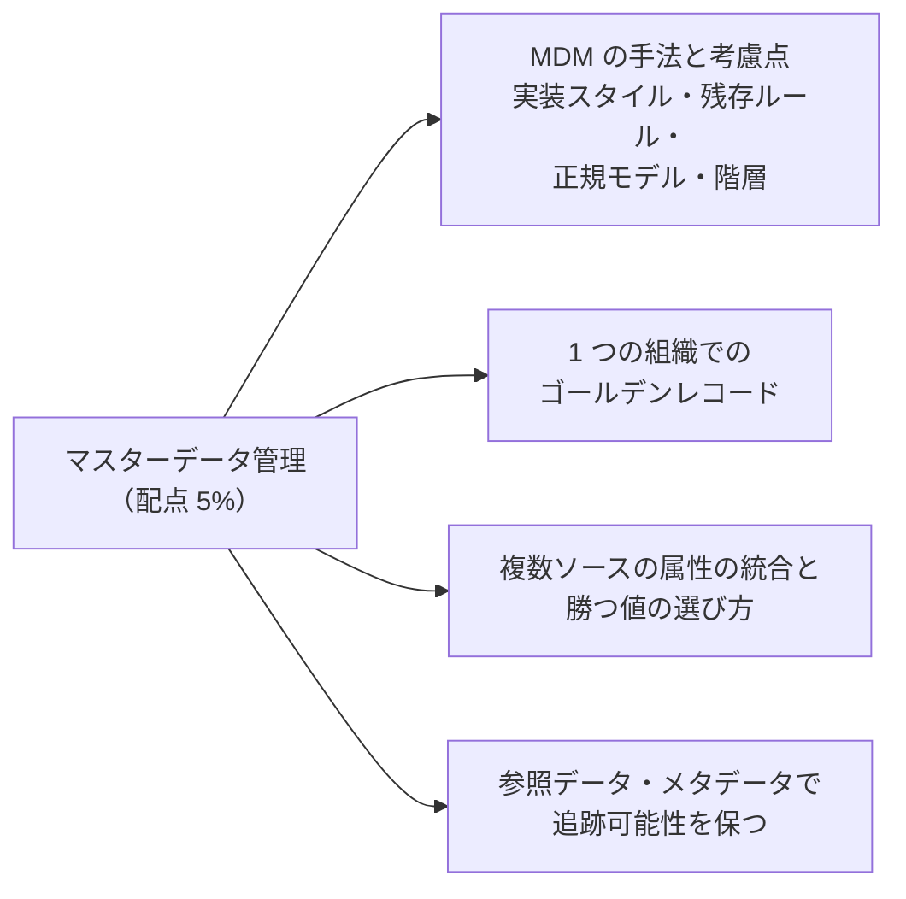
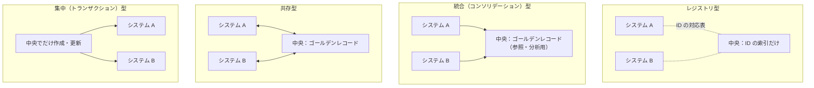
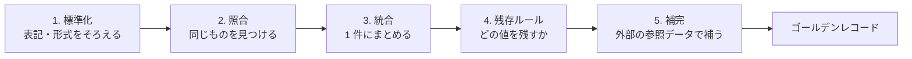
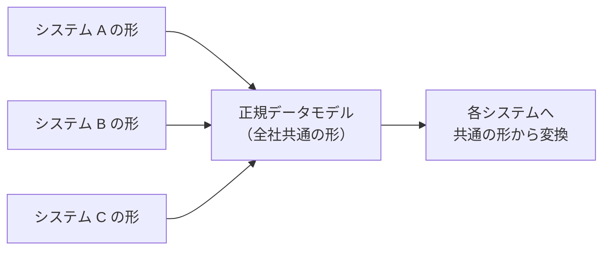

## はじめに：この範囲で学ぶこと

「マスターデータ管理（MDM）」は配点 **5%** と小さめですが、他の範囲（データ管理・移行・ガバナンス）の土台になる考え方です。

---

## 1. マスターデータとは

| 種類 | 意味 | 例 |
|---|---|---|
| **マスターデータ** | 業務の中心となる、何度も使われる「もの」のデータ | 顧客、商品、取引先、従業員、拠点 |
| **トランザクションデータ** | 日々の出来事の記録 | 注文、請求、ケース、活動 |
| **参照データ** | 値の選択肢となる、変化の少ないデータ | 国コード、通貨、業種コード、状態の値 |
| **メタデータ** | データについてのデータ | 項目の意味、出どころ、機密度 |

**MDM** は、複数のシステムに散らばったマスターデータを、**正しく、一貫した 1 つの姿**に保つための仕組みと運用です。

---

## 2. MDM の実装スタイル

| スタイル | 内容 | 長所 | 短所 |
|---|---|---|---|
| **レジストリ型** | データは各システムに残し、中央は**ID の対応表**だけを持つ | 導入が軽い、各システムを変えない | 各システムのデータの質は改善されない |
| **統合（コンソリデーション）型** | 各システムから集めて中央で**ゴールデンレコード**を作る。各システムには戻さない | 分析・レポートに使える | 各システムのデータはばらばらのまま |
| **共存型** | 中央でゴールデンレコードを作り、各システムにも**配信**する。各システムでも更新できる | 全体の一貫性が上がる | 双方向の同期と競合の解決が複雑 |
| **集中（トランザクション）型** | マスターデータは**中央でだけ**作成・更新し、各システムへ配信 | 最も一貫性が高い | 導入の負荷が大きく、業務の変更が必要 |

選び方の目安

- 「まずは各システムの顧客がどれとどれか分かればよい」→ **レジストリ型**
- 「全社の顧客分析をしたい（業務システムは今のまま）」→ **統合型**
- 「すべてのシステムで正しい顧客情報を使いたい」→ **共存型**または**集中型**

---

## 3. 複数ソースの統合と「勝つ値」の選び方

### 3-1. 統合の流れ

| 手順 | 内容 | 例 |
|---|---|---|
| **標準化** | 表記ゆれ・形式をそろえる | 「株式会社」と「(株)」、電話番号のハイフン、住所の表記 |
| **照合（マッチング）** | 同じ顧客・会社を見つける | 法人番号、メールアドレス、名前＋住所 |
| **しきい値** | どれくらい似ていたら同じとみなすか | 一致度 90% 以上なら自動で統合、70〜90% は人が確認 |
| **重み付け** | 項目ごとに一致の重要度を変える | 法人番号の一致は重く、名前の一致は軽く |
| **統合** | 1 件のレコードにまとめる | 重複した取引先を 1 件に |

### 3-2. 残存ルール（サバイバーシップ）

統合するとき、項目ごとに**どのソースの値を残すか**のルールです。

| ルール | 残す値 | 向いている項目 |
|---|---|---|
| **信頼できるソースを優先** | 決めたソースの値（ERP ＞ CRM ＞ アンケート） | 請求先住所（ERP が正）、法人名 |
| **最新** | 最後に更新された値 | 電話番号、メールアドレス |
| **最も完全** | 空でない・詳しい値 | 住所（番地まであるもの） |
| **最も頻繁** | 多くのソースで一致する値 | 名前の表記 |
| **項目ごとに決める** | 上のルールを項目ごとに組み合わせる | 住所は ERP、メールは MA ツール、担当者は CRM |

属性ごとに「正」を決める理由

1 つのシステムがすべての項目で正しいとは限りません。請求先住所は請求を出す ERP が最も正確で、メールアドレスは配信の反応がある MA ツールが最も新しい、ということがよくあります。**項目ごとに信頼できるソース（System of Record）**を決めるのが MDM の基本です。

### 3-3. 外部の参照データで補完する

- 企業情報データベース（法人番号、業種、従業員数、親会社）などの**外部の参照データ**で、足りない項目を補い、正しさを確認します。
- 住所の正規化サービスで、住所を標準の形にそろえます。
- 補完に使ったデータの**出どころと日付**を記録しておきます（後で追跡できるように）。

---

## 4. 正規（カノニカル）データモデル

- **正規データモデル**は、システムをまたいで使う**共通のデータの形**です。
- 各システムは「自分の形 ⇔ 共通の形」の変換だけを持てばよく、システムが増えても変換の数が増えすぎません。
- 連携基盤や MDM で使われ、Data 360 の **Customer 360 データモデル**も考え方は同じです。

---

## 5. 階層の管理

| 階層 | 例 | Salesforce での表現 |
|---|---|---|
| **企業の親子関係** | 親会社 → 子会社 → 支店 | 取引先の**親取引先**（取引先階層） |
| **商品の階層** | カテゴリ → サブカテゴリ → 商品 | 商品の分類項目、カスタムオブジェクト |
| **地域の階層** | 地域 → 国 → 都道府県 | テリトリー、選択リスト |

- 企業の階層は、外部の企業情報データで**正しい親子関係**を取り込むと、グループ全体の取引額を把握できます。
- 階層が深い・大きい場合は、集計の方法（Flow・バッチで親に集計）や性能も考えます。

---

## 6. Salesforce の組織でゴールデンレコードを作る

| 手段 | 使い方 |
|---|---|
| **一致ルール・重複ルール** | 入力時・取り込み時に重複を見つけ、警告またはブロック |
| **重複レコードセット・マージ** | 見つかった重複を統合する |
| **外部 ID** | 各システムのキーを持ち、照合と upsert に使う |
| **入力規則・選択リスト** | 形式と値をそろえる（標準化） |
| **Flow・Apex** | 保存前に形式を整える（電話番号の正規化など） |
| **Data 360 の ID 解決** | 複数ソースの顧客を統合プロファイルにまとめる（一致ルール・調整ルール） |
| **専用の MDM 製品** | 大規模・複雑な MDM は、外部の MDM 製品と連携 |

例：顧客のゴールデンレコード

ERP・EC・Salesforce に同じ法人顧客が別々に登録されている。
1. 法人番号を**外部 ID** として全システムで持つ（照合のキー）
2. 社名・住所は外部の企業情報で**標準化と補完**
3. 請求先住所は ERP、担当者と商談は Salesforce を**正**とする残存ルール
4. Salesforce に統合した取引先を作り、各システムの ID を**対応表**（外部 ID 項目や関連オブジェクト）で持つ

---

## 7. 参照データとメタデータで追跡可能性を保つ

| 何を記録するか | 目的 |
|---|---|
| **元のシステムと元の ID** | どこから来たデータか追える（統合前のレコードとの対応） |
| **統合した日時・ルール** | なぜこの値になったのか説明できる |
| **参照データ（コード表）の版** | 国コードや業種コードの定義が変わっても、過去のデータを解釈できる |
| **項目の意味と所有者** | 業務ルールの共通の前提を保つ（データ辞書） |
| **変更の履歴** | 項目履歴、Field Audit Trail で長期保存 |

- 参照データは、選択リストの値を**グローバル選択リスト**や**カスタムメタデータ型**で一元管理すると、システム間でぶれにくくなります。

---

## 8. まとめ

| テーマ | 覚えること |
|---|---|
| 実装スタイル | レジストリ（索引だけ）、統合（中央で作る・戻さない）、共存（中央で作り配る）、集中（中央でだけ更新） |
| 統合 | 標準化 → 照合（しきい値・重み）→ 統合 → 残存ルール → 補完 |
| 残存ルール | 信頼できるソース、最新、最も完全、最も頻繁。項目ごとに決める |
| 正規モデル | 全社共通の形。変換の数を減らす |
| 階層 | 親取引先などで表現、外部データで正しい親子 |
| Salesforce | 重複ルール、マージ、外部 ID、入力規則、Data 360 の ID 解決 |
| 追跡可能性 | 元のシステムと ID、統合のルール、参照データの版、履歴 |

## 試験直前チェック

- [ ] MDM の 4 つの実装スタイルの違いを言える
- [ ] 残存ルールの種類と向いている項目を言える
- [ ] しきい値と重み付けの意味を言える
- [ ] 正規データモデルの利点を言える
- [ ] Salesforce の組織でゴールデンレコードを作る手段を 4 つ言える
- [ ] 追跡可能性のために記録すべきことを 3 つ言える
