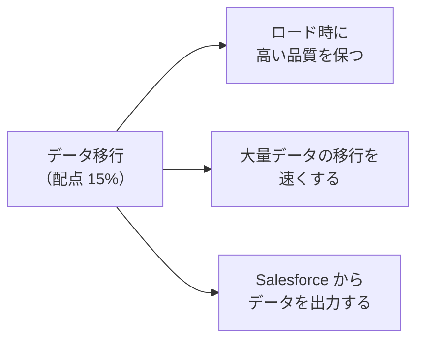
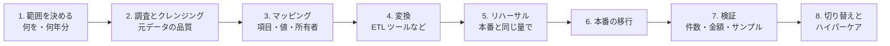
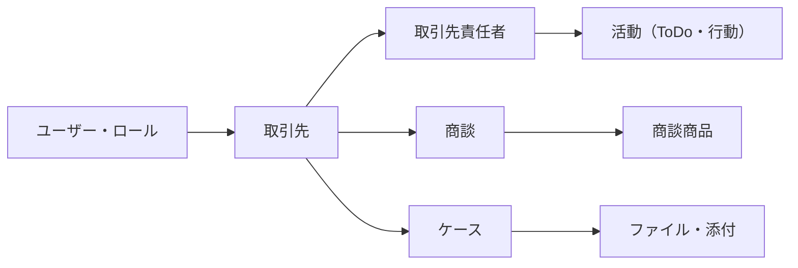
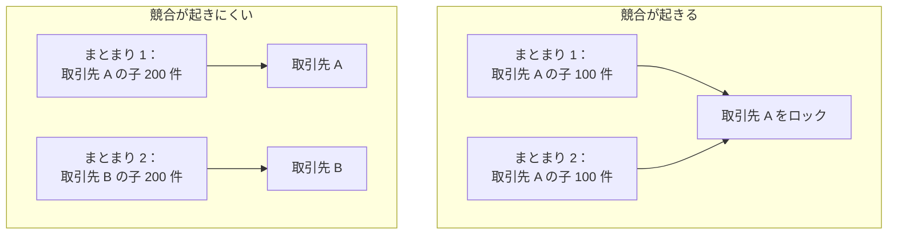

## はじめに：この範囲で学ぶこと

「データ移行」は配点 **15%** です。

---

## 1. 移行の全体の流れ

### 1-1. 読み込む順番（親 → 子）

- 参照先（親）が先にないと、子のリレーションを設定できません。
- 参照データ（商品、価格表、選択リストの値）も先に用意します。

---

## 2. ロード時に高いデータ品質を保つ

| 手法 | 内容 |
|---|---|
| **移行前のクレンジング** | 元のシステムで重複・誤り・古いデータを直してから移す（Salesforce に入れてから直すより安い） |
| **移さないデータを決める** | 使っていない古いデータ、重複、テストデータは移さない |
| **マッピング表** | 元の項目 → Salesforce の項目、型、変換のルール、選択リストの値の対応を文書にする |
| **外部 ID** | 元システムのキーを**外部 ID** に入れ、**upsert** で親子をつなぐ（Salesforce の ID を調べなくてよい）。再実行しても重複しない |
| **重複のチェック** | 移行前に照合し、重複ルールで新たな重複を防ぐ |
| **入力規則とのかかわり** | 必要なら一時的に止めるが、その分**事前の検証**で品質を担保する |
| **必須項目・型** | 日付の形式、数値の桁、必須項目の欠けを事前にチェック |
| **所有者** | 元システムの担当者を Salesforce のユーザーに対応させる。退職者の扱いを決める |
| **監査項目** | 作成日・作成者などを元の値で入れたい場合は、「**監査項目の設定**」を有効にして、作成時に設定する |

外部 ID で upsert する利点

- 子を読み込むとき、親の **Salesforce ID を調べなくても**、親の外部 ID で関連付けられる
- 移行を**やり直しても**、同じキーのレコードは更新になるので重複しない
- 移行後の**連携**でも、同じ外部 ID を使い続けられる

---

## 3. 大量データの移行を速くする

### 3-1. 主な手法

| 手法 | 内容 |
|---|---|
| **Bulk API 2.0** | 大量データを非同期で並列処理。API の呼び出し数も節約 |
| **親でソートする** | 同じ親の子を同じまとまりに入れ、**ロックの競合**を減らす |
| **直列での処理** | ロックの競合がひどい場合は、並列をやめて順番に処理（遅くなるが確実） |
| **自動化を止める** | 移行中は Flow・トリガー・入力規則・ワークフローなどを必要に応じて無効化（後で必要な処理はバッチで） |
| **共有計算の延期** | 共有ルールの計算を止め、移行後にまとめて実行 |
| **ロール・所有者の準備** | ユーザーとロールを先に作り、正しい所有者で入れる（後から所有者を変えると共有の再計算が起きる） |
| **insert と upsert** | 新規だけなら insert のほうが速い（upsert は既存の検索が必要） |
| **項目を絞る** | 必要な項目だけ読み込む |
| **時間帯** | 業務時間外に実行 |
| **リハーサルで時間を測る** | 本番と同じ量で試し、切り替えの時間内に終わるか確認 |

### 3-2. ロックの競合とは

子を作成・更新すると、親のレコードも一時的に**ロック**されます。並列で動く別々のまとまりが**同じ親**の子を同時に処理すると、ロックの取り合いになり、失敗や遅延が起きます。**親の ID で並べ替えて**から読み込むと防げます。

ひっかけ注意

「並列モードでロックのエラーが多発した。まず何をするか」→ いきなり直列にする前に、**親でソート**して同じ親の子を同じまとまりに入れる。それでも解消しなければ直列を検討します。

---

## 4. Salesforce からデータを出力する

| 方法 | 特徴 | 向いている場面 |
|---|---|---|
| **データエクスポートサービス** | 設定画面から、週次または月次でデータを CSV（zip）として出力 | 定期的なバックアップ（簡易） |
| **データローダーのエクスポート** | 指定したオブジェクトを CSV で出力。「すべてエクスポート」なら削除済み・アーカイブ済みも含む | 必要なオブジェクトを都度出す |
| **Bulk API のクエリ** | 大量データを非同期で取り出す。大きなテーブルは**主キーで分割**（PK チャンキング）して速く | 数千万件の出力 |
| **REST・SOAP API のクエリ** | 少量を取り出す | 連携での参照 |
| **レポートの出力** | 画面からレポートを出力 | 業務担当者の少量の出力（件数に制限） |
| **ETL ツール・連携基盤** | 変換しながら他のシステムに送る | DWH への定期的な出力 |
| **バックアップ用の製品** | 自動のバックアップと**復元** | 本格的なバックアップと復旧 |

### 4-1. 出力の考慮点

| 考慮点 | 内容 |
|---|---|
| **件数と時間** | 大量なら Bulk API と主キーでの分割 |
| **API の上限** | 出力にも API 呼び出しを使う |
| **削除済みのデータ** | 必要なら「すべてエクスポート」（ごみ箱・アーカイブ済みの活動を含む） |
| **ファイル** | 添付・ファイルは別に出力が必要 |
| **リレーション** | ID を含めて出し、出力先でつなげ直せるようにする |
| **セキュリティ** | 出力したファイルの保管・暗号化、出力できる人を絞る |
| **復元** | バックアップは「戻せる」ことが大事。リレーションも含めて復元する手順を確認 |

---

## 5. 検証と切り替え

| 検証 | 内容 |
|---|---|
| **件数** | 元のシステムと Salesforce の件数を比べる（オブジェクトごと） |
| **合計値** | 金額・数量の合計を比べる |
| **サンプル** | 業務担当者が代表的なレコードを確認する |
| **リレーション** | 親子が正しくつながっているか |
| **エラーファイル** | 読み込みの失敗を確認し、直して再投入 |

- 切り替え後は、問題にすぐ対応できる**ハイパーケア**の期間を設け、旧システムを参照できる期間も決めておきます。
- 止めた自動化・入力規則・共有計算を**元に戻す**のを忘れないようにします。

---

## 6. まとめ

| テーマ | 覚えること |
|---|---|
| 流れ | 範囲 → クレンジング → マッピング → 変換 → リハーサル → 移行 → 検証 → 切り替え |
| 順番 | 親 → 子（ユーザー → 取引先 → 取引先責任者 → 商談 → …） |
| 品質 | 事前のクレンジング、外部 ID で upsert、マッピング表、監査項目の設定 |
| 速さ | Bulk API、親でソート、直列、自動化の停止、共有計算の延期、insert |
| 出力 | データエクスポートサービス、データローダー（すべてエクスポート）、Bulk API（PK チャンキング）、バックアップ製品 |
| 検証 | 件数・合計・サンプル・リレーション・エラーファイル |

## 試験直前チェック

- [ ] 移行の順番を言え、その理由を説明できる
- [ ] 外部 ID で upsert する利点を 3 つ言える
- [ ] 元の作成日を移行する方法を言える
- [ ] ロックの競合の原因と対策を言える
- [ ] 大量移行を速くする手法を 5 つ言える
- [ ] データを出力する方法を 4 つ言え、使い分けを説明できる
- [ ] 移行後の検証方法を言える
