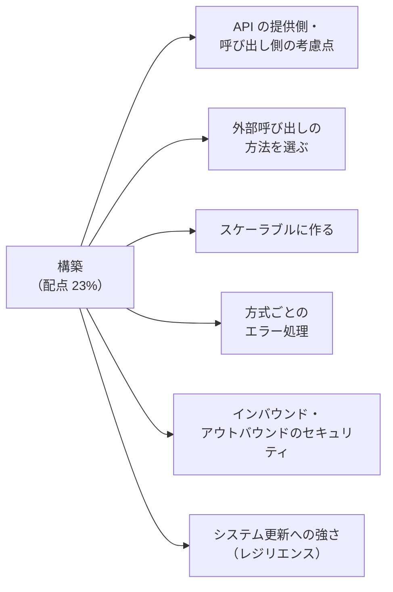
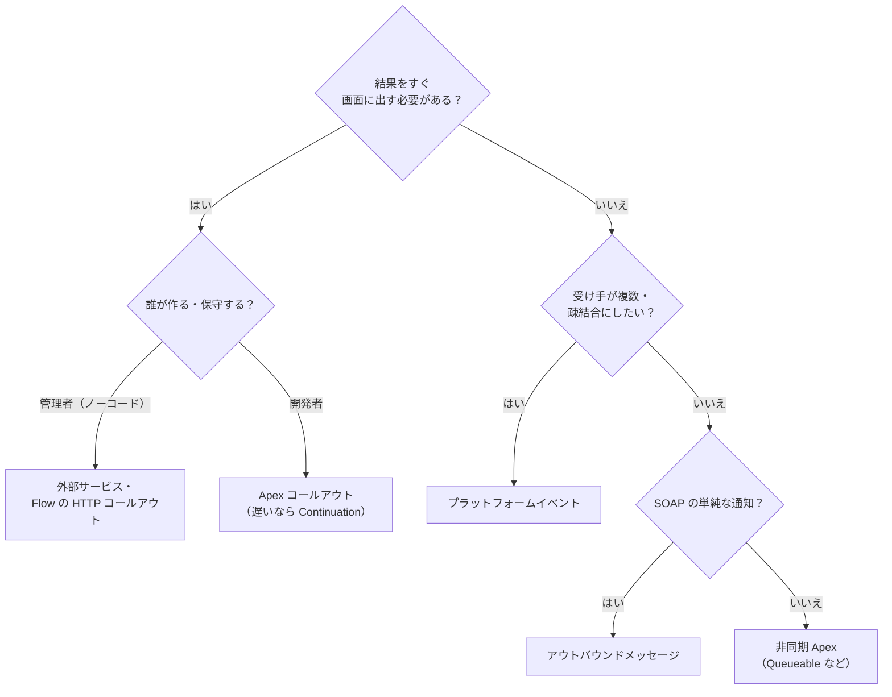
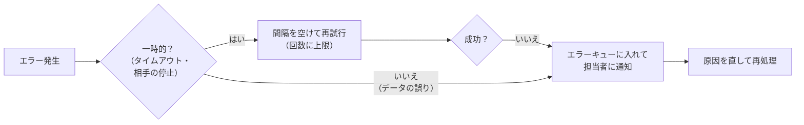

## はじめに：この範囲で学ぶこと

「ソリューションの構築」は配点 **23%** です。設計した連携を、**Salesforce の制約の中で確実に動くように作る**ための知識が問われます。

---

## 1. Salesforce が API を「提供する」側

### 1-1. まず標準の API で足りるか

外部システムが Salesforce のデータを読み書きするなら、まず **標準の REST・SOAP・Bulk API** で足りるかを考えます。独自の API を作ると、開発・テスト・保守のコストがかかるからです。

| 状況 | 選択 |
|---|---|
| 1 つのオブジェクトの作成・更新・参照 | 標準の REST API |
| 関連する複数のレコードをまとめて登録 | Composite API |
| 大量データ | Bulk API 2.0 |
| 複数オブジェクトにまたがる**独自の検証や処理**を 1 回で行いたい | **Apex REST**（独自のエンドポイント） |

### 1-2. Apex REST で API を作るときの考慮点

| 考慮点 | 内容 |
|---|---|
| **URL とバージョン** | `@RestResource(urlMapping='/orders/v1/*')` のように URL に**バージョン**を入れ、互換性のない変更は新しいバージョンで |
| **HTTP メソッド** | 取得は GET、作成は POST、更新は PUT・PATCH、削除は DELETE |
| **一括処理** | 複数件をまとめて受け取れるようにし、ガバナ制限を超えないよう**バルク化** |
| **入力チェック** | 必須項目、形式、値の範囲を確認し、分かりやすいエラーを返す |
| **ステータスコード** | 成功は 200・201、入力の誤りは 400、権限なしは 403 など、意味の合ったコードを返す |
| **セキュリティ** | 共有（`with sharing`）、オブジェクト・項目の権限を**ユーザーモード**で守る（`WITH USER_MODE`、`Security.stripInaccessible`） |
| **冪等性** | 外部 ID で upsert し、同じ要求が 2 回来ても二重登録しない |
| **ドキュメント** | 仕様（入出力、エラー）を公開し、利用者に伝える |

ひっかけ注意

Apex は既定で**システムモード**で動き、オブジェクトや項目の権限を自動では確認しません。外部に API を公開するときは、**連携ユーザーの権限で動く**ように明示的にチェックします。

---

## 2. Salesforce が外部を「呼び出す」側

### 2-1. 呼び出し方法の比較

| 方法 | 同期／非同期 | 特徴 | 向いている場面 |
|---|---|---|---|
| **Apex コールアウト**（HttpRequest） | どちらも | 柔軟。細かい制御ができる | 複雑な処理、独自の認証、エラー処理を作り込みたい |
| **外部サービス** | 同期（Flow・Apex から） | OpenAPI の仕様を登録すると、**Flow のアクション**として呼べる | 管理者が Flow で外部 API を使いたい |
| **Flow の HTTP コールアウト** | 同期 | Flow の中で REST API を宣言的に呼ぶ（サンプルの JSON から定義を作る） | 単純な REST の呼び出しをノーコードで |
| **WSDL から生成した Apex** | 同期 | SOAP サービスを呼ぶクラスを自動生成 | SOAP しかない外部システム |
| **アウトバウンドメッセージ** | 非同期 | 宣言的に SOAP メッセージを送る。自動で再送 | SOAP を受けられるシステムへの単純な通知 |
| **プラットフォームイベント** | 非同期 | Salesforce は発行するだけ。外部（連携基盤）が購読して処理 | 疎結合にしたい、受け手が複数 |
| **Continuation**（継続） | 非同期（画面から） | 画面（LWC など）から時間のかかる呼び出しを、サーバーのスレッドを占有せずに待つ | 画面から遅い外部サービスを呼ぶ |

### 2-2. コールアウトのルール

| ルール | 対処 |
|---|---|
| 1 トランザクションで最大 100 回、合計 120 秒 | まとめて送る、非同期に分ける |
| トリガーから同期のコールアウトはできない | `@future(callout=true)`、Queueable（`Database.AllowsCallouts`）、イベント |
| DML の後に、同じトランザクションでコールアウトはできない | コールアウトを先に、または非同期に分ける |
| 呼び出し先を登録する | **指定ログイン情報**（推奨）、またはリモートサイトの設定 |
| テストでは実際に呼べない | `HttpCalloutMock`（SOAP は `WebServiceMock`）で応答を模擬 |

### 2-3. 非同期 Apex の使い分け

| 種類 | 特徴 | 使いどころ |
|---|---|---|
| **Future** | 単純。引数は基本の型だけ | 簡単な非同期のコールアウト |
| **Queueable** | 複雑な型を渡せる、**連鎖**できる、ジョブを監視できる、**ファイナライザー**で後処理 | 多くの非同期処理の第一候補 |
| **Batch Apex** | 大量のレコードを分割して処理 | 数十万件の同期・更新 |
| **Schedulable** | 決まった時刻に実行 | 夜間の処理の起動 |

---

## 3. スケーラブルに作る

| 原則 | 内容 |
|---|---|
| **バルク化** | 1 件ずつではなく、まとめて処理する（トリガーは最大 200 件単位で動く） |
| **1 件ごとのコールアウトを避ける** | 200 件のレコードで 200 回呼ぶ設計は上限を超える。まとめて 1 回で送る |
| **非同期にする** | 利用者を待たせない、外部の遅さに引きずられない |
| **イベント駆動** | ポーリングをやめ、変化があったときだけ動く |
| **大量データは Bulk API** | API の呼び出し数を節約し、並列で処理 |
| **長時間のリクエストを避ける** | 外部から呼ばれる処理は短く。重い処理は非同期に |
| **非同期の上限を意識** | 24 時間あたりの非同期 Apex の実行数にも上限がある |
| **イベントの発行のタイミング** | プラットフォームイベントの「**すぐに発行**」と「**コミット後に発行**」を使い分ける（ロールバックされたら送りたくない場合はコミット後） |

「コミット後に発行」が大事な理由

「すぐに発行」だと、その後にエラーでトランザクションがロールバックされても、イベントは**送られてしまいます**。存在しない受注を ERP に送ってしまうかもしれません。業務データの確定を知らせるイベントは「**コミット後に発行**」にします。逆に、エラーのログを残すためのイベントは、ロールバックされても届くように「すぐに発行」にします。

---

## 4. 方式ごとのエラー処理

| 方式 | エラー処理 |
|---|---|
| **同期のコールアウト** | `try-catch` で例外をとらえ、タイムアウトを設定し、**利用者に分かるメッセージ**を表示。必要なら後で再送できるよう記録 |
| **Queueable** | **トランザクションファイナライザー**で、失敗したときにログを残す・再試行のジョブを登録する |
| **Batch Apex** | `Database.RaisesPlatformEvents` を付けると、失敗時に **BatchApexErrorEvent** が発行され、それを購読して記録・通知 |
| **プラットフォームイベントのトリガー** | 一時的なエラーなら `EventBus.RetryableException` を投げて**再試行**（回数に上限あり）。処理済みの位置を記録して途中から再開 |
| **Flow** | **障害パス**（フォールトパス）で、失敗時の処理（ログ、通知、利用者へのメッセージ）を作る |
| **アウトバウンドメッセージ** | 受信確認がなければ最大 24 時間自動で再送。設定画面で失敗したメッセージを確認・再送 |
| **Bulk API** | レコードごとの成功・失敗の結果を取得し、**失敗したものだけ**直して再送 |
| **イベントの購読（外部）** | **リプレイ ID** を保存し、止まった後に続きから受け取る |
| **連携基盤** | 間隔を広げながらの再試行（指数バックオフ）、**エラーキュー**（デッドレターキュー）、通知、手動の再処理 |

再試行の前提は「冪等」

再試行すると、同じデータが**2 回届く**ことがあります。外部 ID で upsert する、処理済みの ID を記録するなど、**何回届いても結果が同じ**（冪等）になるように作ってから再試行を入れます。

---

## 5. インバウンド・アウトバウンドのセキュリティ

### 5-1. インバウンド（外部 → Salesforce）

| 対策 | 内容 |
|---|---|
| **OAuth 2.0** | サーバー間は JWT ベアラー・クライアントクレデンシャル。パスワードを外部に持たせない |
| **外部クライアントアプリケーション** | スコープ、許可するユーザー、IP 制限、トークンの有効期限 |
| **連携ユーザー** | API のみ、最小限の権限セット |
| **IP 制限** | 外部システムの IP アドレスからだけ許可 |
| **CORS の許可リスト** | ブラウザの JavaScript から Salesforce の API を呼ぶ場合 |
| **入力チェック** | Apex REST では入力を検証し、権限をユーザーモードで確認 |

### 5-2. アウトバウンド（Salesforce → 外部）

| 対策 | 内容 |
|---|---|
| **指定ログイン情報＋外部ログイン情報** | URL と認証情報をコードから分離して安全に保管。コードでは `callout:名前/パス` で呼ぶ |
| **プリンシパル** | 共通の 1 アカウント（名前付きプリンシパル）か、利用者ごと（ユーザーごとのプリンシパル）か |
| **権限セットでアクセス制御** | どのユーザーがその外部ログイン情報を使えるか |
| **相互 TLS** | 外部がクライアント証明書を求める場合、Salesforce の証明書を使う |
| **暗号化・最小化** | 必要な項目だけ送る、機密データはマスキング |

---

## 6. システム更新に強い連携（レジリエンス）

Salesforce は**年 3 回**のメジャーリリースがあり、外部システムも更新されます。更新で連携が壊れないように作ります。

| 手法 | 内容 |
|---|---|
| **API のバージョンを固定** | Salesforce の API は**バージョンを指定**して呼ぶ。新しいバージョンへの移行は計画的に |
| **疎結合** | 連携基盤やシステム API をはさみ、相手の変更の影響を 1 か所に閉じ込める |
| **設定を外に出す** | エンドポイントや切り替えのフラグを、コードではなく**指定ログイン情報**や**カスタムメタデータ**に持つ |
| **寛容な読み取り** | 知らない項目が増えても壊れないように、必要な項目だけを読む |
| **リリース前の検証** | **サンドボックスのプレビュー**で新しいリリースを先に試し、連携の回帰テストを流す |
| **リリース更新の確認** | Salesforce のリリース更新（強制される変更）を期限までに検証 |
| **メンテナンス中の待ち行列** | 相手の停止中はメッセージをためて、再開後に送る |
| **ハードコードしない** | レコード ID、URL、組織固有の値をコードに書かない |

---

## 7. まとめ

| テーマ | 覚えること |
|---|---|
| 提供側 | まず標準 API。独自処理は Apex REST（バージョン、バルク化、入力チェック、ユーザーモード、冪等） |
| 呼び出し側 | Apex コールアウト、外部サービス、Flow の HTTP コールアウト、WSDL、アウトバウンドメッセージ、イベント、Continuation |
| ルール | 100 回・120 秒、トリガーと DML の後のコールアウト、指定ログイン情報、モックでテスト |
| スケール | バルク化、非同期、イベント駆動、Bulk API、コミット後に発行 |
| エラー処理 | ファイナライザー、BatchApexErrorEvent、RetryableException、障害パス、リプレイ ID、エラーキュー、冪等 |
| セキュリティ | インバウンド＝OAuth・連携ユーザー・IP・CORS、アウトバウンド＝指定・外部ログイン情報・相互 TLS |
| レジリエンス | バージョン固定、疎結合、設定の外出し、プレビューで検証、待ち行列 |

## 試験直前チェック

- [ ] 標準 API ではなく Apex REST を作るべき場面を言える
- [ ] Apex REST を作るときの考慮点を 4 つ言える
- [ ] 外部呼び出しの方法を 5 つ言え、使い分けを説明できる
- [ ] トリガーからコールアウトする方法を言える
- [ ] 「すぐに発行」と「コミット後に発行」の違いを言える
- [ ] Queueable・Batch・プラットフォームイベントのトリガー・Flow のエラー処理の方法を言える
- [ ] 指定ログイン情報を使う利点を言える
- [ ] システム更新に強くする手法を 4 つ言える
