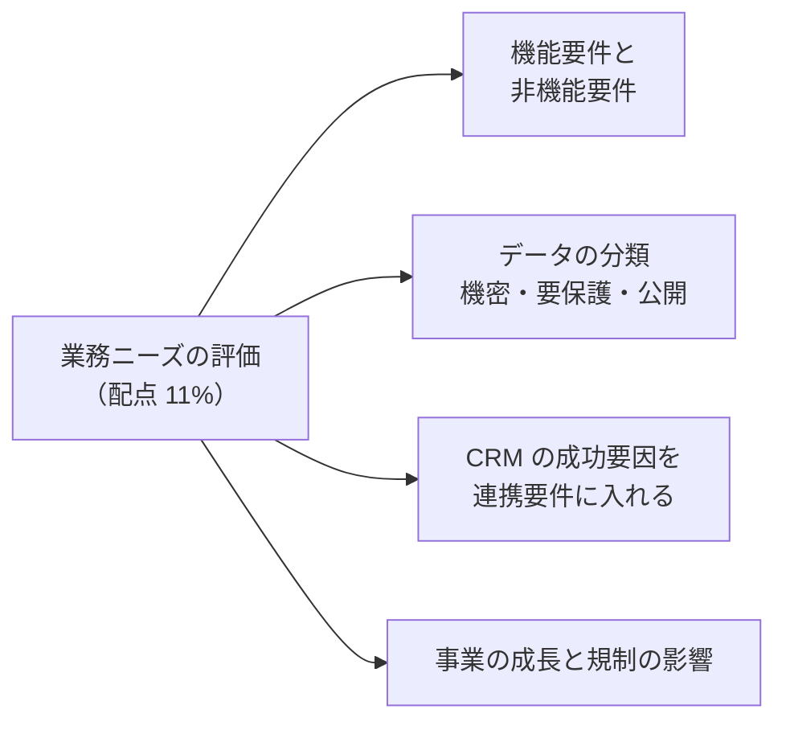
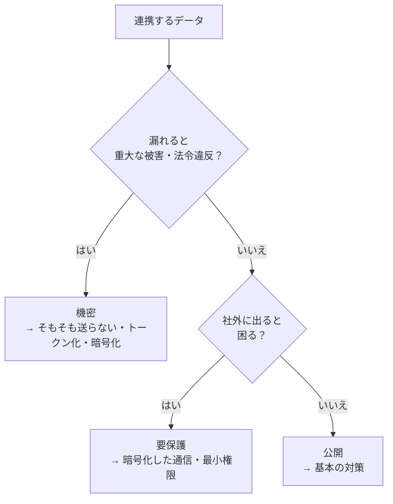

## はじめに：この範囲で学ぶこと

「業務ニーズの評価」は配点 **11%** です。技術を選ぶ前に「**何のために、どんな条件で**連携するのか」を明らかにします。

---

## 1. 機能要件と非機能要件

### 1-1. 違い

| | 機能要件 | 非機能要件 |
|---|---|---|
| 問い | **何を**するか | **どれくらいよく**するか |
| 例 | 受注が成立したら、注文を ERP に送る | 5 秒以内に送る、1 日 5 万件、99.9% の可用性、通信は暗号化 |

### 1-2. 連携の機能要件を引き出す質問

| 質問 | 例 |
|---|---|
| **何のデータ**を連携するか | 受注、顧客、在庫、請求 |
| **どの向き**か | Salesforce → ERP、ERP → Salesforce、双方向 |
| **きっかけ**は何か | レコードの保存、ボタン、決まった時刻、外部からの通知 |
| **誰が**結果を使うか | 営業担当者が画面で見る、経理が翌朝使う |
| **何が起きたら成功**か | ERP の受注番号が Salesforce に戻ってくる |
| **失敗したらどうするか** | 担当者に通知、自動で再送、手作業に切り替え |

### 1-3. 非機能要件の一覧

| 要件 | 確認すること | 例 |
|---|---|---|
| **タイミング（鮮度）** | どれくらい新しいデータが必要か | リアルタイム（数秒）、ほぼリアルタイム（数分）、日次 |
| **量** | 平常時・ピーク時の件数、データの大きさ | 1 日 1 万件、月末は 10 倍 |
| **応答時間** | 利用者が待てる時間 | 画面の操作は 2〜3 秒以内 |
| **可用性** | 止まってよい時間、止まったときの業務 | 外部が止まっても受注は受け付ける |
| **信頼性** | 取りこぼし・重複が許されるか | 1 件も落としてはいけない、二重登録は不可 |
| **順序** | 処理の順番が大事か | 「作成」の前に「更新」が届いてはいけない |
| **セキュリティ** | 暗号化、認証、アクセス制御 | 通信は TLS、個人情報は項目を暗号化 |
| **監査** | 誰がいつ何を送ったかの記録 | 5 年間ログを保管 |
| **保守性** | 変更のしやすさ、監視 | 外部システムの変更に影響されにくい |

「リアルタイム」と言われたら確認する

業務部門の「リアルタイムで」は、本当は「**数分以内なら十分**」ということがよくあります。本当に数秒が必要か、業務上の理由（「顧客が電話中に在庫を答えたい」など）を確認しましょう。必要以上のリアルタイム性は、コストと複雑さを増やします。

---

## 2. データを分類する（機密・要保護・公開）

連携するデータを、守るべき度合いで分類し、**その分類に合ったセキュリティ**を設計します。

| 分類 | 例 | 必要な対策の例 |
|---|---|---|
| **機密（Confidential）** | クレジットカード番号、マイナンバー、健康情報、パスワード | 連携しないで済むか検討、暗号化（通信・保存）、マスキング、厳しいアクセス制御、監査ログ |
| **要保護（Secure・社外秘）** | 氏名・住所・電話番号、取引条件、売上 | 暗号化した通信、認証、最小権限、必要な項目だけ送る |
| **公開（Public）** | 製品カタログ、店舗の住所、公開している価格 | 改ざん防止（通信の暗号化）など基本の対策 |

- Salesforce では、項目に**データの機密度**（データ分類）を設定して、どの項目が機密かを記録できます。
- カード番号のような機密データは、Salesforce に**保存しない**（決済代行会社のトークンだけ持つ）のが最も安全な場合があります。
- 保存が必要なら、**Shield Platform Encryption**（保存データの暗号化）なども検討します。

ひっかけ注意

「機密データも、通信が HTTPS なら問題ない」は不十分です。通信の暗号化に加えて、**保存時の暗号化**、**誰が見られるか**、**ログに残さない**、**そもそも必要か**まで考えます。

---

## 3. CRM の成功要因を連携要件に入れる

連携は、CRM（Salesforce）を**業務で使ってもらうため**の手段です。次のような成功要因を、連携の要件として明示します。

| CRM の成功要因 | 連携要件にすると |
|---|---|
| **データが正しく信頼できる** | マスターを決める、重複を作らない（外部 ID で照合）、入力チェック |
| **必要な情報が 1 か所で見られる** | 請求・在庫・出荷の状況を Salesforce の画面で見られる |
| **データが新しい** | 業務に必要な鮮度で同期する |
| **使いやすく速い** | 画面の表示を遅くしない（重い処理は非同期） |
| **二重入力がない** | Salesforce に入れたら外部にも反映 |
| **業務を止めない** | 外部が止まっても Salesforce の業務は続けられる |
| **経営の数字が合う** | 売上・受注の数字がシステム間で一致する（照合の仕組み） |

例

営業が「Salesforce の売上と ERP の売上が合わないので、結局 ERP を見ている」という状態だと、CRM は使われなくなります。→ 連携要件として「**受注データの照合（毎日、件数と金額を比較して差異を通知）**」を入れる。

---

## 4. 事業の成長と規制の影響

### 4-1. 事業の成長

| 成長の要因 | 連携への影響 | 対応の例 |
|---|---|---|
| **データ量の増加** | 今の方法では処理しきれなくなる | Bulk API、非同期、イベント駆動 |
| **利用者の増加** | API の呼び出しが増え、上限に近づく | まとめて呼ぶ（Composite）、キャッシュ |
| **新しいシステム・チャネルの追加** | 連携の数が増える | 連携基盤（ハブ）、API 主導の連携、イベントの購読 |
| **M&A・海外展開** | 組織やシステムが増える、言語・通貨 | 疎結合の設計、データモデルの標準化 |

### 4-2. 規制

| 規制・要件 | 影響 |
|---|---|
| **個人情報の保護**（GDPR、個人情報保護法など） | 送るデータの最小化、同意、削除の依頼に応える仕組み、国外へのデータ移転 |
| **業界の規制**（PCI DSS、HIPAA など） | カード情報や健康情報の扱い。暗号化、アクセス記録、保存場所 |
| **データの保存場所（データレジデンシー）** | データを特定の国・地域に置く必要がある |
| **監査・記録の保存** | 連携のログを決められた期間保管 |

なぜ最初に確認するのか

規制は後から変えられない「前提条件」です。たとえば「カード情報を Salesforce に置いてはいけない」と後で分かると、データモデルも連携もやり直しになります。**設計の前に**確認します。

---

## 5. まとめ

| テーマ | 覚えること |
|---|---|
| 機能要件 | 何を・どの向き・きっかけ・誰が使う・成功の条件・失敗時 |
| 非機能要件 | 鮮度、量、応答時間、可用性、信頼性、順序、セキュリティ、監査、保守性 |
| データの分類 | 機密・要保護・公開。分類に合わせた対策。機密は送らない選択も |
| CRM の成功要因 | 正しいデータ、1 か所で見られる、新しい、速い、二重入力なし、業務を止めない |
| 成長 | 量・利用者・システムの増加 → 非同期・Bulk・連携基盤・疎結合 |
| 規制 | 個人情報、業界規制、保存場所、監査 |

## 試験直前チェック

- [ ] 機能要件と非機能要件の違いを例で説明できる
- [ ] 非機能要件を 6 つ言える
- [ ] データを 3 つに分類し、それぞれの対策を言える
- [ ] CRM の成功要因を連携要件にした例を 2 つ言える
- [ ] 事業の成長が連携方式に与える影響と対応を言える
- [ ] 規制の要件を設計の前に確認すべき理由を言える
