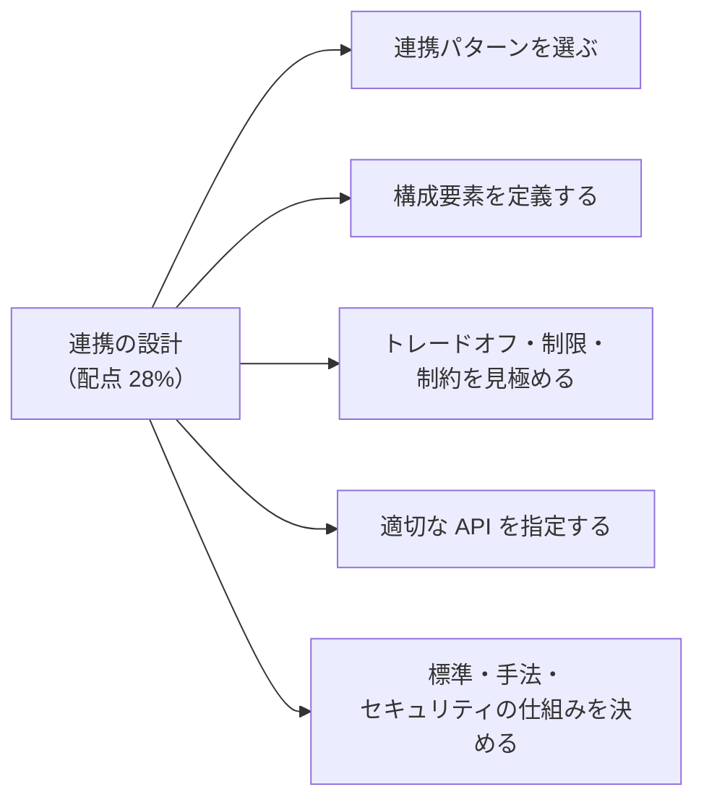
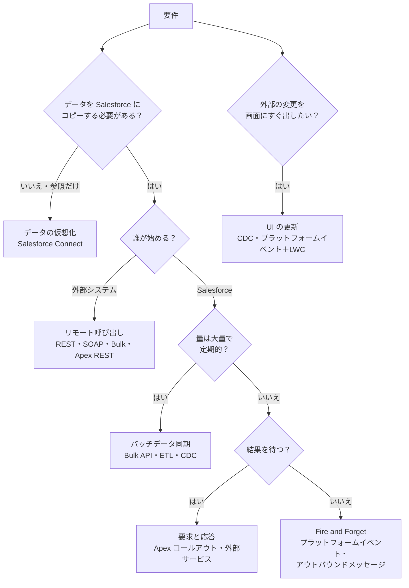
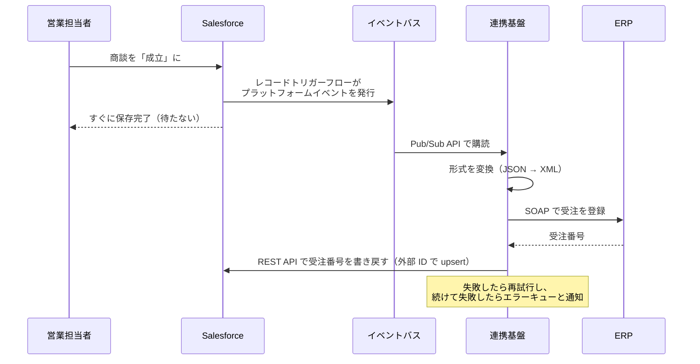
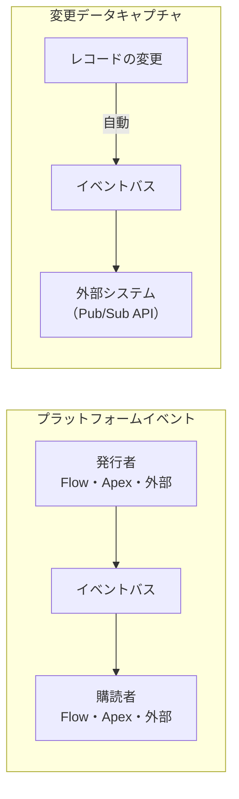
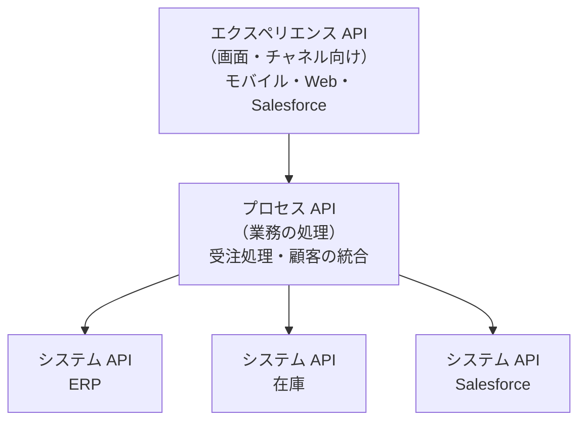

## はじめに：この範囲で学ぶこと

「連携ソリューションの設計」は配点 **28%** で、この試験で最も大きい範囲です。

---

## 1. 連携パターンを選ぶ

パターン選びの練習

| 要件 | パターン |
|---|---|
| 営業が見積を作るとき、ERP の最新の価格を画面に表示したい | 要求と応答 |
| 受注が成立したら ERP に送る。ERP は数分かかることがある | Fire and Forget |
| 毎晩 200 万件の取引データを DWH から取り込む | バッチデータ同期 |
| EC サイトで会員登録されたら Salesforce に取引先責任者を作る | リモート呼び出し |
| 10 年分の請求履歴を、コピーせずに取引先の画面で見たい | データの仮想化 |
| 配送システムで状態が変わったら、ケースの画面にすぐ表示したい | UI の更新 |

---

## 2. 構成要素を定義する

### 2-1. 例：受注を ERP に送る（Fire and Forget）

| 構成要素 | 役割 |
|---|---|
| **発行する側**（Flow・Apex） | 業務の出来事をイベントとして発行 |
| **イベントバス** | イベントを保持（72 時間）し、購読者に配信 |
| **購読する側**（連携基盤） | イベントを受け取り、変換して ERP に送る |
| **変換** | データの形式・項目の対応・コード値の変換 |
| **書き戻し** | 結果（ERP の受注番号）を Salesforce に戻す |
| **エラー処理** | 再試行、エラーキュー、通知、手動での再処理 |
| **監視** | 処理件数、失敗件数、遅延 |

---

## 3. Salesforce の API を使い分ける

| API | 特徴 | 使いどころ |
|---|---|---|
| **REST API** | JSON、軽量。レコードの作成・参照・更新・削除、クエリ | 一般的な連携、モバイル・Web |
| **SOAP API** | WSDL で型が厳密 | 型の厳密さが必要な企業システム、SOAP しか使えない環境 |
| **Bulk API 2.0** | 大量データを**非同期**に処理。自動で分割 | 数千件以上の読み書き、データ移行、夜間の同期 |
| **Composite API** | 最大 25 の操作を 1 回の呼び出しで。前の結果を後の操作で参照できる | 親と子をまとめて作る、往復を減らす |
| **Composite Graph API** | さらに多くの関連する操作を 1 回で、まとめて成功・失敗 | 複雑な関連データの一括登録 |
| **sObject Collections** | 最大 200 件を 1 回で作成・更新・削除 | 少量のまとめて処理 |
| **GraphQL API** | 必要な項目・関連だけを 1 回で取得 | 画面のデータ取得、モバイル |
| **Pub/Sub API** | gRPC でイベントを**発行・購読**。効率がよい | プラットフォームイベント・変更データキャプチャの購読 |
| **Streaming API** | CometD でイベントを購読（従来の方式） | 既存の仕組み（新しい開発では Pub/Sub API が推奨） |
| **Apex REST・Apex SOAP** | 独自のロジックを API として公開 | 標準の API では足りない処理（複数オブジェクトの検証付き登録など） |
| **Metadata API・Tooling API** | 設定（メタデータ）の取得・リリース | 開発・リリースの自動化（データ連携には使わない） |
| **User Interface API** | 画面の表示に必要な情報（レイアウト・項目・値）をまとめて取得 | Salesforce と同じ見た目の独自アプリ |

選び方の合言葉

- **少量・すぐ** → REST
- **まとめて往復を減らす** → Composite・Collections
- **大量** → Bulk 2.0
- **変化を知らせる** → イベント（Pub/Sub API で購読）
- **標準で足りない独自処理** → Apex REST

---

## 4. イベント駆動の仕組みを使い分ける

| 仕組み | 何を送るか | 特徴 | 使いどころ |
|---|---|---|---|
| **プラットフォームイベント** | 自分で定義した**業務の出来事**（受注確定、在庫切れ） | 発行と購読が疎結合。Flow・Apex・外部から発行・購読できる。保持 72 時間、**リプレイ ID**で取りこぼしを再取得 | Salesforce と外部の双方向のイベント連携 |
| **変更データキャプチャ（CDC）** | レコードの**作成・更新・削除・復元**の変更内容 | 設定するだけで自動で発行。変更された項目がわかる。保持 72 時間 | 外部システムのデータを Salesforce と同期させる |
| **アウトバウンドメッセージ** | 指定した項目を SOAP メッセージで送る | 宣言的。受信確認がないと最大 24 時間再送 | SOAP を受け取れるシステムへの簡単な通知 |
| **Streaming API（PushTopic・汎用）** | クエリに合う変更、任意のメッセージ | 従来の方式 | 既存の仕組みの維持 |

ひっかけ注意

- 「取引先のすべての変更を外部の DWH に反映したい」→ 自分でイベントを作るより **CDC**。
- 「『受注が確定した』という業務の出来事を、複数のシステムに知らせたい」→ **プラットフォームイベント**。
- 「購読側が 2 日止まっていた」→ 保持期間（72 時間）内ならリプレイ ID で再取得できる。それより長く止まるなら、**照合（差分の洗い直し）**の仕組みも必要。

---

## 5. データの仮想化（Salesforce Connect）

| 項目 | 内容 |
|---|---|
| 仕組み | 外部のデータを**外部オブジェクト**（API 名が `__x`）として表示。データは外部に置いたまま |
| アダプター | **OData**（2.0・4.0・4.01）、**組織間**（別の Salesforce 組織）、**独自のアダプター**（Apex で作る） |
| リレーション | **外部参照関係**（外部オブジェクトが親）、**間接参照関係**（外部オブジェクトの子が、Salesforce の外部 ID 項目で親を参照） |
| 向いている | 大量で、たまにしか見ない、Salesforce で集計や自動化に使わないデータ |
| 向いていない | 頻繁に参照・集計する、Salesforce の自動化（Flow・入力規則）で使う、外部が遅い・止まりやすい |

---

## 6. 連携基盤（ミドルウェア）

| 種類 | 役割 |
|---|---|
| **ESB** | 多数のシステムの間でメッセージを中継・変換・振り分け |
| **ETL** | 大量データの抽出・変換・ロード（バッチ） |
| **iPaaS**（MuleSoft など） | クラウドで提供される連携基盤。API の管理も |

### 6-1. API 主導の連携

- **システム API**：各システムへのアクセスを隠す（ERP が変わってもここだけ直せばよい）
- **プロセス API**：複数のシステムをまたぐ業務の処理
- **エクスペリエンス API**：画面やチャネルごとに必要な形で提供

連携基盤が向いているのは、**多数のシステム**、**複雑な変換**、**オーケストレーション**（順番に複数システムを呼ぶ）、**再試行・監視の一元化**が必要なときです。

---

## 7. トレードオフと制約を見極める

| 選択 | 長所 | 短所 |
|---|---|---|
| **同期** | すぐ結果がわかる、作りが単純 | 外部が遅い・止まると利用者も止まる、ガバナ制限 |
| **非同期** | 利用者を待たせない、外部の停止に強い | 結果がすぐわからない、順序・重複の考慮が必要 |
| **ポイント・ツー・ポイント** | 早く安く作れる | 連携が増えると保守が大変 |
| **連携基盤** | 変換・監視・再利用を一元化 | 導入・運用のコスト、基盤が単一障害点になり得る |
| **データのコピー** | 速い、Salesforce の機能（レポート・自動化）で使える | ストレージ、同期の手間、鮮度のずれ |
| **データの仮想化** | ストレージ不要、常に最新 | 外部の性能に依存、機能の制限 |
| **宣言的（Flow・外部サービス）** | 管理者でも保守しやすい | 複雑な処理や大量データには不向き |
| **コード（Apex）** | 柔軟、細かい制御 | 開発・テスト・保守のコスト |

---

## 8. 標準・手法・セキュリティの仕組み

| 目的 | 仕組み |
|---|---|
| **認証（インバウンド）** | OAuth 2.0（JWT ベアラー、クライアントクレデンシャル、Web サーバーフロー）、外部クライアントアプリケーション |
| **認証（アウトバウンド）** | 指定ログイン情報＋外部ログイン情報、相互 TLS（クライアント証明書） |
| **通信の保護** | TLS（HTTPS）、IP 制限、プライベートな接続（Private Connect など） |
| **データの保護** | Shield Platform Encryption、項目レベルセキュリティ、マスキング |
| **アクセスの最小化** | 連携ユーザー＋最小限の権限セット、OAuth のスコープ |
| **イベントのアクセス** | プラットフォームイベント・CDC を購読できるユーザーを権限で制御 |
| **重複の防止** | **外部 ID**を使った upsert（同じデータが 2 回来ても 1 件） |
| **データの形式** | JSON・XML、共通のデータモデル（正規データモデル） |

外部 ID と upsert が設計の基本になる理由

非同期の連携では、再試行で**同じメッセージが 2 回届く**ことがあります。外部システムの ID を Salesforce の**外部 ID 項目**に持ち、**upsert**（あれば更新、なければ作成）で登録すれば、何回届いても結果は同じ（**冪等**）になります。

---

## 9. まとめ

| テーマ | 覚えること |
|---|---|
| パターン | コピーするか → 誰が始めるか → 大量・定期か → 待つか |
| 構成要素 | 発行・バス・購読・変換・書き戻し・エラー処理・監視 |
| API | 少量＝REST、まとめる＝Composite・Collections、大量＝Bulk 2.0、変化＝Pub/Sub、独自＝Apex REST |
| イベント | 業務の出来事＝プラットフォームイベント、レコードの変更＝CDC、SOAP の簡単な通知＝アウトバウンドメッセージ。保持 72 時間 |
| 仮想化 | 外部オブジェクト、OData・組織間・独自アダプター、外部参照・間接参照 |
| 連携基盤 | 多数・変換・オーケストレーション。API 主導（システム・プロセス・エクスペリエンス） |
| セキュリティ | OAuth、指定ログイン情報、相互 TLS、暗号化、最小権限、外部 ID で冪等 |

## 試験直前チェック

- [ ] 要件から連携パターンを選ぶ質問の順番を言える
- [ ] Fire and Forget の構成要素を図で説明できる
- [ ] REST・SOAP・Bulk 2.0・Composite・GraphQL・Pub/Sub の使い分けを言える
- [ ] プラットフォームイベントと CDC の違いを言える
- [ ] Salesforce Connect が向いている場面・向いていない場面を言える
- [ ] API 主導の連携の 3 つの層を言える
- [ ] 同期と非同期、コピーと仮想化のトレードオフを言える
- [ ] 外部 ID と upsert で冪等にする理由を言える
