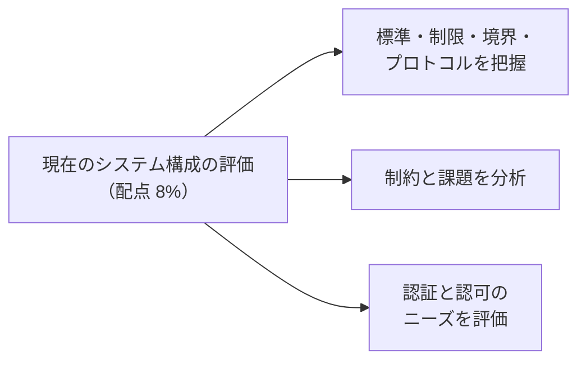
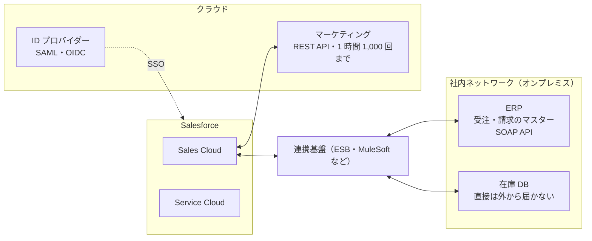
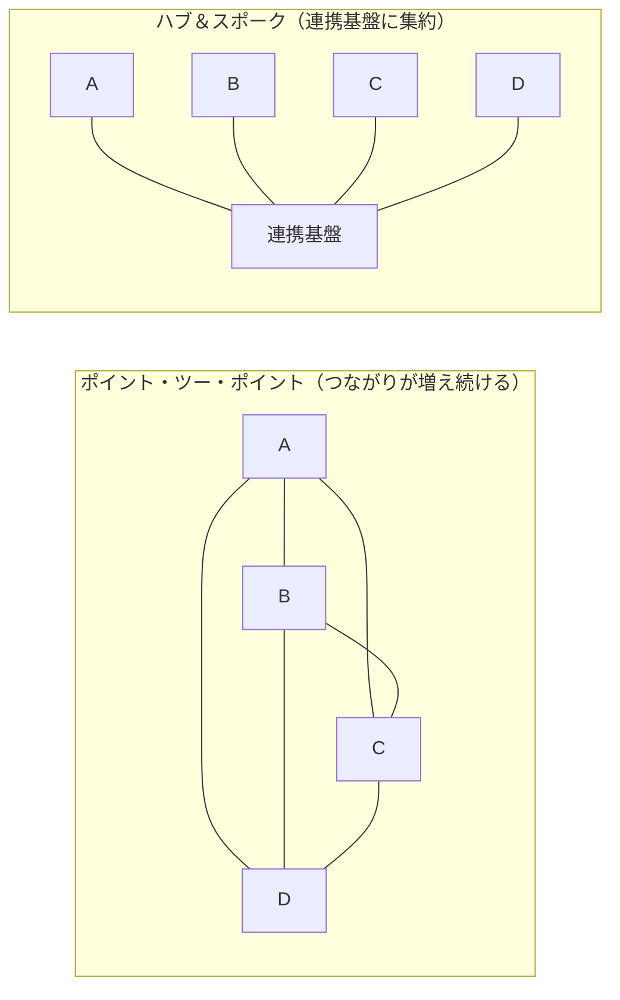
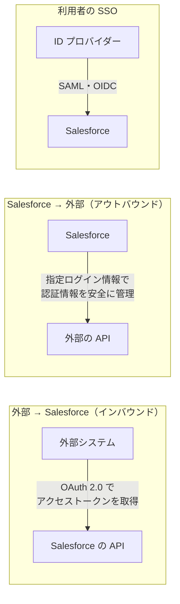

## はじめに：この範囲で学ぶこと

「現在のシステム構成の評価」は配点 **8%** です。設計に入る前に「**今どうなっているか**」を正しく知る力が問われます。

---

## 1. システム構成を把握する

### 1-1. まず描く：システム構成図

構成図には、システムの名前だけでなく、**役割・データのマスター・API の種類・制限**を書き込みます。

### 1-2. 確認する観点

| 観点 | 確認すること | なぜ必要か |
|---|---|---|
| **役割とデータのマスター** | どのシステムが、どのデータの「正」か | 連携の向き（どちらからどちらへ）を決める |
| **プロトコル・API** | REST、SOAP、ファイル（CSV）、DB 直結、メッセージキュー | 使える連携方法が決まる |
| **データの形式** | JSON、XML、CSV、固定長 | 変換が必要かどうか |
| **認証方式** | OAuth 2.0、基本認証、API キー、証明書（相互 TLS）、SAML | セキュリティの設計を決める |
| **ネットワーク** | インターネットから届くか、ファイアウォール、IP 制限、VPN | 直接つなげるか、中継が必要か |
| **量と頻度** | 1 日の件数、ピーク時の件数、更新の頻度 | API の選択、同期か非同期か |
| **制限** | 外部 API の呼び出し回数の上限、タイムアウト、メンテナンス時間 | 再試行や待ち行列の設計 |
| **既存の連携基盤** | ESB、ETL、MuleSoft、iPaaS の有無 | 新しく作るか、あるものを活かすか |
| **運用** | 誰が保守しているか、監視の仕組み、障害時の連絡先 | 運用設計 |

「標準・制限・境界・プロトコル」と覚える

- **標準**：会社の決まりごと（「連携は必ず ESB を通す」「個人情報は暗号化する」）
- **制限**：API の上限、タイムアウト、ライセンス、データ量
- **境界**：ネットワークやセキュリティの境目（社内／社外、ファイアウォール）
- **プロトコル**：通信の決まり（HTTPS、REST、SOAP、SFTP）

---

## 2. 主な標準・プロトコル

| 標準 | 内容 | Salesforce での例 |
|---|---|---|
| **REST** | HTTP と JSON を使う軽量な API | REST API、Apex REST、外部サービス |
| **SOAP** | WSDL で厳密に型が決まった XML の API | SOAP API、WSDL から Apex クラスを生成、アウトバウンドメッセージ |
| **OData** | データを参照するための REST の標準 | Salesforce Connect の外部オブジェクト |
| **gRPC** | 高速な通信の仕組み | Pub/Sub API |
| **CometD（Bayeux）** | サーバーからの通知を受け取る仕組み | Streaming API |
| **OAuth 2.0** | API の**認可**（何をしてよいか）の標準 | 接続アプリケーション、外部クライアントアプリケーション |
| **OpenID Connect** | OAuth 2.0 の上で**認証**（誰か）を行う標準 | ソーシャルログイン、SSO |
| **SAML** | **シングルサインオン**のための XML の標準 | ID プロバイダーと連携した SSO |
| **SFTP** | ファイルを安全に送る | 夜間のファイル連携 |

---

## 3. 制約と課題を分析する

### 3-1. よくある制約と設計への影響

| 制約 | 設計への影響 |
|---|---|
| 外部システムが**社内ネットワーク**にあり、外から届かない | 連携基盤やゲートウェイを中継させる、外部システム側から Salesforce を呼ぶ形にする、プライベートな接続を検討 |
| 外部システムが **SOAP しか**提供しない | WSDL から Apex クラスを生成、または連携基盤で REST に変換 |
| 外部 API に**呼び出し回数の上限**がある | まとめて送る、キャッシュする、非同期にして流量を調整する |
| 外部システムが**夜間だけ止まる** | 待ち行列にためて再開後に送る、時間帯をずらす |
| 応答が**遅い**（数十秒） | 利用者を待たせる同期の呼び出しを避け、非同期にする |
| データ量が**とても多い** | Bulk API、バッチの同期、データの仮想化 |
| **ファイル連携**しかできない | ETL ツールや Bulk API で取り込む |
| 会社の標準で「**連携は必ず ESB 経由**」 | 直接の連携ではなく、ESB を使う設計にする |

### 3-2. 現在の課題（ペインポイント）を見つける

| 課題 | 例 | 連携で解決できること |
|---|---|---|
| **二重入力** | 営業が受注を Salesforce と ERP の両方に入力 | 受注を自動で ERP に送る |
| **古い情報** | 在庫が翌日にならないと分からない | 在庫をリアルタイムで照会 |
| **データの不整合** | 住所がシステムごとに違う | マスターを決め、そこから配る |
| **手作業の受け渡し** | CSV を手で出してメールで送る | 自動のバッチ連携 |
| **連携のスパゲッティ化** | システム同士が直接つながり、変更が怖い | 連携基盤で整理（ハブ＆スポーク） |

なぜポイント・ツー・ポイントが問題になるのか

システムが n 個あると、直接つなぐ線は最大で n×(n−1)÷2 本になります。1 つのシステムを変えると、つながる全部の連携を直す必要があります。連携基盤に集約すると、変換・再試行・監視も 1 か所にまとめられます。ただし、連携が 1〜2 本だけなら、連携基盤を入れるほうが大げさな場合もあります。

---

## 4. 認証と認可のニーズを評価する

### 4-1. 認証と認可の違い

| | 認証（Authentication） | 認可（Authorization） |
|---|---|---|
| 問い | **誰か**を確かめる | **何をしてよいか**を決める |
| 例 | ID とパスワード、証明書、SAML、OpenID Connect | OAuth のスコープ、権限セット、共有 |

### 4-2. どの向きの連携か

| 状況 | 評価すること |
|---|---|
| **外部システムが Salesforce を呼ぶ** | どの OAuth フローを使うか（サーバー間か、利用者の操作か）、**連携ユーザー**の権限、IP 制限 |
| **Salesforce が外部を呼ぶ** | 外部が求める認証方式（OAuth、API キー、基本認証、証明書）、認証情報の保管方法（**指定ログイン情報**） |
| **利用者のシングルサインオン** | ID プロバイダー（社内の認証基盤）と SAML・OpenID Connect で連携するか |
| **利用者ごとの権限で外部を呼ぶ** | 利用者ごとの認証（ユーザーごとのプリンシパル）が必要か、共通の 1 アカウントで足りるか |

評価の例

「夜間バッチで、ERP が Salesforce に受注データを書き込む。人は介在しない」
→ **サーバー間**の連携なので、人のログインを前提とする OAuth フローは不向き。**JWT ベアラーフロー**や**クライアントクレデンシャルフロー**を検討し、**専用の連携ユーザー**に必要最小限の権限を与える。

---

## 5. まとめ

| テーマ | 覚えること |
|---|---|
| 把握 | 役割・マスター、API、形式、認証、ネットワーク、量、制限、連携基盤、運用 |
| 4 つの観点 | 標準・制限・境界・プロトコル |
| 制約の影響 | 届かない → 中継、SOAP のみ → 生成・変換、上限 → まとめる・非同期、遅い → 非同期 |
| 課題 | 二重入力、古い情報、不整合、手作業、スパゲッティ化 |
| 認証・認可 | 誰か／何をしてよいか。向き（インバウンド・アウトバウンド・SSO）ごとに評価 |

## 試験直前チェック

- [ ] 現在のシステム構成で確認すべき観点を 5 つ言える
- [ ] 「標準・制限・境界・プロトコル」の例をそれぞれ言える
- [ ] 外部システムが社内ネットワークにある場合の選択肢を言える
- [ ] ポイント・ツー・ポイントの問題点と、ハブ＆スポークの利点を言える
- [ ] 認証と認可の違いを言える
- [ ] インバウンドとアウトバウンドで、評価する認証のポイントの違いを言える
