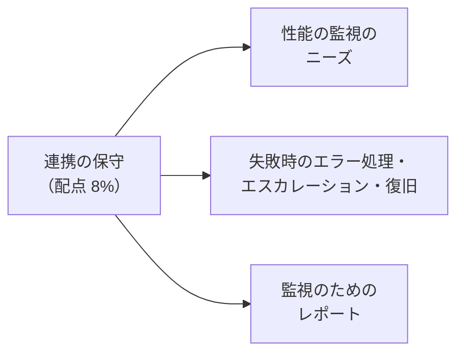
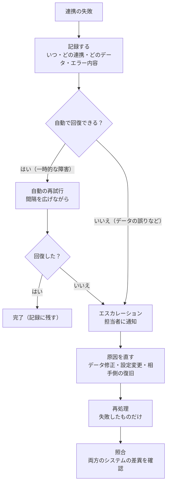

## はじめに：この範囲で学ぶこと

「連携の保守」は配点 **8%** です。作った連携を**止めずに、問題があればすぐ気づいて直せる**ようにします。

---

## 1. 性能を監視する

### 1-1. 何を見るか

| 指標 | 意味 | 悪化のサイン |
|---|---|---|
| **処理件数** | 一定時間に処理した件数 | いつもより少ない（どこかで止まっている） |
| **成功率・失敗件数** | どれだけ失敗しているか | 失敗が急に増えた |
| **応答時間・遅延** | 1 件の処理にかかる時間、発生から反映までの時間 | 遅くなってきた（外部の性能、データ量の増加） |
| **待ち行列の長さ** | 処理待ちのメッセージ・ジョブの数 | 増え続けている（処理が追いつかない） |
| **API の使用量** | 24 時間あたりの API 呼び出し数の使用率 | 上限に近い |
| **非同期ジョブ** | Apex ジョブ、Bulk API のジョブの状態 | 失敗・長時間の実行 |
| **イベントの使用量** | プラットフォームイベントの発行・配信量 | 上限に近い |

### 1-2. Salesforce で使える監視の道具

| 道具 | 確認できること |
|---|---|
| **システムの概要**・**組織の制限**（REST API の Limits リソース） | API 要求の残り、ストレージ、各種の上限の使用状況 |
| **API 使用状況の通知** | API の使用量がしきい値を超えたらメールで通知 |
| **Apex ジョブ** | 非同期 Apex（Queueable・Batch・Future）の状態と失敗 |
| **一括データ読み込みジョブ** | Bulk API のジョブの進み具合と失敗 |
| **アウトバウンドメッセージの監視** | 送信待ち・失敗したメッセージと再送 |
| **イベントモニタリング**（Shield） | API の呼び出し、ログイン、レポートの出力などのイベントログを詳しく分析 |
| **デバッグログ** | 特定のユーザー（連携ユーザーなど）の処理の詳細（調査用、常時ではない） |
| **プラットフォームイベントの使用量** | 発行・配信の量 |
| **連携基盤の監視** | MuleSoft などのダッシュボード、アラート |
| **独自のログオブジェクト** | 連携ごとの結果を記録して、レポートで分析 |

「API の上限に近づいている」と言われたら

1. **イベントモニタリング**や API の使用状況で、**どの連携ユーザー・どのアプリ**が多く呼んでいるか調べる
2. 1 件ずつの呼び出しを、**Composite・Collections・Bulk API** でまとめる
3. ポーリングを、**変更データキャプチャ**などのイベント購読に置き換える
4. それでも足りなければ、上限の追加購入を検討する

---

## 2. 失敗した連携のエラー処理・エスカレーション・復旧

### 2-1. 全体の流れ

### 2-2. エスカレーションの設計

| レベル | 条件 | 誰に・どうやって |
|---|---|---|
| **1. 自動対応** | 一時的なエラー | 再試行（回数と間隔に上限） |
| **2. 運用担当** | 再試行で回復しない、データの誤り | メール・チャット・ケースで通知。手順書に沿って対応 |
| **3. 開発・システム担当** | 設定やコードの問題、相手システムの障害 | 運用担当から引き継ぎ |
| **4. 業務部門・責任者** | 業務への影響が大きい（受注が止まっている） | 影響範囲と見込みを報告。手作業での代替を判断 |

- **手順書（ランブック）**：よくあるエラーごとに、確認する場所・対処・再処理の方法を書いておく。
- **通知が多すぎない**ように：同じ原因のエラーはまとめて 1 回の通知にする（通知に慣れて見落とすのを防ぐ）。

### 2-3. 復旧の方法

| 状況 | 復旧の方法 |
|---|---|
| 外部システムが止まっていた | 待ち行列にたまったメッセージを、再開後に順に送る |
| イベントの購読者が止まっていた | **リプレイ ID** で、止まった位置から受け取り直す（保持期間内） |
| 保持期間を過ぎた、記録がない | **照合**して差分を見つけ、**バッチで再同期**する |
| 一部のレコードだけ失敗した | 失敗したレコードだけを直して**再送**（外部 ID で upsert すれば二重にならない） |
| 誤ったデータが大量に送られた | 送信を止め、影響範囲を特定し、正しいデータで上書き。必要ならバックアップから戻す |

照合（リコンシリエーション）が必要な理由

再試行やリプレイがあっても、すべての失敗に気づけるとは限りません。定期的に**両方のシステムの件数や金額を比べ**、差異を見つける仕組みがあると、「気づかないうちにずれていた」を防げます。

---

## 3. 監視のためのレポート

| レポート | 内容 | 誰が見る |
|---|---|---|
| **連携ごとの成功・失敗件数** | 日別・連携別の件数と失敗率 | 運用担当 |
| **未解決のエラー一覧** | まだ再処理されていない失敗と、その経過時間 | 運用担当 |
| **処理時間・遅延の推移** | 平均・最大の処理時間 | 開発・システム担当 |
| **API 使用量の推移** | 日別の API 呼び出し数と上限に対する割合 | システム管理者 |
| **照合の結果** | システム間の差異の件数 | 業務部門・運用担当 |
| **SLA の達成状況** | 決めた時間内に処理できた割合 | 責任者 |

- **独自のログオブジェクト**（連携名、レコード ID、状態、エラー内容、再試行回数、日時）を作ると、Salesforce の**レポート・ダッシュボード**で可視化でき、しきい値を超えたら通知する仕組みも作れます。
- ログが増えすぎないよう、**保管期間**を決めて古いログを削除・アーカイブします。
- ログに**機密データ**（カード番号など）を残さないようにします。

やってみよう（15 分）

1. 設定 →「システムの概要」で、API 要求の使用状況を確認する
2. 設定 →「API 使用状況の通知」で、使用量が 80% を超えたら自分にメールが届く通知を作る
3. 設定 →「Apex ジョブ」で、非同期ジョブの状態の見方を確認する
4. 設定 →「一括データ読み込みジョブ」で、Bulk API のジョブの結果（成功・失敗の件数）の見方を確認する

---

## 4. まとめ

| テーマ | 覚えること |
|---|---|
| 監視の指標 | 件数、成功率、応答時間・遅延、待ち行列、API 使用量、ジョブ、イベント量 |
| 道具 | システムの概要・Limits、API 使用状況の通知、Apex ジョブ、一括データ読み込みジョブ、アウトバウンドメッセージの監視、イベントモニタリング |
| エラー処理 | 記録 → 自動の再試行 → エスカレーション → 修正 → 再処理 → 照合 |
| 復旧 | 待ち行列、リプレイ ID、照合と再同期、失敗分だけ再送 |
| レポート | 成功・失敗、未解決のエラー、遅延、API 使用量、照合、SLA |

## 試験直前チェック

- [ ] 連携の性能で監視すべき指標を 5 つ言える
- [ ] API の使用量を確認・通知する方法を言える
- [ ] 失敗からの復旧の流れを順に言える
- [ ] エスカレーションのレベルを説明できる
- [ ] リプレイ ID で復旧できない場合の対処を言える
- [ ] 独自のログオブジェクトを作る利点と注意点を言える
