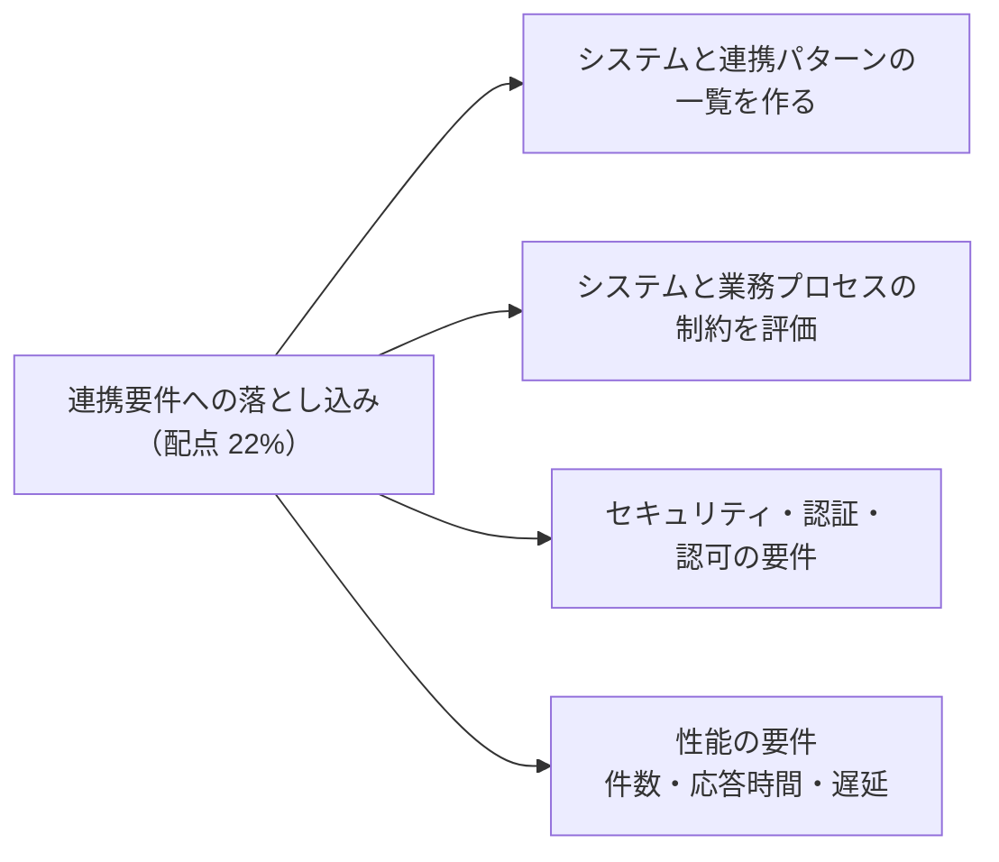
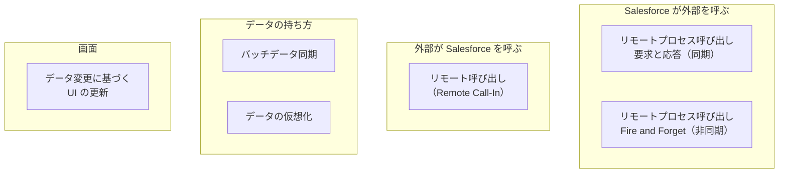
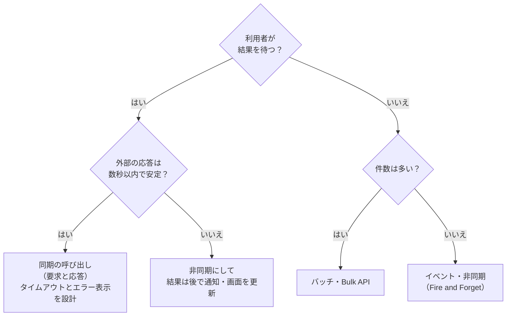

## はじめに：この範囲で学ぶこと

「ニーズを連携要件に落とし込む」は配点 **22%** と大きい範囲です。業務のニーズを、**設計できる具体的な要件**に変換します。

---

## 1. 連携の一覧（インベントリ）を作る

### 1-1. 一覧に書く項目

システム構成図を見ながら、**連携 1 本ごと**に 1 行の表を作ります。

| 項目 | 例 |
|---|---|
| 連携の名前 | 受注の送信 |
| 送り元 → 送り先 | Salesforce → ERP |
| データ | 商談・商談商品 |
| きっかけ | 商談のフェーズが「成立」になったとき |
| タイミング | ほぼリアルタイム（数分以内） |
| 同期／非同期 | 非同期（利用者は結果を待たない） |
| 件数 | 1 日 500 件、月末は 3,000 件 |
| 連携パターン | リモートプロセス呼び出し（Fire and Forget） |
| 技術 | プラットフォームイベント → 連携基盤 → ERP の SOAP API |
| 認証 | 連携基盤は JWT ベアラーで Salesforce に接続 |
| エラー時 | 連携基盤で再試行、3 回失敗したら運用担当に通知 |
| 担当 | 営業システムチーム |

### 1-2. Salesforce の 6 つの連携パターン（超頻出）

| パターン | 内容 | タイミング | 例 | 主な技術 |
|---|---|---|---|---|
| **リモートプロセス呼び出し — 要求と応答** | Salesforce から外部を呼び、**結果を待つ** | 同期 | 与信の結果を画面に表示 | Apex コールアウト、外部サービス、Flow の HTTP コールアウト |
| **リモートプロセス呼び出し — Fire and Forget** | Salesforce から外部に送り、**結果を待たない** | 非同期 | 受注を ERP に通知 | プラットフォームイベント、アウトバウンドメッセージ、非同期 Apex |
| **バッチデータ同期** | 大量データを**定期的に**同期 | 非同期 | 夜間に商品マスターを取り込む | Bulk API、ETL、変更データキャプチャ |
| **リモート呼び出し** | **外部から** Salesforce のデータを作成・更新・参照 | 同期・非同期 | EC サイトが顧客を登録 | REST・SOAP・Bulk API、Apex REST |
| **データ変更に基づく UI の更新** | Salesforce のデータ変更を**画面にすぐ反映** | 非同期 | 外部で更新された注文の状態を画面に表示 | 変更データキャプチャ、プラットフォームイベント、Lightning コンポーネント |
| **データの仮想化** | データを**コピーせず**、外部にあるまま参照 | 同期 | 古い注文履歴を ERP から表示 | Salesforce Connect（外部オブジェクト） |

パターンを選ぶ 3 つの質問

1. **どちらが呼ぶか**（Salesforce → 外部か、外部 → Salesforce か）
2. **結果を待つ必要があるか**（同期か非同期か）
3. **データをコピーするか**（同期するか、参照だけか）

---

## 2. システムと業務プロセスの制約を評価する

### 2-1. Salesforce 側の制約（ガバナ制限など）

| 制約 | 内容 | 設計への影響 |
|---|---|---|
| **コールアウトの回数** | 1 トランザクションで最大 100 回 | 1 件ずつ呼ばずに、まとめて送る |
| **コールアウトの時間** | 1 トランザクションの合計で最大 120 秒（既定のタイムアウトは 10 秒） | 遅い外部システムは非同期に |
| **トリガーからのコールアウト** | トリガーから同期のコールアウトはできない | 非同期 Apex（Queueable など）やイベントを使う |
| **DML の後のコールアウト** | 同じトランザクションで、DML の後にコールアウトはできない | 順番を入れ替える、非同期に分ける |
| **API 要求の上限** | 24 時間あたりの API 呼び出し数（エディションとライセンス数で決まる） | まとめて呼ぶ、Bulk API、イベントの購読 |
| **長時間の同時リクエスト** | 20 秒以上かかる API リクエストの同時実行数に上限（本番で 25） | 外部から呼ぶ処理を短くする、非同期に |
| **ヒープサイズ** | 同期 6MB・非同期 12MB | 大きなデータは分割する |
| **イベントの配信** | プラットフォームイベントの発行・配信量に上限、保持期間は 72 時間 | 購読側が止まっている期間を考える |

### 2-2. 外部システム側の制約

- API の**呼び出し上限**、**応答時間**、**メンテナンスの時間帯**、同時接続数
- 提供している**プロトコル**（SOAP だけ、ファイルだけ）
- **ネットワーク**（社内からしか届かない）

### 2-3. 業務プロセスの制約

| 制約 | 例 | 設計への影響 |
|---|---|---|
| **順序** | 顧客が先に登録されていないと注文を登録できない | 依存関係の順に処理、順序を保証する仕組み |
| **人の承認** | 値引きは承認後でないと ERP に送れない | 承認後をきっかけにする |
| **処理の時間帯** | ERP の締め処理中は受け付けない | 待ち行列にためる |
| **データの所有** | 価格は ERP でしか変えてはいけない | Salesforce 側は参照のみにする |
| **手作業の残り** | 例外は人が判断する | 例外を担当者に回す仕組み |

---

## 3. セキュリティ・認証・認可の要件

### 3-1. 外部 → Salesforce（インバウンド）：OAuth 2.0 のフロー

| フロー | 使う場面 | ポイント |
|---|---|---|
| **Web サーバーフロー（認可コード）** | 利用者がブラウザでログインして、外部の Web アプリに許可を与える | PKCE で安全性を高める |
| **JWT ベアラーフロー** | **サーバー間**の連携（人が介在しない） | 証明書で署名した JWT を使う。事前に承認されたユーザー |
| **クライアントクレデンシャルフロー** | **サーバー間**の連携 | クライアント ID と秘密鍵で取得。トークンは指定した「実行ユーザー」の権限で動く |
| **デバイスフロー** | 入力が難しい機器（テレビ、IoT） | 別の端末でコードを入力して許可 |
| **リフレッシュトークン** | アクセストークンの更新 | 有効期限のポリシーを決める |
| **ユーザー名・パスワードフロー** | （非推奨） | パスワードを外部に持たせるため避ける |

- 外部アプリの登録には、**外部クライアントアプリケーション**（新しい方式）または**接続アプリケーション**を使います。
- 外部クライアントアプリケーションや接続アプリケーションで、**スコープ**（許可する範囲）、**IP 制限**、**許可するユーザー**、**トークンの有効期限**を設定します。

### 3-2. 連携ユーザー

- 連携には**専用のユーザー**を作り、人のアカウントを使い回さない。
- **API のみ**のアクセスにし、画面からはログインさせない。
- 必要な**オブジェクト・項目・レコードだけ**にアクセスできる権限セットを付ける（最小権限）。
- 連携専用の**ライセンス**（Salesforce Integration ユーザーライセンス）も使えます。

### 3-3. Salesforce → 外部（アウトバウンド）

| 仕組み | 内容 |
|---|---|
| **指定ログイン情報**（Named Credential） | 呼び出し先の URL と認証をまとめて管理。コードに URL やパスワードを書かない |
| **外部ログイン情報**（External Credential） | 認証方式（OAuth、基本認証、API キー、AWS 署名など）と、**プリンシパル**（共通の 1 アカウントか、利用者ごとか）を定義。権限セットでアクセスを与える |
| **相互 TLS（双方向の証明書認証）** | 外部が Salesforce のクライアント証明書を求める場合 |
| **リモートサイトの設定** | 指定ログイン情報を使わない場合に、呼び出し先を許可する（指定ログイン情報が推奨） |

### 3-4. データを守る要件

- 通信の暗号化（TLS）、保存時の暗号化（Shield Platform Encryption）
- 機密データの**最小化**（送らない、マスキング、トークン化）
- **ログ**に機密データを残さない
- 外部に公開する API の**入力チェック**

---

## 4. 性能の要件と解決策

### 4-1. 件数で API を選ぶ

| 件数・状況 | おすすめ | 理由 |
|---|---|---|
| 1 件ずつ、すぐに | **REST API**（sObject） | シンプル |
| 数件〜200 件をまとめて | **sObject Collections**（最大 200 件） | 1 回の呼び出しでまとめて処理 |
| 関連する複数の操作を 1 回で | **Composite API**（最大 25 のサブリクエスト）、**Composite Graph** | 往復の回数と API 呼び出し数を減らす |
| 数千〜数百万件 | **Bulk API 2.0** | 非同期で大量に処理。API 呼び出し数を節約 |
| 必要な項目だけを柔軟に取りたい | **GraphQL API** | 取りすぎ・取り足りないを防ぐ |
| 変化を外部に知らせたい | **変更データキャプチャ**、**プラットフォームイベント**（Pub/Sub API で購読） | ポーリング（定期的な問い合わせ）をやめて API 呼び出しを減らす |

### 4-2. 応答時間と遅延

| 要件 | 解決策 |
|---|---|
| 画面の表示を速くしたい | 外部データを**キャッシュ**（Platform Cache など）、必要な項目だけ取得 |
| 外部の大量データを見たいが、コピーしたくない | **データの仮想化**（Salesforce Connect）。ただし表示のたびに外部を呼ぶので、外部の性能に左右される |
| 大量データを夜間に処理 | Bulk API 2.0、ETL、処理の並列化 |
| リアルタイムに近い同期 | 変更データキャプチャやプラットフォームイベントで、変化があったものだけ送る |

ひっかけ注意

- 「数十万件の初期データ移行に REST API を 1 件ずつ使う」→ 遅く、API の上限を使い果たします。**Bulk API 2.0**。
- 「外部の応答に 30 秒かかるのに、画面のボタンから同期で呼ぶ」→ 利用者を待たせ、タイムアウトの危険。**非同期**にします。
- 「外部システムが 1 分ごとに Salesforce に変更を問い合わせる」→ API の無駄遣い。**変更データキャプチャ**を購読します。

---

## 5. まとめ

| テーマ | 覚えること |
|---|---|
| 一覧 | 連携ごとに送り元・送り先・データ・きっかけ・タイミング・件数・パターン・技術・認証・エラー時 |
| 6 つのパターン | 要求と応答、Fire and Forget、バッチ同期、リモート呼び出し、UI の更新、データの仮想化 |
| Salesforce の制約 | 100 回・120 秒、トリガーと DML の後のコールアウト、API 上限、長時間リクエスト、イベントの保持 72 時間 |
| 業務の制約 | 順序、承認、時間帯、データの所有 |
| インバウンドの認証 | サーバー間は JWT ベアラー・クライアントクレデンシャル、利用者は Web サーバーフロー |
| アウトバウンドの認証 | 指定ログイン情報＋外部ログイン情報 |
| 性能 | 件数で API を選ぶ、待つなら同期・待たないなら非同期、ポーリングよりイベント |

## 試験直前チェック

- [ ] 6 つの連携パターンを、例と技術とともに言える
- [ ] 連携の一覧に書くべき項目を 6 つ言える
- [ ] トリガーからのコールアウトと、DML の後のコールアウトの制約と対処を言える
- [ ] サーバー間の連携に向く OAuth フローを 2 つ言える
- [ ] 指定ログイン情報と外部ログイン情報の役割を言える
- [ ] 件数に応じて REST・Collections・Composite・Bulk を使い分けられる
- [ ] ポーリングをやめるべき理由と代わりの方法を言える
