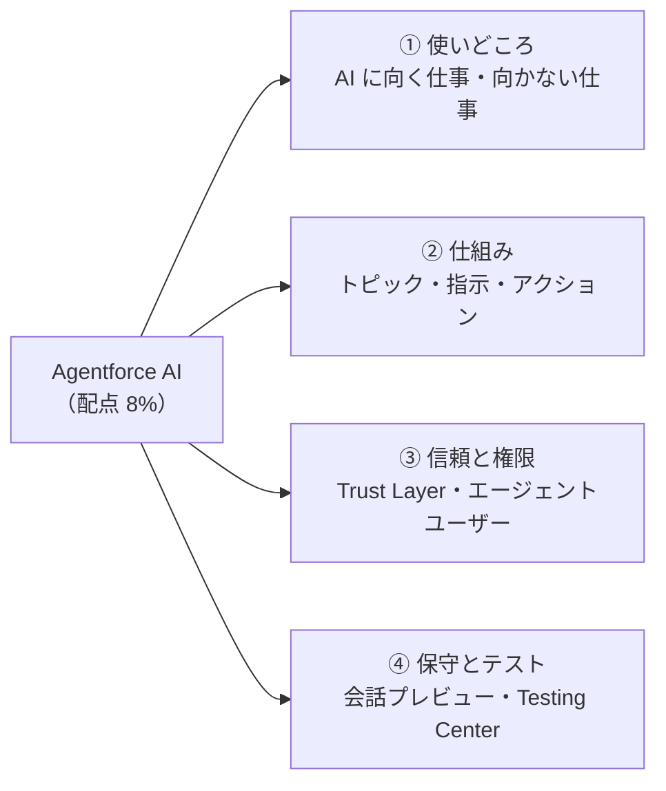
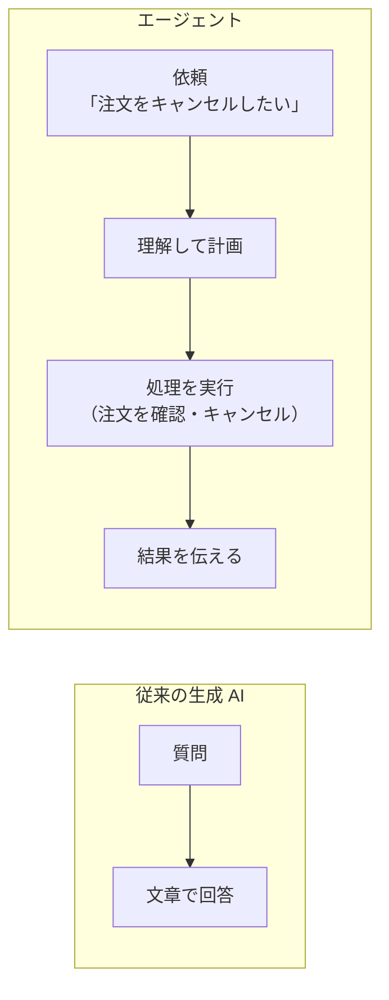
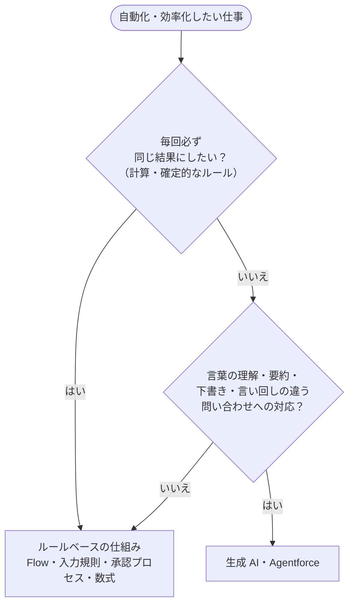
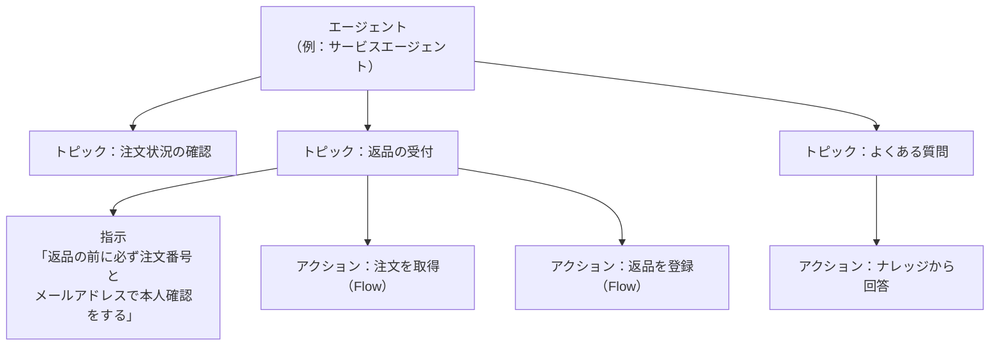
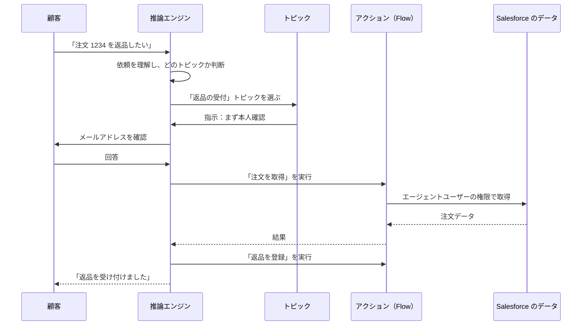
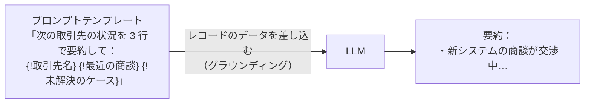
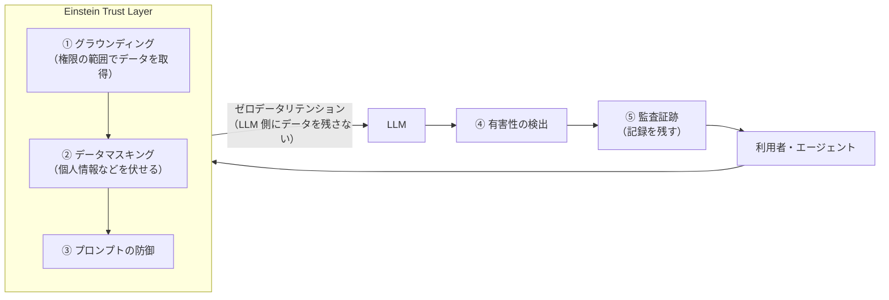
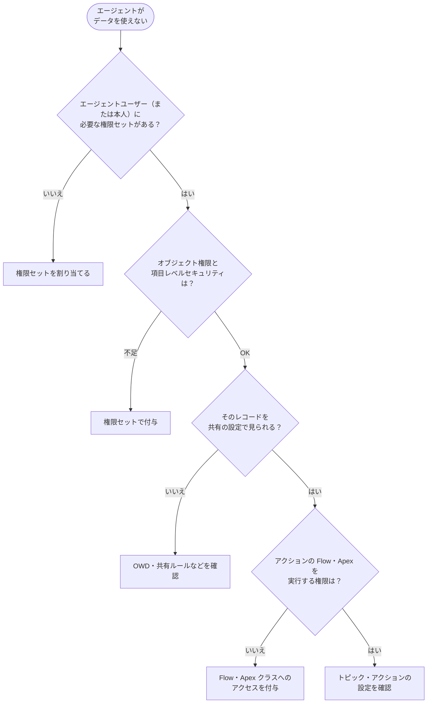
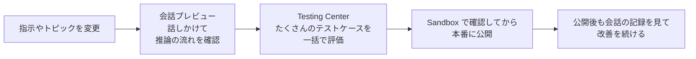

## はじめに：この範囲で学ぶこと

「Agentforce AI」は配点 8% の新しい範囲です。Salesforce の公式な説明では、次の内容が問われます。

- Agentforce の**ユースケース**と、**AI を使うのが適切な場面**
- エージェントの**セキュリティと権限**、アクセスの**トラブルシューティング**
- Agentforce Builder での**指示やプロンプトの保守**（簡単なテストや会話プレビューを含む）

管理者に求められるのは、**AI の専門家になることではなく、安全に正しく設定・保守すること**です。

---

## 1. 生成 AI とエージェントの基本

### 1-1. 生成 AI とは

**生成 AI** は、大量の文章から学習した **LLM（大規模言語モデル）**を使って、文章を新しく作る AI です。要約、下書き、質問への回答、情報の整理が得意です。

なぜ生成 AI は「間違える」ことがあるの？

LLM は「次に来そうな言葉」を予測して文章を作ります。そのため、**もっともらしいけれど事実と違う答え**（ハルシネーション）を作ることがあります。また、会社の最新の価格表や顧客の注文状況は、LLM はもともと知りません。

そこで Salesforce では、**会社の実際のデータを AI に渡して、それを根拠に答えさせます**。これを**グラウンディング**と呼びます。

### 1-2. エージェントとは

**エージェント**は、ただ文章を作るだけでなく、**依頼を理解し、必要な処理（データの取得や更新）を自分で選んで実行する** AI です。

| エージェントの例 | 使う人 | 内容 |
|---|---|---|
| **サービスエージェント** | お客様 | チャットやメッセージングで、注文確認・返品受付・よくある質問に 24 時間答える |
| **従業員向けのエージェント**（Agentforce アシスタント） | 社員 | レコードの要約、メールの下書き、データの検索を手伝う |

---

## 2. AI を使うべき場面・使うべきでない場面（頻出）

### 2-1. 判断の基準

| AI に向いている | AI に向いていない（ルールで行う） |
|---|---|
| 長いケースのやり取りを**要約**する | 請求金額を税率どおりに**計算**する |
| 営業メールの**下書き**を作る | 値引きが 20% を超えたら**承認**を必要にする |
| 言い回しが毎回違う**問い合わせ**に答える | 取引先の**重複を確実にブロック**する |
| ナレッジ記事から答えを**探して説明**する | 必須項目のチェック |

なぜ計算やルールに AI を使わないの？

生成 AI は**確率で文章を作る**ので、同じ質問でも毎回少しずつ違う答えになります。要約や下書きならそれで問題ありませんが、金額の計算や承認のルールが「たまに違う」のは許されません。

**毎回必ず同じ結果が必要なものは、Flow・入力規則・数式などのルールベースの仕組み**に任せます。エージェントに計算させたいときも、計算そのものは Flow で作り、エージェントは**その Flow を呼び出す**だけにします。

ひっかけ注意

「次のうち、Agentforce ではなく Flow などを使うべきものは？」という問題では、**計算・承認・確定的な判定**を選びます。「AI は何でもできる」という選択肢に引っぱられないようにしましょう。

---

## 3. エージェントの仕組み

### 3-1. 構成要素

| 要素 | 役割 | たとえると |
|---|---|---|
| **トピック** | エージェントが扱う**仕事の単位**。「**分類の説明**」と「**範囲**」で、どの依頼をこのトピックで扱うかが決まる | 担当する業務の種類 |
| **指示（Instructions）** | トピックの中での**振る舞いのルール**（自然な言葉で書く） | 業務マニュアル |
| **アクション** | 実際に行う**処理**。**Flow・Apex・プロンプトテンプレート**・標準のアクション（ナレッジの回答など）を呼び出す | 使える道具 |
| **推論エンジン（Atlas）** | 依頼を理解し、トピックとアクションを選んで実行する頭脳 | 考える人 |

### 3-2. エージェントが依頼を処理する流れ

### 3-3. プロンプトビルダー

**プロンプトビルダー**は、AI への指示文（**プロンプト**）を**テンプレート**として作るツールです。テンプレートには、レコードの項目などの**差し込み**ができます。

| テンプレートの例 | 内容 |
|---|---|
| 営業メール | 商談の情報から顧客へのメールの下書きを作る |
| 項目生成 | レコードの項目に生成した文章（要約など）を入れる |
| レコードの要約 | レコードと関連データを要約する |
| フレックス | 自由に入力を決めて、Flow やエージェントのアクションから使う |

---

## 4. 信頼とセキュリティ

### 4-1. Einstein Trust Layer

**Einstein Trust Layer** は、Salesforce の AI 機能と LLM の間に入って、データを守る仕組みです。

| 機能 | 内容 |
|---|---|
| 安全なデータ取得 | **利用者（またはエージェントユーザー）の権限**の範囲でデータを取得する |
| **データマスキング** | 個人情報などを LLM に送る前に伏せる |
| プロンプトの防御 | 不適切な使い方を抑える仕組み |
| **ゼロデータリテンション** | 外部の LLM の提供会社に、データを**保存させない・学習に使わせない** |
| **有害性の検出** | 回答の有害さをチェックする |
| **監査証跡** | プロンプトと回答を記録し、後で確認できる |

ひっかけ注意

Einstein Trust Layer は「**AI の回答が常に正しいことを保証する**」ものではありません。データを守る仕組みです。回答の正確さは、グラウンディングや指示の質、テストで高めます。

### 4-2. エージェントの権限（頻出）

なぜ権限がそんなに大事なの？

エージェントは、Salesforce の通常のセキュリティの仕組み（第 1 章「構成と設定」の 4 つの層）に**従って**データにアクセスします。つまり、**エージェントが見られないデータは使えません**。逆に、権限を広く与えすぎると、お客様に見せてはいけない情報までエージェントが答えてしまう危険があります。

| エージェントの種類 | 誰の権限で動く？ |
|---|---|
| 顧客向け（サービスエージェントなど） | **エージェントユーザー**（エージェント専用のユーザー）の権限 |
| 従業員向け | **使っている社員本人**の権限 |

**最小権限の原則**: エージェントユーザーには、仕事に必要なオブジェクト・項目・レコードへのアクセスだけを、**権限セット**で与えます。システム管理者のような広い権限を与えてはいけません。

### 4-3. アクセスのトラブルシューティング

「エージェントがデータを取得できない」ときは、次の順番で確認します（構成と設定のレッスンと同じ考え方です）。

### 4-4. 人への引き継ぎ

感情的な苦情、高額の返金、規則上人の判断が必要なものなどは、エージェントが**人間の担当者に引き継ぐ**よう設計します。引き継ぐときは会話の内容も一緒に渡し、お客様に同じ説明をさせないようにします。

---

## 5. 保守とテスト

### 5-1. Agentforce Builder

**Agentforce Builder** で、エージェントのトピック・指示・アクションを編集し、テストします。

### 5-2. うまく動かないときの直し方

| 症状 | 見直すところ |
|---|---|
| **違うトピックが選ばれる**（返品の依頼に注文状況で答える） | トピックの**分類の説明**と**範囲**を具体的にして、違いをはっきりさせる |
| **手順を守らない**（本人確認をせずに返品を進める） | **指示**を具体的にする（「返品の前に必ず〜する」）。確実にしたいならアクションの Flow 側でも確認する |
| **アクションが動かない・違うアクションが使われる** | アクションの**説明・入力・出力**の説明、実行する**権限** |
| **データを取得できない** | エージェントユーザーの**権限**（4-3 の手順） |
| **回答が不正確** | **グラウンディング**（正しいデータやナレッジを参照させる） |

### 5-3. テストの道具

| 道具 | 内容 |
|---|---|
| **会話プレビュー** | Agentforce Builder の中で実際に話しかけ、**どのトピック・アクションが選ばれたか**（推論の流れ）を確認する |
| **Testing Center（テストセンター）** | 「この依頼なら、このトピックとアクションが選ばれるべき」というテストケースを**一括で実行**して評価する |

やってみよう（20 分・環境に Agentforce がある場合）

Developer Edition 組織では、Agentforce と Data 360 が使える場合があります（使えない場合は Trailhead の Agentforce の学習用環境を使います）。

1. 設定 →「Agentforce エージェント」で、テンプレートからエージェントを作る
2. Agentforce Builder でトピックを 1 つ開き、「分類の説明」「範囲」「指示」を読んでみる
3. 右側の会話プレビューで話しかけ、どのトピックとアクションが選ばれたかを確認する
4. 指示を 1 行追加して、もう一度話しかけ、振る舞いが変わるかを確認する

---

## 6. まとめ

| テーマ | 覚えること |
|---|---|
| 使いどころ | 要約・下書き・言い回しの違う問い合わせ＝AI、計算・承認・確定的なルール＝Flow など |
| 仕組み | トピック（何の仕事か：分類の説明と範囲）、指示（振る舞い）、アクション（Flow・Apex・プロンプトテンプレート） |
| グラウンディング | 会社の実データを根拠に答えさせる |
| Trust Layer | マスキング、ゼロデータリテンション、有害性の検出、監査。正確さの保証ではない |
| 権限 | 顧客向け＝エージェントユーザー、従業員向け＝本人。最小権限。見られないデータは使えない |
| 直し方 | 違うトピック＝分類の説明・範囲、手順を守らない＝指示、データが取れない＝権限 |
| テスト | 会話プレビュー（1 件ずつ・推論の確認）、Testing Center（一括） |

## 試験直前チェック

- [ ] AI に向いている仕事と向いていない仕事を、例を挙げて言える
- [ ] グラウンディングの意味を説明できる
- [ ] トピック・指示・アクションの違いを言える
- [ ] Einstein Trust Layer の機能を 4 つ言える
- [ ] 顧客向けと従業員向けのエージェントが、誰の権限で動くかを言える
- [ ] エージェントがデータを取得できないときの確認の順番を言える
- [ ] 「違うトピックが選ばれる」「手順を守らない」ときに見直す場所を言える
- [ ] 会話プレビューと Testing Center の違いを言える
