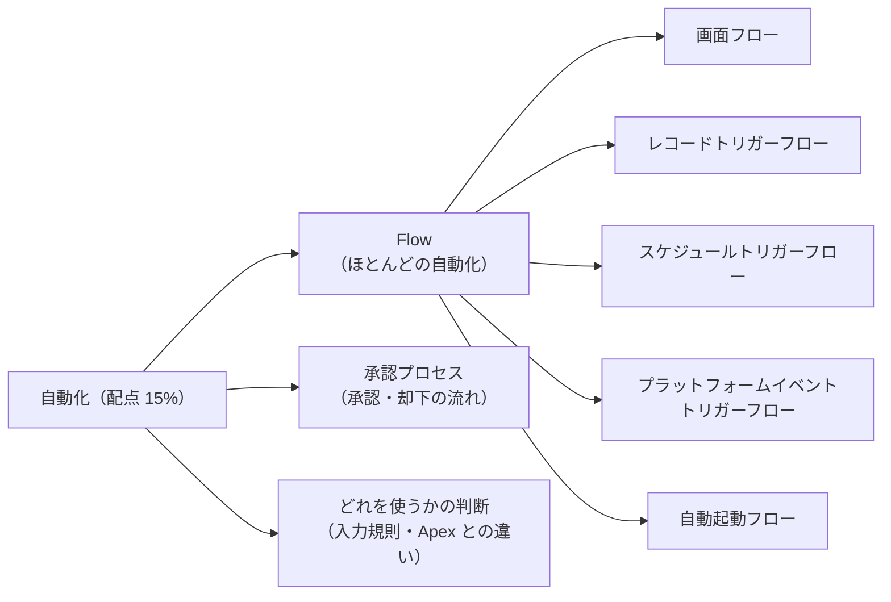
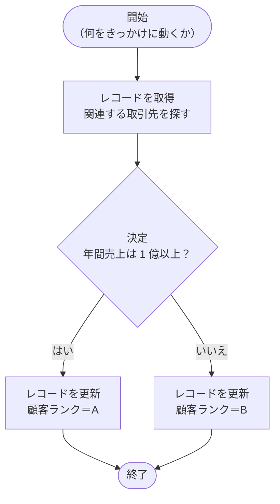
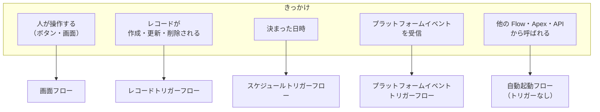
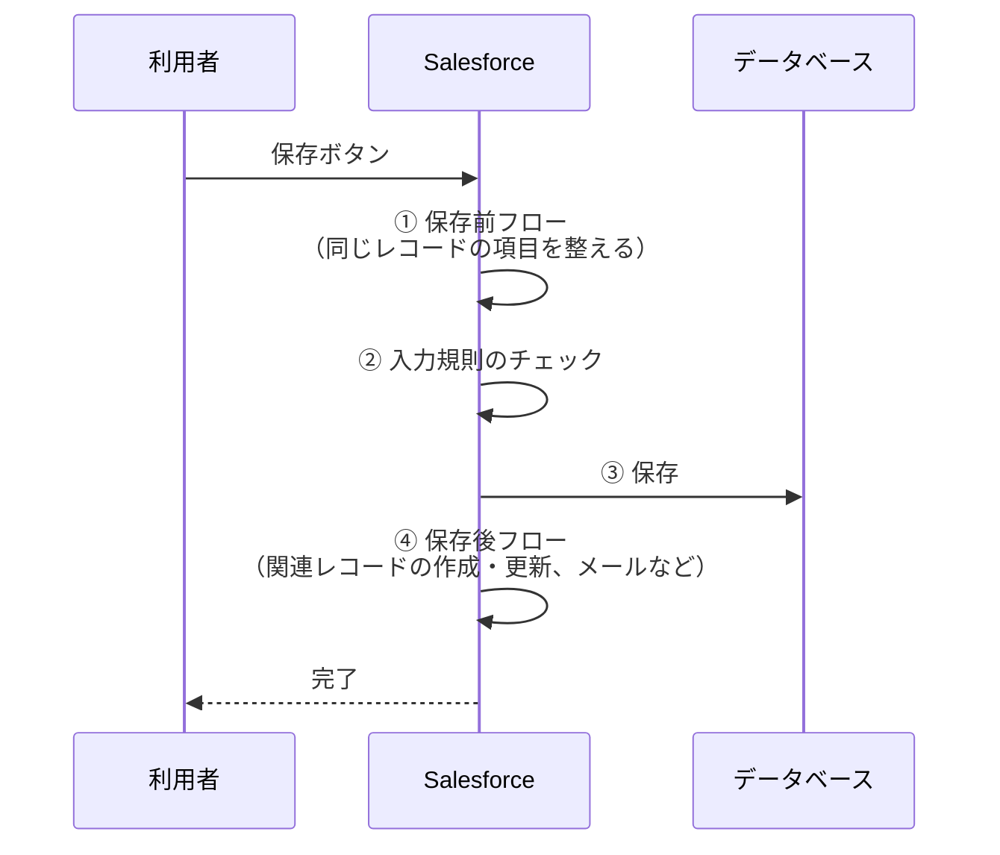
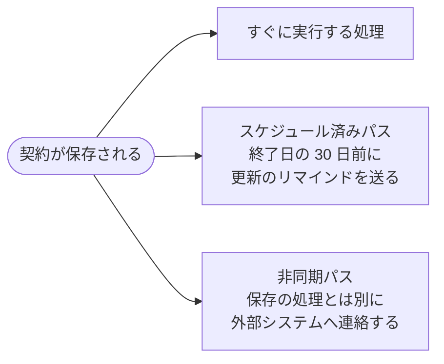
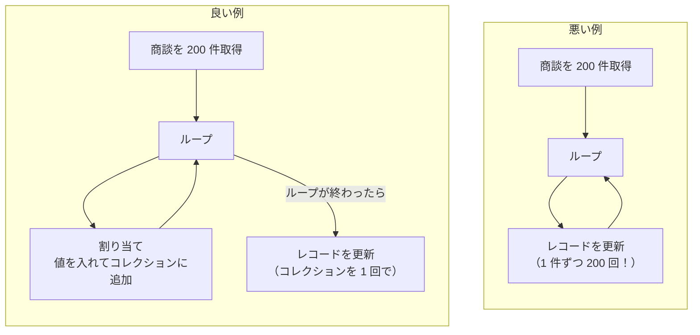
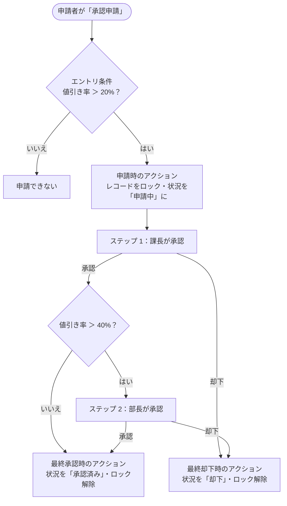
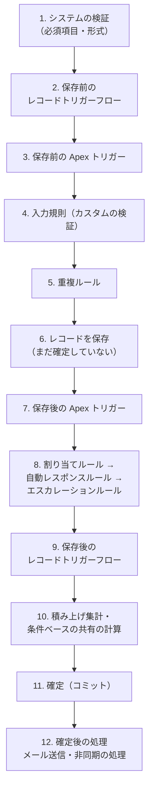
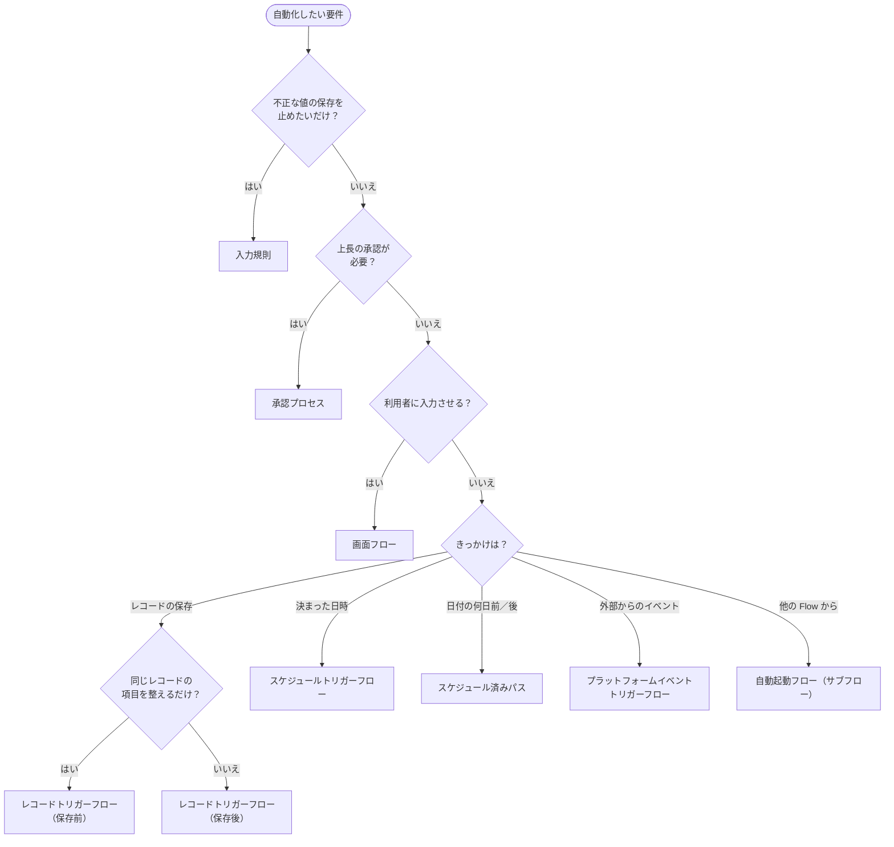

## はじめに：この範囲で学ぶこと

「自動化」は配点 15% です。人が毎回手でやっている作業を、Salesforce に任せる方法を学びます。

大事な前提

以前は「ワークフロールール」「プロセスビルダー」という自動化ツールがありましたが、**サポートが終了**しました。今の Salesforce では、新しい自動化は**すべて Flow で作る**のが前提です。古い自動化は「Flow に移行」ツールで Flow に移します。

---

## 1. なぜ自動化するのか

| 手作業の問題 | 自動化すると |
|---|---|
| 忘れる（ToDo を作り忘れる） | 必ず実行される |
| 人によってやり方が違う | 同じルールで処理される |
| 時間がかかる | 一瞬で終わる |
| 入力ミス | 正しい値が入る |

ただし「何でも自動化すればよい」わけではありません。**ルールが決まっていて、繰り返し発生する作業**が自動化に向いています。

---

## 2. Flow の基本

### 2-1. Flow とは

**Flow** は、Flow Builder という画面で、**部品（要素）を線でつないで**処理の流れを作るツールです。プログラムを書かずに、かなり複雑な処理まで作れます。

### 2-2. 主な要素

| 分類 | 要素 | 役割 |
|---|---|---|
| データ | **レコードを取得** | 条件に合うレコードを探して変数に入れる |
| データ | **レコードを作成／更新／削除** | データベースに書き込む |
| ロジック | **決定** | 条件で分岐する（if） |
| ロジック | **ループ** | コレクション（複数のレコード）を 1 件ずつ処理する |
| ロジック | **割り当て** | 変数に値を入れる、コレクションに追加する |
| 操作 | **画面** | 利用者に入力・表示させる（画面フローだけ） |
| 操作 | **アクション** | メール送信、Chatter 投稿、承認申請、Apex の呼び出しなど |
| 操作 | **サブフロー** | 別の Flow を呼び出す |

**変数**は Flow の中で値を一時的に入れておく箱、**コレクション変数**は複数の値（レコード）を入れる箱です。

---

## 3. Flow の種類（超頻出）

Flow の種類は「**何をきっかけに動くか**」で決まります。

| 種類 | きっかけ | 例 |
|---|---|---|
| **画面フロー** | 利用者がボタンや画面から起動 | 返品受付の入力ウィザード、失注理由を入力して商談を更新 |
| **レコードトリガーフロー** | レコードの作成・更新・削除 | 商談が成立したら取引先を更新し ToDo を作る |
| **スケジュールトリガーフロー** | 指定した日時・頻度 | 毎朝 6 時に期限切れの ToDo の担当者に通知 |
| **プラットフォームイベントトリガーフロー** | プラットフォームイベントの受信 | 外部の在庫システムから「在庫切れ」の通知を受けて処理 |
| **自動起動フロー（トリガーなし）** | 他の Flow・Apex・API から呼ばれる | 複数の Flow で使う共通の計算処理（サブフロー） |

覚え方

問題文の「**〜したら**」「**毎朝**」「**ボタンを押すと**」「**画面で入力しながら**」「**外部からの通知で**」に注目すると、Flow の種類が決まります。

---

## 4. レコードトリガーフローを深く理解する

### 4-1. 保存前と保存後

レコードトリガーフローは、レコードが**保存される前**に動くか、**保存された後**に動くかを選びます。

| | **保存前**（高速項目更新） | **保存後**（アクションと関連レコード） |
|---|---|---|
| できること | **トリガーしたレコード自身の項目を更新** | 関連レコードの作成・更新・削除、メール送信、通知、他の Flow や Apex の呼び出し |
| できないこと | **他のレコードの変更**、メール送信などのアクション | — |
| 速さ | **とても速い**（追加の保存が不要） | 保存前より遅い |

なぜ保存前のほうが速いの？

保存前フローは、レコードがデータベースに書き込まれる**前**に値を書き換えます。だから書き込みは 1 回で済みます。
保存後フローで同じレコードを更新すると、「保存 → Flow が更新 → もう一度保存」と**2 回書き込む**ことになり、そのたびに他の自動化も動き直します。

**同じレコードの項目を整えるだけなら、保存前**が鉄則です。

具体例

- 取引先の「都道府県」から同じ取引先の「地域」を設定 → **保存前**
- 商談が成立したら、**取引先**の顧客ランクを更新 → **保存後**（別のレコード）
- 商談が成立したら、所有者に **ToDo を作成** → **保存後**（新しいレコード）

### 4-2. いつ動かすかの設定

| 設定 | 内容 |
|---|---|
| トリガー | 作成時／更新時／作成または更新時／削除時 |
| **エントリ条件** | 条件に合うレコードだけで動かす（例: フェーズ ＝ 成立） |
| **「条件の要件を満たすようにレコードが更新されたときのみ」** | 条件を満たしていなかったレコードが、**満たすように変わったときだけ**動かす |

ひっかけ注意

「金額が 1,000 万円以上に**なったとき**だけ通知したい」→ **「条件の要件を満たすようにレコードが更新されたときのみ」**を選びます。「レコードが更新されるたび」を選ぶと、金額が 1,000 万円以上のまま他の項目を変えるたびに、何度も通知されてしまいます。

### 4-3. 後で動かす：スケジュール済みパスと非同期パス

| 機能 | 内容 | 例 |
|---|---|---|
| **スケジュール済みパス** | レコードの**日付項目などを基準に、後のタイミング**で実行 | 「完了予定日の 3 日前」「作成から 1 時間後」 |
| **非同期パス** | 保存の処理（トランザクション）が終わった後に、**別に**実行 | 時間のかかる外部連携 |

---

## 5. Flow の品質：ガバナ制限とエラー処理

### 5-1. ループの中でデータを書き込まない（最重要）

なぜループの中で更新してはいけないの？

Salesforce は多くの会社で共有するシステム（マルチテナント）なので、1 回の処理でデータベースを操作できる回数に**上限（ガバナ制限）**があります。ループの中で「レコードを更新」すると、レコードの数だけデータベースを操作するので、すぐに上限を超えてエラーになります。

**ループの中では割り当てだけ、データの読み書きはループの外で 1 回**、と覚えましょう。

### 5-2. エラー処理とテスト

| 機能 | 内容 |
|---|---|
| **障害パス（Fault Path）** | データ要素などが失敗したときの処理（管理者へのメール、利用者へのメッセージ）を作る |
| **デバッグ** | Flow Builder で、テスト用のレコードや入力を指定して実行し、各要素の動きを確認する。変更を元に戻す（ロールバック）設定もできる |
| **バージョン** | Flow は保存するとバージョンが増える。**有効にできるのは 1 つのバージョンだけ**。問題があれば以前のバージョンを有効にして戻せる |

### 5-3. 共通処理はサブフローに

複数の Flow で同じ処理を使うなら、**自動起動フロー（トリガーなし）**として 1 つ作り、各 Flow から**サブフロー**として呼び出します。修正が 1 か所で済みます。

---

## 6. 承認プロセス

### 6-1. 承認プロセスとは

値引きや経費など、**誰かの承認が必要なレコード**を、決まった承認者に順番に回す仕組みです。

| 要素 | 内容 |
|---|---|
| **エントリ条件** | どのレコードが申請できるか |
| **申請時のアクション** | 申請した瞬間に行う処理。**レコードのロック**（申請中は編集できない）が代表的 |
| **承認ステップ** | 誰が承認するか。複数ステップ、条件付きのステップ、並行承認（全員／最初の 1 人）も可能 |
| 承認者 | 特定のユーザー、キュー、**関連ユーザー項目（例: 上司）** |
| **最終承認／最終却下時のアクション** | 項目の更新、メール送信、ロック解除など |
| 取り消し | 申請者が申請を取り消すときのアクション |

ひっかけ注意

- 「申請中のレコードを申請者が編集できない」→ **申請時にレコードがロックされている**から
- 「条件を満たしたら保存させない」なら承認ではなく**入力規則**。「条件を満たしたら**承認を必要にする**」なら承認プロセス
- 申請は手動（承認申請ボタン）でも、**Flow から自動で**行うこともできる

---

## 7. 保存の順番（実行順序）と自動化ユーザー

### 7-1. 実行順序

レコードを保存すると、Salesforce は決まった順番で処理を行います。試験では「どれが先に動くか」が問われます。

| 覚えるポイント | 内容 |
|---|---|
| **保存前フローは入力規則より先** | 保存前フローで値を整えてから、入力規則でチェックされる |
| **入力規則は保存の前** | 入力規則のエラーなら保存されず、保存後の自動化も動かない |
| **割り当てルールは保存後** | ケース・リードの割り当てルールは、レコードが保存された後に動く |
| **保存後フローは後半** | 関連レコードの作成などは、保存後のフローで行う |
| **メールは確定後** | エラーでロールバックされたら、メールは送られない |

### 7-2. デフォルトの自動化ユーザー

- 自動化の中には、**特定の利用者ではなく、システムとして動くもの**があります（スケジュールで動く処理、時間がたってから動く処理など）。
- 設定の「**プロセスの自動化の設定**」で、既定の自動化ユーザー（**デフォルトのワークフローユーザー**）を指定します。処理を起こしたユーザーが無効になっている場合などに、このユーザーとして実行されます。
- プラットフォームイベントで動くフローなどは、システムの「**自動化プロセス**」ユーザーとして実行されることがあります。作成者や最終更新者にこのユーザーが表示されることがあります。

ひっかけ注意

「退職者を無効にしたら、その人が起点の時間ベースの処理が止まった」→ 既定の自動化ユーザー（デフォルトのワークフローユーザー）を、**有効な管理者ユーザー**に設定しておきます。

---

## 8. どの自動化を使うか（判断フロー）

| 要件 | 選ぶもの |
|---|---|
| 同じレコードの項目を保存時に設定 | レコードトリガーフロー（保存前） |
| 関連レコードを作る・更新する・メールを送る | レコードトリガーフロー（保存後） |
| 画面で入力させながら処理 | 画面フロー |
| 毎日・毎週まとめて処理 | スケジュールトリガーフロー |
| 日付の〇日前に処理 | スケジュール済みパス |
| 上長の承認が必要 | 承認プロセス |
| 不正な値の保存を止める | 入力規則（自動化ではない） |
| Flow では難しい複雑な処理 | Apex（開発者に依頼） |

やってみよう（25 分）

1. 設定 → 「フロー」→ 新規 →「レコードトリガーフロー」
2. オブジェクト「商談」、トリガー「作成または更新」、条件「フェーズ ＝ 成立」、「条件の要件を満たすようにレコードが更新されたときのみ」を選び、「アクションと関連レコード（保存後）」を選ぶ
3. 「レコードを作成」で ToDo を作る（件名「お礼の連絡」、任命先＝商談の所有者 ID、関連先＝商談 ID）
4. 「デバッグ」で既存の商談を指定して動きを確認し、保存して有効化
5. 商談を「成立」にして、ToDo が作られることを確認する。もう一度保存しても、2 つ目の ToDo ができないことも確認しましょう

---

## 9. まとめ

| テーマ | 覚えること |
|---|---|
| 前提 | 新しい自動化は Flow。ワークフロールールとプロセスビルダーは移行 |
| Flow の種類 | 画面＝人、レコードトリガー＝保存、スケジュール＝日時、プラットフォームイベント＝外部の通知、自動起動＝呼ばれる |
| 保存前／保存後 | 同じレコードだけ＝保存前（速い）、他のレコードやメール＝保存後 |
| 条件 | 「満たすように更新されたときのみ」で重複を防ぐ |
| 後で動かす | スケジュール済みパス＝日付基準、非同期パス＝別のトランザクション |
| 品質 | ループ内でデータの読み書きをしない、障害パス、デバッグ、有効なバージョンは 1 つ |
| 承認プロセス | エントリ条件 → 申請時（ロック）→ ステップ → 最終承認／却下 |
| 実行順序 | 保存前フロー → 入力規則 → 保存 → 保存後トリガー → 割り当てルール → 保存後フロー → 確定 → メール |

## 試験直前チェック

- [ ] Flow の 5 つの種類と、それぞれのきっかけを言える
- [ ] 保存前と保存後の違いと、保存前が速い理由を説明できる
- [ ] 「満たすように更新されたときのみ」が必要な場面を言える
- [ ] スケジュール済みパスと非同期パスの違いを言える
- [ ] ループの中で「レコードを更新」してはいけない理由を説明できる
- [ ] 障害パス・デバッグ・バージョンの役割を言える
- [ ] 承認プロセスの流れと、申請中にレコードが編集できない理由を言える
- [ ] 入力規則・承認プロセス・Flow の使い分けを説明できる
- [ ] 保存前フロー・入力規則・保存後フロー・割り当てルールの実行順序を言える
- [ ] デフォルトのワークフローユーザーを設定する理由を言える
