## はじめに：この範囲で学ぶこと

「構成と設定」は配点 15% の範囲です。大きく 3 つのテーマに分かれます。

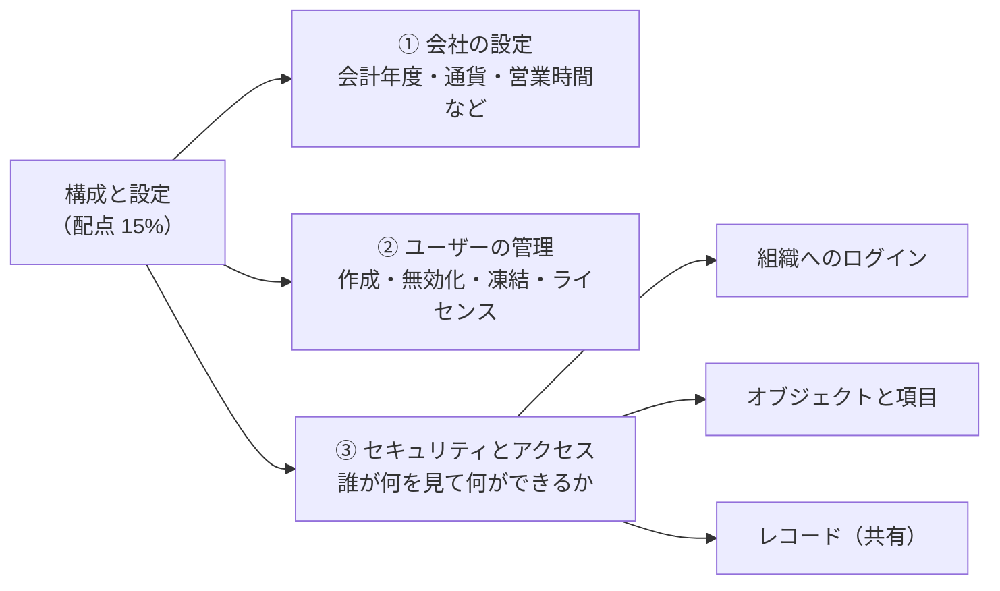

この中で**圧倒的に重要なのが ③ セキュリティとアクセス**です。他の範囲（営業、サービス、レポート、自動化、Agentforce）の問題でも「なぜこのユーザーは見られないのか」という形で何度も登場します。ここを本当に理解できれば、試験全体の正答率が大きく上がります。

このレッスンの読み方

最初から順番に読むのがおすすめです。各テーマには次の囲みが出てきます。

- **なぜ？** … その仕組みがなぜそうなっているのかの理由。理由が分かると、初めて見る問題でも答えを導けます。
- **具体例** … 架空の会社を使った状況。
- **ひっかけ注意** … 試験でよく間違える選択肢のパターン。
- **やってみよう** … 無料の練習環境で実際に操作する手順。

### 練習環境を用意しよう

Salesforce は**実際に触ると何倍も早く覚えられます**。無料で使える練習環境が 2 種類あります。

| 環境 | 入手方法 | 特徴 |
|---|---|---|
| **Trailhead Playground** | Trailhead（Salesforce の無料学習サイト）にログインすると自動で作られる | Trailhead の課題と連動。すぐ使える |
| **Developer Edition 組織** | 「Salesforce Developer Edition」で検索して無料登録 | 期限なしで使える自分専用の組織 |

どちらも本番の会社のデータには影響しないので、自由に設定を変えて試して大丈夫です。このレッスンの「やってみよう」はどちらの環境でもできます。

---

## 1. Salesforce の「組織」と設定画面の基本

### 組織（org）とは

Salesforce では、会社ごとに用意される自分たち専用の環境を**組織（org）**と呼びます。1 つの組織の中に、その会社のデータ（取引先、商談など）と設定（項目、画面、権限など）がすべて入っています。

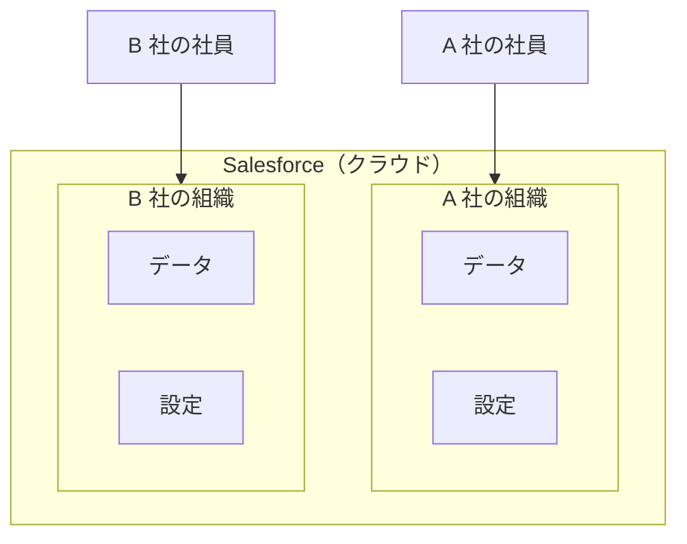

なぜ？ マルチテナントという仕組み

Salesforce は、たくさんの会社が同じ大きなシステムを共有しながら、データは会社ごとにきっちり分けて使う**マルチテナント**という方式です。マンション（建物は共通、部屋は別々）をイメージしてください。

この方式のおかげで、Salesforce は年 3 回のバージョンアップを全社に一斉に届けられます。一方で、1 社が使いすぎると他社に迷惑がかかるため、**処理量の上限（ガバナ制限）**があります。後のレッスンの「自動化」で出てくる「ループの中でレコードを更新しない」というルールも、この上限が理由です。

### 設定画面の入り口

管理者の作業はほとんど**設定（Setup）**で行います。画面右上の歯車アイコン → 「設定」から開きます。

| 画面 | できること |
|---|---|
| **設定（Setup）のホーム** | ユーザー、セキュリティ、会社の設定など組織全体の管理。左上の「クイック検索」で設定名を検索できる |
| **オブジェクトマネージャー** | オブジェクト（取引先、商談など）ごとの項目・ページレイアウト・入力規則などの管理 |
| **アプリケーションランチャー** | 9 つの点のアイコン。アプリやオブジェクトを切り替える |

ポイント

設定の画面名を全部覚える必要はありません。試験で問われるのは「**どの機能を使えば要件を満たせるか**」です。このレッスンでは機能の「役割」と「使い分け」に集中します。

---

## 2. 会社の設定

会社全体に関わる基本の設定です。1 回設定したらあまり変えないものが多いですが、**元に戻せない設定**があるので試験に出ます。

### 2-1. 会社情報

設定の「会社情報」で、組織全体の**デフォルト（初期値）**を決めます。

| 項目 | 意味 |
|---|---|
| デフォルトのロケール | 日付・数値・住所の表示形式（例: 2026/10/17 か 10/17/2026 か） |
| デフォルトの言語 | 新しいユーザーの画面の言語の初期値 |
| デフォルトのタイムゾーン | 新しいユーザーのタイムゾーンの初期値 |
| 通貨のロケール | 組織の通貨（複数通貨を使わない場合） |
| ライセンスの残数 | 使えるユーザーライセンスの数と使用数 |

ユーザーは自分の**個人設定**で、言語・ロケール・タイムゾーンを自分用に変えられます。

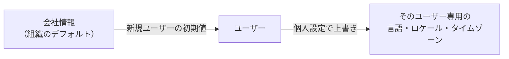

### 2-2. 会計年度

売上予測やレポートの「今期」「前四半期」などの期間の基準になります。

| 種類 | 内容 | 向いている会社 |
|---|---|---|
| **標準会計年度** | 開始月だけを変える（例: 4 月開始）。四半期は 3 か月ずつ | ほとんどの会社 |
| **カスタム会計年度** | 「4-4-5 週」など、月とずれた独自の期間を定義できる | 小売業など、週単位で業績を管理する会社 |

ひっかけ注意

**カスタム会計年度は、一度有効にすると無効に戻せません。** さらに売上予測やレポートにも影響します。「4 月始まりにしたい」だけなら**標準会計年度の開始月を変える**のが正解です。「カスタム会計年度を有効にする」という選択肢に飛びつかないようにしましょう。

### 2-3. 営業時間と祝日

「平日 9 時〜18 時」のような**営業時間**と、**祝日**を設定します。

なぜ必要？

「ケースが作成されてから 4 時間以内に対応する」というルールがあるとき、金曜 17 時に来たケースの期限が土曜 1 時になってしまっては困ります。営業時間を設定すると「営業時間で 4 時間」＝月曜 12 時のように計算できます。

営業時間は、**エスカレーションルール**や**エンタイトルメント（マイルストン）**など、サービスの時間計算で使われます（「サービス・サポート」のレッスンで詳しく学びます）。

### 2-4. 通貨

| 設定 | 内容 |
|---|---|
| 単一通貨（初期状態） | 組織全体で 1 つの通貨 |
| **複数通貨** | レコードごとに通貨を選べる。**組織の通貨（コーポレート通貨）**と換算レートを管理する |
| **高度な通貨管理** | 日付ごとの換算レート（**日付の入った換算レート**）を使う。商談などで、成立日のレートで換算できる |

ひっかけ注意

**複数通貨も、一度有効にすると無効に戻せません。** 「元に戻せない設定」は試験の定番です。まとめて覚えておきましょう。

- カスタム会計年度
- 複数通貨
- 個人取引先（「営業・マーケティング」のレッスンで学びます）

元に戻せない設定は、**必ず Sandbox（検証用の環境）で試してから**本番で有効にするのが基本です。

---

## 3. ユーザーの管理

### 3-1. ユーザーを構成するもの

ユーザーを作るときに決めるものを図にすると次のようになります。

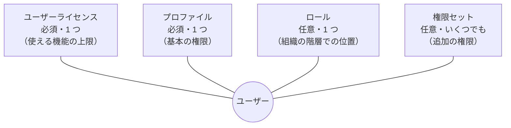

| 要素 | 必須？ | 数 | 一言でいうと |
|---|---|---|---|
| **ユーザーライセンス** | 必須 | 1 つ | 契約上「このユーザーが使える機能の上限」 |
| **プロファイル** | 必須 | 1 つ | 基本の権限のセット |
| **ロール** | 任意 | 1 つ | 組織の上下関係の中での位置（レコードの共有に使う） |
| **権限セット** | 任意 | 0 個以上 | プロファイルに**足す**追加の権限 |

なぜライセンスとプロファイルが別なの？

ライセンスは「**契約で買った枠**」、プロファイルは「**会社が決める権限**」です。たとえば Salesforce ライセンスでは商談を使えますが、ある部署には商談を見せたくない場合、プロファイルで商談の権限を外します。

ライセンスは天井、プロファイルや権限セットはその天井の下で何を許すかを決めるもの、と考えてください。**ライセンスにない権限は、プロファイルや権限セットでも付けられません。**

#### ライセンスの種類

| 種類 | 例 |
|---|---|
| ユーザーライセンス | Salesforce、Salesforce Platform、外部ユーザー用（Customer Community など） |
| 権限セットライセンス | 特定の機能を追加で使うためのライセンス（権限セットと組み合わせて付与） |
| 機能ライセンス | ユーザーレコードのチェックボックスで付与。**マーケティングユーザー**（キャンペーンの作成に必要）、**ナレッジユーザー**、**Service Cloud ユーザー**など |

ひっかけ注意

「権限は付けたのにキャンペーンを作れない」という問題では、答えは**ユーザーレコードの「マーケティングユーザー」チェック**です。同じように、ナレッジ記事を作れないときは「ナレッジユーザー」を疑います。

### 3-2. ユーザーのライフサイクル

ユーザーは**削除できません**。これが一番大事なポイントです。

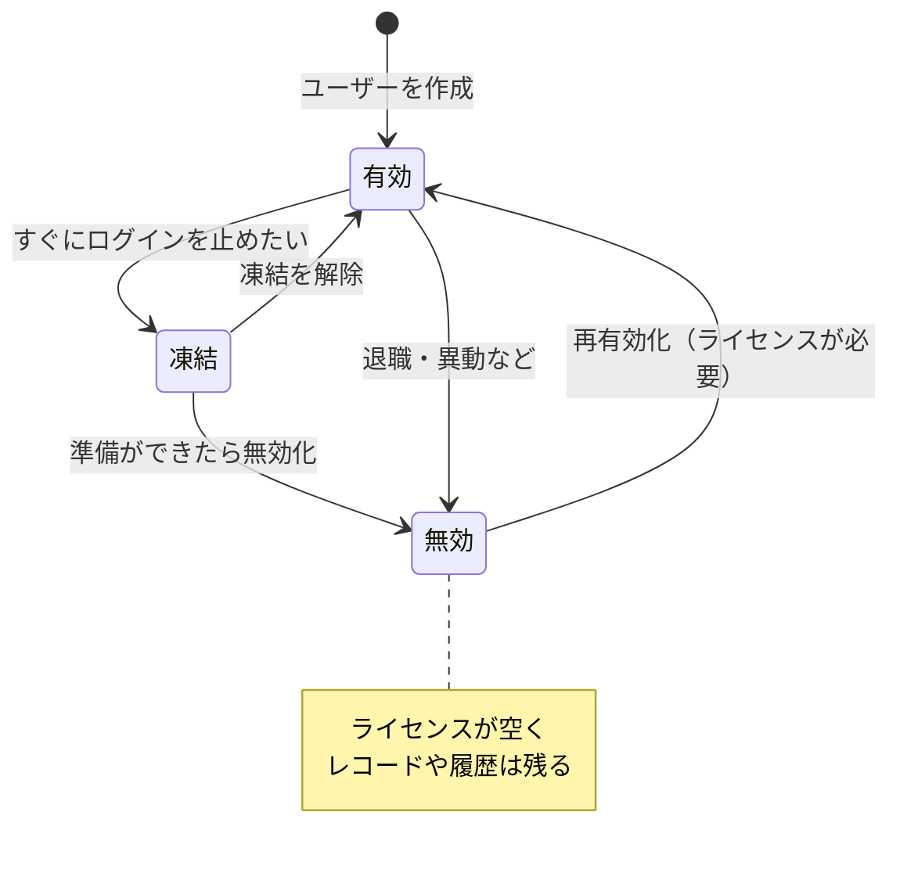

| 状態 | ログイン | ライセンス | 使う場面 |
|---|---|---|---|
| **有効** | できる | 使う | 通常 |
| **凍結** | できない | 使ったまま | **今すぐログインを止めたいが、無効化できない事情がある**とき |
| **無効** | できない | 空く | 退職・長期休職など |

なぜ削除できないの？

ユーザーは、作成したレコード、所有しているレコード、変更履歴、承認履歴など、たくさんのデータと結びついています。ユーザーを削除すると「この商談は誰が作ったのか」が分からなくなり、監査や分析ができなくなります。だから**無効化**して、ログインとライセンスだけを止めるのです。

なぜ「凍結」が必要なの？

ユーザーをすぐに無効化できないケースがあります。

- **カスタム階層項目**（上司など）で、他のユーザーから参照されている
- 承認プロセスの承認者に指定されている
- 特定の設定（例: デフォルトのリードの所有者など）に使われている

こうした参照を外すには時間がかかります。でも退職者のログインは今日止めたい。そんなときに**凍結**でログインだけを先に止め、準備ができてから無効化します。

具体例

Universal Containers の営業担当が今日退職しました。この担当は承認プロセスの承認者になっています。

1. まず**凍結**してログインを止める
2. 承認プロセスの承認者を別の人に変更する
3. 所有しているレコードを後任に移す（レコードの所有権の一括移行）
4. **無効化**してライセンスを空ける

### 3-3. その他のユーザー管理

| 作業 | ポイント |
|---|---|
| **パスワードのリセット** | 管理者がリセットすると、ユーザーにメールが送られ、次回ログイン時に新しいパスワードを設定する |
| **ユーザーとしてログイン** | 問題の再現に便利。組織で「管理者はすべてのユーザーとしてログインできる」を有効にするか、ユーザー本人が「ログインアクセスの許可」をしている必要がある |
| **一括でユーザーを追加** | データインポートウィザードやデータローダーで作成できる |
| **代理管理（委任管理）** | 一部のユーザー管理（特定のロール配下のユーザーの作成・パスワードリセットなど）を、管理者以外に任せる仕組み |

ポイント：ユーザー名のルール

ユーザー名は**メールアドレスの形式**で、**すべての Salesforce 組織を通して一意**でなければなりません（例: `taro@uc.example.com.sandbox`）。メールアドレス自体は他のユーザーと同じでも構いません。

やってみよう（10 分）

1. 設定 → クイック検索で「ユーザー」→「新規ユーザー」
2. 姓・メール・ユーザー名を入力し、ユーザーライセンス「Salesforce Platform」、プロファイル「Standard Platform User」を選んで保存
3. 作成したユーザーを開き、「凍結」ボタンがあることを確認する
4. 「編集」→「有効」のチェックを外して保存すると、無効化できることを確認する
5. 削除ボタンがどこにもないことも確認しましょう

---

## 4. セキュリティとアクセスの全体像（最重要）

ここからが本番です。Salesforce のアクセス制御は**4 つの層**で考えると整理できます。

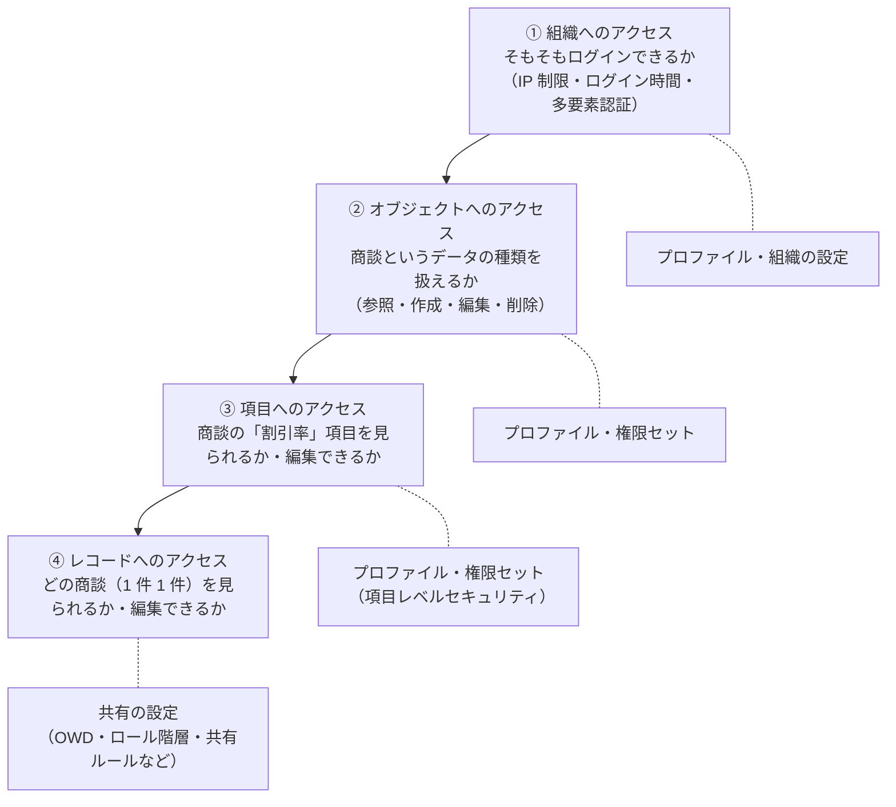

なぜ層に分かれているの？ 図書館のたとえ

図書館で考えてみましょう。

1. **組織へのアクセス** … 図書館の建物に入れるか（入館証）
2. **オブジェクトへのアクセス** … 「歴史の棚」を使えるか
3. **項目へのアクセス** … 本の中の「付録のページ」を読めるか
4. **レコードへのアクセス** … 歴史の棚の**どの本**を手に取れるか

棚を使う権利がなければ、どの本も手に取れません。逆に、棚を使えても、特定の本が貸出禁止なら読めません。**どれか 1 つでも NG なら使えない**、これが基本ルールです。

試験で一番大事なルール

**上の層で許可されていなければ、下の層でいくら広げても使えません。**

例: 共有ルールで商談に「参照・更新」のアクセスを付けても、プロファイル（または権限セット）で商談の**「編集」権限**がなければ、編集はできません。

---

## 5. 組織へのアクセス（ログインのセキュリティ）

### 5-1. ログインのときに何がチェックされるか

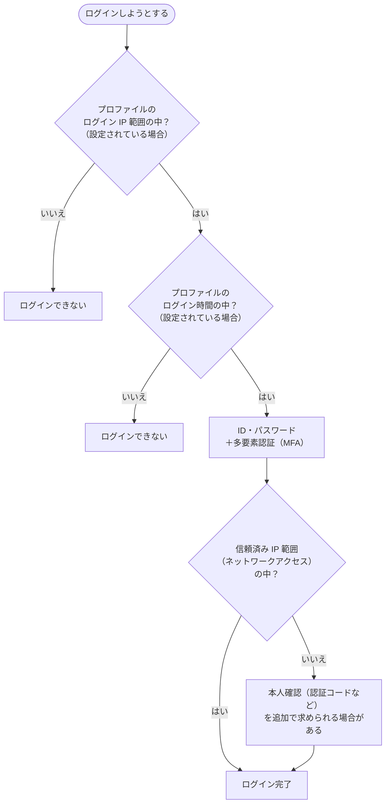

### 5-2. 似ている 2 つの IP 設定（超頻出）

| | **ログイン IP 範囲** | **信頼済み IP 範囲** |
|---|---|---|
| 設定場所 | **プロファイル** | 設定 →「ネットワークアクセス」（組織全体） |
| 範囲の外からは？ | **ログインできない** | ログインできる（本人確認が追加で求められることがある） |
| 目的 | 社外からのアクセスを**禁止**する | 社内からのログインを**楽にする** |

ひっかけ注意

「社内ネットワークからしかログインさせたくない」→ **プロファイルのログイン IP 範囲**です。
「信頼済み IP 範囲」を選ぶと、範囲外からもログインできてしまうので**不正解**になります。名前が「信頼」なので強そうに見えますが、役割は「範囲内なら本人確認を省略する」だけです。

### 5-3. ログイン時間

プロファイルに曜日ごとのログイン可能な時間帯を設定できます。

- 時間外は**ログインできない**
- **ログイン中に時間外になると、ログアウトされる**

具体例

Cloud Kicks のコールセンターのアルバイトには、平日 9〜18 時以外は使わせたくありません。→ アルバイト用プロファイルの**ログイン時間**を平日 9:00〜18:00 に設定します。

### 5-4. その他のログインのセキュリティ

| 機能 | 内容 |
|---|---|
| **多要素認証（MFA）** | パスワードに加えて、認証アプリなどの 2 つ目の確認を求める。Salesforce はすべてのユーザーに MFA を求めている |
| **パスワードポリシー** | 最小文字数・有効期限・複雑さなど。**組織全体**で設定し、**プロファイルごと**に上書きできる |
| **セッションの設定** | 操作がないときに自動ログアウトするまでの時間（タイムアウト）など |
| **シングルサインオン（SSO）** | 社内の認証基盤（例: Microsoft Entra ID）のアカウントで Salesforce にログインする |

### 5-5. 監視と点検の道具

| 機能 | 何が分かる？ | 覚え方 |
|---|---|---|
| **ログイン履歴** | 誰が・いつ・どこから・ログインに成功／失敗したか（過去 6 か月） | 「ログインの記録」 |
| **設定変更履歴（Setup Audit Trail）** | 誰が・いつ・**設定**を変更したか（過去 180 日） | 「設定の記録」 |
| **項目履歴管理** | レコードの**項目の値**が誰に・いつ・何から何に変えられたか | 「データの記録」（データのレッスンで詳しく） |
| **ヘルスチェック** | セキュリティ設定を Salesforce の推奨（ベースライン）と比べたスコア | 「健康診断」 |

ひっかけ注意

「誰かが入力規則を無効にした」→ 設定の変更なので**設定変更履歴**。
「誰かが商談の金額を変えた」→ データの変更なので**項目履歴管理**。
「ログインに失敗する理由を調べたい」→ **ログイン履歴**。
問題文が「設定」「データ」「ログイン」のどれについて聞いているかを見分けましょう。

---

## 6. オブジェクトと項目へのアクセス

### 6-1. オブジェクト権限

オブジェクト（取引先、商談、カスタムオブジェクトなど）ごとに、次の権限を付けます。

| 権限 | できること |
|---|---|
| 参照 | 自分がアクセスできるレコードを見る |
| 作成 | 新しいレコードを作る |
| 編集 | 自分がアクセスできるレコードを変更する |
| 削除 | 自分がアクセスできるレコードを削除する |
| **すべて参照** | 共有の設定に関係なく、**そのオブジェクトの全レコード**を見る |
| **すべて変更** | 共有の設定に関係なく、そのオブジェクトの全レコードを編集・削除する |

なぜ「参照」と「すべて参照」が別なの？

「参照」は「**見る能力**」、どのレコードを見られるかは共有（第 7 章）で決まります。
「すべて参照」は「共有を無視して全部見る」特別な権限です。監査担当者やデータ管理者のように、本当に全件を見る必要がある人だけに付けます。

さらに強い権限として、オブジェクトを問わず組織の全データを対象にする**「すべてのデータの参照」「すべてのデータの編集」**があります（主にシステム管理者用）。

### 6-2. 項目レベルセキュリティ（FLS）

項目ごとに「**参照可能**」「**参照のみ**」を設定します。

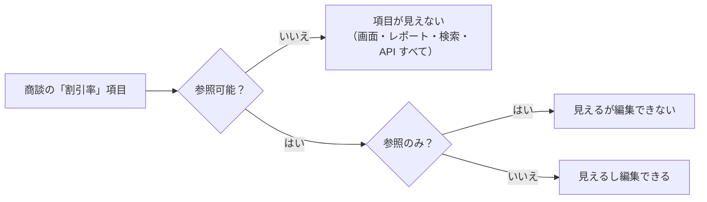

ひっかけ注意：ページレイアウトとの違い

ページレイアウトでも項目を「参照のみ」にしたり、外したりできます。しかしそれは**その画面の見た目だけ**です。レポート・リストビュー・API（データローダーなど）では見えたり編集できたりします。

**本当に見せたくない・編集させたくない**なら、必ず**項目レベルセキュリティ**を使います。

### 6-3. プロファイルと権限セット

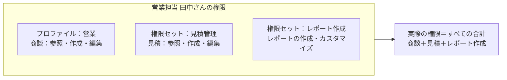

| | **プロファイル** | **権限セット** |
|---|---|---|
| 1 ユーザーあたり | **必ず 1 つ** | 0 個以上（いくつでも） |
| 役割 | 基本の権限と、**ユーザーの基本設定** | 権限を**追加**する |
| プロファイルにしかない設定の例 | ログイン IP 範囲、ログイン時間、ページレイアウトの割り当て、デフォルトのレコードタイプ | — |
| 権限を取り上げられる？ | — | **できない**（足し算だけ） |

なぜ Salesforce は「プロファイルは最小限、権限は権限セットで」と勧めるの？

プロファイル中心で管理すると、「営業部のプロファイル」「営業部（見積もできる）のプロファイル」「営業部（見積もできてレポートも作れる）」…と組み合わせの数だけプロファイルが増えてしまいます。

権限セットなら、部品のように「見積」「レポート作成」を足すだけで済みます。管理がシンプルになり、人事異動のときも権限セットの付け外しで対応できます。

ひっかけ注意：権限は足し算だけ

「プロファイルでは編集できるが、この人だけ編集させたくない」→ 権限セットで取り上げることは**できません**。正しい方法は、権限の少ない別のプロファイルを使い、必要な権限を権限セットで足すことです。

また、**標準プロファイル**（「標準ユーザー」など Salesforce が最初から用意しているもの）はオブジェクト権限などを変更できません。変更したい場合は**コピー（複製）してカスタムプロファイル**を作ります。

### 6-4. 権限セットグループとミュート権限セット

**権限セットグループ**は、職務に必要な権限セットを**束ねて**まとめて割り当てる仕組みです。

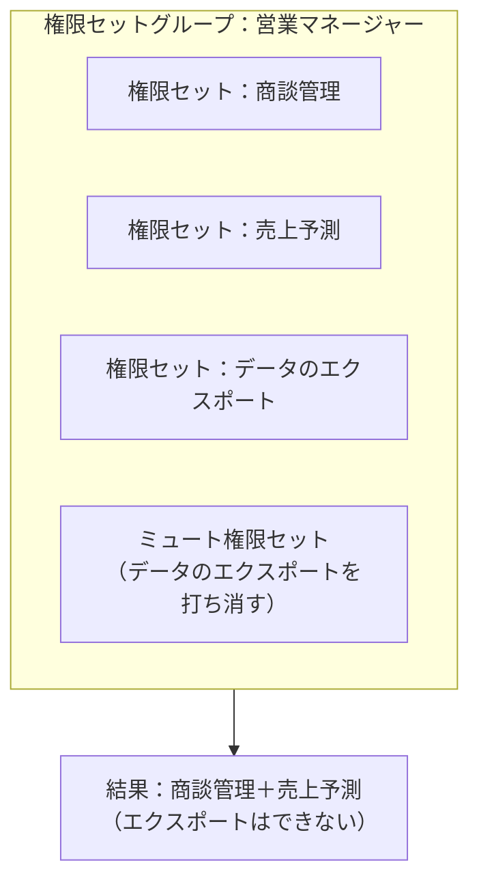

- **ミュート権限セット**: グループの中の特定の権限だけを打ち消す。グループの中でだけ働く
- 割り当てには**有効期限**を付けられる（一時的な権限付与に便利）

具体例

Cloud Kicks の営業マネージャーには、営業用の 3 つの権限セットをまとめて付けたいが、一部のマネージャーにはデータのエクスポートをさせたくない。→ 別の**権限セットグループ**を作り、**ミュート権限セット**で「データのエクスポート」だけを打ち消します。

---

## 7. レコードへのアクセス（共有）

ここが Salesforce のセキュリティで一番奥が深いところです。

### 7-1. 基本の考え方：「まず絞って、必要な分だけ広げる」

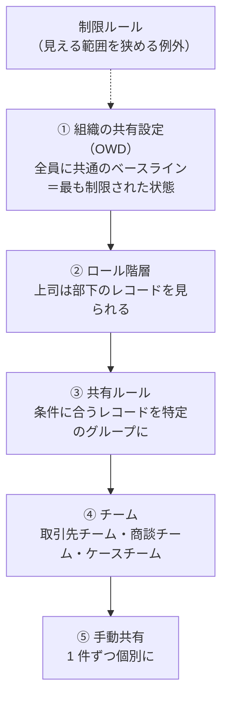

上から順に**アクセスを広げていく**仕組みです。どれか 1 つでアクセスがあれば、そのレコードにアクセスできます。

なぜ「最も厳しい状態」から始めるの？

Salesforce のレコード共有の仕組みは、基本的に**アクセスを広げることしかできません**（例外は後で出てくる制限ルール）。だから OWD を広く設定してしまうと、後から「この人には見せたくない」ができなくなります。

**OWD は「この会社で一番見せてはいけない人」に合わせて決める**、と覚えましょう。

### 7-2. 組織の共有設定（OWD）

オブジェクトごとに、**所有者以外の人**がそのレコードにどうアクセスできるかの初期値を決めます。

| 設定 | 所有者以外の人は… |
|---|---|
| **非公開** | 見られない |
| **公開／参照のみ** | 見られるが編集できない |
| **公開／参照・更新** | 見られるし編集できる |
| **公開／参照・更新・転送** | 見る・編集・所有者の変更ができる（**リードとケース**だけにある） |
| **公開／フルアクセス** | 見る・編集・削除・転送ができる（**キャンペーン**にある） |
| **親レコードによる制御** | 親レコード（主従関係の主）のアクセスに従う |

さらに、OWD は**内部ユーザー用**と**外部ユーザー用**（顧客・パートナーのサイトのユーザー）を別々に設定できます。外部は内部と同じか、より厳しくしかできません。

具体例：OWD の決め方

Northern Trail Outfitters で、

- 営業担当は**他の担当の商談を見てはいけない** → 商談は「**非公開**」
- 製品カタログは全員が見てよいが、編集は担当者だけ → 「**公開／参照のみ**」
- 社内の FAQ のカスタムオブジェクトは誰が編集してもよい → 「**公開／参照・更新**」

### 7-3. ロール階層

ロール階層は組織の上下関係を表し、**上位のロールのユーザーは、下位のロールのユーザーが所有する（またはアクセスできる）レコードにアクセスできます。**

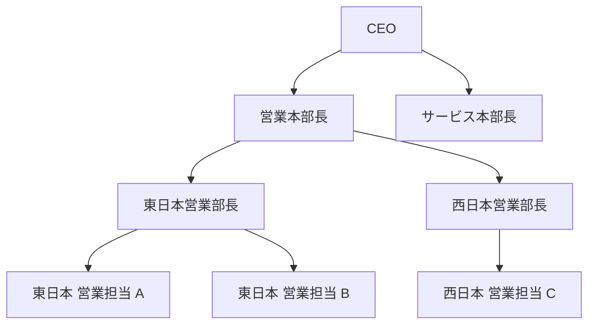

この図で、OWD が「非公開」のとき：

| ユーザー | 見られる商談 |
|---|---|
| 東日本 営業担当 A | 自分の商談だけ（B の商談は見られない） |
| 東日本営業部長 | 自分＋A＋B の商談 |
| 営業本部長 | 東日本・西日本すべての営業の商談 |
| サービス本部長 | 営業の商談は見られない（別の枝だから） |

ひっかけ注意

- **同じロール同士では共有されません。** A と B は同じ「東日本 営業担当」でも、お互いの商談は見られません。共有したいなら共有ルールが必要です。
- ロール階層は**組織図そのものではなく「データを見る上下関係」**です。肩書きが同じでも、データを見る範囲が同じなら同じロールにまとめて構いません。
- **カスタムオブジェクト**では「**階層を使用したアクセス許可**」のチェックを外すと、ロール階層による共有を止められます（人事評価など、上司にも見せたくないデータ）。**標準オブジェクトでは外せません。**

### 7-4. 共有ルール

OWD の例外として、**特定のグループにアクセスを広げる**ルールです。

| 種類 | 何を基準にする？ | 例 |
|---|---|---|
| **所有者ベース** | レコードの**所有者**がどのロール・グループにいるか | 「東日本営業部が所有する取引先」を「マーケティング部」に共有 |
| **条件ベース** | レコードの**項目の値** | 「地域 ＝ 関西」の取引先を「関西支店」に共有 |

共有先として選べるもの：**公開グループ**、**ロール**、**ロールと部下**、**テリトリー**など。アクセスレベルは「参照のみ」か「参照・更新」です。

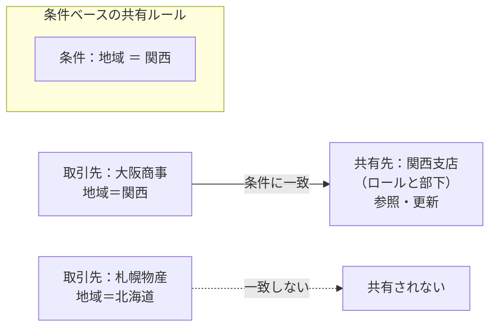

ポイント：公開グループ

**公開グループ**は、ユーザー・ロール・他のグループを自由に組み合わせた「共有のための名簿」です。ロールをまたいだメンバー（例: プロジェクトメンバー 15 人）に共有したいときに使います。

なお、**Chatter グループ**は共有ルールの共有先にはできません。名前が似ているので注意。

### 7-5. チーム・手動共有・キュー

| 仕組み | 内容 | ポイント |
|---|---|---|
| **取引先チーム／商談チーム／ケースチーム** | レコードごとに、複数の人と役割・アクセスレベルを設定 | 「この大口顧客は営業・技術・サポートの 3 人で担当」 |
| **手動共有** | レコードの「共有」ボタンで 1 件ずつ共有 | 所有者・その上司・管理者ができる。**所有者が変わると削除される** |
| **キュー** | レコードの「置き場所」。キューがレコードを所有し、メンバーが引き取る | リード・ケース・カスタムオブジェクトなど。メンバーはキューのレコードにアクセスできる |

### 7-6. 制限ルール（逆向きの仕組み）

**制限ルール**は、条件に合うレコードだけが見えるように、**見える範囲を狭める**仕組みです。

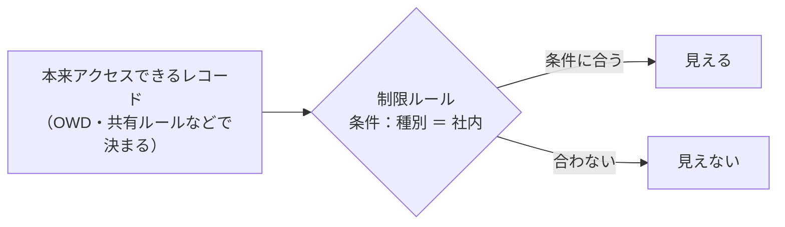

- 共有ルールなどが「足し算」なのに対して、制限ルールは「**絞り込み**」
- 使えるオブジェクトには制限がある（カスタムオブジェクト、契約、ToDo、行動など）

### 7-7. どの方法で共有する？ 判断フロー

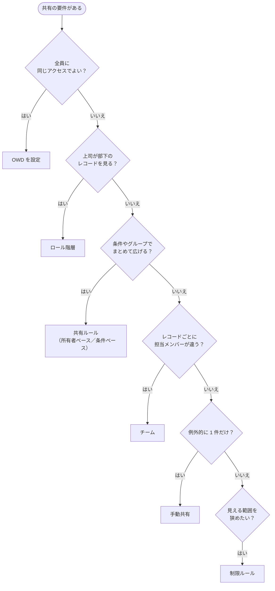

やってみよう（15 分）

1. 設定 → 「共有設定」を開き、各オブジェクトの OWD を眺める（リードとケースにだけ「転送」があることを確認）
2. 設定 → 「ロール」でロール階層を作る（例: 営業部長 → 営業担当）
3. 共有設定の下のほうにある「取引先の共有ルール」で「新規」→ 条件ベースのルールを作ってみる（例: 業種 ＝ 製造 の取引先を「営業部長と部下」に参照のみで共有）
4. 取引先のレコードを開き、「共有」→「共有階層」で、誰がどの理由でアクセスできるかを確認する

---

## 8. 総合演習：「見られない・編集できない」を診断する

試験で最も多いパターンは「ユーザーが〇〇できない。原因は？」です。次の順番で確認すれば必ず答えにたどり着きます。

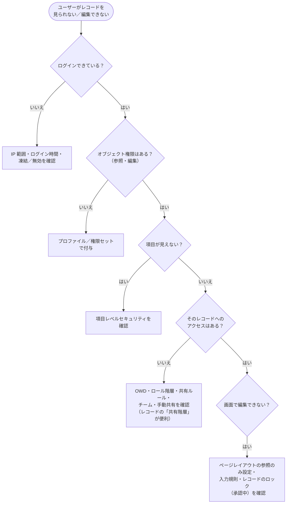

例題で確認

**問題**: 共有ルールで商談に「参照・更新」を付けたのに、ユーザーが商談を編集できない。最も考えられる原因は？

**考え方**: 共有ルールは④レコードの層。その上の②オブジェクトの層を確認します。→ **プロファイル／権限セットに商談の「編集」権限がない**が正解です。

---

## 9. まとめ

| テーマ | 覚えること |
|---|---|
| 元に戻せない設定 | カスタム会計年度、複数通貨、個人取引先 |
| ユーザー | 削除できない。無効化でライセンスが空く。すぐ止めたいが無効化できないときは凍結 |
| アクセスの層 | 組織 → オブジェクト → 項目 → レコード。上で NG なら下で広げても NG |
| IP | ログイン IP 範囲（プロファイル）＝禁止、信頼済み IP 範囲＝本人確認の省略 |
| 権限 | プロファイルは 1 つ、権限セットはいくつでも、権限は足し算だけ。打ち消しは権限セットグループのミュートで |
| FLS | 本当に隠すなら項目レベルセキュリティ。ページレイアウトは見た目だけ |
| 共有 | OWD で一番絞る → ロール階層・共有ルール・チーム・手動共有で広げる。狭めるのは制限ルール |
| ロール階層 | 上司は部下のレコードを見られる。同じロール同士は共有されない |
| 履歴 | 設定の変更＝設定変更履歴、データの変更＝項目履歴、ログイン＝ログイン履歴 |

## 試験直前チェック

- [ ] 「元に戻せない設定」を 3 つ言える
- [ ] 凍結と無効化の違いと、凍結を使う場面を説明できる
- [ ] アクセスの 4 つの層を順番に言え、「上の層が優先」を説明できる
- [ ] ログイン IP 範囲と信頼済み IP 範囲の違いを説明できる
- [ ] プロファイルと権限セットの違い、ミュート権限セットの使いどころを言える
- [ ] 項目レベルセキュリティとページレイアウトの違いを言える
- [ ] OWD の 6 つの選択肢と、「転送」があるオブジェクトを言える
- [ ] ロール階層で「同じロール同士は共有されない」理由を言える
- [ ] 所有者ベースと条件ベースの共有ルールの違いを言える
- [ ] 設定変更履歴・項目履歴・ログイン履歴の使い分けを言える
