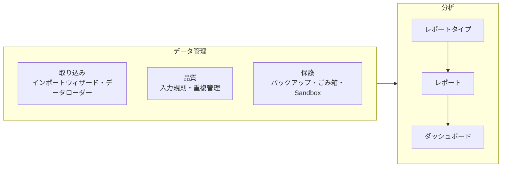
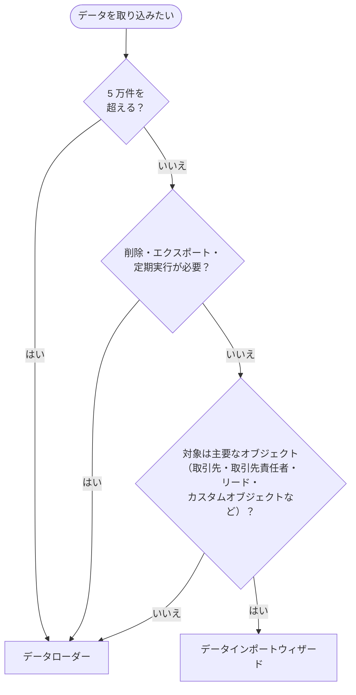
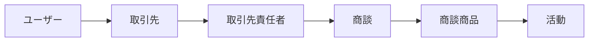
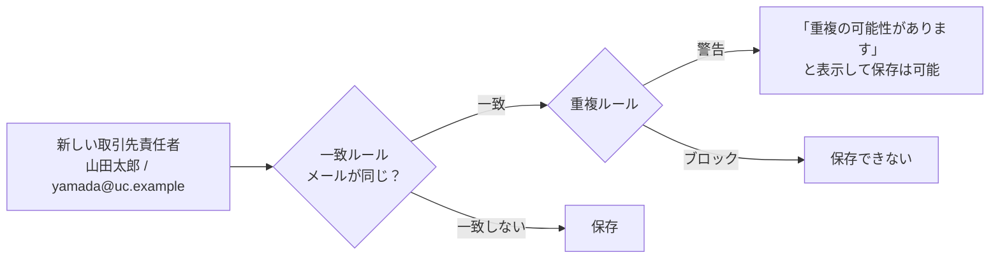
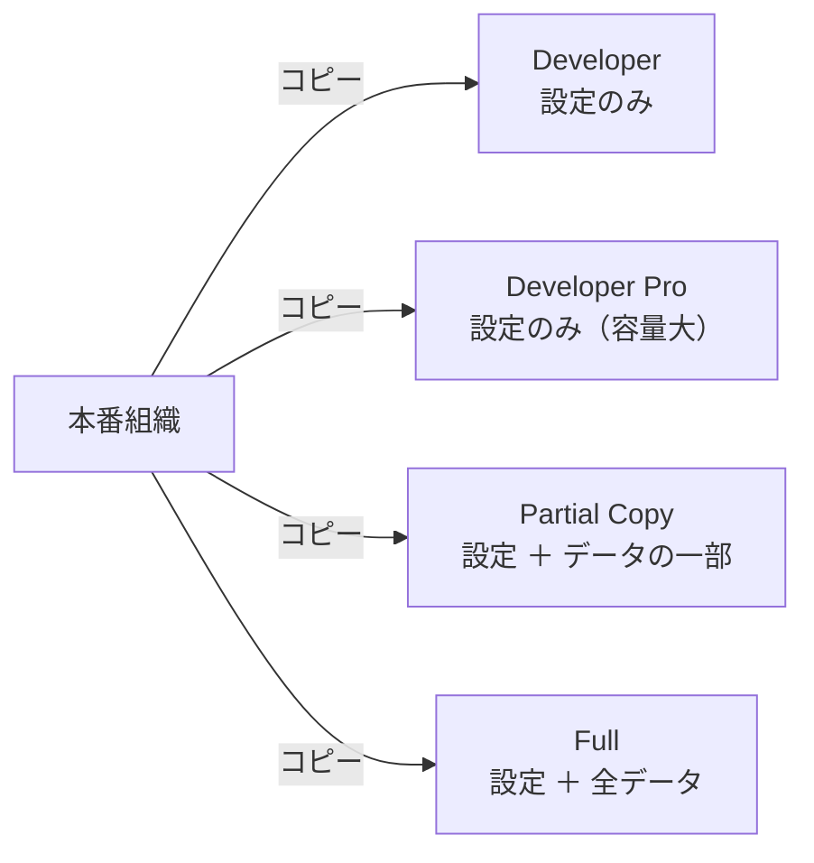
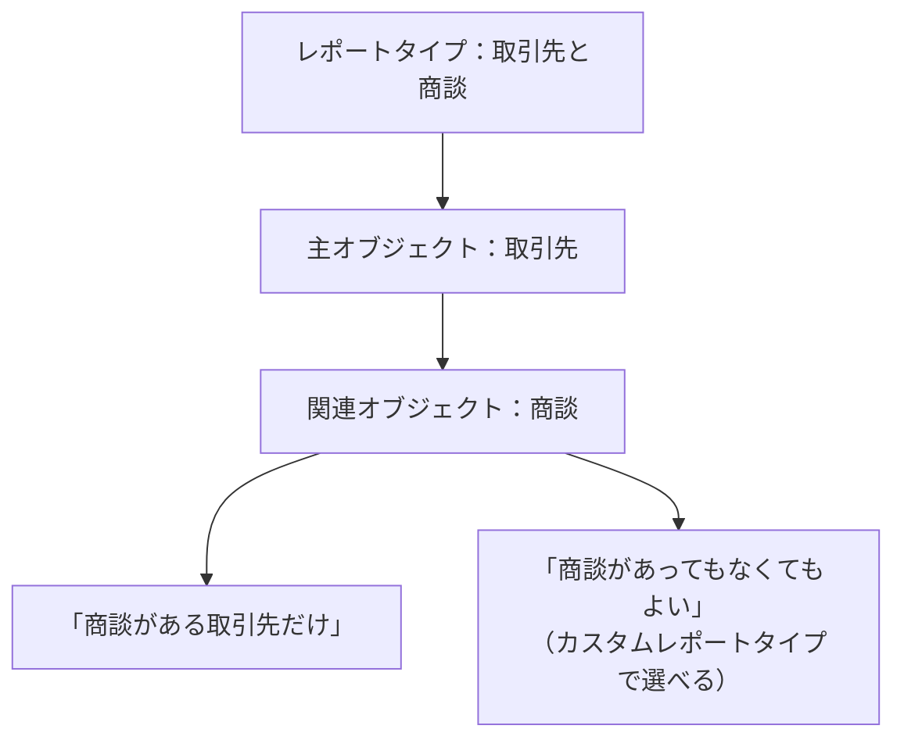
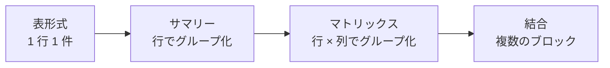
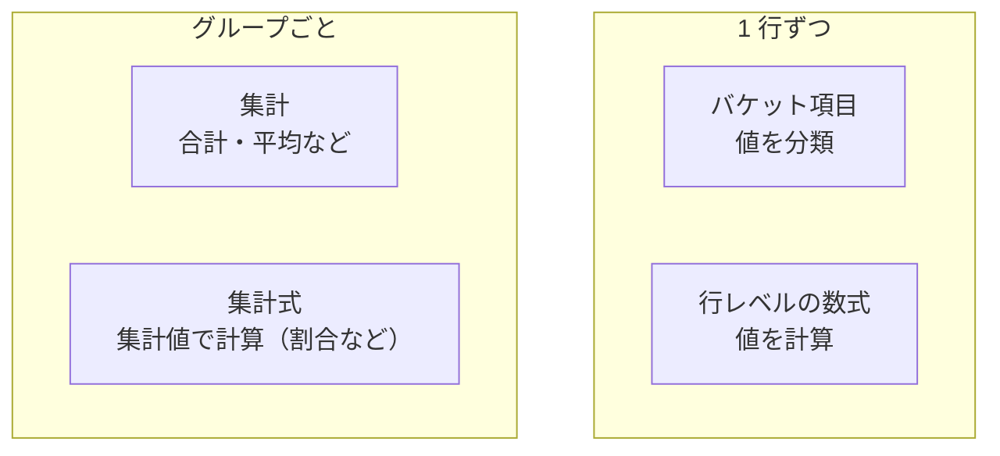
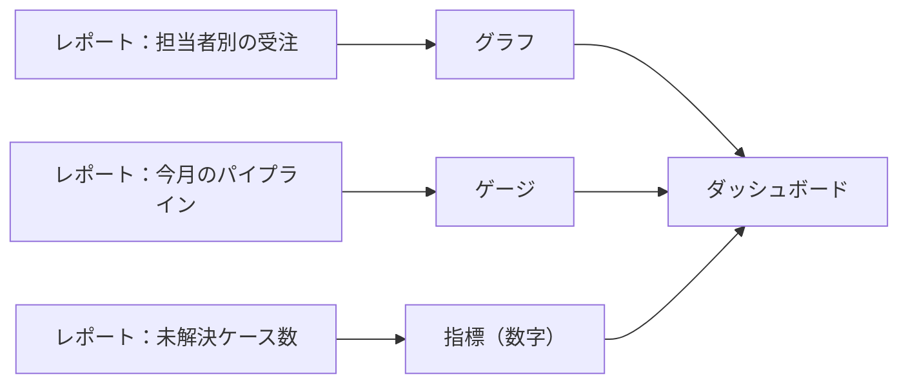
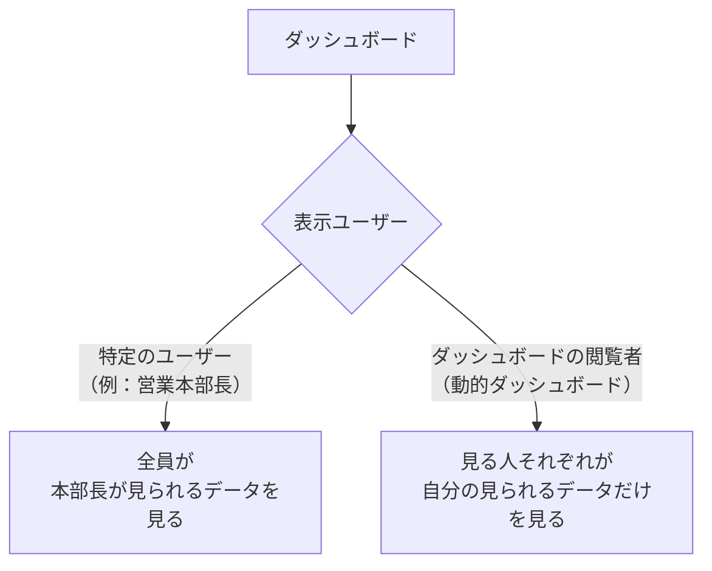

## はじめに：この範囲で学ぶこと

「データと分析の管理」は**配点 17% で最大**の範囲です。前半は「データを正しく入れて守る」、後半は「データを見える化する」です。

---

## 1. データの取り込み

### 1-1. 2 つの代表的なツール

| | **データインポートウィザード** | **データローダー** |
|---|---|---|
| どこで使う？ | ブラウザ（設定の中） | パソコンにインストールするアプリ（コマンドラインも可） |
| 件数 | **5 万件まで** | **500 万件まで**（それ以上は他の方法を検討） |
| 対象 | 取引先・取引先責任者・リード・ソリューション・キャンペーンメンバー・カスタムオブジェクトなど | **ほぼすべてのオブジェクト** |
| 操作 | 新規・更新・upsert | 新規・更新・upsert・**削除**・**完全削除**・**エクスポート** |
| 重複のチェック | 取り込み時に指定できる（メールアドレスなど） | 外部 ID や Salesforce ID で制御 |
| 自動化 | なし | **コマンドラインで定期実行**できる |
| ワークフローの実行 | 実行しない設定も選べる | 通常どおり Flow などが動く |

なぜ 2 つあるの？

データインポートウィザードは「**管理者でなくても迷わず使える**」ことを重視した簡単なツールです。ブラウザだけで使え、重複のチェックも画面で選べます。
データローダーは「**大量・高機能**」を重視したツールです。削除や定期実行など、細かい操作ができますが、そのぶん操作を間違えたときの影響も大きくなります。
少量で簡単なら前者、大量や特殊な操作なら後者、と使い分けます。

### 1-2. 操作の種類

| 操作 | 内容 |
|---|---|
| 新規（insert） | 新しいレコードを作る |
| 更新（update） | **Salesforce ID** を指定して既存のレコードを更新する |
| **upsert** | キー（**外部 ID** か Salesforce ID）で探し、**あれば更新・なければ新規** |
| 削除（delete） | レコードを削除してごみ箱へ |
| 完全削除（hard delete） | ごみ箱を通さずに削除（復元できない） |
| エクスポート | データを CSV で出す（「すべてエクスポート」は削除済みのものも含む） |

ポイント：外部 ID と upsert

外部システムと毎晩データを同期するとき、Salesforce ID を外部システムが知っているとは限りません。外部システムの顧客番号を**外部 ID 項目**として持っておけば、**upsert** で「その番号のレコードがあれば更新、なければ作成」ができます。さらに、取引先責任者を取り込むときに**親の取引先を外部 ID で指定**して紐づけることもできます。

### 1-3. 取り込みの順番

親子関係があるデータは、**親から先に**取り込みます。子は親への参照が必要だからです。

---

## 2. データ品質

### 2-1. 品質を守る仕組み

| 段階 | 仕組み |
|---|---|
| 入力の形をそろえる | **選択リスト**、データ型（数値・日付・メール） |
| 入力を必須にする | 項目の必須、**入力規則** |
| 重複を防ぐ | **一致ルール＋重複ルール**、項目の「ユニーク」 |
| 変更を追跡する | **項目履歴管理** |

### 2-2. 重複管理

- **一致ルール**: 何をもって同じとみなすか（完全一致、あいまい一致）
- **重複ルール**: 一致したら警告するか、ブロックするか。**レポート用に重複を記録**することもできる

### 2-3. 項目履歴管理

オブジェクトごとに**追跡する項目**を選ぶと、「誰が・いつ・何から何に」変えたかが記録されます。履歴は関連リストやレポートで見られます。標準では **18 か月**保持されます（より長く保持したいなら Field Audit Trail）。

---

## 3. データを守る：バックアップとごみ箱

| 機能 | 内容 |
|---|---|
| **データエクスポートサービス** | 全データを CSV で**週に 1 回**（エディションにより月 1 回）書き出す。追加費用なしの標準機能 |
| **ごみ箱** | 削除したレコードは **15 日間**保持され、その間は**復元できる**（完全削除したものは除く） |
| Salesforce Backup など | 有償のバックアップ製品。自動・頻繁なバックアップと復元 |
| **レコードの所有権の一括移行** | 退職者のレコードを後任に一括で移す |
| 一括削除 | 条件に合うレコードをまとめて削除 |

ひっかけ注意

- 3 日前に削除した取引先 → **ごみ箱から復元**（データエクスポートからの再取り込みは不要）
- 1 か月前に完全削除した取引先 → ごみ箱にはない。**事前に取っておいたバックアップから再取り込み**するしかない

---

## 4. Sandbox：検証用の環境

### 4-1. Sandbox とは

**Sandbox** は本番組織をコピーした**検証用の環境**です。本番に影響を与えずに、設定の変更・開発・テスト・研修ができます。

| 種類 | データ | 容量 | 更新できる間隔 | 主な用途 |
|---|---|---|---|---|
| **Developer** | **設定のみ** | 小 | 1 日 | 開発、単体テスト |
| **Developer Pro** | **設定のみ** | 中 | 1 日 | 開発、少し大きめのテスト |
| **Partial Copy** | 設定 ＋ **データの一部**（Sandbox テンプレートで選ぶ） | 中 | 5 日 | 統合テスト、**研修**、UAT |
| **Full** | 設定 ＋ **全データ** | 本番と同じ | 29 日 | **性能テスト**、本番同等の最終確認 |

なぜ種類があるの？

本番の全データをコピーするとコピーに時間がかかり、容量も大きくなります。開発者が設定を試すだけならデータは不要です。逆に「本番と同じデータ量で処理が間に合うか」を確かめたいなら全データが必要です。**目的に合わせて、必要なだけコピーする**ために種類が分かれています。

ポイント

Sandbox で作った変更は、**変更セット**などを使って本番にリリースします。Sandbox では、本番の顧客に誤ってメールを送らないよう、メール配信が「システムメールのみ」になっていることがあります。

---

## 5. レポート

### 5-1. レポートタイプ：何を報告できるか

レポートを作るときは、最初に**レポートタイプ**を選びます。レポートタイプは「**どのオブジェクトの組み合わせを報告できるか**」を決めるものです。

- **標準レポートタイプ**: Salesforce が用意しているもの（「取引先と取引先責任者」など）
- **カスタムレポートタイプ**: 管理者が作る。主オブジェクトと関連オブジェクト（最大 4 階層）、**「関連レコードがない場合も含めるか」**、表示する項目を決められる

ひっかけ注意

「**商談があってもなくても**取引先を表示したい」「欲しい組み合わせが標準にない」→ **カスタムレポートタイプ**を作ります。ただし、オブジェクト同士に**リレーションがあること**が前提です。

### 5-2. レポートの形式

| 形式 | 見た目 | グラフ | 使いどころ |
|---|---|---|---|
| **表形式** | 一覧 | **付けられない** | 連絡先リスト、データの書き出し |
| **サマリー** | 行でグループ化（担当者ごとなど） | 付けられる | 担当者別の商談金額 |
| **マトリックス** | 行と列でグループ化 | 付けられる | 担当者 × 月の受注金額 |
| **結合** | 複数のレポートタイプのブロックを並べる | 付けられる | ケースと商談を並べて比較 |

なぜ表形式にはグラフが付けられないの？

グラフは「グループごとの合計（担当者 A は 300 万、B は 200 万）」を描くものです。表形式にはグループがないので、描く元がありません。**グラフやダッシュボードのグラフにしたいなら、グループ化（サマリー以上）が必要**です。

### 5-3. 絞り込み（フィルター）

| フィルター | 内容 |
|---|---|
| 標準フィルター | 「自分の／すべての」「期間（作成日・完了予定日など）」 |
| 項目フィルター | 「金額 ≥ 100 万」など。**フィルターロジック**（`1 AND (2 OR 3)`）で組み合わせる |
| **クロス条件** | 「**商談を持たない**取引先」のように、子レコードの有無で親を絞る |
| 行の制限 | 上位 10 件など |

### 5-4. 計算と分類

| 機能 | 計算の単位 | 例 |
|---|---|---|
| **集計（合計・平均・最大・最小）** | グループごと | 担当者ごとの金額の合計 |
| **バケット項目** | 1 行ずつ分類 | 年間売上を「大・中・小」に分ける（**項目を作らずに**） |
| **行レベルの数式** | 1 行ずつ計算（1 レポートに 1 つ） | 金額 × 確度 |
| **集計式（カスタムサマリー式）** | グループの集計値で計算 | 成約率 ＝ 成立件数 ÷ 全件数 |

ひっかけ注意

- 「グループごとの割合（成約率）」→ **集計式**（行レベルの数式ではない）
- 「項目を作らずに値を範囲で分類」→ **バケット項目**

### 5-5. その他のレポート機能

| 機能 | 内容 |
|---|---|
| **レポートの購読** | スケジュール（毎週月曜など）と**条件**（合計が〇〇を超えたら）でメールを受け取る |
| 条件付き書式 | 値に応じて色を変える |
| **履歴トレンドレポート** | 過去の時点と比べて**変化**を見る（先週と比べたパイプライン） |
| 報告スナップショット | 定期的にレポートの結果を保存して、推移を記録する |

---

## 6. ダッシュボード

### 6-1. 仕組み

- 1 つの**コンポーネント**（グラフ・ゲージ・指標・表など）は **1 つの元レポート**から作る
- **ダッシュボードフィルター**で、地域などを切り替えて表示できる

### 6-2. 表示ユーザー（超頻出）

ダッシュボードは「**誰の権限でデータを見せるか**」を選べます。

| 表示ユーザー | 結果 | 注意 |
|---|---|---|
| **特定のユーザー** | 全員が同じデータ（そのユーザーの権限のデータ）を見る | 本来見られないデータの集計値まで見えてしまうことがある |
| **ダッシュボードの閲覧者（動的ダッシュボード）** | 閲覧者自身の権限で見えるデータだけ | 1 つのダッシュボードを全員で使い回せる |

具体例

Cloud Kicks の営業マネージャー 5 人が、同じダッシュボードでそれぞれ自分のチームの数字だけを見たい。→ 表示ユーザーを「**ダッシュボードの閲覧者**」にした動的ダッシュボードを 1 つ作ります。マネージャーごとにダッシュボードを複製する必要はありません。

### 6-3. レポートとダッシュボードの共有

レポートとダッシュボードは、**フォルダ**で共有します。

| アクセス | できること |
|---|---|
| 参照者 | 見る |
| 編集者 | 見る・編集する |
| 管理者 | 見る・編集する・フォルダの共有を変える |

ポイント

レポートのフォルダを共有しても、**レポートに表示されるレコードは見る人の権限で決まります**。フォルダの共有は「レポートそのものを開けるか」、中のデータは「その人が見られるレコードか」で決まる、という 2 段階です。

やってみよう（20 分）

1. 設定 → 「データインポートウィザード」を開き、取引先責任者の取り込み画面で、重複の判定方法（メールアドレスなど）を選べることを確認する
2. レポートタブ → 新規レポート →「商談」を選び、「取引先所有者」でグループ化してサマリーにする
3. 「行」の項目にバケット列を追加し、金額を「小（〜100 万）」「中」「大」に分ける
4. グラフを追加して保存し、ダッシュボードを作ってそのレポートからグラフのコンポーネントを置く
5. ダッシュボードの「表示ユーザー」の設定で、「ダッシュボードの閲覧者」を選べることを確認する

---

## 7. 総合演習：要件からの選び方

| 要件 | 機能 |
|---|---|
| 3 万件の取引先責任者を、メールアドレスで重複を避けて取り込む | データインポートウィザード |
| 毎晩 20 万件を外部システムから同期 | データローダーのコマンドラインで、外部 ID を使って upsert |
| レコードを一括で削除 | データローダー |
| 研修用に一部のデータを含む環境 | Partial Copy Sandbox |
| 本番と同じ量で性能テスト | Full Sandbox |
| 週 1 回の全データのバックアップ（無料） | データエクスポートサービス |
| 数日前に削除したレコードを戻す | ごみ箱 |
| 誰がいつ値を変えたか | 項目履歴管理 |
| 担当者 × 月の表 | マトリックス形式 |
| 項目を作らずに値を分類 | バケット項目 |
| グループごとの割合 | 集計式 |
| 子を持たない親を探す | クロス条件 |
| 条件を満たしたらメールで知らせる | レポートの購読 |
| 見る人ごとに自分のデータだけを表示 | 動的ダッシュボード |
| 地域を切り替えて表示 | ダッシュボードフィルター |

## 8. まとめ

| テーマ | 覚えること |
|---|---|
| 取り込み | ウィザード＝5 万件・簡単・主要オブジェクト。データローダー＝500 万件・削除・エクスポート・定期実行 |
| upsert | 外部 ID であれば更新・なければ新規 |
| 順番 | 親 → 子 |
| 品質 | 選択リスト・入力規則・一致ルール＋重複ルール・項目履歴 |
| 保護 | データエクスポート（週次）、ごみ箱 15 日 |
| Sandbox | Developer／Developer Pro＝設定のみ、Partial＝一部データ、Full＝全データ |
| レポート | レポートタイプで組み合わせ、表形式はグラフ不可、バケット・行レベルの数式・集計式の使い分け |
| ダッシュボード | 1 コンポーネント 1 レポート。表示ユーザー＝特定のユーザー／閲覧者（動的） |
| 共有 | フォルダで共有。中のデータは見る人の権限 |

## 試験直前チェック

- [ ] データインポートウィザードとデータローダーの違いを 4 つ言える
- [ ] upsert の動きと外部 ID の役割を説明できる
- [ ] 取り込みの順番が「親 → 子」である理由を言える
- [ ] 一致ルールと重複ルールの役割の違いを言える
- [ ] ごみ箱の保持期間と、戻せないケースを言える
- [ ] 4 種類の Sandbox のデータの違いと用途を言える
- [ ] 4 つのレポート形式と、グラフが付けられない形式を言える
- [ ] バケット項目・行レベルの数式・集計式を使い分けられる
- [ ] クロス条件で何ができるか言える
- [ ] 動的ダッシュボードの意味と、特定のユーザーとして表示する場合の注意を言える
