## はじめに：この範囲で学ぶこと

「オブジェクトマネージャーと Lightning アプリケーションビルダー」は配点 15% です。一言でいうと「**データの形を決めて、それを使いやすい画面にする**」範囲です。

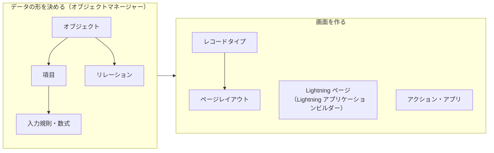

---

## 1. オブジェクト・項目・レコードとは

### 1-1. 表計算ソフトにたとえると

Salesforce のデータは、Excel のような表にたとえると分かりやすくなります。

| Salesforce | Excel でいうと | 例 |
|---|---|---|
| **オブジェクト** | シート（表）そのもの | 「取引先」「商談」 |
| **項目** | 列 | 「取引先名」「業種」「電話」 |
| **レコード** | 行（1 件のデータ） | 「株式会社ユニバーサル」の 1 行 |

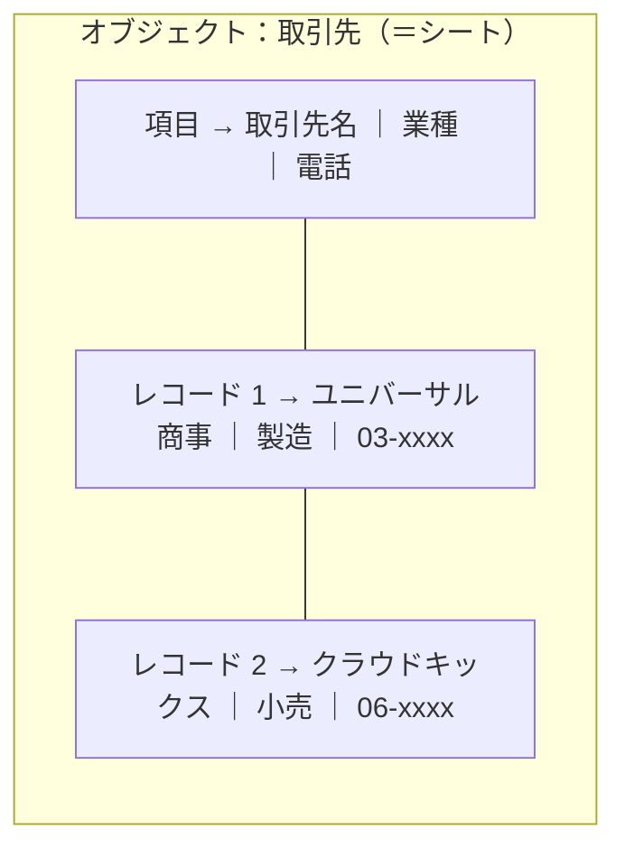

ただし Excel と違い、Salesforce では**シート同士をつなげられます**（リレーション）。「この商談はどの取引先のものか」を正しく結びつけられるのが大きな違いです。

### 1-2. 標準オブジェクトとカスタムオブジェクト

| | 標準オブジェクト | カスタムオブジェクト |
|---|---|---|
| 例 | 取引先、取引先責任者、リード、商談、ケース、キャンペーン | 「プロジェクト」「出荷」「研修申込」など会社独自のもの |
| 用意する人 | Salesforce が最初から用意 | 管理者が作る |
| API 名 | `Account`、`Opportunity` など | 末尾が **`__c`**（例: `Project__c`） |
| 機能 | 売上予測、ケースのエスカレーションなど**専用の機能**が使える | 自分で設計する |

なぜ「まず標準オブジェクト」なの？

標準オブジェクトには、Salesforce が用意した**専用の機能**がついています。たとえば「商談」には売上予測・パス・商談チーム、「ケース」にはエスカレーションやオムニチャネルがあります。

同じようなデータをカスタムオブジェクトで作ってしまうと、これらの機能が使えず、Salesforce が毎年追加する新機能の恩恵も受けられません。**標準オブジェクトで表現できないか、まず考える**のが鉄則です。

ポイント：API 名

項目やオブジェクトには、画面に表示される「表示ラベル」と、プログラムやデータ連携で使う「**API 名**」があります。カスタムのものは API 名の末尾が `__c` になります。表示ラベルは後から自由に変えられますが、API 名を変えると連携や Flow に影響するので注意します。

---

## 2. 項目（データ型）

### 2-1. 主なデータ型

項目を作るときは、まず**データ型**を選びます。入る値の種類が決まり、入力ミスを防げます。

| データ型 | 入る値 | 使いどころ・注意 |
|---|---|---|
| テキスト | 255 文字までの文字 | 名前、コードなど |
| ロングテキストエリア | 長い文章 | メモ、説明。**検索条件やフィルターに使いにくい** |
| リッチテキストエリア | 書式・画像つきの文章 | 手順の説明など |
| 数値・通貨・パーセント | 数値 | 計算や集計に使える |
| 日付・日付/時間 | 日付（・時刻） | 期限、予定日 |
| チェックボックス | オン／オフ | 「重要顧客」など |
| **選択リスト** | 決められた値から 1 つ | 「業種」など。**表記ゆれを防ぐ** |
| **複数選択リスト** | 決められた値から複数 | 便利だが、レポートや条件で扱いにくい |
| メール・電話・URL | 形式つきの文字 | クリックでメール・電話・リンク |
| **自動採番** | 自動で振られる連番 | 「INV-0001」など |
| **数式** | 他の項目から計算した値 | 読み取り専用。保存されない |
| **積み上げ集計** | 子レコードの件数・合計など | 主従関係の「主」側だけ |
| **参照関係・主従関係** | 他のレコードへのリンク | 第 3 章で詳しく |
| 地理位置情報 | 緯度・経度 | 店舗の位置など |

なぜ「テキスト」ではなく「選択リスト」を使うの？

業種を自由入力にすると「製造」「製造業」「メーカー」がバラバラに入り、レポートで正しく集計できなくなります。選択リストにすれば値がそろいます。**データの品質は、入力の段階で守るのが一番安い**、これは Salesforce 管理の基本的な考え方です。

### 2-2. 項目の大事なオプション

| オプション | 効果 |
|---|---|
| **必須** | 値がないと保存できない（画面・API のすべてで） |
| **ユニーク** | 他のレコードと同じ値を入れられない |
| **外部 ID** | 外部システムのキーとして使う。データローダーの upsert や連携で一致の判定に使われ、検索も速くなる |
| デフォルト値 | 新規作成時に最初から入る値 |
| ヘルプテキスト | 項目の横の「i」マークに表示される説明 |

### 2-3. 選択リストの便利な機能

- **連動選択リスト**: 「制御項目」の値によって、「連動項目」で選べる値を絞り込む（例: 国 → 都道府県）
- **グローバル選択リスト値セット**: 同じ値のリストを複数の項目で共有し、1 か所で管理する
- **制限付き選択リスト**: 決められた値以外は API からも入れられない

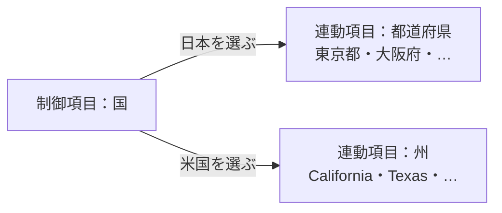

### 2-4. 数式項目

数式項目は、他の項目から**表示のたびに計算**される読み取り専用の項目です。

| 例 | 数式のイメージ |
|---|---|
| 支払期限＝申込日の 7 日後 | `申込日 + 7` |
| 重要顧客＝年間売上 1 億円以上 | `年間売上 >= 100000000`（チェックボックス型） |
| 取引先の業種を商談に表示 | `Account.Industry`（**親オブジェクトの項目を参照できる**） |

ポイント：数式と積み上げ集計の違い

- **数式**は「同じレコードや**親**レコードの項目」から計算する
- **積み上げ集計**は「**子**レコードをまとめる」（件数・合計・最小・最大）

「子の合計を親に出したい」なら数式ではなく**積み上げ集計**です（ただし主従関係が必要）。

### 2-5. 項目の型を変えるときの注意

項目のデータ型を後から変えると、**データが失われたり**、その項目を使っている数式・入力規則・レポート・Flow が動かなくなったりすることがあります（例: テキスト → 数値で、数字でない値が消える）。変更する前に項目の「**使用場所**」で影響を確認し、Sandbox で試します。

削除した項目は **15 日間**は復元できます。

---

## 3. リレーション（オブジェクト同士のつながり）

### 3-1. リレーションの考え方

「この商談はどの取引先のものか」「この取引先責任者はどの会社の人か」をつなげるのがリレーションです。**子の側に親を指す項目**を作ります。

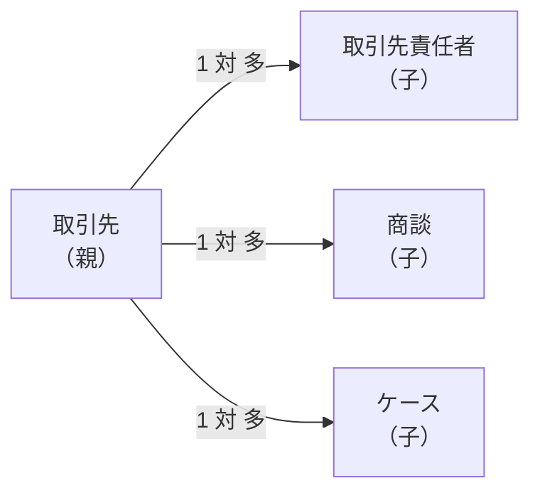

1 つの取引先に、取引先責任者・商談・ケースがたくさんぶら下がる「**1 対 多**」の関係です。

### 3-2. 参照関係と主従関係（超頻出）

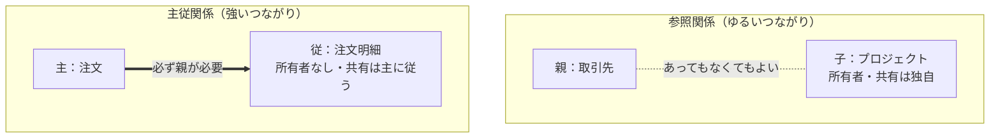

| | **参照関係** | **主従関係** |
|---|---|---|
| 親は必須？ | 任意（必須にもできる） | **必須**（親なしでは保存できない） |
| 親を削除すると | 子は残る（参照が空になる。削除を禁止する設定も可能） | **子も削除される** |
| 子の所有者 | 子にも所有者がいる | **子には所有者項目がない** |
| 子の共有 | 子は独自の OWD・共有を持つ | **主（親）の共有に従う** |
| 積み上げ集計 | 使えない（標準では） | **主の側で使える** |
| 1 オブジェクトに作れる数 | 40 まで | **2 つまで** |

なぜ主従関係では、子に所有者がないの？

主従関係は「子は親の一部」という強い関係です。注文明細は注文の一部であり、注文明細だけを別の人が持つことは考えにくいですよね。だから子は**親と運命を共にします**。親の所有者・共有がそのまま子に適用され、親を消せば子も消えます。

この「一体」の関係があるからこそ、親で子の合計（積み上げ集計）を正確に保てるのです。

#### どちらを選ぶ？

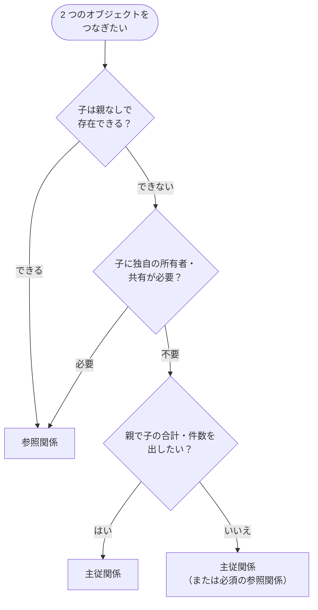

ひっかけ注意

- **参照関係を主従関係に変えるには**、すべての子レコードに親が入っている必要があります。空のレコードが 1 件でもあるとエラーになります。
- 1 つのオブジェクトに主従関係は **2 つまで**です。
- 「子の合計を親に表示したいが、関係は参照関係」→ 標準の積み上げ集計は使えません。主従関係に変えるか、Flow で集計します。
- 例外として、**取引先と商談**のような標準の親子関係では、取引先に商談の積み上げ集計を作れます。

### 3-3. 多対多：連結オブジェクト

「1 人の学生が複数の講座を受け、1 つの講座に複数の学生がいる」ような**多対多**の関係は、間に**連結オブジェクト**を作って表現します。

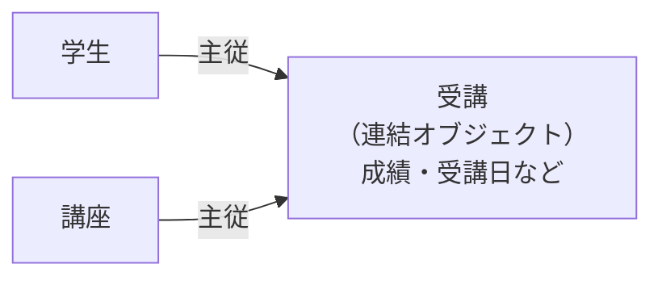

連結オブジェクトは**2 つの主従関係**を持ちます。連結オブジェクトには「成績」のような**その組み合わせだけの情報**を持たせられるのが利点です。

### 3-4. その他のリレーション

| 種類 | 内容 |
|---|---|
| **階層関係** | **ユーザーオブジェクト専用**の自己参照（「上司」など） |
| 自己参照 | 同じオブジェクトを参照（取引先の「親取引先」で企業グループを表すなど） |
| 外部参照・間接参照 | 外部オブジェクト（Salesforce Connect）とのつながり |

### 3-5. スキーマビルダー

オブジェクトとリレーションを**図で表示し、その場で作成・編集**できるツールです。組織全体のデータ構造をつかむのに便利です。

やってみよう（15 分）

1. 設定 → オブジェクトマネージャー → 「作成」→「カスタムオブジェクト」で「注文」を作る
2. もう 1 つ「注文明細」を作り、項目「注文」を**主従関係**（主＝注文）で作る
3. 注文明細に「金額」（通貨）項目を作る
4. 注文に「明細合計」を**積み上げ集計**（注文明細の金額の合計）で作る
5. 設定 → クイック検索「スキーマビルダー」で、2 つのオブジェクトのつながりを図で見てみる

---

## 4. 入力規則

### 4-1. 仕組み

入力規則は、**数式が TRUE（真）になったら保存をエラーにする**ルールです。

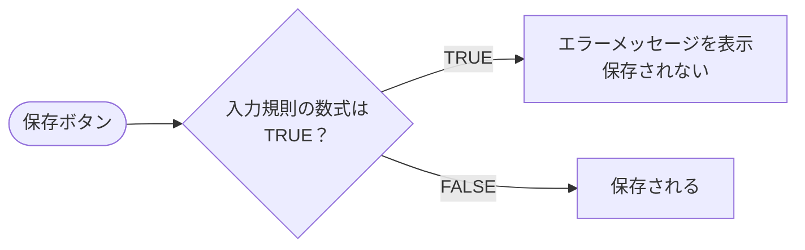

ひっかけ注意：「TRUE ＝ エラー」

入力規則は「正しい条件」ではなく「**エラーにしたい条件**」を書きます。ここを逆に読むと答えを間違えます。

`AND(ISPICKVAL(StageName, "Closed Won"), ISBLANK(Contract_No__c))`

→ 「フェーズが成立」**かつ**「契約番号が空」なら TRUE → エラー。
→ つまり「**成立するときは契約番号が必須**」という意味です。

### 4-2. よく使う関数

| 関数 | 意味 | 例 |
|---|---|---|
| `ISBLANK(項目)` | 空かどうか | 必須チェック |
| `ISPICKVAL(選択リスト, "値")` | 選択リストが特定の値か | フェーズの判定 |
| `ISCHANGED(項目)` | 項目が変更されたか | 変更を禁止する |
| `PRIORVALUE(項目)` | 変更前の値 | 値を下げることを禁止する |
| `ISNEW()` | 新規作成か | 新規のときだけチェック |
| `AND()`・`OR()`・`NOT()` | 条件の組み合わせ | — |
| `REGEX(項目, "パターン")` | 形式のチェック | 郵便番号の形式 |

なぜ「ページレイアウトの必須」ではなく入力規則なの？

ページレイアウトの必須は**その画面で入力するときだけ**効きます。データローダーや連携、別の画面からは空のまま保存できてしまいます。入力規則は**どの経路の保存でも**チェックされるので、本当に守りたいルールに使います。

また入力規則なら「**フェーズが成立のときだけ必須**」のような条件付きの必須も表現できます。

---

## 5. 画面の仕組み：ページレイアウトとレコードタイプ

### 5-1. ページレイアウト

**ページレイアウト**は、レコードの詳細画面に**どの項目・関連リスト・ボタンを、どの順で並べるか**を決めます。

- 項目を画面上だけ「必須」「参照のみ」にできる（**セキュリティではない**）
- 関連リストの列や並び順を決める
- ボタン・アクションを配置する

### 5-2. レコードタイプ

**レコードタイプ**は、同じオブジェクトの中で「種類」を分け、種類ごとに次の 3 つを切り替える仕組みです。

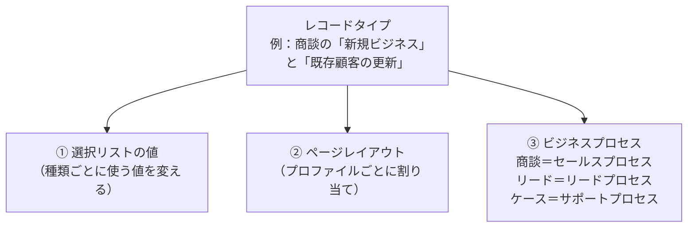

具体例

Cloud Kicks では、法人向けと個人向けで商談の進め方も画面も違います。

- レコードタイプ「法人」「個人」を作る
- 法人のセールスプロセスには「提案」「稟議」のフェーズ、個人には「試着」「購入」のフェーズ
- それぞれに別のページレイアウトを割り当てる

### 5-3. 割り当ての仕組み（超頻出）

ページレイアウトは「**プロファイル × レコードタイプ**」の組み合わせごとに割り当てます。

| | レコードタイプ：法人 | レコードタイプ：個人 |
|---|---|---|
| **営業プロファイル** | 法人営業レイアウト | 個人営業レイアウト |
| **サポートプロファイル** | サポート用レイアウト | サポート用レイアウト |

ユーザーがどのレコードタイプを使えるかは、**プロファイル（または権限セット）**で決めます。複数使える場合は、新規作成時にどれにするか選びます。

ひっかけ注意：ビジネスプロセスの対応

「フェーズ・状況の値を種類ごとに変えたい」問題では、オブジェクトとプロセスの組み合わせを正しく選びます。

| オブジェクト | 項目 | プロセス |
|---|---|---|
| 商談 | フェーズ | **セールスプロセス** |
| リード | リードの状況 | **リードプロセス** |
| ケース | 状況 | **サポートプロセス** |

手順は「プロセスを作る → レコードタイプに割り当てる → プロファイルにレコードタイプを割り当てる」です。

### 5-4. その他のレイアウト

| レイアウト | 決めること |
|---|---|
| **コンパクトレイアウト** | レコードページ上部の**強調表示パネル**と、**モバイルアプリ**でのレコード表示の主要項目 |
| 検索レイアウト | 検索結果や参照項目の候補に表示する列 |

---

## 6. Lightning アプリケーションビルダー

### 6-1. Lightning ページの種類

**Lightning アプリケーションビルダー**は、ドラッグ＆ドロップで画面を作るツールです。

| ページ | 内容 |
|---|---|
| **レコードページ** | 取引先や商談などのレコードの画面 |
| **ホームページ** | ログイン後の最初の画面 |
| **アプリケーションページ** | 特定の業務用の 1 枚の画面 |

画面には**コンポーネント**（レコードの詳細、関連リスト、レポートのグラフ、リッチテキスト、Flow など）を配置します。

### 6-2. ページレイアウトとの関係

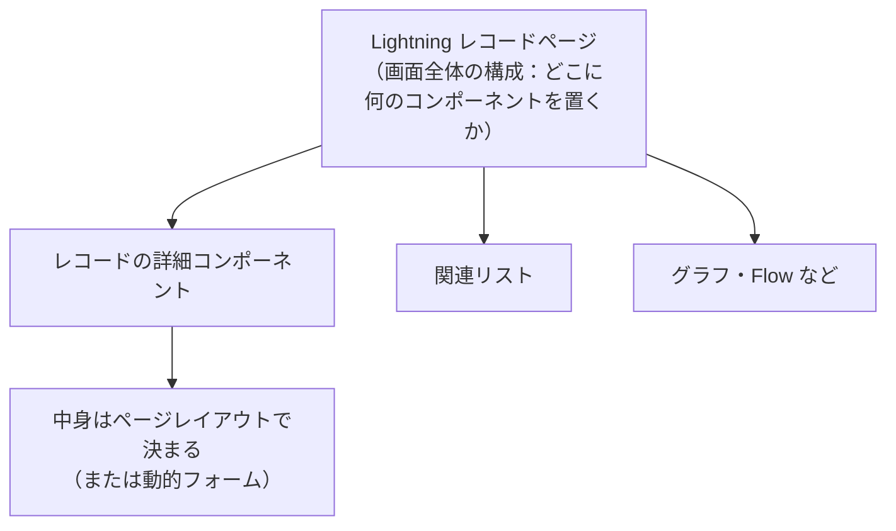

Lightning ページは「**画面全体の枠組み**」、ページレイアウトは「**詳細コンポーネントの中身**」と考えると整理できます。

### 6-3. Lightning ページの割り当て

Lightning レコードページは、次の段階で割り当てられます。下にいくほど細かく、優先されます。

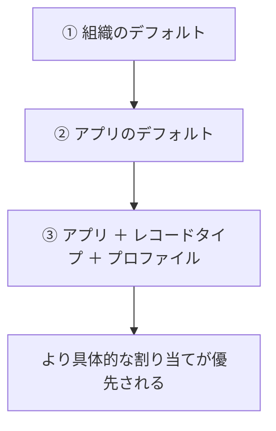

ひっかけ注意

Lightning ページの割り当ての条件は「**アプリ・レコードタイプ・プロファイル**」です。**ロールや権限セットでは割り当てられません**（ページの中のコンポーネントの表示条件なら、権限なども使えます）。

### 6-4. 表示を切り替える 3 つの「動的」機能

| 機能 | 何を切り替える？ | 例 |
|---|---|---|
| **コンポーネントの表示条件** | コンポーネントを出す／出さない | 未解決ケースが 5 件以上のときだけ警告を表示、スマホでは関連リストを隠す |
| **動的フォーム** | **項目単位**で出す／出さない | 優先度が「高」のときだけ「エスカレーション理由」項目を表示 |
| **動的アクション** | ボタン（アクション）を出す／出さない | フェーズが「交渉」のときだけ「値引き申請」ボタンを表示 |

表示条件には、**項目の値・デバイス（デスクトップ／電話）・ユーザーの権限やプロファイル**などを使えます。

なぜ動的フォームが便利なの？

以前は「条件によって表示項目を変えたい」とき、レコードタイプとページレイアウトを増やすしかありませんでした。動的フォームなら**1 つのページの中で条件付きに表示**できるので、レイアウトの数が増えず、管理がずっと楽になります。

ただし動的フォームの「表示しない」も**見た目の制御**です。データを守るには項目レベルセキュリティを使います。また、条件付きで**必須**にしたいなら入力規則を組み合わせます。

---

## 7. アクションとアプリ

### 7-1. アクション

アクションは、ボタン 1 つで「レコード作成」「更新」「メール送信」「Flow の起動」などを行う仕組みです。

| 種類 | どこで使える？ | 特徴 |
|---|---|---|
| **オブジェクト固有アクション** | 特定のオブジェクトのレコードページ | **関連レコード**を作ると、親との関連が自動で入る（取引先からケースを作ると、ケースの取引先が自動で入る） |
| **グローバルアクション** | どこからでも（ホーム、ユーティリティバー、モバイル） | 特定のレコードに関連づかない作成など |

アクションには、**定義済みの項目値**（作成時の既定値）を設定できます。

### 7-2. Lightning アプリ

**Lightning アプリ**は、業務に必要なタブ（ナビゲーション項目）、ユーティリティバー、ロゴ・色をまとめたものです。

| ナビゲーションの形式 | 特徴 |
|---|---|
| 標準ナビゲーション | 通常の画面。1 つずつレコードを開く |
| **コンソールナビゲーション** | タブとサブタブで複数のレコードを同時に開ける（サービスコンソールなど） |

アプリをどのプロファイルに表示するかを設定できます。

やってみよう（15 分）

1. 取引先のレコードを開き、歯車 →「編集ページ」で Lightning アプリケーションビルダーを開く
2. 「リッチテキスト」コンポーネントを置き、「重要顧客です」と入力する
3. コンポーネントの「表示条件を設定」で「年間売上 ≥ 100,000,000」を条件にする
4. 保存 →「有効化」で、組織のデフォルトに割り当てる
5. 年間売上が大きい取引先と小さい取引先で、表示が変わることを確認する

---

## 8. 総合演習：要件からの選び方

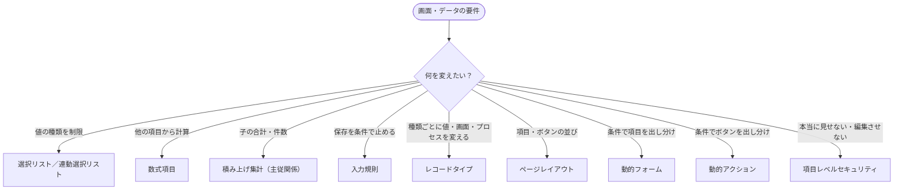

例題で確認

**問題**: ページレイアウトで「業種」を必須にしたのに、データローダーで業種が空のレコードが入った。なぜ？

**考え方**: ページレイアウトの必須は**画面上だけ**。どの経路でも必須にしたいなら、**項目の必須設定**か**入力規則**を使います。

## 9. まとめ

| テーマ | 覚えること |
|---|---|
| オブジェクト | まず標準オブジェクト。カスタムは API 名が `__c` |
| 項目 | 選択リストで値をそろえる。数式は計算・読み取り専用、積み上げ集計は子の集計 |
| リレーション | 主従＝強い（必須・削除連動・共有は主に従う・積み上げ集計可・2 つまで）、参照＝ゆるい |
| 多対多 | 2 つの主従関係を持つ連結オブジェクト |
| 入力規則 | TRUE ＝ エラー。どの経路の保存でも効く |
| レコードタイプ | 選択リストの値・ページレイアウト・ビジネスプロセスを切り替える |
| ページレイアウト | プロファイル × レコードタイプで割り当て。必須・参照のみは画面上だけ |
| Lightning ページ | アプリ・レコードタイプ・プロファイルで割り当て |
| 動的機能 | コンポーネントの表示条件・動的フォーム（項目）・動的アクション（ボタン） |
| アクション | オブジェクト固有＝関連レコードを作ると親が自動で入る、グローバル＝どこでも |

## 試験直前チェック

- [ ] 標準オブジェクトを優先する理由を言える
- [ ] 数式項目と積み上げ集計の違いを言える
- [ ] 主従関係と参照関係の違いを 5 つ言える
- [ ] 参照関係を主従関係に変えられない典型的な理由を言える
- [ ] 多対多の作り方を説明できる
- [ ] 入力規則の数式を見て、何を禁止しているか読める
- [ ] レコードタイプで切り替えられる 3 つを言える
- [ ] 商談・リード・ケースのビジネスプロセスの名前を言える
- [ ] Lightning ページの割り当て条件を言える
- [ ] 動的フォームと動的アクションの違いを言える
