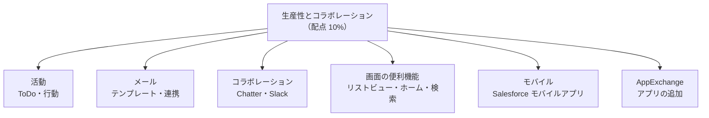
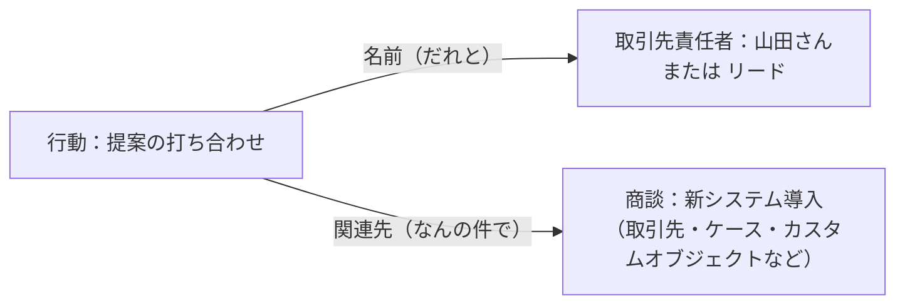
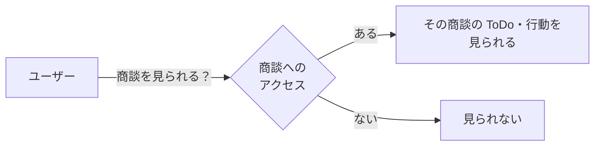
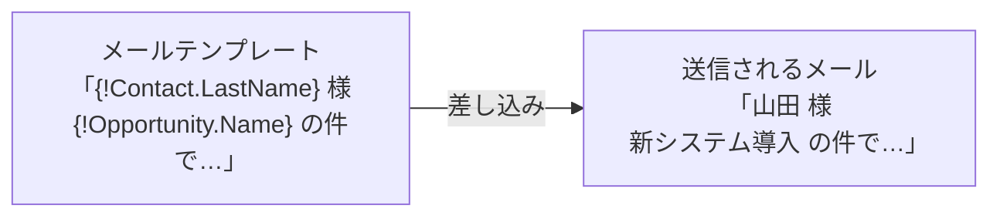
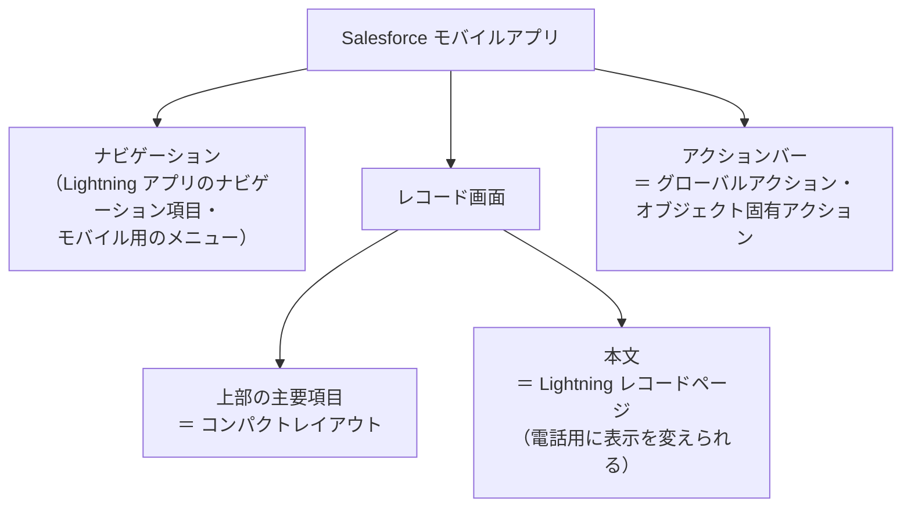
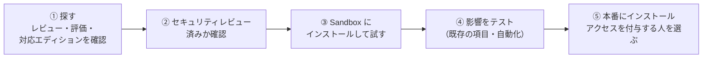

## はじめに：この範囲で学ぶこと

「生産性とコラボレーション」は配点 10% です。営業やサービスの「業務の中身」ではなく、**どの部門のユーザーも毎日使う共通の道具**を学びます。

---

## 1. 活動：ToDo と行動

### 1-1. ToDo と行動の違い

| | **ToDo** | **行動** |
|---|---|---|
| 意味 | やるべき作業 | 予定（カレンダーに入るもの） |
| 時間 | **期日**がある | **開始・終了の日時**がある |
| 例 | 「見積を送る（金曜まで）」 | 「ユニバーサル社と打ち合わせ（10 時〜11 時）」 |

どちらも**繰り返し**（毎週月曜など）を設定できます。

### 1-2. 「名前」と「関連先」

活動は 2 種類のレコードに紐づけられます。

| 紐づけ先 | 何を表す？ | 選べるもの |
|---|---|---|
| **名前** | **誰と**の活動か | 取引先責任者、リード |
| **関連先** | **何の件**の活動か | 取引先、商談、ケース、キャンペーン、カスタムオブジェクトなど |

ポイント：共有活動

標準では、1 つの行動の「名前」には 1 人しか入れられません。**共有活動**を有効にすると、**1 つの ToDo や行動に複数の取引先責任者**を関連づけられます（例: 顧客側の 3 人が参加する打ち合わせ）。

### 1-3. 活動を見られるのは誰？

活動の共有は「**親による制御**」が基本です。つまり**関連先のレコードを見られる人が、その活動を見られます**。

さらにロール階層の上位者は、部下が所有する活動を見られます。行動には「**非公開**」の設定もあり、本人以外には詳細を見せないこともできます。

### 1-4. 活動タイムライン

レコードページの**活動タイムライン**に、過去と今後の ToDo・行動・メール・電話の記録が時系列で表示されます。

---

## 2. メール

### 2-1. Lightning メールテンプレート

- **差し込み項目**で、宛先やレコードの値を自動で入れる
- **フォルダ**で共有範囲を管理する（営業部だけに共有など）
- 「**レターヘッド**」（Enhanced Letterhead）でヘッダー・フッターをそろえる

### 2-2. メールを送る・記録する機能

| 機能 | 内容 |
|---|---|
| **リストメール** | リストビューで選んだ取引先責任者・リードに**一斉送信**（1 日の上限あり） |
| **Outlook／Gmail 連携** | メールソフトから Salesforce のレコードを見て、メールを記録する |
| **Einstein 活動キャプチャ** | メールと予定を**自動で取り込み**、関連するレコードの活動タイムラインに表示する |
| **メール配信設定** | 組織がメールを送るかどうかのアクセスレベル（すべてのメール／システムメールのみ／アクセスなし） |

ひっかけ注意

「**Sandbox でメール通知が届かない**」→ Sandbox を作ると、メール配信設定が「**システムメールのみ**」になっていることがあります。本番の顧客に間違ってメールを送らないための安全策です。テストするには「すべてのメール」に変えます。

なぜ Einstein 活動キャプチャが勧められるの？

営業担当にとって「メールを Salesforce に記録する」作業は面倒で、続きません。記録がないと、マネージャーは顧客とのやり取りが分からず、AI もデータを学習できません。自動で取り込めば、**入力の手間をゼロにして、データだけが貯まる**ようになります。

---

## 3. コラボレーション：Chatter と Slack

### 3-1. Chatter

**Chatter** は Salesforce の中の社内 SNS です。

| 機能 | 内容 |
|---|---|
| フィード | レコード・グループ・個人のタイムライン |
| **@メンション** | 人やグループに呼びかける（通知が届く） |
| フォロー | レコードや人をフォローすると、その更新が自分のフィードに流れる |
| **フィード追跡** | 指定した項目の**変更をフィードに自動投稿**する（例: 商談のフェーズが変わったら投稿） |
| **Chatter グループ** | テーマごとのグループ |

#### Chatter グループの種類

| 種類 | 投稿を見られる人 | 参加方法 |
|---|---|---|
| 公開 | 誰でも | 誰でも参加できる |
| **非公開** | メンバーだけ | 参加を申請し、オーナーが承認 |
| **一覧に表示しない** | メンバーだけ（グループの存在も見えない） | 招待のみ |

ひっかけ注意

**Chatter グループは、レコードの共有ルールの共有先にはできません**。レコードを共有したいなら**公開グループ**を使います（名前が似ているので混同しやすい）。

### 3-2. Slack 連携

Salesforce と Slack をつなぐと、Slack の中で商談やケースの通知を受けたり、レコードを確認・更新したりできます。Salesforce の画面を開かずに素早く情報共有できるのが利点です。

---

## 4. 画面の便利機能

### 4-1. リストビュー

**リストビュー**は、条件で絞り込んだレコードの一覧です。

| 機能 | 内容 |
|---|---|
| 条件 | 「自分の商談」「今月完了予定」など |
| **表示範囲** | **自分のみ／すべてのユーザー／特定のグループ（公開グループ・ロールなど）** |
| **インライン編集** | 一覧のまま値を編集（条件あり） |
| **カンバン表示** | 選択リストの値（フェーズなど）ごとの列に並べ、**ドラッグで更新** |
| 分割ビュー | 一覧とレコードを並べて表示 |
| グラフ | 一覧の内容を簡単なグラフで表示 |

### 4-2. ホームページと検索

| 機能 | 内容 |
|---|---|
| **ホームページ** | Lightning アプリケーションビルダーで作り、**アプリやプロファイルごと**に割り当てる |
| グローバル検索 | 画面上部の検索窓。組織全体を検索 |
| お気に入り | よく使うレコードやリストを星印で登録 |
| ユーティリティバー | 画面下のツール（メモ、最近使ったデータなど） |

### 4-3. アプリ内ガイダンス

画面の上に**プロンプト**（短い案内）や**ウォークスルー**（手順の案内）を表示して、新しい機能の使い方をその場で教える機能です。トレーニングの補助に使います。

---

## 5. Salesforce モバイルアプリ

### 5-1. モバイルで何が表示されるか

| 部分 | 決めるもの |
|---|---|
| **コンパクトレイアウト** | レコードを開いたときに最初に見える主要項目（デスクトップの強調表示パネルにも使われる） |
| **アクション** | モバイルのアクションバーに表示される（訪問記録の作成など） |
| **コンポーネントの表示条件** | 「電話」のときだけ表示・非表示を切り替えられる |

具体例

外出先の営業担当が、スマホから 1 タップで訪問記録を残したい。訪問記録はどのレコードにも関連づけない。→ **グローバルアクション**で「訪問記録の作成」を作り、モバイルのナビゲーションやアクションバーに配置します。

---

## 6. AppExchange

### 6-1. AppExchange とは

**AppExchange** は Salesforce の公式マーケットプレイスです。アプリ、コンポーネント、Flow のテンプレート、コンサルティング会社などを探せます。

### 6-2. 導入の手順

| ポイント | 内容 |
|---|---|
| まず Sandbox | 本番の設定やデータへの影響を確かめてから本番に入れる |
| アクセスの付与 | インストール時に「管理者のみ」「すべてのユーザー」「特定のプロファイル」を選べる |
| **管理パッケージ** | 提供元が管理する。中身（コード）は変更できず、**アップグレードは提供元から配信**される |
| 非管理パッケージ | 中身を自由に変更できるが、アップグレードはされない（主にテンプレートや見本） |

### 6-3. AgentExchange

**AgentExchange** は、Agentforce 向けの**エージェントのテンプレート、アクション、トピック（サブエージェント）、プロンプトテンプレート**などを探せるマーケットプレイスです（AppExchange の一部として提供）。

| 使いどころ | 例 |
|---|---|
| エージェントをゼロから作らずに始めたい | 業界・業務向けのエージェントのテンプレートを入れる |
| 外部サービスとつながるアクションがほしい | パートナーが提供するアクションを入れる |
| よく使うプロンプトを再利用したい | 公開されているプロンプトテンプレートを入れて自社用に調整 |

- **出品（公開）できるのは、Salesforce のパートナー（ISV など）**で、セキュリティレビューなどの審査を通ったものが掲載されます。
- 入れたものは、AppExchange のアプリと同じく**まず Sandbox で試し**、プロンプトや指示を自社の業務に合わせて調整してから本番で使います。

なぜ「まず Sandbox」なの？

AppExchange のアプリは、項目やオブジェクト、自動化を組織に追加します。既存の設定と名前がぶつかったり、既存の Flow と同時に動いて想定外の結果になったりすることがあります。本番でいきなり試すと業務が止まる危険があるので、**本番のコピーである Sandbox で確認**します。

やってみよう（15 分）

1. 商談のリストビューを開き、表示を「カンバン」に切り替えて、商談をドラッグしてフェーズを変えてみる
2. 設定 → 「フィード追跡」→ 商談を選び、「フェーズ」の追跡を有効にする。商談のフェーズを変えて、フィードに投稿されることを確認する
3. 設定 → 「グローバルアクション」で、ToDo を作成するアクションを作る
4. AppExchange のサイトで「無料」「Lightning 対応」で絞り込み、アプリの詳細ページで「セキュリティレビュー」や対応エディションの表示を見てみる（インストールは不要）

---

## 7. 総合演習：要件からの選び方

| 要件 | 機能 |
|---|---|
| 1 つの打ち合わせに顧客側の複数人を紐づけたい | 共有活動 |
| 定型メールを差し込み付きで送りたい | Lightning メールテンプレート |
| 一覧から複数の人に同じメールを送りたい | リストメール |
| メールと予定を自動で記録したい | Einstein 活動キャプチャ |
| Sandbox でメールが届かない | メール配信設定（システムメールのみ → すべてのメール） |
| 項目の変更をフォロワーに知らせたい | フィード追跡 |
| 承認制で、メンバー以外に投稿を見せないグループ | 非公開の Chatter グループ |
| フェーズの列に並べてドラッグで更新 | カンバン表示 |
| 特定の部署だけに見えるリストビュー | リストビューの表示範囲（公開グループ） |
| モバイルで最初に見える項目を変えたい | コンパクトレイアウト |
| どこからでも使える作成ボタン | グローバルアクション |
| 新しいアプリを安全に試したい | AppExchange のアプリを Sandbox にインストール |

## 8. まとめ

| テーマ | 覚えること |
|---|---|
| 活動 | ToDo＝期日、行動＝日時。名前＝誰と、関連先＝何の件。共有は関連先に従う |
| メール | テンプレートはフォルダで共有。Sandbox はシステムメールのみに注意 |
| Chatter | フィード追跡で項目の変更を投稿。Chatter グループは共有ルールに使えない |
| リストビュー | 表示範囲、インライン編集、カンバン |
| モバイル | コンパクトレイアウト・アクション・電話用の表示条件 |
| AppExchange | まず Sandbox。管理パッケージは変更不可・アップグレードは提供元から |

## 試験直前チェック

- [ ] ToDo と行動、名前と関連先の違いを言える
- [ ] 共有活動で何ができるか言える
- [ ] 活動を見られるのが誰かを説明できる
- [ ] Sandbox でメールが届かない原因を言える
- [ ] Chatter グループの 3 種類の違いを言える
- [ ] フィード追跡で何ができるか言える
- [ ] コンパクトレイアウトが使われる場所を 2 つ言える
- [ ] AppExchange のアプリを導入する手順を言える
- [ ] 管理パッケージと非管理パッケージの違いを言える
- [ ] AgentExchange で手に入るものと、出品できる人を言える
