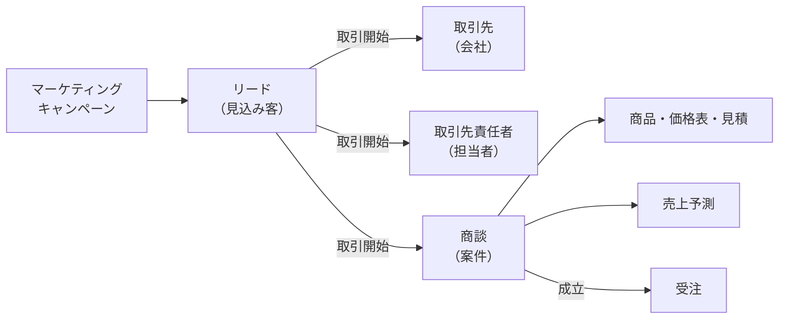
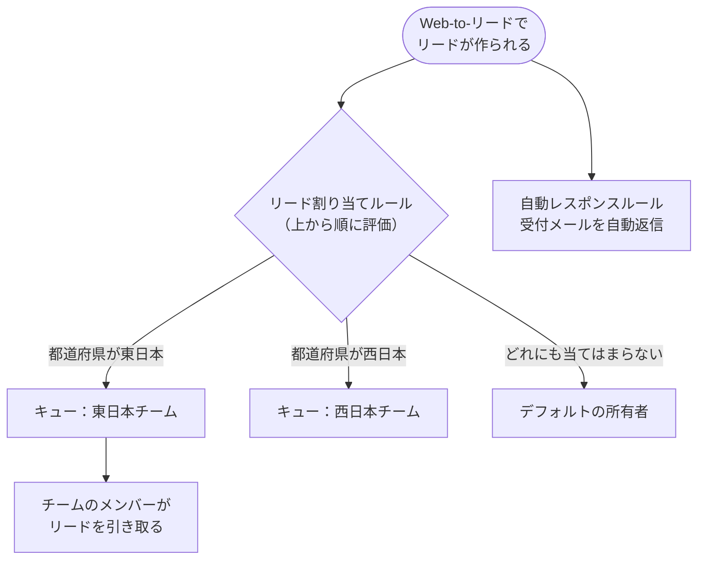
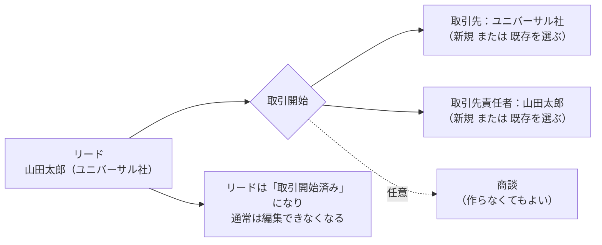
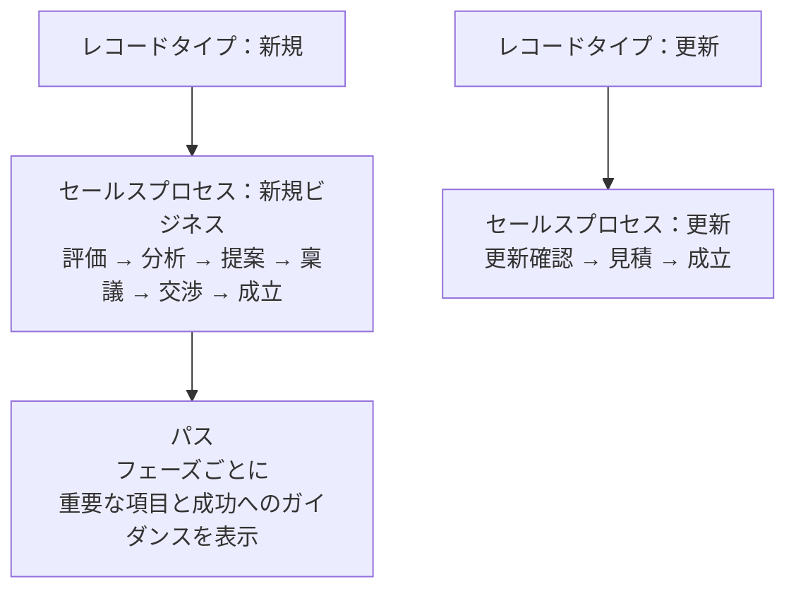
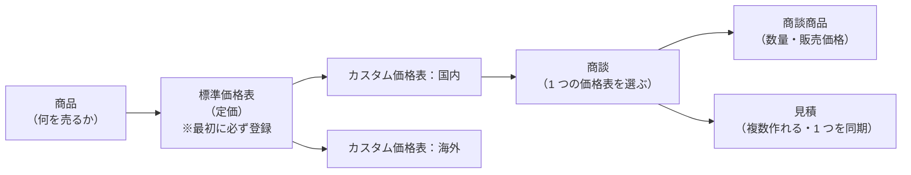
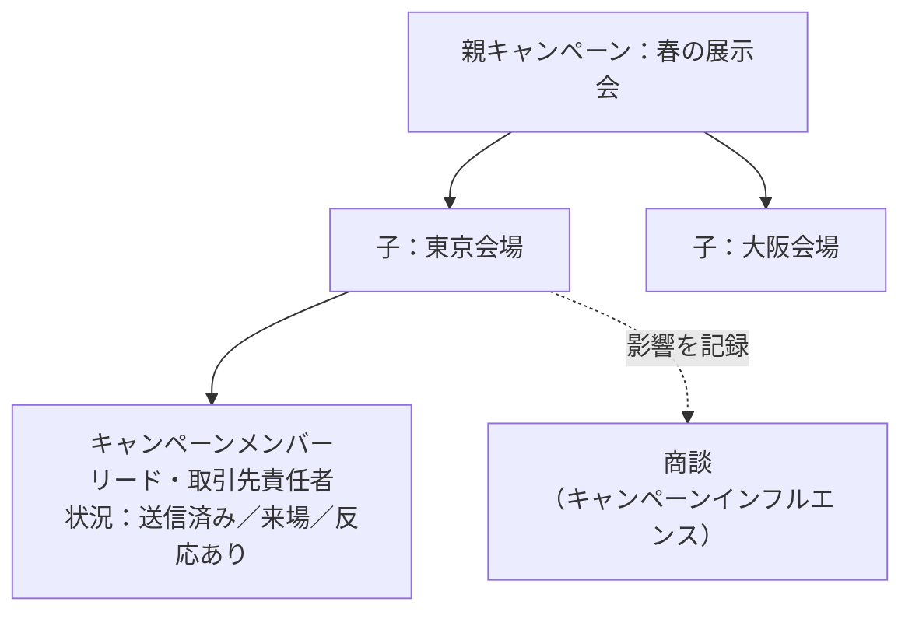
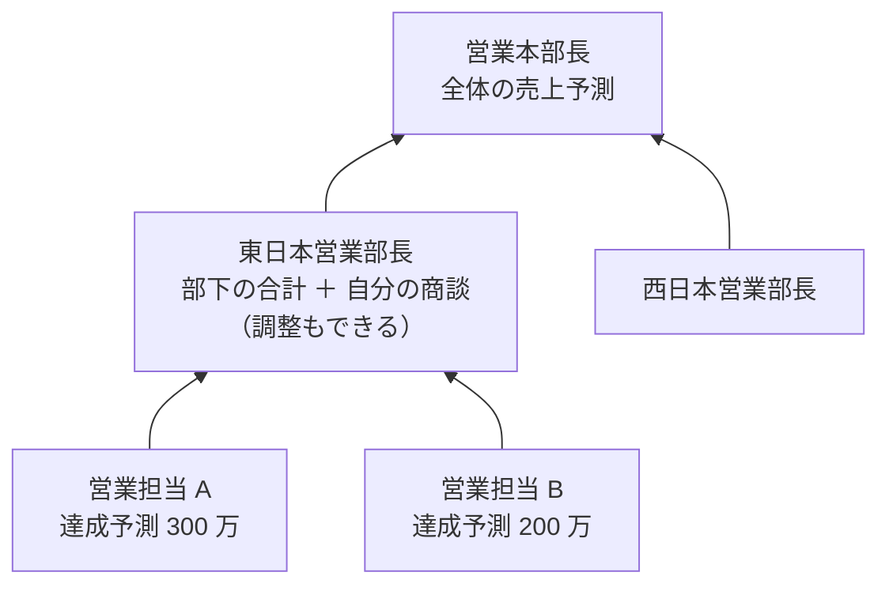

## はじめに：この範囲で学ぶこと

「営業・マーケティングアプリケーション」は配点 10% です。営業の仕事の流れに沿って、Salesforce のどの機能を使うかを学びます。

用語の整理

| 用語 | 意味 | 例 |
|---|---|---|
| **リード** | まだ評価していない見込み客 | 展示会で名刺を交換した人 |
| **取引先** | 取引のある（またはしたい）会社 | 株式会社ユニバーサル |
| **取引先責任者** | 取引先の担当者 | 株式会社ユニバーサルの山田さん |
| **商談** | 受注を目指す具体的な案件 | 「ユニバーサル社 新システム導入 500 万円」 |

---

## 1. リード：見込み客を管理する

### 1-1. なぜリードと取引先を分けるの？

なぜ？

展示会で集めた名刺には、本当に買う気のある人もいれば、情報収集だけの人もいます。最初から全員を取引先・取引先責任者として登録すると、**取引先の一覧が「見込みの薄い会社」で埋まってしまいます**。

そこで、まだ評価していない人は「リード」として別に管理し、**営業する価値があると判断した時点で「取引開始」**して取引先・取引先責任者・商談に変えます。これで取引先のデータをきれいに保てます。

### 1-2. リードの入り口

| 方法 | 内容 |
|---|---|
| **Web-to-リード** | Web サイトのお問い合わせフォームから自動でリードを作る。HTML フォームを Salesforce が生成してくれる。**1 日に作れる件数に上限がある** |
| データのインポート | 展示会の名簿などをデータインポートウィザードで取り込む |
| 手動 | 営業担当が入力する |
| マーケティングツール連携 | Marketing Cloud Account Engagement などから連携 |

### 1-3. リードの割り当てとキュー

| 機能 | 内容 |
|---|---|
| **リード割り当てルール** | 条件に応じてユーザーかキューに割り当てる。**有効にできるルールは 1 つ**（1 つのルールの中に複数の条件エントリを並べる）。条件は**上から順に評価され、最初に一致したもの**で割り当てる |
| **キュー** | 複数人で共有する「置き場所」。キューのメンバーがレコードを引き取る |
| **自動レスポンスルール** | Web-to-リードで作られたリードに、受付メールを自動で送る |

ひっかけ注意

- 割り当てルールは「**有効なルールは 1 つ**」。2 つのルールを同時に有効にする選択肢は誤りです。
- 条件エントリの**順番**が大事です。広い条件を上に置くと、下の細かい条件まで届きません。

### 1-4. リードの状況とリードプロセス

リードには「未対応」「対応中」「評価済み」「不適格」などの**リードの状況**があります。レコードタイプごとに使う値を変えたいときは**リードプロセス**を使います（商談のセールスプロセスと同じ考え方）。

### 1-5. リードの取引開始（コンバート）

リードを評価して営業する価値があると判断したら、**取引開始**します。

| ポイント | 内容 |
|---|---|
| 作られるもの | **取引先・取引先責任者**（必ず）、**商談**（任意） |
| 既存のレコード | 既存の取引先・取引先責任者を選んで紐づけられる（重複を防ぐ） |
| 項目の引き継ぎ | 標準項目は自動。**カスタム項目は「リード項目の対応付け」で設定**すると引き継がれる |
| 取引開始後のリード | 削除されず「取引開始済み」として残る。活動やキャンペーンの履歴も引き継がれる |

ひっかけ注意

「リードのカスタム項目の値が、取引開始後に取引先責任者に入らない」→ **リード項目の対応付け**を設定していないのが原因です。対応付けるには、**データ型が互換**のカスタム項目が両方に必要です。

### 1-6. 重複を防ぐ

| 機能 | 役割 |
|---|---|
| **一致ルール** | 「何をもって同じとみなすか」（例: メールアドレスが同じ、会社名と電話が似ている） |
| **重複ルール** | 一致したときにどうするか（**警告**か**ブロック**か）。別のオブジェクト（リードと取引先責任者など）と比較もできる |

---

## 2. 取引先と取引先責任者

### 2-1. 法人取引先と個人取引先

| | 法人取引先 | **個人取引先** |
|---|---|---|
| 対象 | 会社（BtoB） | 個人のお客様（BtoC） |
| 構造 | 取引先（会社）と取引先責任者（担当者）が別 | 1 つのレコードに会社と人の情報をまとめる |
| 注意 | — | **一度有効にすると無効にできない** |

### 2-2. 取引先の便利な機能

| 機能 | 内容 |
|---|---|
| **取引先階層（親取引先）** | 親会社・子会社の関係を表す。グループ全体の状況をつかめる |
| **取引先チーム** | 取引先ごとに担当者の役割（営業、技術、サポート）とアクセスを設定 |
| **取引先と取引先責任者のリレーション** | 1 人の取引先責任者を複数の取引先に関連づける（顧問、兼任の取締役など） |

---

## 3. 商談：案件を管理する

### 3-1. フェーズ・確度・売上予測分類

商談は、**フェーズ**（進み具合）で管理します。フェーズの各値には**確度**と**売上予測分類**が設定されています。

| フェーズ（例） | 確度 | 売上予測分類 |
|---|---|---|
| 見込み客の評価 | 10% | パイプライン |
| ニーズの分析 | 20% | パイプライン |
| 提案 | 50% | 最善達成予測 |
| 交渉 | 80% | 達成予測 |
| 成立 | 100% | 完了 |
| 不成立 | 0% | 売上予測から除外 |

フェーズを変えると、確度が**初期値として自動で入ります**（編集権限があれば手で変更もできます）。

### 3-2. セールスプロセスとパス

| 機能 | 内容 |
|---|---|
| **セールスプロセス** | レコードタイプごとに使う**フェーズの値**を選ぶ |
| **パス** | 画面上部に矢印でフェーズを表示し、各フェーズで入力すべき**重要な項目**と**成功へのガイダンス**（コツ）を表示する |

なぜパスが大事なの？

営業担当によって「提案」の意味がバラバラだと、パイプラインや売上予測が信用できなくなります。パスで「このフェーズでは予算と決裁者を確認する」と画面に示すと、全員が同じ基準で営業を進められます。

さらに入力を**強制**したいなら、入力規則で「提案に進むには予算が必須」と組み合わせます。パスのガイダンスは表示だけで、強制力はありません。

### 3-3. 商談チームと商談分割

| 機能 | 内容 |
|---|---|
| **商談チーム** | 商談に関わるメンバー（プリセールス、エンジニアなど）と役割・アクセスを記録 |
| **商談分割** | 売上（または貢献度）をメンバー間で配分する（例: 営業 70%、プリセールス 30%）。売上予測にも反映できる |
| **商談の取引先責任者の役割** | 顧客側の担当者の役割（意思決定者、影響者など）を商談ごとに記録 |
| **大規模商談アラート** | 金額と確度の条件を満たしたら、指定した人にメールで通知 |

---

## 4. 商品・価格表・見積

### 4-1. 仕組み

| 用語 | 内容 |
|---|---|
| **商品** | 販売する商品やサービス |
| **標準価格表** | すべての商品の定価。**商品はまず標準価格表に登録する**必要がある |
| **カスタム価格表** | 販売先や地域ごとの価格（国内用、海外用、代理店用など） |
| **価格表エントリ** | 「この価格表で、この商品はいくら」という 1 行 |
| **商談商品** | 商談で販売する商品と数量・価格 |
| **スケジュール** | 数量・売上を期間に分割（月額サービスなど） |

ひっかけ注意

「新しく作った商品が商談で選べない」→ その商品が**商談で選んでいる価格表に登録されていない**（または有効になっていない）のが原因です。手順は「標準価格表に登録 → カスタム価格表に登録」です。

### 4-2. 見積

- 商談から**見積**を作れる。1 つの商談に**複数の見積**を作れる（A 案・B 案など）
- そのうち **1 つだけを「同期」**すると、見積の明細と商談商品が連動する
- 見積テンプレートで **PDF** を作り、メールで送れる
- 複雑な価格ルールや製品構成が必要なら **Revenue Cloud（CPQ）** を検討する

---

## 5. キャンペーン：マーケティング施策を管理する

### 5-1. 仕組み

| 機能 | 内容 |
|---|---|
| **キャンペーン** | 展示会、メール配信、セミナーなどの施策。予算・実績のコスト・期待収益を記録 |
| **キャンペーンメンバー** | キャンペーンに関わった**リードまたは取引先責任者**と、その**メンバー状況**（送信済み、反応ありなど） |
| **キャンペーン階層** | 親子関係を作り、親で子の合計を見られる |
| **キャンペーンインフルエンス** | 商談にどのキャンペーンが影響したかを記録し、貢献度を分析 |

ひっかけ注意

- キャンペーンを作成・編集するには、ユーザーレコードの「**マーケティングユーザー**」にチェックが必要です。
- キャンペーンメンバーになれるのは**リードと取引先責任者**（と個人取引先）です。商談やケースはメンバーになれません。

---

## 6. 売上予測（Collaborative Forecasts）

### 6-1. 仕組み

| ポイント | 内容 |
|---|---|
| 積み上がり方 | **ロール階層**（またはテリトリー階層）に沿って上司に積み上がる |
| 何が含まれる？ | 商談の**売上予測分類**（パイプライン・最善達成予測・達成予測・完了）で決まる |
| 期間 | **会計年度**の設定に従う（月別・四半期別） |
| **売上予測種別** | 商談の金額・数量、商品ファミリー別、商談分割、カスタム項目など |
| **調整** | マネージャーが部下の予測を自分の見立てで上書きできる。**元の値は残る** |
| **売上目標（ノルマ）** | 目標を設定すると達成率を表示できる |

なぜマネージャーの「調整」が別に記録されるの？

営業担当は楽観的・悲観的に予測しがちです。マネージャーは経験から「この案件は来月にずれそう」と判断し、自分の予測として調整します。担当者の数字を消してしまうと、後で「誰の見立てが正しかったか」を振り返れません。だから**元の値と調整後の値を両方残す**のです。

### 6-2. テリトリー管理（概要）

地域・業種・規模などの**ルールで取引先をテリトリーに割り当て**、テリトリーのメンバーにアクセスと売上予測を与える仕組みです（Enterprise Territory Management）。ロール階層とは**別の階層**で、1 つの取引先を複数のテリトリーに割り当てられます。詳しくは Sales Consultant 資格で学びます。

やってみよう（20 分）

1. リードを 1 件作り、「取引開始」を押す。商談を作らない選択もできることを確認する
2. 設定 → 「商品」で商品を作り、「標準価格」を追加する
3. 「価格表」でカスタム価格表を作り、その商品を追加する
4. 商談を開き、「商品」関連リストで価格表を選んで商品を追加する
5. 設定 → 「パス」で商談のパスを作り、「提案」フェーズに重要な項目とガイダンスを追加する

---

## 7. 総合演習：要件からの選び方

| 要件 | 機能 |
|---|---|
| Web フォームから見込み客を登録 | Web-to-リード |
| 地域ごとに担当チームへ自動で振り分け | リード割り当てルール＋キュー |
| 問い合わせに受付メールを自動返信 | 自動レスポンスルール |
| リードのカスタム項目を取引開始時に引き継ぐ | リード項目の対応付け |
| 新規と更新で商談のフェーズを変える | セールスプロセス＋レコードタイプ |
| フェーズごとのコツを画面に表示 | パス |
| 売上をメンバーで配分 | 商談チーム＋商談分割 |
| 地域ごとに違う価格 | カスタム価格表 |
| 施策がどの受注に貢献したか | キャンペーンインフルエンス |
| マネージャーが部下の予測を補正 | Collaborative Forecasts の調整 |

## 8. まとめ

| テーマ | 覚えること |
|---|---|
| リード | 評価前の見込み客を分けて管理し、取引先データをきれいに保つ |
| 割り当てルール | 有効は 1 つ、上から順に評価 |
| 取引開始 | 取引先・取引先責任者は必須、商談は任意。カスタム項目は対応付けが必要 |
| 個人取引先 | BtoC 用。無効に戻せない |
| 商談 | フェーズ → 確度・売上予測分類。セールスプロセスで種類ごとに変える |
| 商品 | 商品 → 標準価格表 → カスタム価格表 → 商談商品 |
| 見積 | 複数作れて、同期は 1 つ |
| キャンペーン | マーケティングユーザーが必要。メンバーはリードと取引先責任者 |
| 売上予測 | ロール階層で積み上がる。調整しても元の値は残る |

## 試験直前チェック

- [ ] リードと取引先を分ける理由を言える
- [ ] 割り当てルールの「有効は 1 つ」「上から評価」を説明できる
- [ ] 取引開始で作られるレコードと、項目の引き継ぎ方を言える
- [ ] フェーズに設定されている 2 つの値を言える
- [ ] セールスプロセスとパスの役割の違いを言える
- [ ] 商品が商談で選べないときの原因を言える
- [ ] キャンペーンを作れないときに確認すべき設定を言える
- [ ] キャンペーンメンバーになれるものを言える
- [ ] 売上予測が何に沿って積み上がるかを言える
