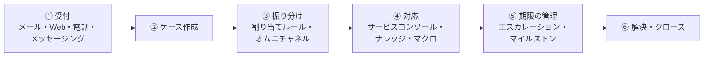
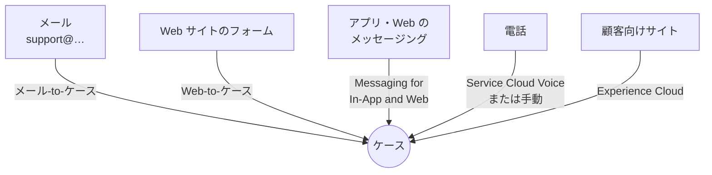
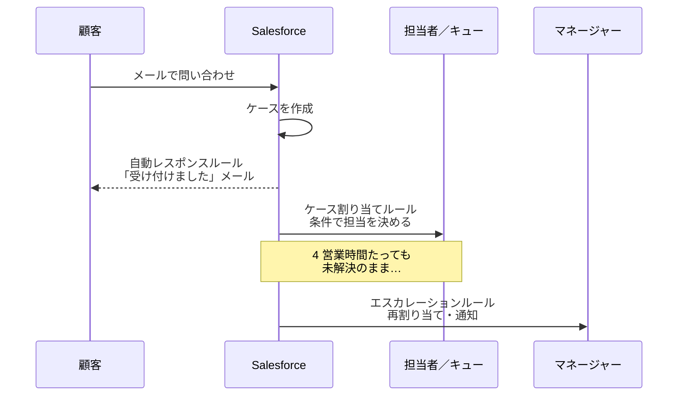
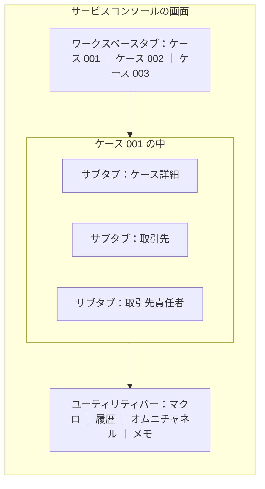
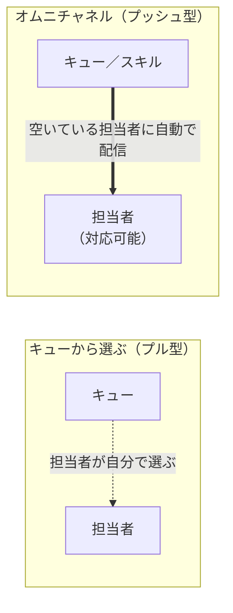
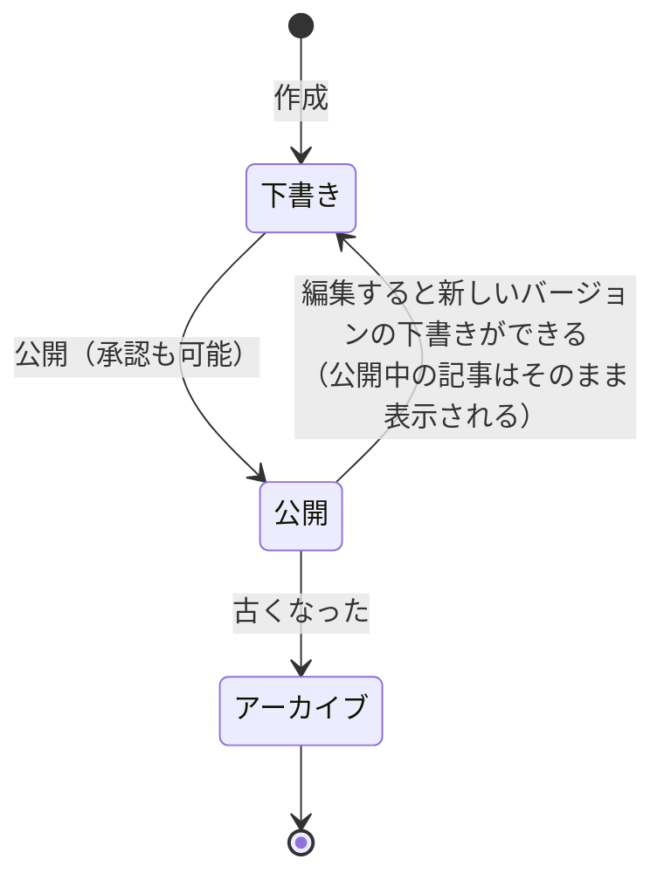
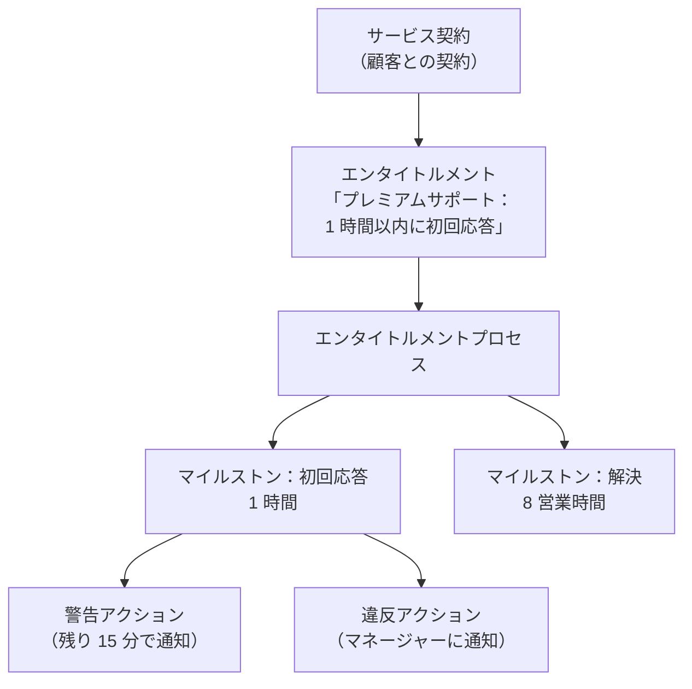

## はじめに：この範囲で学ぶこと

「サービス・サポートアプリケーション」は配点 10% です。お客様の問い合わせ対応の流れに沿って学びます。

用語：ケースとは

**ケース**は、お客様からの 1 件の問い合わせ・相談・苦情を表すレコードです。「状況」（新規 → 対応中 → 解決済み → クローズ）で進み具合を管理します。

---

## 1. 受付：ケースの入り口

| 方法 | 内容 | ポイント |
|---|---|---|
| **メール-to-ケース** | サポート用アドレスに届いたメールからケースを作る | **オンデマンド**版は、Salesforce が用意するアドレスに転送するだけで使える（社内にソフトウェア不要）。返信は同じケースに紐づく |
| **Web-to-ケース** | Web サイトのフォームからケースを作る | HTML フォームを生成。**1 日の上限**あり。スパム対策に reCAPTCHA |
| メッセージング | アプリや Web に組み込んだチャットのような会話 | 途中で離れても後から続けられる |
| 電話 | Service Cloud Voice などで電話をコンソールに統合 | — |
| 顧客向けサイト | Experience Cloud のヘルプセンターで顧客が自分で起票 | ナレッジ検索とセット |

---

## 2. 振り分けと自動化のルール

### 2-1. 3 つのルールの違い（超頻出）

名前が似ている 3 つのルールを、**いつ・何をするか**で区別しましょう。

| ルール | いつ動く？ | 何をする？ |
|---|---|---|
| **ケース割り当てルール** | ケースが作られたとき | 条件でユーザーやキューに**割り当てる**。有効なルールは 1 つ、上から順に評価 |
| **自動レスポンスルール** | メールや Web からケースが作られたとき | お客様に**受付メールを自動返信**する。最初に一致した条件のテンプレートを使う |
| **エスカレーションルール** | 一定時間がたっても条件を満たしているとき | **再割り当て**や**通知**で上の人に上げる。**営業時間**を考慮できる |

ひっかけ注意

- 「受付メールを送りたい」→ **自動レスポンスルール**（割り当てルールではない）
- 「時間がたったら上長に」→ **エスカレーションルール**
- 「状況が解決済みになったらアンケートを送りたい」→ どの 3 つでもなく、**レコードトリガーフロー**（自動化のレッスン）

### 2-2. キューとケースチーム

| 機能 | 内容 |
|---|---|
| **キュー** | 「一般サポート」「上級サポート」などの**置き場所**。キューがケースを所有し、メンバーが引き取る（またはオムニチャネルで配信） |
| **ケースチーム** | 1 件のケースに複数の担当者と**役割**（技術担当、営業担当など）・アクセスを設定 |

### 2-3. サポートプロセス

ケースの「状況」の値を種類ごとに変えたいときは、**サポートプロセス**を作って**レコードタイプ**に割り当てます。商談のセールスプロセス、リードのリードプロセスと同じ考え方です。

---

## 3. 対応：サービスコンソールと効率化の道具

### 3-1. サービスコンソール

**サービスコンソール**は、サポート担当者が**複数のケースを同時に**、関連する情報と一緒に扱えるアプリです。

なぜコンソールが必要なの？

電話中のサポート担当者は、ケース・顧客の情報・過去の問い合わせ・ナレッジ記事を**行ったり来たり**します。通常の画面では 1 つずつ開き直すことになり、お客様を待たせてしまいます。コンソールなら**タブとサブタブで全部を開いたまま**切り替えられるので、対応時間が短くなります。

### 3-2. 効率化の道具

| 機能 | 内容 | 例 |
|---|---|---|
| **マクロ** | 複数の操作を**ワンクリック**で実行 | 「返信メールを送って、状況を回答待ちにする」 |
| **クイックテキスト** | 定型文を挿入 | 「お問い合わせありがとうございます」 |
| メールテンプレート | 差し込み項目つきの定型メール | 解決のお知らせ |
| 画面フロー | 手順をガイドする画面 | 返品受付の手順 |

ひっかけ注意

マクロとクイックテキストの違い：**マクロは「複数の操作」**、クイックテキストは「**文章の挿入だけ**」です。「メールを送って項目も更新する」ならマクロ。

---

## 4. オムニチャネル：自動で配信する

### 4-1. 「選ぶ」から「届く」へ

なぜオムニチャネルを使うの？

キューから担当者が自分で選ぶ方式だと、**簡単な案件ばかり選ばれて難しい案件が残る**、特定の人に仕事が偏る、といった問題が起きます。オムニチャネルは、**対応可能で、余裕のある担当者に自動で配信**するので、公平で速くなります。

### 4-2. オムニチャネルの仕組み

| 要素 | 内容 |
|---|---|
| **プレゼンス状況** | 担当者が「対応可能」「休憩中」などを切り替える。**対応可能の人にだけ配信** |
| **容量** | 担当者が同時に扱える量（例: チャット 3 件、または電話 1 件） |
| **ルーティング設定** | 優先度や配信の方法を決める |
| **キューベース** | キューのメンバーに配信 |
| **スキルベース** | 言語や製品などの**スキル**を持つ担当者に配信 |
| **オムニチャネルスーパーバイザー** | マネージャーが待ち状況と担当者の状態をリアルタイムで見る |

ひっかけ注意

「オムニチャネルで作業が配信されない」→ まず担当者の**プレゼンス状況が「対応可能」になっているか**を確認します。

---

## 5. ナレッジ：答えを共有する

### 5-1. Lightning ナレッジ

**ナレッジ記事**は「よくある質問」や「手順書」など、問い合わせへの答えをまとめた記事です。

| ポイント | 内容 |
|---|---|
| 記事の種類 | **レコードタイプ**で分ける（FAQ、手順書、トラブルシューティング） |
| **データカテゴリ** | 記事を分類し、**誰がどのカテゴリの記事を見られるか**を制御する |
| **公開チャネル** | 記事を**どこに出すか**（社内アプリ、顧客のサイト、パートナー、公開ナレッジベース） |
| ユーザー設定 | 記事を作る人には、ユーザーレコードの「**ナレッジユーザー**」が必要 |
| ケースとの連携 | 解決に使った記事をケースに添付し、どの記事が役立ったかを測る |

ポイント：データカテゴリと公開チャネルの違い

- **公開チャネル**は「**どこに**出すか」（社内向けか、顧客のサイトか）
- **データカテゴリ**は「**どの分類を誰に**見せるか」（製品 A の記事は製品 A の担当だけ）

---

## 6. 期限の管理：エンタイトルメントとマイルストン

### 6-1. 仕組み

| 用語 | 内容 |
|---|---|
| **エンタイトルメント** | 顧客が受けられるサポートの内容（例: 24 時間電話サポート、初回応答 1 時間） |
| **エンタイトルメントプロセス** | どのマイルストンを、どの順番で達成するかの流れ |
| **マイルストン** | 「初回応答」「解決」などの**時間目標**。成功・警告・違反のときのアクションを設定できる |
| サービス契約 | 顧客との契約全体 |

ポイント：エスカレーションルールとの使い分け

- 単純に「時間がたったら上長に」→ **エスカレーションルール**
- 顧客ごとに違う約束（SLA）を管理し、**残り時間を表示**し、警告・違反を記録したい → **エンタイトルメントとマイルストン**

---

## 7. セルフサービス：Experience Cloud

**Experience Cloud** で、顧客向けのヘルプセンター（ポータル）を作れます。

- 顧客がナレッジを**検索して自己解決**する（問い合わせが減る＝デフレクション）
- 解決しなければ**ケースを起票**し、状況を確認する
- 外部ユーザーには**外部の組織の共有設定**が使われ、社内より厳しく設定できる

やってみよう（20 分）

1. 設定 → 「ケース割り当てルール」で新規ルールを作り、条件「優先度 ＝ 高」→ キュー（事前に「上級サポート」キューを作っておく）を設定して有効化
2. 設定 → 「エスカレーションルール」で、「優先度 ＝ 高」のケースを作成から 1 時間後に自分へ再割り当てするルールを作る
3. アプリケーションランチャーで「サービスコンソール」を開き、ケースを 2 件開いてタブを切り替えてみる
4. 設定 → 「Lightning ナレッジの設定」でナレッジを有効にし、自分のユーザーに「ナレッジユーザー」をチェックして記事を 1 件作る

---

## 8. 総合演習：要件からの選び方

| 要件 | 機能 |
|---|---|
| メールからケースを作りたい（社内にソフトを入れない） | オンデマンドメール-to-ケース |
| Web フォームからケースを作りたい | Web-to-ケース |
| 受付メールを自動返信 | 自動レスポンスルール |
| 優先度で担当キューを決める | ケース割り当てルール |
| 時間がたったら上長に | エスカレーションルール（営業時間を考慮） |
| 種類ごとに状況の値を変える | サポートプロセス＋レコードタイプ |
| 複数のケースを同時に扱う | サービスコンソール |
| 複数の操作をワンクリック | マクロ |
| 空いている担当者に自動配信 | オムニチャネル（言語などで振り分けるならスキルベース） |
| 記事を製品別に見せ分け | データカテゴリ |
| 記事を顧客のサイトに出す | 公開チャネル |
| 顧客ごとの SLA と残り時間 | エンタイトルメント＋マイルストン |
| 顧客が自分で解決・起票 | Experience Cloud のヘルプセンター |

## 9. まとめ

| テーマ | 覚えること |
|---|---|
| 受付 | メール-to-ケース（オンデマンド）、Web-to-ケース（上限あり） |
| 3 つのルール | 割り当て＝誰に、自動レスポンス＝受付メール、エスカレーション＝時間がたったら |
| コンソール | タブ・サブタブ・ユーティリティバーで同時に扱う |
| マクロ | 複数の操作。クイックテキストは文章だけ |
| オムニチャネル | プッシュ型。プレゼンスと容量。キューベースとスキルベース |
| ナレッジ | 下書き → 公開 → アーカイブ。データカテゴリ＝誰に、公開チャネル＝どこに。ナレッジユーザーが必要 |
| SLA | エンタイトルメントとマイルストンで時間目標と残り時間 |

## 試験直前チェック

- [ ] 割り当て・自動レスポンス・エスカレーションの 3 つのルールを区別できる
- [ ] オンデマンドメール-to-ケースの利点を言える
- [ ] サポートプロセスの役割を言える
- [ ] マクロとクイックテキストの違いを言える
- [ ] オムニチャネルが配信しないときに確認することを言える
- [ ] キューベースとスキルベースの違いを言える
- [ ] 公開済みのナレッジ記事を編集したときの動きを言える
- [ ] データカテゴリと公開チャネルの違いを言える
- [ ] エスカレーションルールとマイルストンの使い分けを言える
