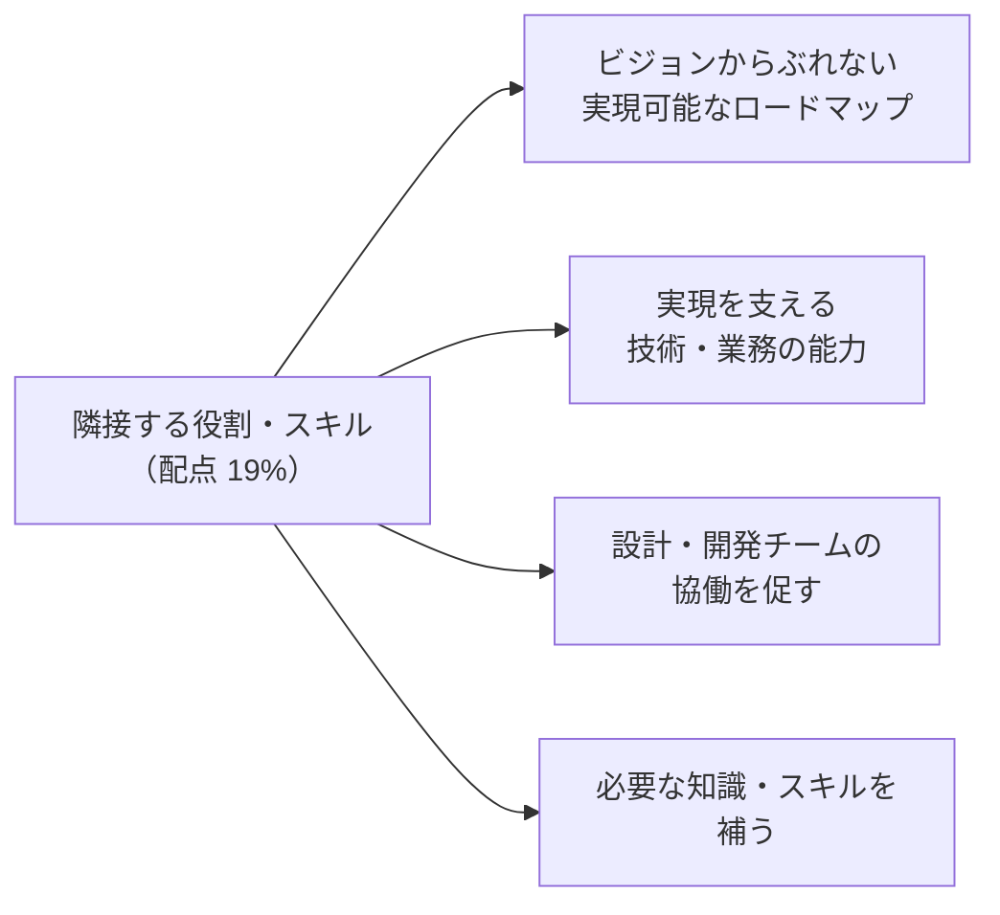
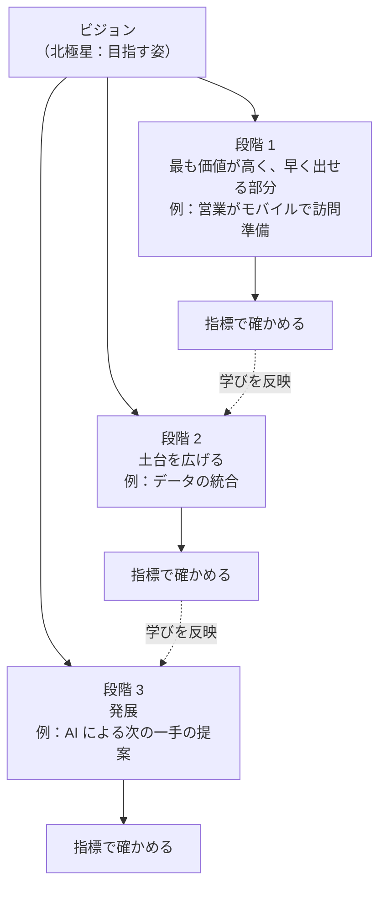

## はじめに：この範囲で学ぶこと

「隣接する役割・スキルの活用」は配点 **19%** です。

---

## 1. 隣接する役割を知る

| 役割 | 主な責任 | 戦略デザイナーとの関係 |
|---|---|---|
| **ビジネスアナリスト** | 要件定義、業務プロセス、ユーザーストーリー | ビジョンと課題を渡し、詳細な要件に落としてもらう |
| **ソリューション・テクニカルアーキテクト** | 技術的な実現方法（データ、連携、セキュリティ） | 実現可能性の確認、方向性の技術的な裏付け |
| **UX デザイナー** | 画面の使いやすさ、詳細なデザイン | リサーチとペルソナを共有し、体験を具体化 |
| **管理者・開発者** | 設定と開発 | プロトタイプづくりの協力、実装 |
| **プロダクトオーナー** | 優先順位の決定、価値の最大化 | 価値の判断材料を提供 |
| **プロジェクトマネージャー** | 計画・予算・リスクの管理 | ロードマップを実行計画にする |
| **チェンジマネジメント担当** | トレーニング、コミュニケーション、定着 | ビジョンとユーザー像を共有 |
| **データサイエンティスト・AI の専門家** | データ分析、AI モデル | AI の実現可能性と効果の検証 |

戦略デザイナーが持つもの・任せるもの

- **持つ**：「なぜ・誰のため・何を目指すか・何をもって成功とするか」
- **任せる**：「どう作るか」の詳細（データモデル、連携方式、画面の細部、テスト計画）

技術的に分からないことを自分で決めつけず、**アーキテクトに確認**します。

---

## 2. ビジョンからぶれないロードマップ

### 2-1. ビジョンからロードマップへ

| 原則 | 内容 |
|---|---|
| **段階ごとに価値を届ける** | 最後の段階まで何も届かない計画にしない。各段階でユーザーが価値を感じられる |
| **どの段階もビジョンにつながる** | 目先の要望に流されて、ビジョンと関係ない機能を入れない |
| **実現可能性** | 技術・データ・体制・予算の制約を踏まえる（アーキテクト・PM と確認） |
| **依存関係** | 先に必要な土台（データの整備、連携）を前の段階に入れる |
| **学びを反映** | 各段階の指標とフィードバックで、次の段階を見直す |
| **ガードレール** | 「これはやらない」を決め、ビジョンからのずれを防ぐ |

### 2-2. 最初の段階の考え方

| 考え方 | 内容 |
|---|---|
| **MVP（必要最小限の製品）** | 学ぶために、最小限の機能で早く出す |
| **MLP（最小限で愛される製品）** | 最小限でも、ユーザーが「使いたい」と思える体験の質を保つ |
| **クイックウィン** | 早く成果が見えるものを入れて、信頼と勢いを作る |

ひっかけ注意

「予算が削られたので、ビジョンに関係なく作りやすい機能から並べ直す」は誤り。**範囲を小さくしても、ビジョンにつながる順番**を守ります。削るなら「ビジョンへの貢献が小さいもの」から削ります。

### 2-3. ロードマップの表し方

| 形 | 内容 | 向いている場面 |
|---|---|---|
| **今・次・後で（Now / Next / Later）** | 時期を細かく決めず、優先度で示す | 不確かなことが多い |
| **時系列（四半期ごと）** | 時期と内容を示す | 予算や外部の期限がある |
| **テーマ・成果ごと** | 「何を達成するか」で並べる | 機能より成果を共有したい |

---

## 3. 実現を支える技術・業務の能力

ビジョンを実現するには、**どんな能力（ケイパビリティ）が必要か**を見極めます。

| 種類 | 例 | 確認する相手 |
|---|---|---|
| **技術の能力** | データの統合、連携、モバイル、AI、セキュリティ、性能 | アーキテクト |
| **データの能力** | 必要なデータがあるか、品質は十分か | データの担当、アーキテクト |
| **業務の能力** | 新しいプロセス、役割の変化、運用体制 | ビジネスアナリスト、業務部門 |
| **人の能力** | スキル、トレーニング、変化への準備 | チェンジマネジメント担当 |
| **組織の能力** | 意思決定の仕組み、予算、ガバナンス | スポンサー、PM |

例

ビジョン：「顧客がいつでも AI エージェントで注文状況を確認し、返品も手続きできる」
- 技術：注文システムとの連携、エージェントの構築
- データ：注文データが正しく最新であること
- 業務：返品の判断ルールを明文化（AI に任せられる形に）
- 人：サービス担当者の役割を「難しい問い合わせの対応」に移す
- 組織：AI の利用ルールとガバナンス
→ 「返品の判断ルールが明文化されていない」ことが分かれば、それをロードマップの最初に入れる。

---

## 4. 設計・開発チームの協働を促す

業務の成果物（要件、ストーリー）と技術の成果物（設計書、データモデル）が**ばらばら**だと、作ったものがビジョンからずれます。

| 状況 | 協働を促す方法 |
|---|---|
| 業務側と技術側が別々に文書を作っている | 共通の成果物（ジャーニーマップ、課題定義文）に、要件と設計を**ひも付ける** |
| 言葉が通じない | 用語集、具体的なユーザーのストーリーで話す |
| 優先順位で対立 | ビジョンと指標に立ち返る、プロダクトオーナーに判断の材料を渡す |
| 実装中に体験の質が下がっている | ユーザーテストへの参加、デモでの確認、ユーザーの視点を伝え続ける |
| 決定が伝わっていない | 決定の記録、定期的な共有の場 |

- 戦略デザイナーは、実装が始まってからも**ユーザーの視点を守る役割**として関わり続けます（テストへの参加、フィードバックの確認、指標の測定）。

---

## 5. 必要な知識・スキルを補う

ビジョンを作るために、チームに足りない知識やスキルを見極め、**適切な人を巻き込みます**。

| 足りないもの | 補う方法 |
|---|---|
| 業界・業務の深い知識 | 現場の専門家（SME）、業界の専門家 |
| AI・データの専門知識 | データサイエンティスト、AI の専門家 |
| アクセシビリティ | アクセシビリティの専門家、多様なユーザーのテスト |
| 法令・規制 | 法務、コンプライアンス |
| 技術の実現性 | アーキテクト、技術的な検証（PoC） |
| ユーザーの声 | 実際のユーザー、顧客の代表 |

- 「自分たちだけで決めない」ことが、ビジョンの質を上げます。
- 小規模なプロジェクトでは 1 人が複数の役割を兼ねることがあります。その場合も、**今どの役割として考えているか**を意識します。

---

## 6. 引き継ぎ

| 引き継ぐもの | 目的 |
|---|---|
| リサーチの結果・ペルソナ | 誰のためかを忘れない |
| ジャーニーマップ・サービスブループリント | どこを変えるかの共通理解 |
| 課題定義文・成功の指標 | 判断の基準 |
| 優先順位とその理由 | 後から変更するときの判断材料 |
| ロードマップ | 実行計画の土台 |

---

## 7. まとめ

| テーマ | 覚えること |
|---|---|
| 役割 | 戦略デザイナーは「なぜ・誰・成功」、詳細の「どう作るか」は専門の役割へ |
| ロードマップ | 段階ごとに価値、どの段階もビジョンにつながる、依存関係、学びの反映、ガードレール |
| 最初の段階 | MVP、MLP、クイックウィン |
| 能力 | 技術・データ・業務・人・組織 |
| 協働 | 共通の成果物にひも付け、用語集、ビジョンと指標に立ち返る、決定の記録 |
| スキルを補う | 業務の専門家、AI・データ、アクセシビリティ、法務、アーキテクト、ユーザー |

## 試験直前チェック

- [ ] 戦略デザイナーが持つべきことと任せるべきことを言える
- [ ] ビジョンからぶれないロードマップの原則を 4 つ言える
- [ ] MVP と MLP の違いを言える
- [ ] 予算が削られたときのロードマップの見直し方を言える
- [ ] ビジョンの実現に必要な能力を 5 種類言える
- [ ] 業務と技術の成果物がばらばらなときの対処を言える
- [ ] 足りない知識やスキルを補う方法を 3 つ言える
